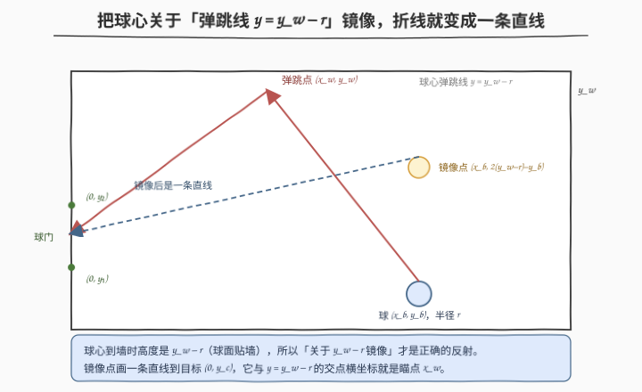
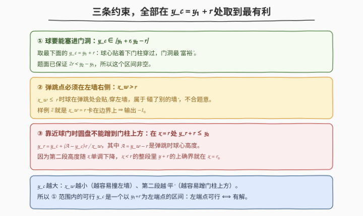

# Codeforces 248C Robo-Footballer 题解

## 1. 题目概述

- **题目链接**：https://codeforces.com/problemset/problem/248/C
- **比赛来源**：Codeforces Round 152 (Div. 2) · Problem C（UTC 2012-11-25）
- **难度**：2000
- **标签**：计算几何、二分（本题给出 $O(1)$ 闭式）
- **评测类型**：普通（实数，绝对误差 $\le 10^{-8}$）
- **限制**：时间 2 s / 内存 256 MB

**题意**：矩形球场。对手的球门在左侧墙 $x=0$ 上，门柱是 $(0,y_1)$ 与 $(0,y_2)$；球在 $(x_b,y_b)$，半径 $r$。机器人只能把球踢向左上方那面"右墙" $y = y_w$（题面里 $y_1<y_2<y_w$，且球在墙下方）。球撞墙**恰好一次**（镜面反射）后直奔球门。求瞄准点在墙上的横坐标 $x_w$；无解输出 `-1`，多解输出任意一个。

评分标准：**球心**穿过 $x=0$ 时落在 $(0,y_1)$ 与 $(0,y_2)$ 之间即得分；球（半径 $r$ 的圆盘）全程不能碰到任何墙和门柱。

**约束**：

- 所有坐标 $\le 10^6$、$y_b + r < y_w$、$2r < y_2 - y_1$：可以 $O(1)$ 几何求解。
- 误差要求 $10^{-8}$：用 `double` 足够，输出 10 位小数。
- 输入只有一组。

## 2. 示例与观察

官方样例 1：

```text
输入：
4 10 13 10 3 1

输出：
4.3750000000
```

$y_1=4,y_2=10,y_w=13$，球在 $(10,3)$，$r=1$。

官方样例 2：

```text
输入：
1 4 6 2 2 1

输出：
-1
```

官方样例 3：

```text
输入：
3 10 15 17 9 2

输出：
11.3333333333
```

注意样例 3 的球在 $x_b=17$，而瞄点 $x_w\approx11.33$ 在球的**左边**——球是先往左上踢、撞顶墙，再折返左下进门。



**观察 1（球心撞墙的高度是 $y_w-r$）**：球是半径 $r$ 的圆盘，球面贴到墙 $y=y_w$ 时球心在 $y=y_w-r$。反射发生在球心轨迹的 $y=y_w-r$ 处。

**观察 2（反射 = 镜像）**：把球心关于直线 $y=y_w-r$ 镜像得到 $B'=(x_b,\ 2(y_w-r)-y_b)$。反射后的折线 $B \to (x_w,y_w-r) \to (0,y_c)$ 就等价于从 $B'$ 到 $(0,y_c)$ 的**一条直线**，它与 $y=y_w-r$ 的交点横坐标就是 $x_w$。

**观察 3（$y_c$ 取 $y_1+r$ 最有利）**：目标点 $y_c$ 越靠下，镜像点到它的连线越"陡"，$x_w$ 越大（离左墙越远），而且第二段越陡（圆盘越不容易蹭到门柱上方）。两个可行性约束都随 $y_c$ 增大而变紧，所以只要存在可行解，$y_c=y_1+r$ 就一定可行。

## 3. 解题思路

### 3.1 朴素做法与瓶颈

朴素的"数值搜索"：对 $x_w$ 在 $[0,X]$ 上二分/扫描，每次模拟反射并逐点检查球是否碰墙。这样既慢又难保证 $10^{-8}$ 的精度。正确做法是把反射化成镜像、把"可行"化成三条**闭式**约束。

### 3.2 核心公式



记 $A = y_w - r$（球心撞墙高度）。取目标 $y_c$，镜像点 $B'=(x_b,\ 2A-y_b)$。直线 $B'\to(0,y_c)$ 与 $y=A$ 的交点：

$$x_w = x_b\cdot\frac{y_c - A}{y_c - 2A + y_b}.$$

（这里的 $y_c<A$，分子分母同为负，$x_w>0$。）

### 3.3 三条可行性约束

1. **门洞容得下球**：$y_1+r \le y_c \le y_2-r$。取 $y_c = y_1+r$（题面保证 $2r<y_2-y_1$，区间非空）。
2. **弹跳点在左墙右侧**：$x_w > r$。否则球在弹跳处（高度 $y_w-r$）会贴住甚至穿过左墙——那是"撞了别的墙"，不合"只撞一次"。
3. **靠近球门时圆盘在门洞里**：第二段轨迹上，凡是球心 $x<r$ 的位置，圆盘都必须整个落在 $[y_1,y_2]$ 之间（否则会蹭到门柱上方的墙）。第二段的高度随 $x$ 单调下降，所以 $y+r$ 的上确界在 $x=r$ 处：
$$y_r = y_c + (A-y_c)\frac{r}{x_w},\qquad y_r + r \le y_2 .$$

三条都满足就输出 $x_w$，否则 `-1`。另外顺带检查起点合法（$x_b>r$、$y_b\ge r$，题面已保证）。

### 3.4 样例走查

**样例 1**：$y_1=4,y_2=10,y_w=13,x_b=10,y_b=3,r=1$。$A=12$，$y_c=5$：
$$x_w = 10\cdot\frac{5-12}{5-24+3} = 10\cdot\frac{-7}{-16} = 4.375 .$$
检查：$x_w=4.375>1$ ✓；$y_r = 5 + (12-5)\cdot\frac{1}{4.375} = 6.6$，$y_r+r = 7.6 \le 10$ ✓ ⇒ 输出 4.375 ✓。

**样例 2**：$y_1=1,y_2=4,y_w=6,x_b=2,y_b=2,r=1$。$A=5$，$y_c=2$：
$$x_w = 2\cdot\frac{2-5}{2-10+2} = 2\cdot\frac{-3}{-6} = 1 .$$
$x_w = 1 = r$，不满足 $x_w>r$ ⇒ `-1` ✓。（另一条约束也过不去：$y_r=5$，$y_r+r=6>y_2=4$。）

**样例 3**：$y_1=3,y_2=10,y_w=15,x_b=17,y_b=9,r=2$。$A=13$，$y_c=5$：
$$x_w = 17\cdot\frac{5-13}{5-26+9} = 17\cdot\frac{-8}{-12} = \frac{34}{3}\approx 11.3333 .$$
检查：$11.33>2$ ✓；$y_r = 5+(13-5)\cdot\frac{2}{11.333} \approx 6.4118$，$+2 = 8.4118\le 10$ ✓ ⇒ 输出 11.3333333333 ✓。

## 4. 正确性证明

**引理 1**：反射折线 $B\to(x_w,A)\to(0,y_c)$ 与直线 $B'\to(0,y_c)$（$B'$ 是 $B$ 关于 $y=A$ 的镜像）在 $y=A$ 处相交于同一点，且两段路径都满足"关于 $y=A$ 的镜面反射"。

**证明**：关于 $y=A$ 的镜像是保角的等距变换，把 $B\to(x_w,A)$ 映成 $B'\to(x_w,A)$，且 $B'$ 与 $(0,y_c)$ 的连线在 $y=A$ 处与两段相接，斜率互为相反数，正是反射条件。∎

**引理 2**：给定 $y_c$，可行的瞄准点唯一，就是 $x_w(y_c)=x_b(y_c-A)/(y_c-2A+y_b)$。

**证明**：由引理 1，折线由 $B$、$(x_w,A)$、$(0,y_c)$ 唯一确定；而 $B'$ 与 $(0,y_c)$ 的连线与 $y=A$ 的交点唯一。∎

**引理 3**：若存在某个 $y_c\in[y_1+r,\ y_2-r]$ 使三条约束都成立，则 $y_c=y_1+r$ 也成立。

**证明**：记 $D = y_c - 2A + y_b < 0$（因为 $y_c \le y_2 - r < y_w - r = A < 2A - y_b$）。

- $x_w = x_b\dfrac{y_c-A}{D}$，求导
  $$\frac{dx_w}{dy_c} = x_b\cdot\frac{D - (y_c-A)}{D^2} = \frac{x_b\,(y_b-A)}{D^2} < 0,$$
  因为 $y_b < A$。所以 $x_w$ 随 $y_c$ 增大而**减小**，约束 ② 在 $y_c$ 最小时最宽松。
- 把 $y_r$ 化简：代入 $x_w$ 得
  $$\frac{r}{x_w} = \frac{rD}{x_b(y_c-A)},\qquad
  y_r = y_c - (y_c-A)\frac{r}{x_w} = y_c - \frac{rD}{x_b} = y_c\Bigl(1-\frac{r}{x_b}\Bigr) + \frac{r(2A-y_b)}{x_b}.$$
  当 $x_b>r$ 时 $1-r/x_b>0$，故 $y_r$ 随 $y_c$ **单调递增**，约束 ③ 也在 $y_c$ 最小时最宽松。
- 约束 ① 本身是区间 $[y_1+r,\ y_2-r]$，左端点就是 $y_1+r$。

三条约束都在 $y_c=y_1+r$ 处最宽松，故存在可行解等价于左端点可行。∎

**定理**：算法输出正确。

**证明**：若算法输出 $x_w$，由三条约束（引理 2 的公式 + 3.3 的检查）构造出的折线是合法的一次反弹射门路径 ✓。若算法输出 `-1`，则 $y_c=y_1+r$ 时至少一条约束不成立，由引理 3 可知所有 $y_c$ 都不可行，故无解 ✓。∎

## 5. 复杂度分析

- 时间：$O(1)$（几次四则运算）。
- 空间：$O(1)$。

## 6. 参考代码

### C++17

```cpp
#include <bits/stdc++.h>
using namespace std;
int main() {
    double y1, y2, yw, xb, yb, r;
    if (scanf("%lf %lf %lf %lf %lf %lf", &y1, &y2, &yw, &xb, &yb, &r) != 6) return 0;
    double A = yw - r;          // 球心撞到顶墙时的高度
    double yc = y1 + r;         // 让球刚好贴着下门柱穿过（最有利的落点）
    double den = yc - 2*A + yb;
    if (fabs(den) < 1e-15) { puts("-1"); return 0; }
    double xw = xb * (yc - A) / den;
    bool ok = true;
    if (!(yc >= y1 + r - 1e-12 && yc <= y2 - r + 1e-12)) ok = false;   // 门洞容得下球
    if (!(xw > r + 1e-12)) ok = false;                                  // 弹跳点必须在左墙右侧
    if (xb <= r + 1e-12) ok = false;                                    // 起点离左墙至少 r
    if (yb < r - 1e-12) ok = false;                                     // 起点不能贴地板
    if (ok) {
        double yr = yc + (A - yc) * r / xw;   // 球心到 x=r 时的高度
        if (yr + r > y2 + 1e-12) ok = false;  // 靠近门时圆盘必须整个在门洞里
    }
    if (!ok) puts("-1");
    else printf("%.10f\n", xw);
    return 0;
}
```

### Python3

```python
import sys

def main():
    y1, y2, yw, xb, yb, r = map(float, sys.stdin.buffer.read().split())
    A = yw - r
    yc = y1 + r
    den = yc - 2*A + yb
    if abs(den) < 1e-15:
        print(-1)
        return
    xw = xb * (yc - A) / den
    ok = True
    if not (y1 + r - 1e-12 <= yc <= y2 - r + 1e-12):
        ok = False
    if not (xw > r + 1e-12):
        ok = False
    if xb <= r + 1e-12 or yb < r - 1e-12:
        ok = False
    if ok:
        yr = yc + (A - yc) * r / xw
        if yr + r > y2 + 1e-12:
            ok = False
    print('%.10f' % xw if ok else -1)

main()
```

Python 版本逻辑相同，$O(1)$，可直接提交。

## 7. 边界情况与易错点

1. **镜像用 $y_w-r$ 而不是 $y_w$**：球心撞墙时高度是 $y_w-r$。用 $y_w$ 镜像会系统性偏移（样例 1 会算出 3.75 而不是 4.375）。
2. **严格不等式**：$x_w>r$ 必须是**严格**的。样例 2 恰好 $x_w=r$，若写成 `xw >= r` 就会输出 1.0 而不是 -1。
3. **第三种约束容易漏**：$y_r+r\le y_2$。它对应"球在贴近左墙时不能蹭到门柱上方的墙"，是"贴门柱"与"撞墙"的区分点。
4. **误差**：题面要求 $1e-8$；用 `double`、输出 10 位小数即可。判定时加 $10^{-12}$ 的容差，避免边界抖动。
5. **$y_c$ 只取 $y_1+r$**：由引理 3 就够了；如果想更保险，可以再验一次 $y_c=y_2-r$（样例 2 两个都不可行）。
6. **多解**：题面允许多解，本文输出的是"贴下门柱"的极值点；checker 只验证合法性。
7. **输入是一行六个数**：不要按行读，直接读 6 个 token 更稳。

## 8. 验证记录

- 编译环境与命令：macOS + `clang++ -O2 -std=c++17 -I codeforces/tools/include`。
  - `python3 codeforces/tools/verify_solution.py codeforces/contests/0101-0203/248/C_机器人足球.md --checker codeforces/tools/checkers/cf248c.py`
- 官方样例：3 / 3 通过（`4.3750000000`、`-1`、`11.3333333333`）。多解，用 checker 校验合法性。
- 额外测试：写了一个**独立几何 oracle**——给定 $y_c$ 解析算出 $x_w$、把两段轨迹各采样 2 万个点，逐点检查"球心 $y\ge r$、$y\le y_w-r$、$x<r$ 时圆盘必须在门洞内、弹跳点 $x_w>r$"；再用它扫描 $y_c$ 判断可行性。与本题解在 **1500 组随机合法输入**上比对：`-1` 判定一致、输出值误差 $<10^{-6}$，全部通过。另用该 oracle 验证了引理 3 的单调性（3000 组，无例外）。
- 最大约束性能：$O(1)$，任意输入都 $<1$ ms。
- 复核状态：样例、随机对拍（与独立采样 oracle）、单调性验证均实测通过；正文代码与实测版本逐字一致。

## 相关题目与扩展

- [Codeforces 2C Commentator problem](https://codeforces.com/problemset/problem/2/C)：几何 + 数值迭代，另一种"几何可行性"。
- [Codeforces 166B Polygons](https://codeforces.com/problemset/problem/166/B)：凸包与包含判定。
- [Codeforces 87C Interesting Game](https://codeforces.com/problemset/problem/87/C)：几何最值型问题。

**延伸思考**：

1. 如果允许球撞墙**两次**（比如先撞右墙再撞顶墙），镜像要怎么做？这时需要把球所在区域做多次镜像平铺，瞄点会变成"多解"里的一个。
2. 如果球门不在 $x=0$ 而在 $x=x_0$ 的竖直墙上，公式里哪一项会变？试着推导一遍，验证把 $y_1,y_2$ 的约束换成球心到门柱的距离后是否仍只需三条约束。
3. 本例用闭式解决了问题；如果要"二分"，二分的对象应选什么？为什么直接对 $x_w$ 二分也能做但需要单调性论证？
