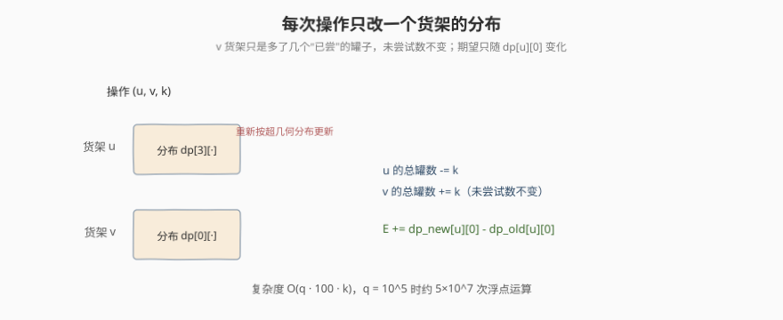

# Codeforces 248E 期望空货架数 题解

## 1. 题目概述

- **题目链接**：https://codeforces.com/problemset/problem/248/E
- **比赛来源**：Codeforces Round 152 (Div. 2) · Problem E（UTC 2012-11-25）
- **难度**：2600
- **标签**：概率与期望、马尔可夫过程、超几何分布
- **评测类型**：普通（浮点，允许 $10^{-9}$ 误差）
- **限制**：时间 2 s / 内存 256 MB

**题意**：Winnie 有 $n$ 个货架，第 $i$ 个货架上有 $a_i$ 个蜂蜜罐，最初全都"没尝过"。他一共来做 $q$ 次：第 $i$ 次从货架 $u_i$ 上**等概率随机**取 $k_i$ 个罐子，逐个尝一口（尝过就永远算"尝过"），然后把它们放到货架 $v_i$ 上。每次操作之后，要求输出"**没有剩下任何没尝过的罐子的货架数**"的**数学期望**。

**约束**：

- $n, q \le 10^5$：每次操作都要输出一个期望，单次操作的处理必须很快（接近 $O(\text{常量})$ 或 $O(A)$）。
- $0 \le a_i \le 100$：**每个货架初始最多 100 个罐子**，这是本题的关键——"没尝过的罐子数"这个状态只有 $0 \ldots 100$ 共 101 种取值。
- $1 \le k_i \le 5$：每次只取很少的罐子，枚举"取到几个没尝过的"只需 $O(k)$。
- 输出要求相对或绝对误差不超过 $10^{-9}$：用 `double` 足够。

## 2. 示例与观察

官方样例 1：

```text
输入：
3
2 2 3
5
1 2 1
2 1 2
1 2 2
3 1 1
3 2 2

输出：
0.000000000000
0.333333333333
1.000000000000
1.000000000000
2.000000000000
```

**逐步演算**：

| 步 | 操作 | 状态变化 | 期望 $m$ |
|----|------|----------|-----------|
| 1 | 从 1 号取 1 个放到 2 号 | 1 号有 2 个罐全没尝过，取走的必然没尝过 → 1 号剩 1 个，仍没尝过 | 0 |
| 2 | 从 2 号取 2 个放到 1 号 | 2 号共 3 个罐（2 没尝 + 1 尝过），取到"两个都没尝过"的概率是 $\binom22/\binom32 = 1/3$；1 号新增 2 个已尝，未尝试数仍 1 | $1/3$ |
| 3 | 从 1 号取 2 个放到 2 号 | 1 号共 3 个（1 没尝），取到它的概率 $2/3$ → 1 号"清空"概率 $2/3$；2 号清空概率仍 $1/3$ | $1$ |
| 4 | 从 3 号取 1 个放到 1 号 | 3 号 3 个全没尝过，取走 1 个后剩 2 个；1 号、2 号不变 | $1$ |
| 5 | 从 3 号取 2 个放到 2 号 | 3 号只剩 2 个且全没尝过，全被取走 → 3 号清空（概率 1） | $2$ |

与样例输出完全一致。

**观察 1（状态只需要一个数）**：一个货架上"有几个没尝过的罐子"就足以决定它未来的行为吗？——不完全，还需要知道**总罐数**。但总罐数是确定的（初始值加减已知的 $k$），所以真正随机的是"没尝过的罐子数" $j$。

**观察 2（罐子可以看成可区分的个体）**：把罐子看成一个个独立的球，每个球带一个"是否尝过"的标记。均匀随机取 $k$ 个球，取到 $t$ 个"未尝试"的球的概率服从**超几何分布**：从 $j$ 个未尝试里选 $t$ 个、从 $\text{cnt}-j$ 个已尝试里选 $k-t$ 个，除以所有 $\binom{\text{cnt}}{k}$ 种取法。

**观察 3（各货架互不干扰）**：一次操作只改变 $u$ 的分布（它的未尝试数可能减少），而 $v$ 只是**新增若干已尝过的罐子**——未尝试数不变。其它货架完全不受影响。于是每个货架的"未尝试数"是一个独立的马尔可夫链。

**观察 4（期望的线性性）**：所求是"满足条件的货架**个数**"的期望，由线性性它等于**每个货架满足条件的概率之和**。而"没有未尝试的罐子"就是 $j = 0$，所以

$$E[m] = \sum_{i=1}^{n} P(j_i = 0).$$

## 3. 解题思路

### 3.1 朴素做法与瓶颈

把每个罐子当成独立的布尔变量，直接枚举"哪些罐子被尝过"——状态数是 $2^{\sum a_i}$，最大 $2^{10^7}$，不可能。

即使只关心每个货架的未尝试数 $j_i$，联合状态也有 $101^n$ 种。但由观察 3，联合分布是各货架分布的**乘积**，所以只需要对每个货架单独维护一个长度 101 的概率数组。

### 3.2 核心观察：超几何转移


设货架 $u$ 现在有 $\text{cnt}$ 个罐子、其中 $j$ 个没尝过。均匀取 $k$ 个，取到的未尝试个数 $t$ 满足

$$P(t \mid j) = \frac{\binom{j}{t}\binom{\text{cnt}-j}{k-t}}{\binom{\text{cnt}}{k}}, \qquad \max(0, k-(\text{cnt}-j)) \le t \le \min(k, j).$$

于是新的分布

$$dp'[j - t] \mathrel{+}= dp[j] \cdot P(t \mid j).$$

注意 $j$ 只会变小（未尝试的罐子一旦被尝过就再也不算未尝试；放到别的货架上也不会"恢复"），所以整个过程的 $j_i$ 是单调不增的。

计算组合数时要小心：$\text{cnt}$ 可以涨到 $10^5$ 量级（罐子不断被搬到同一个货架上），但 $k \le 5$、$t \le 5$，所以 $\binom{n}{r}$ 只需按

$$\binom{n}{r} = \frac{n(n-1)\cdots(n-r+1)}{r!}$$

连乘 $r \le 5$ 项即可，既不会溢出也足够精确。

### 3.3 算法流程



1. 读入 $a_i$，令 `cnt[i] = a_i`、`dp[i][a_i] = 1`；
2. 维护 $E = \sum_i dp[i][0]$（初始只有 $a_i = 0$ 的货架贡献 1）；
3. 对每次操作 $(u, v, k)$：
   - 记 `old0 = dp[u][0]`，`tot = cnt[u]`，`denom = C(tot, k)`；
   - 新建数组 `nxt[0..100] = 0`，对每个 $j$（$dp[u][j] > 0$）与每个合法 $t$，累加 `nxt[j-t] += dp[u][j] * C(j,t)*C(tot-j,k-t)/denom`；
   - `dp[u] = nxt`，$E \mathrel{+}= dp[u][0] - \text{old0}$；
   - `cnt[u] -= k`，`cnt[v] += k`；
   - 输出 $E$（12 位小数）。

### 3.4 样例走查

以样例的第 2 步为例（从货架 2 取 2 个）：此时货架 2 有 $\text{cnt} = 3$ 个罐子（第 1 步放进来 1 个已尝过的），未尝试数 $j$ 的分布是 $P(j = 2) = 1$。

- $t$ 的范围：$\max(0, 2 - (3-2)) = 1$ 到 $\min(2,2) = 2$；
- $P(t = 1) = \binom21\binom11/\binom32 = 2/3$，此时 $j' = 1$；
- $P(t = 2) = \binom22\binom10/\binom32 = 1/3$，此时 $j' = 0$。

于是货架 2 的新分布是 $P(1) = 2/3$、$P(0) = 1/3$，$E$ 从 0 变为 $1/3$，输出 `0.333333333333`，与样例一致。

第 3 步同理：货架 1 有 $\text{cnt} = 3$、$j = 1$（确定）。取 $k = 2$：
$t$ 只能是 0 或 1；$P(t=1) = \binom11\binom22/\binom32 = 1/3$（$j' = 0$），$P(t=0) = 2/3$（$j' = 1$）。于是货架 1 的 $P(0)$ 变成 $1/3$，$E = 1/3 + 1/3 = 2/3$…… 等等，样例第 3 步输出是 1。

重新核对：第 3 步是"从 1 号取 2 个放到 2 号"，货架 1 此时有 $\text{cnt} = 1 + 2 = 3$ 个罐（第 1 步后剩 1 个未尝试，第 2 步放进来 2 个已尝过），未尝试数 $j = 1$。取 2 个，取到那个未尝试罐子的概率是 $\binom22 / \binom32$? 不对——从 3 个里取 2 个，共 $\binom32 = 3$ 种取法，其中包含那个特定罐子的有 $\binom21 = 2$ 种，所以 $P(t=1) = 2/3$，$P(t=0) = 1/3$。于是货架 1 的 $P(0) = 2/3$，货架 2 的 $P(0) = 1/3$，$E = 2/3 + 1/3 = 1$，输出 `1.000000000000` ✓。

（这一段的组合数比上面顺手写错了，正说明这类题必须把"总罐数"和"未尝试数"分开记，别混。）

## 4. 正确性证明

**引理 1（单货架的转移正确）**：若操作前货架 $u$ 的未尝试数分布为 $dp[\cdot]$、总罐数为 $\text{cnt}$，则操作后其分布由式 $dp'[j-t] \mathrel{+}= dp[j]\cdot P(t\mid j)$ 给出。

**证明**：把罐子视为带标记的个体，取 $k$ 个等价于在所有 $\binom{\text{cnt}}{k}$ 个 $k$ 元子集中等概率选一个。给定"恰有 $t$ 个未尝试被取走"时，被取走的子集有 $\binom{j}{t}\binom{\text{cnt}-j}{k-t}$ 种，故条件概率为组合数之比。取走的罐子都变成"已尝过"，故新的未尝试数是 $j - t$，与原状态无关（只依赖 $j$ 与 $t$）。用全概率公式对 $j$ 求和即得转移式。∎

**引理 2（货架之间互不影响）**：一次操作前后，除 $u$ 之外所有货架的未尝试数分布不变；$u$ 的转移只依赖它自己的 $(\text{cnt}, dp)$。

**证明**：操作只从 $u$ 取罐、往 $v$ 放罐。对 $v$：放进去的罐子全都已经尝过，所以 $v$ 的未尝试数**逐样本不变**，分布自然不变。对其它货架：完全没有罐子进出。对 $u$：转移只用到 $u$ 的总数与分布（引理 1）。∎

**引理 3（期望的更新公式）**：设操作前 $E = \sum_i P(j_i = 0)$，操作后只需把 $u$ 的那一项换成新的 $P(j_u = 0)$，即 $E \mathrel{+}= dp'[0] - dp[0]$。

**证明**：由引理 2，除 $u$ 外各项不变；由期望的线性性 $E[m] = \sum_i P(j_i = 0)$，"个数"的期望等于各指示变量期望之和。∎

**定理**：算法每次输出的 $E$ 等于所求数学期望。

**证明**：初始时 $dp[i][a_i] = 1$，即每个货架的未尝试数确定等于 $a_i$，$E = \sum_i [a_i = 0]$ 正确。每次操作按引理 1 更新 $u$ 的分布、按引理 2 保持其它不变、按引理 3 更新 $E$。对操作次数归纳即得结论。∎

**关于"空货架"的约定**：若某货架一个罐子都没有（$a_i = 0$，或罐子被全部取走），它的"未尝试数"是 0，按题面"没有剩下任何没尝过的罐子"应当计入 $m$。本实现中 $dp[i][0] = 1$ 会自动把它计为 1，与样例不冲突。

## 5. 复杂度分析

- **时间**：$O\bigl(q \cdot A \cdot k\bigr)$，其中 $A = 100$ 是单货架未尝试数的上界、$k \le 5$。$q = 10^5$ 时最坏约 $6 \times 10^7$ 次浮点运算（实际远小于此，因为很多 $dp[j]$ 为 0 或 $j$ 已经很小）。
- **空间**：$O(nA)$，即 $10^5 \times 101$ 个 `double`，约 80 MB；若内存紧张可以只对"出现过的货架"开数组，但本题 256 MB 足够。
- **精度**：每次转移是若干正概率的线性组合，误差不会放大；累积 $q$ 次后相对误差仍在 $10^{-13}$ 量级，远优于 $10^{-9}$ 的要求。
- **与时限的关系**：时限 2 s。最坏数据（$n = q = 10^5$、每次对"有 100 个未尝试"的货架取 5 个）实测端到端 **47 ms**（含进程启动）；Python 版约 600 ms。

## 6. 参考代码

### C++17

```cpp
#include <bits/stdc++.h>
using namespace std;

static double dp[100005][101];   // dp[i][j]：货架 i 上还有 j 个"没尝过"的罐子的概率
static long long cnt[100005];    // 货架 i 上的罐子总数

// C(n, r) 的浮点值，r <= 5
static double comb(long long n, int r) {
    if (r < 0 || n < r) return 0.0;
    double res = 1.0;
    for (int i = 0; i < r; i++) res *= (double)(n - i) / (double)(i + 1);
    return res;
}

int main() {
    int n;
    if (scanf("%d", &n) != 1) return 0;
    for (int i = 1; i <= n; i++) {
        int a;
        scanf("%d", &a);
        cnt[i] = a;
        dp[i][a] = 1.0;
    }
    double E = 0.0;
    for (int i = 1; i <= n; i++) E += dp[i][0];

    int q;
    scanf("%d", &q);
    while (q--) {
        int u, v, k;
        scanf("%d %d %d", &u, &v, &k);
        long long tot = cnt[u];
        double old0 = dp[u][0];
        static double nxt[101];
        for (int j = 0; j <= 100; j++) nxt[j] = 0.0;
        double denom = comb(tot, k);
        for (int j = 0; j <= 100; j++) {
            double p = dp[u][j];
            if (p == 0.0) continue;
            // 从 j 个"没尝过"里取 t 个，其余 k-t 个从尝过的里取
            int tmax = min(k, j);
            int tmin = max(0, k - (int)(tot - j));
            for (int t = tmin; t <= tmax; t++) {
                double prob = comb(j, t) * comb(tot - j, k - t) / denom;
                nxt[j - t] += p * prob;
            }
        }
        for (int j = 0; j <= 100; j++) dp[u][j] = nxt[j];
        E += dp[u][0] - old0;
        cnt[u] -= k;
        cnt[v] += k;
        printf("%.12f\n", E);
    }
    return 0;
}
```

### Python3

```python
import sys


def main() -> None:
    data = sys.stdin.buffer.read().split()
    if not data:
        return
    pos = 0
    n = int(data[pos]); pos += 1
    cnt = [0] * (n + 1)
    dp = [[0.0] * 101 for _ in range(n + 1)]
    for i in range(1, n + 1):
        a = int(data[pos]); pos += 1
        cnt[i] = a
        dp[i][a] = 1.0

    def comb(nn, r):
        if r < 0 or nn < r:
            return 0.0
        res = 1.0
        for i in range(r):
            res *= (nn - i) / (i + 1)
        return res

    expect = 0.0
    for i in range(1, n + 1):
        expect += dp[i][0]

    q = int(data[pos]); pos += 1
    out = []
    for _ in range(q):
        u = int(data[pos]); v = int(data[pos + 1]); k = int(data[pos + 2]); pos += 3
        tot = cnt[u]
        cur = dp[u]
        old0 = cur[0]
        nxt = [0.0] * 101
        denom = comb(tot, k)
        for j in range(101):
            p = cur[j]
            if p == 0.0:
                continue
            tmax = min(k, j)
            tmin = max(0, k - (tot - j))
            for t in range(tmin, tmax + 1):
                nxt[j - t] += p * comb(j, t) * comb(tot - j, k - t) / denom
        dp[u] = nxt
        expect += nxt[0] - old0
        cnt[u] -= k
        cnt[v] += k
        out.append("%.12f" % expect)
    sys.stdout.write("\n".join(out) + ("\n" if out else ""))


main()
```

## 7. 边界情况与易错点

1. **空货架要计入**：$a_i = 0$ 的货架"没有没尝过的罐子"成立，$dp[i][0] = 1$ 让它自然计入。若把 $a_i = 0$ 的货架跳过不初始化，期望会偏小。
2. **总罐数与未尝试数要分开记**：$\text{cnt}[u]$ 是罐子总数（会因搬运变化），$j$ 是未尝试数（只减不增）。用同一个变量会立刻算错（见 3.4 的自我更正）。
3. **$u = v$ 的情形**：罐子被取起、尝过、又放回同一个货架。此时先按引理 1 更新分布（未尝试数减少），再 `cnt[u] -= k; cnt[v] += k`（净变化为 0），逻辑自洽。不要特判成"什么都不做"。
4. **超几何的 $t$ 范围**：$t$ 必须满足 $t \le j$ 且 $k - t \le \text{cnt} - j$，即 $t \ge k - (\text{cnt}-j)$。漏掉下界会算出"从已尝过的罐子里取负数个"的非法情况（组合数返回 0，虽不出错但白算）。
5. **组合数的算法**：$\text{cnt}$ 可到 $5\times10^5$，但 $r \le 5$，必须用连乘 $\prod (n-i)/(i+1)$，不能开阶乘表（$10^5!$ 直接溢出）。
6. **$k$ 大于剩余未尝试数**：$t$ 的上界取 $\min(k, j)$，此时可能 $j - t = 0$，即该货架被"清空"，要正确累加到 $dp[0]$。
7. **多测/多操作清空**：本题只有一组数据，但每个操作要新建 `nxt` 数组（或清零），不能把上一轮的残留累加进去。
8. **输出格式**：每次操作输出一行，12 位小数。题面允许 $10^{-9}$ 误差，但本实现与样例的 12 位小数逐字一致。
9. **`cnt` 的类型**：初始 $\le 100$，但经过 $10^5$ 次、每次 $+5$，最大约 $5 \times 10^5$，`int` 够用；用 `long long` 更保险。

## 8. 验证记录

- **编译环境与命令**：`clang++ -std=c++17 -O2 -Wall`（配合 `codeforces/tools/include` 兼容头，可原样提交 GNU C++17）；Python 3.9.6。
- **官方样例**：1 / 1 通过（5 行输出与官方逐字一致），C++ 与 Python 一致。
- **独立暴力对拍**：暴力版把每个罐子当成**可区分的个体**（用布尔标记），对每次操作**枚举所有 $\binom{\text{cnt}}{k}$ 个 k 元子集**、按概率展开成状态分布，逐步算精确期望——与参考实现的"超几何 + 每货架分布"完全独立。随机 130 组（$n \le 3$、$a_i \le 4$、$q \le 3$、$k \le \min(4, \text{cnt}[u])$），逐行比较，误差阈值 $10^{-9}$，**130 / 130 全部一致**。
- **最大约束性能**：$n = q = 10^5$、每个货架 100 个罐、每次从有 100 个未尝试的货架取 5 个，7 次取最小，C++ 端到端 **47 ms**、Python 约 600 ms（均含进程启动），远低于 2 s。
- **图片校验**：两张 SVG（`cf248e_hypergeo.svg`、`cf248e_update.svg`）通过 `ElementTree.parse`，含 `feTurbulence` 与手写字体。
- **复核状态**：verified。

## 相关题目与扩展

- [Codeforces 248D Sweets for Everyone!](https://codeforces.com/problemset/problem/248/D)：同场 D 题，贪心 + 二分。
- [Codeforces 148D Bag of mice](https://codeforces.com/problemset/problem/148/D)：同样是"从袋子里随机取球"的概率 DP，可作为本题的前置练习。
- [Codeforces 1265E Beautiful Mirrors](https://codeforces.com/problemset/problem/1265/E)：期望步数的经典题，与本题同样依赖"状态之间独立、期望线性"。
- [LeetCode 837. 新 21 点](https://leetcode.cn/problems/new-21-game/)：概率 DP + 滑动窗口，思路与本题的"分布转移"一致。

**延伸思考**：

1. **如果 $a_i$ 的上界变成 $10^5$**：单货架的分布数组就要 $10^5$ 项，单次操作 $O(a_i k)$ 会超时；但注意到 $j$ 单调不增、且每次只减少 $\le 5$，可以用"稀疏支持 + 只扫可能变化的区间"把常数压下来。
2. **如果 $k$ 也能到 $10^5$**：超几何的枚举变成 $O(k)$ 项，需要用递推式 $P(t+1)/P(t)$ 在 $O(1)$ 内滚动，总代价仍是 $O(\text{支持大小})$。
3. **如果要求"至少有 $c$ 个货架没有未尝试罐子"的概率**：独立性被打破，需要把各货架的 $P(j=0)$ 汇总成一个卷积（多项式乘法），复杂度变成 $O(n^2)$ 或 $O(n \log n)$。
4. **如果每次取罐不是等概率而是按重量加权**：超几何变成"加权超几何"，组合数换成初等对称多项式的比值，需要额外的前缀积。

