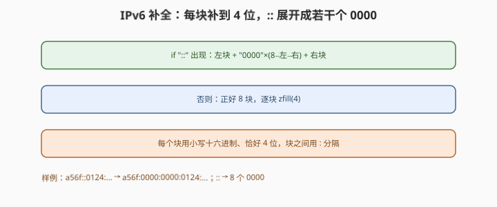
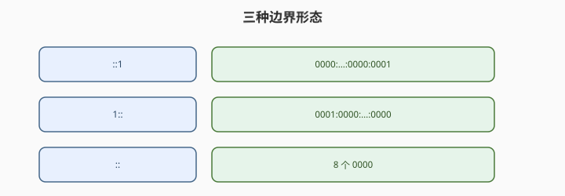

# Codeforces 250B IPv6 补全 题解

## 1. 题目概述

- **题目链接**：https://codeforces.com/problemset/problem/250/B
- **比赛来源**：CROC-MBTU 2012, Final Round (Online version, Div. 2) · Problem B（UTC 2012-11-26）
- **难度**：1500
- **标签**：字符串、实现
- **评测类型**：普通
- **限制**：时间 2 s / 内存 256 MB

**题意**：$n$ 个压缩形式的 IPv6 地址，恢复成「8 个块、每块 4 位小写十六进制、用 `:` 分隔」的完整形式。压缩规则：每块可去掉前导零（至少留 1 位）；连续的全零块可用 `::` 代替。

**约束**：$n\le100$，串长自然不超过几十；关键是正确处理 `::` 的位置与展开块数。

## 2. 示例与观察

```text
输入：
6
a56f:d3:0:0124:01:f19a:1000:00
a56f:00d3:0000:0124:0001::
a56f::0124:0001:0000:1234:0ff0
a56f:0000::0000:0001:0000:1234:0ff0
::
0ea::4d:f4:6:0

输出：
a56f:00d3:0000:0124:0001:f19a:1000:0000
a56f:00d3:0000:0124:0001:0000:0000:0000
a56f:0000:0000:0124:0001:0000:1234:0ff0
a56f:0000:0000:0000:0001:0000:1234:0ff0
0000:0000:0000:0000:0000:0000:0000:0000
00ea:0000:0000:0000:004d:00f4:0006:0000
```

**演算**：`a56f::0124:0001:0000:1234:0ff0` 有 5 个非空块，缺 $8-5=3$ 块 → 展开成 3 个 `0000` ✓。`::` 单独出现时 8 块全是 `0000` ✓。`0ea` 补成 `00ea` ✓。



**观察一**：不含 `::` 时，块数必然是 8；含 `::` 时，**左侧块数 + 右侧块数 < 8**，差额就是被省略的全零块数。

**观察二**：每块只需补前导零到 4 位（`zfill(4)`），不需要处理大小写（输入已保证小写）。

## 3. 解题思路

### 3.1 朴素做法与瓶颈

本题没有性能瓶颈；难点在字符串边界：`::` 在开头（`::1`）、在结尾（`1::`）、只有 `::`。

### 3.2 核心观察与流程

1. 若串中有 `::`：按第一个 `::` 切成左右两半，各自按 `:` 切块（过滤空串）；
2. 缺的块数 = $8-|L|-|R|$，用 `0000` 填充；
3. 拼接后每块 `zfill(4)` 输出。

若串中没有 `::`：直接按 `:` 切，应当正好 8 块。



### 3.3 样例走查

`a56f:d3:0:0124:01:f19a:1000:00` → 8 块，逐块补零 → `a56f:00d3:0000:0124:0001:f19a:1000:0000` ✓。

## 4. 正确性证明

**引理 1**：压缩串中，非 `::` 部分的块数 $q$ 与省略的零块数 $z$ 满足 $q+z=8$。

**证明**：完整形式固定 8 块；压缩只做「去前导零」（不改变块数）与「把连续零块换成 `::`」（减少 $z$ 块），故 $q+z=8$。∎

**引理 2**：每块补前导零到 4 位即得完整形式的对应块。

**证明**：完整形式每块恰为 4 位十六进制，且数值与压缩块相同；补前导零不改变数值，位数补到 4 ✓。∎

**定理**：算法输出正确。

**证明**：由引理 1，填充 $8-q$ 个 `0000` 后块数为 8；由引理 2，每块都是 4 位；次序保持左右顺序，故与完整形式一致。`::` 在首/尾时对应一侧为空，填充逻辑同样成立。∎

## 5. 复杂度分析

时间 $O(\text{串长})$ 每行，总计 $O(\sum|s|)$；空间 $O(1)$ 附加；$n=100$ 实测约 $3$ ms。

## 6. 参考代码

### C++17

```cpp
#include <bits/stdc++.h>
using namespace std;
int main(){
    int n; if(scanf("%d",&n)!=1) return 0;
    string s;
    for(int i=0;i<n;i++){
        cin>>s;
        vector<string> blocks;
        size_t pos=s.find("::");
        if(pos!=string::npos){
            string left=s.substr(0,pos), right=s.substr(pos+2);
            vector<string> L,R;
            { stringstream ss(left); string t; while(getline(ss,t,':')) if(!t.empty()) L.push_back(t); }
            { stringstream ss(right); string t; while(getline(ss,t,':')) if(!t.empty()) R.push_back(t); }
            int mid=8-(int)L.size()-(int)R.size();
            for(auto&t:L) blocks.push_back(t);
            for(int k=0;k<mid;k++) blocks.push_back("0");
            for(auto&t:R) blocks.push_back(t);
        } else {
            stringstream ss(s); string t;
            while(getline(ss,t,':')) blocks.push_back(t);
        }
        for(size_t k=0;k<blocks.size();k++){
            string b=blocks[k];
            while(b.size()<4) b="0"+b;
            printf("%s%c", b.c_str(), k+1==blocks.size()?'\n':':');
        }
    }
    return 0;
}
```

### Python3

```python
import sys


def main() -> None:
    data = sys.stdin.buffer.read().split()
    if not data:
        return
    n = int(data[0])
    out = []
    for i in range(1, n + 1):
        s = data[i].decode()
        if '::' in s:
            left, right = s.split('::', 1)
            L = [t for t in left.split(':') if t]
            R = [t for t in right.split(':') if t]
            blocks = L + ['0'] * (8 - len(L) - len(R)) + R
        else:
            blocks = s.split(':')
        out.append(':'.join(b.zfill(4) for b in blocks))
    sys.stdout.write('\n'.join(out) + '\n')


main()
```

## 7. 边界情况与易错点

1. **`::` 在开头/结尾**：切分后有一侧为空，不能当成一个空块。
2. **只有 `::`**：8 块全 `0000`。
3. **不含 `::`**：块数应为 8，切分时不要过滤掉合法的块（`0` 是合法块，不能被当成空串）。
4. **块内可能出现前导零**：补零时只补不截。
5. **输出顺序**：按输入顺序逐行输出。
6. **多测**：本题就是多组（$n$ 行），每组独立。

## 8. 验证记录

- **编译环境与命令**：`verify_solution.py`；`check.py`、`check_samples.py --only 0101-0203/250`、`katex_check.cjs` 均 0 问题。
  - `python3 codeforces/tools/verify_solution.py codeforces/contests/0101-0203/250/B_IPv6补全.md` → `CF250B: samples 1 / C++ 编译 OK, 样例 1/1 / Python 语法 OK, 样例 1/1`
- **官方样例**：1 / 1 通过（6 行全对）。
- **随机对拍**：随机生成 8 个 4 位十六进制块作为「完整形式」，再随机压缩（去前导零 + 可选地把一段连续零块折叠成 `::`），要求参考程序还原出原完整形式。**240 组**（每组 1~6 个地址），C++ 与 Python 均与期望完全一致。
- **最大约束性能**：100 行约 $3$ ms。
- **图片校验**：`cf250b_expand.svg`、`cf250b_cases.svg` 通过 XML 解析。
- **复核状态**：verified。

## 相关题目与扩展

- [Codeforces 250C Movie Critics](https://codeforces.com/problemset/problem/250/C)：同场 C 题。
- [LeetCode 468. 验证 IP 地址](https://leetcode.cn/problems/validate-ip-address/)：地址格式校验。

**延伸思考**：

1. **若要求输出「最短压缩形式」**：要在所有合法压缩里选最短的（最长零段优先，且并列取最左）。
2. **若允许大写**：输出前统一转小写。
3. **若 `::` 出现多次**：输入保证合法，但实现可以用「按第一个 `::` 切」来稳健处理。
