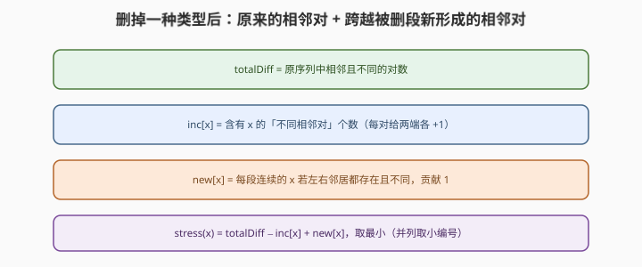
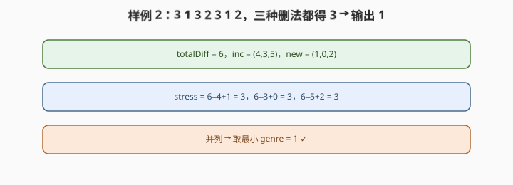

# Codeforces 250C 影评人最少压力 题解

## 1. 题目概述

- **题目链接**：https://codeforces.com/problemset/problem/250/C
- **比赛来源**：CROC-MBTU 2012, Final Round (Online version, Div. 2) · Problem C（UTC 2012-11-26）
- **难度**：1600
- **标签**：贪心、实现
- **评测类型**：普通
- **限制**：时间 2 s / 内存 256 MB

**题意**：长度为 $n$ 的类型序列（类型 $1..k$ 都出现）。删掉某一类型的**全部**电影后，剩下的序列里「相邻且类型不同」的对数就是压力次数。选一个类型使压力最小，并列取编号最小。

**约束**：$n\le10^5$，对每个类型单独过滤重算是 $O(nk)$，太慢；需要 $O(n+k)$ 的公式。

## 2. 示例与观察

```text
输入：
10 3
1 1 2 3 2 3 3 1 1 3

输出：
3
```

```text
输入：
7 3
3 1 3 2 3 1 2

输出：
1
```



**观察一**：删掉类型 $x$ 后，剩下的相邻对分两类：

1. 原本就相邻、且都不等于 $x$ 且类型不同的对；
2. 原来被 $x$ 隔开、删除后变成相邻的一对：即每段极长的 $x$ 的左右邻居（如果都存在）。

**观察二**：设 `totalDiff` 为原序列中相邻且不同的对数、`inc[x]` 为这些对里含 $x$ 的对数，则第 1 类的数量是 $\text{totalDiff}-\text{inc}[x]$。

**观察三**：设 `new[x]` 为「左右邻居都存在且不同的极长 $x$ 段」的个数，则

$$\text{stress}(x)=\text{totalDiff}-\text{inc}[x]+\text{new}[x].$$

## 3. 解题思路

### 3.1 朴素做法与瓶颈

对每个 $x$ 重建过滤后的序列并数相邻不同对：$O(n)$ 每类，$O(nk)$ 总体，最大 $10^{10}$。

### 3.2 核心观察

只需求三个量：

- `totalDiff`：一次扫描；
- `inc[x]`：对每个相邻不同对 $(u,v)$ 给 `inc[u]++`、`inc[v]++`（同一对会被两个端点各记一次，正好对应「删 $u$ 或删 $v$ 时这一对消失」）；
- `new[x]`：扫描每条极长相同段，若它左右都有邻居且邻居类型不同，则给该段类型 `new++`。

然后对每个 $x$ 套公式取最小。



### 3.3 样例走查

样例一：`totalDiff=5`（对 $(1,2),(2,3),(3,2),(2,3),(3,1),(1,3)$ 中不同的 5 个）；`inc[1]=3, inc[2]=4, inc[3]=5`；`new[1]=0, new[2]=1, new[3]=1`。于是 stress$=(2,2,1)$ → 输出 3 ✓。

样例二：`totalDiff=6`，`inc=(4,3,5)`，`new=(1,0,2)` → stress 全为 3 → 并列取 1 ✓。

## 4. 正确性证明

**引理 1（删除后的相邻对分类）**：删掉 $x$ 后，剩余序列的相邻对恰好是「原来相邻且都不等于 $x$ 的对」加上「每个极长 $x$ 段左右邻居组成的对（若两侧都存在）」。

**证明**：把原序列中所有 $x$ 删除后，两个元素在剩余序列中相邻 $\iff$ 它们之间原序列里全是 $x$ $\iff$ 它们原本相邻（中间无元素）或隔着一段极长的 $x$，即它们是一段 $x$ 的左右邻居。∎

**引理 2**：第 1 类中「类型不同」的对数是 $\text{totalDiff}-\text{inc}[x]$。

**证明**：原序列中相邻且不同且都不等于 $x$ 的对数 = 全部相邻不同对数 − 含 $x$ 的相邻不同对数；而含 $x$ 的相邻不同对恰是 `inc[x]`（每个这样的对两个端点各记一次，但只有一端是 $x$，故计数等于对数 ✓）。∎

**定理**：$\text{stress}(x)=\text{totalDiff}-\text{inc}[x]+\text{new}[x]$，且算法输出最小者（并列取小编号）。

**证明**：由引理 1、2，第 1 类贡献 $\text{totalDiff}-\text{inc}[x]$；第 2 类贡献为「左右邻居类型不同」的极长段数，即 `new[x]`。求和即压力。算法对所有存在的类型计算并取最小，并列时因按 $x$ 递增遍历且只在严格更小时更新，故取到最小编号。∎

## 5. 复杂度分析

时间 $O(n+k)$，空间 $O(k)$；$n=10^5$ 实测约 $9$ ms。

## 6. 参考代码

### C++17

```cpp
#include <bits/stdc++.h>
using namespace std;
int main(){
    int n,k;
    if(scanf("%d %d",&n,&k)!=2) return 0;
    vector<int> a(n);
    for(int i=0;i<n;i++) scanf("%d",&a[i]);
    long long totalDiff=0;
    vector<long long> inc(k+1,0), nw(k+1,0);
    for(int i=0;i+1<n;i++) if(a[i]!=a[i+1]){ ++totalDiff; ++inc[a[i]]; ++inc[a[i+1]]; }
    for(int i=0;i<n;){
        int j=i; while(j<n && a[j]==a[i]) ++j;
        if(i>0 && j<n && a[i-1]!=a[j]) ++nw[a[i]];
        i=j;
    }
    long long best=LLONG_MAX; int bestc=1;
    for(int x=1;x<=k;x++){
        long long v=totalDiff-inc[x]+nw[x];
        if(v<best){ best=v; bestc=x; }
    }
    printf("%d\n",bestc);
    return 0;
}
```

### Python3

```python
import sys


def main() -> None:
    data = sys.stdin.buffer.read().split()
    if not data:
        return
    n, k = int(data[0]), int(data[1])
    a = [int(x) for x in data[2:2 + n]]
    total = 0
    inc = [0] * (k + 1)
    nw = [0] * (k + 1)
    for i in range(n - 1):
        if a[i] != a[i + 1]:
            total += 1
            inc[a[i]] += 1
            inc[a[i + 1]] += 1
    i = 0
    while i < n:
        j = i
        while j < n and a[j] == a[i]:
            j += 1
        if i > 0 and j < n and a[i - 1] != a[j]:
            nw[a[i]] += 1
        i = j
    best, bestc = None, 1
    for x in range(1, k + 1):
        v = total - inc[x] + nw[x]
        if best is None or v < best:
            best, bestc = v, x
    print(bestc)


main()
```

## 7. 边界情况与易错点

1. **`inc` 的计数**：每个相邻不同对要给两个端点各加 1（删任意一端这对都消失）。
2. **`new` 只看「左右都存在」的极长段**：开头/结尾的段删除后不产生新相邻对。
3. **左右邻居相同**：不产生压力（同类型相邻不改变情绪）。
4. **并列取小编号**：只有在严格更小时才更新答案。
5. **每个类型都出现**（题面保证），所以不需要判空。
6. **多测**：单组数据。

## 8. 验证记录

- **编译环境与命令**：`verify_solution.py`；`check.py`、`check_samples.py --only 0101-0203/250`、`katex_check.cjs` 均 0 问题。
  - `python3 codeforces/tools/verify_solution.py codeforces/contests/0101-0203/250/C_影评人最少压力.md` → `CF250C: samples 2 / C++ 编译 OK, 样例 2/2 / Python 语法 OK, 样例 2/2`
- **官方样例**：2 / 2 通过（3、1）。
- **暴力对拍**：独立暴力 = 对每个类型过滤后逐对统计相邻不同数。随机 **240 组**（$n\le20$，$k\in[2,5]$），C++、Python、暴力一致。
- **最大约束性能**：$n=10^5,k=1000$ 约 $9$ ms。
- **图片校验**：`cf250c_formula.svg`、`cf250c_walk.svg` 通过 XML 解析。
- **复核状态**：verified。

## 相关题目与扩展

- [Codeforces 250B Restoring IPv6](https://codeforces.com/problemset/problem/250/B)：同场 B 题。

**延伸思考**：

1. **若要求删掉「最多 $c$ 种类型」**：需要对每种组合评估，组合数大时要用 DP/贪心。
2. **若压力定义为「类型变化的次数」而非相邻对数**：过滤后统计相邻差异即可，同一公式。
3. **若需在线回答**（多次删不同类型）：预处理三个数组后可 O(1) 回答。
