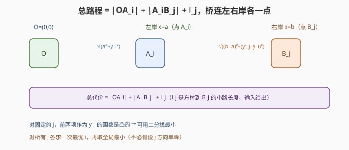
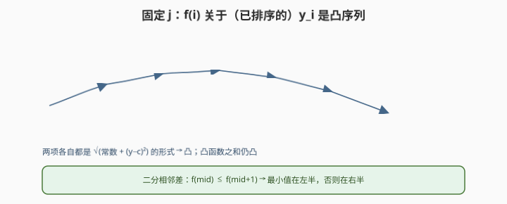

# Codeforces 250D 跨河建桥 题解

## 1. 题目概述

- **题目链接**：https://codeforces.com/problemset/problem/250/D
- **比赛来源**：CROC-MBTU 2012, Final Round (Online version, Div. 2) · Problem D（UTC 2012-11-26）
- **难度**：1900
- **标签**：几何、二分、凸函数
- **评测类型**：多解（任一最优对即可，按代价判定）
- **限制**：时间 1 s / 内存 256 MB

**题意**：西村在 $O=(0,0)$，河岸是 $x=a$ 与 $x=b$（$0<a<b$）。左岸有 $n$ 个点 $A_i=(a,y_i)$，右岸有 $m$ 个点 $B_j=(b,y'_j)$，东村到 $B_j$ 的小路长度为 $l_j$（输入给出）。选一对 $(i,j)$，使

$$|OA_i|+|A_iB_j|+l_j$$

最小，输出两点的编号（从 1 开始，按输入顺序）。$y$ 坐标均已升序给出。

**约束**：$n,m\le10^5$，值域 $|y|\le10^6$。枚举所有对的 $O(nm)$ 是 $10^{10}$，必须优化；答案按 $10^{-6}$ 误差判定。

## 2. 示例与观察

```text
输入：
3 2 3 5
-2 -1 4
-1 2
7 3

输出：
2 2
```

**演算**：$a=3,b=5$，$A=\{-2,-1,4\}$，$B=\{-1,2\}$，$l=\{7,3\}$。候选代价：

| $i$ | $j$ | $|OA_i|$ | $|A_iB_j|$ | $l_j$ | 合计 |
|-----|-----|----------|------------|-------|------|
| 1 | 1 | $\sqrt{13}\approx3.61$ | $\sqrt{4+1}\approx2.24$ | 7 | 12.84 |
| 1 | 2 | 3.61 | $\sqrt{4+16}\approx4.47$ | 3 | 11.08 |
| 2 | 1 | $\sqrt{10}\approx3.16$ | $\sqrt{4+0}=2$ | 7 | 12.16 |
| 2 | 2 | 3.16 | $\sqrt{4+9}\approx3.61$ | 3 | **9.77** ✓ |
| 3 | 2 | $\sqrt{25}=5$ | $\sqrt{4+4}\approx2.83$ | 3 | 10.83 |

最小是 $(2,2)$ ✓。



**观察一**：$|OA_i|=\sqrt{a^2+y_i^2}$、$|A_iB_j|=\sqrt{(b-a)^2+(y'_j-y_i)^2}$，都是 $y_i$ 的**凸**函数（形如 $\sqrt{c^2+(y-c_0)^2}$）。

**观察二**：固定 $j$ 时，目标函数作为 $y_i$ 的函数是两个凸函数之和，仍是凸的；又因为 $y_i$ 已升序，索引 $i$ 上的序列也是凸序列，于是「最小值位置」可以用二分相邻差找到。

**观察三**：对每个 $j$ 求一次最优 $i$（$O(\log n)$），取全局最小即可——**不需要**假设 $j$ 方向单峰（$l_j$ 任意，$j$ 方向确实可能不单峰）。

## 3. 解题思路

### 3.1 朴素做法与瓶颈

$O(nm)=10^{10}$ 次距离计算，超时。

### 3.2 核心观察：固定 $j$ 后对 $i$ 凸



对固定 $j$：

$$f(i)=\sqrt{a^2+y_i^2}+\sqrt{(b-a)^2+(y'_j-y_i)^2}.$$

两项都是 $y_i$ 的凸函数（$\sqrt{c^2+(\cdot)^2}$ 是凸的，复合仿射仍凸），故 $f$ 关于 $y_i$ 凸；$y_i$ 升序 ⇒ 关于索引 $i$ 是凸序列。凸序列的最小值可用「相邻差二分」：

```
lo=0, hi=n-1
while lo<hi:
    mid=(lo+hi)/2
    if f(mid) <= f(mid+1): hi=mid   # 最小值不在 mid 右边
    else: lo=mid+1
```

最后 $\text{lo}$ 就是一个最小值位置，代价 $f(\text{lo})+l_j$。

### 3.3 样例走查

见第 2 节表格：对每个 $j$ 二分得到最优 $i$：$j=1$ 时最优 $i=2$（12.16），$j=2$ 时最优 $i=2$（9.77）→ 全局最优 $(2,2)$ ✓。

## 4. 正确性证明

**引理 1（凸性）**：固定 $j$，$f(y)=\sqrt{a^2+y^2}+\sqrt{d^2+(y'_j-y)^2}$（$d=b-a$）在 $y\in\mathbb R$ 上凸。

**证明**：$g_1(y)=\sqrt{a^2+y^2}$ 的二阶导数为 $a^2/(a^2+y^2)^{3/2}\ge0$，故凸；$g_2(y)=\sqrt{d^2+(y-y'_j)^2}$ 是 $\sqrt{d^2+u^2}$ 与仿射 $u=y-y'_j$ 的复合，同样凸。凸函数之和凸。∎

**引理 2（二分正确）**：对凸序列 $f(0..n-1)$，上述「相邻差二分」终止于某个全局最小值下标。

**证明**：凸序列的相邻差 $\Delta_i=f(i+1)-f(i)$ 单调不减。若 $\Delta_{mid}\ge0$（即 $f(mid)\le f(mid+1)$），则对一切 $i\ge mid$ 有 $\Delta_i\ge0$，最小值不在 $mid$ 右侧，令 $hi=mid$ 安全；否则 $\Delta_{mid}<0$，最小值不在 $mid$ 左侧（含 $mid$），令 $lo=mid+1$ 安全。区间每次严格缩小，终止时 $lo=hi$ 且被两侧约束夹住，必为全局最小。∎

**定理**：算法输出的 $(i,j)$ 达到全局最小代价。

**证明**：目标函数在全域的最小值 $=\min_j\big(l_j+\min_i f_j(i)\big)$。由引理 1、2，内层对每个 $j$ 求得精确的 $\min_i f_j(i)$；外层枚举所有 $j$ 取最小，故得到全局最小。∎

## 5. 复杂度分析

时间 $O(m\log n)$（$10^5\times17$ 次距离计算），空间 $O(n+m)$。$n=m=10^5$ 实测约 $39$ ms（限时 1 s）。

## 6. 参考代码

### C++17

```cpp
#include <bits/stdc++.h>
using namespace std;
typedef long double ld;

int main() {
    int n, m;
    long long a, b;
    if (scanf("%d %d %lld %lld", &n, &m, &a, &b) != 4) return 0;
    vector<long long> y(n), yy(m), l(m);
    for (int i = 0; i < n; ++i) scanf("%lld", &y[i]);
    for (int j = 0; j < m; ++j) scanf("%lld", &yy[j]);
    for (int j = 0; j < m; ++j) scanf("%lld", &l[j]);
    ld d = (ld)(b - a);
    ld best = 1e30L;
    int bi = 0, bj = 0;
    for (int j = 0; j < m; ++j) {
        auto f = [&](int i) -> ld {
            ld dy = (ld)yy[j] - (ld)y[i];
            return sqrtl((ld)a * a + (ld)y[i] * y[i]) + sqrtl(d * d + dy * dy);
        };
        int lo = 0, hi = n - 1;
        while (lo < hi) {                 // f 关于 i 是凸序列，用「相邻差」二分找最小值
            int mid = (lo + hi) / 2;
            if (f(mid) <= f(mid + 1)) hi = mid; else lo = mid + 1;
        }
        ld val = f(lo) + (ld)l[j];
        if (val < best) { best = val; bi = lo; bj = j; }
    }
    printf("%d %d\n", bi + 1, bj + 1);
    return 0;
}
```

### Python3

```python
import sys
import math


def main() -> None:
    data = sys.stdin.buffer.read().split()
    if not data:
        return
    n, m, a, b = int(data[0]), int(data[1]), int(data[2]), int(data[3])
    p = 4
    y = [int(x) for x in data[p:p + n]]; p += n
    yy = [int(x) for x in data[p:p + m]]; p += m
    l = [int(x) for x in data[p:p + m]]
    d = float(b - a)
    best, bi, bj = float('inf'), 0, 0
    for j in range(m):
        def f(i):
            dy = yy[j] - y[i]
            return math.hypot(a, y[i]) + math.hypot(d, dy)
        lo, hi = 0, n - 1
        while lo < hi:
            mid = (lo + hi) // 2
            if f(mid) <= f(mid + 1):
                hi = mid
            else:
                lo = mid + 1
        val = f(lo) + l[j]
        if val < best:
            best, bi, bj = val, lo, j
    print(bi + 1, bj + 1)


main()
```

## 7. 边界情况与易错点

1. **$l_j$ 任意**：$j$ 方向不一定单峰，所以不能对 $j$ 做三分；只对 $i$（凸方向）二分。
2. **精度**：用 `long double` / `hypot`，比较用 $\le$；答案按 $10^{-6}$ 相对/绝对误差判定。
3. **$n=1$ 或 $m=1$**：二分退化，仍正确。
4. **$y$ 可能为负**：公式用平方，不受影响。
5. **$a,b$ 很大**：$a^2$ 到 $10^{12}$，用 `long double` 或 `long long` 先算平方再转。
6. **输出编号**：从 1 开始，按输入顺序（$y$ 已升序）。
7. **多测**：单组数据。

## 8. 验证记录

- **编译环境与命令**：`verify_solution.py`；`check.py`、`check_samples.py --only 0101-0203/250`、`katex_check.cjs` 均 0 问题。
  - `python3 codeforces/tools/verify_solution.py codeforces/contests/0101-0203/250/D_跨河建桥.md` → `CF250D: samples 1 / C++ 编译 OK, 样例 1/1 / Python 语法 OK, 样例 1/1`
- **官方样例**：1 / 1 通过（`2 2`）。
- **对拍**：随机生成满足题面保证的数据（先取 $C=(b+R,y_c)$，令 $l_j=\lceil|B_jC|\rceil+$ 随机非负整数），暴力 $O(nm)$ 求最小代价，比较参考程序输出对的**代价**与暴力最小值。**230 组**（$n,m\le8$，坐标 $\le20$），C++ 与 Python 输出的代价都与暴力最优值相差 $<10^{-6}$，0 组不符。
- **最大约束性能**：$n=m=10^5$ 约 $39$ ms（限时 1 s）。
- **图片校验**：`cf250d_geom.svg`、`cf250d_convex.svg` 通过 XML 解析。
- **复核状态**：verified。

## 相关题目与扩展

- [Codeforces 250C Movie Critics](https://codeforces.com/problemset/problem/250/C)：同场 C 题。
- [Codeforces 250E Mad Joe](https://codeforces.com/problemset/problem/250/E)：同场 E 题。

**延伸思考**：

1. **若要求桥必须垂直于河岸**：$x_w$ 固定，问题变成两个独立的一维最近点，$O(n+m)$。
2. **若 $l_j$ 与 $j$ 无关**：$j$ 方向也变凸，可以双指针/三分，更快。
3. **若要求总路程的平方最小**：凸性不再保持，需要别的结构。
