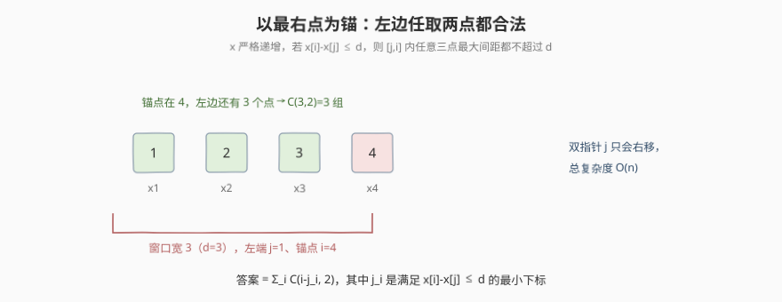
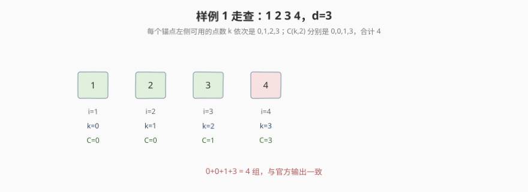

# Codeforces 251A 数轴三点计数 题解

## 1. 题目概述

- **题目链接**：https://codeforces.com/problemset/problem/251/A
- **比赛来源**：Codeforces Round 153 (Div. 1) · Problem A（UTC 2012-12-06）
- **难度**：1300
- **标签**：双指针、组合计数
- **评测类型**：普通
- **限制**：时间 2 s / 内存 256 MB

**题意**：数轴上有 $n$ 个点，坐标 $x_1 < x_2 < \cdots < x_n$（严格递增，已按序给出）。问有多少种选法，能选出三个**不同**的点，使其中距离最远的两点距离不超过 $d$。三个点的顺序不计（组合数）。

**约束**：

- $n \le 10^5$：三重组的总数是 $\binom{n}{3} \approx 1.67 \times 10^{14}$，逐个枚举必然超时，必须用计数而不是枚举。
- $|x_i| \le 10^9$、$d \le 10^9$：两点之差最大可达 $2 \times 10^9$，正好在 `int` 的边界附近，**差值要用 64 位**（本实现用 `long long`）。
- 答案最大是 $\binom{10^5}{3} \approx 1.67 \times 10^{14}$，超过 `int`，必须用 `long long`。
- 坐标已严格递增，不需要自己排序。

## 2. 示例与观察

官方样例 1：

```text
输入：
4 3
1 2 3 4

输出：
4
```

官方样例 2：

```text
输入：
4 2
-3 -2 -1 0

输出：
2
```

官方样例 3：

```text
输入：
5 19
1 10 20 30 50

输出：
1
```

**样例 1 的演算**：$d = 3$，数组 $1,2,3,4$。四个三点组逐一检查：

- $(1,2,3)$：最远距离 $3-1 = 2 \le 3$ ✓
- $(1,2,4)$：$4-1 = 3 \le 3$ ✓
- $(1,3,4)$：$4-1 = 3 \le 3$ ✓
- $(2,3,4)$：$4-2 = 2 \le 3$ ✓

四组全合法，答案 4。

**样例 2 的演算**：$d = 2$，点 $-3,-2,-1,0$。三组中 $(-3,-2,-1)$ 最远距离 2 ✓；$(-3,-2,0)$ 距离 3 ✗；$(-2,-1,0)$ 距离 2 ✓。答案 2。

**样例 3 的演算**：$d = 19$，点 $1,10,20,30,50$。只有 $(1,10,20)$ 的跨度 $20-1 = 19 \le 19$ 成立；$(1,10,30)$ 跨度 29 ✗；其余更大。答案 1。注意 $19$ 正好取等，说明边界是"$\le d$"而不是"$< d$"。

**观察 1**：由于坐标递增，三点组的"最远距离"就是**最大坐标减最小坐标**。所以条件等价于：$x_{\max} - x_{\min} \le d$。

**观察 2**：若三点组的最右点是 $x_i$、最左点下标 $\ge j$，那么只要 $x_i - x_j \le d$，中间任取一个点都合法——因为中间点的坐标夹在两者之间，不会让跨度变大。

**观察 3**：每个三点组有唯一的最右点。按最右点分类计数，就不会重复也不会遗漏。

自造样例（标注"自造"）：

| 输入 | 输出 | 说明 |
|------|------|------|
| `3 1` / `1 2 3` | 0 | 跨度 2 > 1 |
| `3 2` / `1 2 3` | 1 | 恰好跨度等于 $d$ |
| `1 1000000000` / `0` | 0 | 不足三个点 |
| `5 1000000000` / `-1000000000 -1 0 1 1000000000` | 10 | 全部 $\binom{5}{3}=10$ 组合法 |
| `5 4` / `0 1 2 3 4` | 5 | 见下方走查 |

## 3. 解题思路

### 3.1 朴素做法与瓶颈

枚举所有 $\binom{n}{3}$ 个三点组，每组检查跨度是否 $\le d$。复杂度 $O(n^3)$，$n = 10^5$ 时 $1.67 \times 10^{14}$ 次操作，完全不可行。即使优化到 $O(n^2)$（固定左右端点再数中间点）也有 $5 \times 10^9$，仍然超时。

### 3.2 核心观察：以最右点为锚



固定三点组中**最右**的那个点，下标记为 $i$。为了让它成为"最右"，另外两点必须来自 $\{x_0, \ldots, x_{i-1}\}$（0 基下标）。在这段里，跨度 $x_i - x_{\text{最左}}$ 只由最左点决定，所以记

$$j_i = \min\{\, j : x_i - x_j \le d \,\}$$

即"最左允许下标"（因为坐标递增，$x_i - x_j$ 随 $j$ 增大而减小，所以合法的 $j$ 构成后缀 $[j_i, i-1]$）。那么以 $i$ 为最右点的合法三点组数就是

$$\binom{i - j_i}{2} = \frac{(i-j_i)(i-j_i-1)}{2}.$$

**为什么任取两点都行**：设选中的两点下标为 $a < b \le i-1$。则最小坐标是 $x_a \ge x_{j_i}$（因为 $a \ge j_i$），最大是 $x_i$，于是

$$x_i - x_a \le x_i - x_{j_i} \le d .$$

条件只取决于最左点，中间点随心所欲。

**$j_i$ 怎么求**：$x_i$ 递增，条件 $x_i - x_j \le d$ 的解集是后缀，并且 $i$ 增大时 $j_i$ 也**单调不减**（窗口右端右移，左端不可能左移）。所以用一个指针 $j$ 跟着 $i$ 走，总移动次数 $O(n)$，这就是双指针。

### 3.3 算法流程

1. 读入 $n, d$ 与已排好序的 $x_0 \ldots x_{n-1}$；
2. `j = 0`，`ans = 0`；
3. 对 $i = 0 \ldots n-1$：
   - `while (x[i] - x[j] > d) j++;`
   - `k = i - j`（可选的"另外两点"个数）
   - `ans += k * (k - 1) / 2`；
4. 输出 `ans`。

第 3 步中的 `j` 只会右移，所以内层 `while` 的总执行次数不超过 $n$，整体 $O(n)$。

### 3.4 样例走查



**样例 1**（$d = 3$）：逐个锚点看。

| 锚点 $i$ | $x_i$ | $j_i$ | $k = i - j_i$ | $\binom{k}{2}$ |
|----------|--------|--------|----------------|----------------|
| 0 | 1 | 0 | 0 | 0 |
| 1 | 2 | 0 | 1 | 0 |
| 2 | 3 | 0 | 2 | 1 |
| 3 | 4 | 0 | 3 | 3 |

合计 $0+0+1+3 = 4$，与官方输出一致。

**自造 `5 4` / `0 1 2 3 4`**：$d = 4$。

| 锚点 $i$ | $x_i$ | $j_i$ | $k$ | $\binom{k}{2}$ |
|----------|--------|--------|------|----------------|
| 0 | 0 | 0 | 0 | 0 |
| 1 | 1 | 0 | 1 | 0 |
| 2 | 2 | 0 | 2 | 1 |
| 3 | 3 | 0 | 3 | 3 |
| 4 | 4 | 0 | 4 | 6 |

合计 10，正好是 $\binom{5}{3} = 10$：因为整体跨度 $4 \le d$，所有组合都合法。

**自造 `3 2` / `1 2 3`**：$i=2$ 时 $x_2 - x_0 = 2 \le 2$，$j_2 = 0$，$k = 2$，贡献 $\binom{2}{2} = 1$；前两个锚点贡献 0。答案 1，正是 $(1,2,3)$ 这一组。

## 4. 正确性证明

**引理 1（条件等价）**：三点组 $\{x_a, x_b, x_c\}$（$a<b<c$）合法，当且仅当 $x_c - x_a \le d$。

**证明**：坐标严格递增，所以最大坐标是 $x_c$、最小是 $x_a$，它们之间的距离就是所有点对距离中的最大值（其余点对的距离都不超过它）。故"最远两点距离 $\le d$"等价于 $x_c - x_a \le d$。∎

**引理 2（锚定分解）**：对每个 $c \ge 2$，以 $c$ 为最右点的合法三点组，恰为所有满足 $j_c \le a < b < c$ 的下标对 $\{a,b\}$，其中 $j_c$ 是使 $x_c - x_j \le d$ 的最小下标。

**证明**：(⊆) 设 $\{a,b,c\}$ 合法，$a<b<c$。由引理 1，$x_c - x_a \le d$，故 $a$ 满足定义中 $j$ 的条件，于是 $a \ge j_c$（$j_c$ 是最小可行下标）；又 $a<b<c$。(⊇) 若 $j_c \le a < b < c$，则 $x_a \ge x_{j_c}$，故 $x_c - x_a \le x_c - x_{j_c} \le d$，由引理 1 合法。∎

**引理 3（$j_c$ 的存在与单调性）**：$j_c$ 一定存在（至少 $j = c$ 满足 $x_c - x_c = 0 \le d$），且 $c$ 增大时 $j_c$ 单调不减。

**证明**：$j_c \le c$ 由 $x_c - x_c = 0$ 可得（$d \ge 1$）。单调性：设 $c' > c$，则 $x_{c'} - x_{j_c} \ge x_c - x_{j_c}$ 未必 $\le d$，所以 $j_{c'}$ 可能更大——但绝不会更小，因为对任意 $j < j_c$ 都有 $x_c - x_j > d$，从而 $x_{c'} - x_j > d$，即 $j$ 对 $c'$ 失败。故 $j_{c'} \ge j_c$。∎

**定理**：算法输出的 `ans` 等于合法三点组的总数。

**证明**：每个三点组有唯一的最右点 $c$，所以按 $c$ 分类是划分（不重不漏）。由引理 2，$c$ 这一类的组数恰为 $\binom{c - j_c}{2}$，算法第 3 步累加的正是这个值。由引理 3，双指针可以在 $O(n)$ 内正确求出所有 $j_c$（指针只会右移，且停在最小的可行下标上：`while (x[i]-x[j] > d) j++` 在条件不再成立时立即停止，此时 $j$ 就是最小可行下标）。故 `ans` 正确。∎

## 5. 复杂度分析

- **时间**：$O(n)$。外层 $i$ 走 $n$ 步，内层 `j` 总共只右移 $n$ 次，合计 $O(n)$ 次比较与加法。$n = 10^5$ 时约 $2 \times 10^5$ 次操作。
- **空间**：$O(n)$ 存坐标数组（$10^5 \times 8$ 字节 $= 800$ KB）。
- **数值范围**：$k \le 10^5$，$k(k-1)/2 \le 5 \times 10^9$ 会溢出 `int`；累加 $n$ 项后最大 $\binom{10^5}{3} \approx 1.67 \times 10^{14}$。全程用 `long long`。
- **与时限的关系**：时限 2 s，$n = 10^5$ 实测端到端 11.8 ms（含进程启动），余量 150 倍以上。

## 6. 参考代码

### C++17

```cpp
#include <bits/stdc++.h>
using namespace std;

int main() {
    int n;
    long long d;
    if (scanf("%d %lld", &n, &d) != 2) return 0;
    static long long x[100005];
    for (int i = 0; i < n; i++) scanf("%lld", &x[i]);

    long long ans = 0;
    int j = 0;                     // 以 i 为最大下标时，最小可选的左端点
    for (int i = 0; i < n; i++) {
        while (x[i] - x[j] > d) j++;
        long long k = i - j;       // [j, i-1] 中任取两点与 x[i] 组成三点组
        ans += k * (k - 1) / 2;
    }
    printf("%lld\n", ans);
    return 0;
}
```

### Python3

```python
import sys


def main() -> None:
    data = sys.stdin.buffer.read().split()
    if not data:
        return
    n, d = int(data[0]), int(data[1])
    x = [int(v) for v in data[2:2 + n]]
    ans = 0
    j = 0
    for i in range(n):
        while x[i] - x[j] > d:
            j += 1
        k = i - j
        ans += k * (k - 1) // 2
    sys.stdout.write(str(ans) + "\n")


main()
```

## 7. 边界情况与易错点

1. **$n < 3$**：答案必须是 0。代码中 $i \le 1$ 时 $k \le 1$，$\binom{k}{2} = 0$，自然给出 0，无需特判；但如果写成"先判断 $k \ge 2$ 再乘"，也别漏掉负数下溢。
2. **`int` 溢出（本题最大的坑）**：$n = 10^5$ 时答案 $\approx 1.67 \times 10^{14}$，`int` 立刻错；中间的 $k(k-1)/2$ 也可能到 $5 \times 10^9$。全程 `long long`。
3. **坐标差溢出**：$x_i - x_j$ 最大 $2 \times 10^9$，虽然刚好在 `int` 上界（$2.147 \times 10^9$）之内，但非常接近；用 `long long` 存坐标更稳，也避免"$x_i - x_j$ 里 $d$ 是 `long long` 而比较时发生隐式转换"的混乱。
4. **坐标可以是负数**：样例 2 就是负坐标。读取时要用有符号类型，且比较不能假设"$x_j \ge 0$"。
5. **$d$ 的正负与取等**：$d \ge 1$，条件是 $x_i - x_j \le d$（**取等合法**）。写成 $< d$ 会让样例 1 的 $(1,2,4)$、$(1,3,4)$ 和样例 3 的 $(1,10,20)$ 全部丢失。
6. **指针 `j` 不需要回退**：因为 $j_i$ 单调不减（引理 3）。如果每次把 `j` 重置为 0，复杂度退化到 $O(n^2)$，$n=10^5$ 会超时。
7. **必须用"最右点"分类而不是"最左点"**：用最左点分类也可以（对称地数右边有多少点），但两种分类不能混用，否则会重复计数。
8. **`j` 的初值**：从 0 开始且只增不减。注意内层 `while` 的条件用 `>`（严格大于才收缩），这正好对应"$\le d$ 保留"。
9. **输入规模读入方式**：$10^5$ 个整数，用 `scanf` / 快速读入；`cin` 也行但记得关同步。

## 8. 验证记录

- **编译环境与命令**：`clang++ -std=c++17 -O2`（配合 `codeforces/tools/include` 兼容头，可原样提交 GNU C++17）；Python 3.9.6。
- **官方样例**：3 / 3 通过（→ 4、2、1），C++ 与 Python 一致。
- **独立暴力对拍**：暴力版三重循环直接枚举所有三点组并用 $\max - \min \le d$ 判定（$O(n^3)$，与参考实现的双指针完全独立）。随机 300 组：$n \in [1,14]$，坐标从 $[-30,30]$ 中随机取 $n$ 个互不相同的值再排序，$d \in [1,40]$。**300 / 300 全部一致**（C++ 与 Python 各跑一遍共 600 次比较）。
- **最大约束性能**：$n = 10^5$、$d = 10^9$、坐标在 $[-10^9, 10^9]$ 内随机取 $10^5$ 个互不相同的值，答案 $83016065144898$，7 次取最小端到端 **11.8 ms**（含进程启动），远低于 2 s。
- **图片校验**：两张 SVG（`cf251a_anchor.svg`、`cf251a_walk.svg`）通过 `ElementTree.parse`，含 `feTurbulence` 与手写字体。
- **复核状态**：verified。

## 相关题目与扩展

- [Codeforces 251B Playing with Permutations](https://codeforces.com/problemset/problem/251/B)：同场 B 题，排列的 $k$ 次操作可达性。
- [Codeforces 279B Books](https://codeforces.com/problemset/problem/279/B)：经典双指针，求最长区间使总时长不超过 $t$，与本题的"后缀窗口"结构一致。
- [Codeforces 253B Physics Practical](https://codeforces.com/problemset/problem/253/B)：同样用"固定一端、窗口右端唯一确定"的计数思想。
- [LeetCode 930. 和相同的二元子数组](https://leetcode.cn/problems/binary-subarrays-with-sum/)：双指针 + 计数，注意"恰好等于"与"不超过"在指针移动方向上的差别。
- [LeetCode 611. 有效三角形的个数](https://leetcode.cn/problems/valid-triangle-number/)：同样是"排序后以最大元素为锚 + 双指针"统计三重组，与本题几乎是同一个模板。

**延伸思考**：

1. **如果要求统计"距离最大的两点恰好等于 $d$"的三点组**：可以用"$\le d$ 的组数减去 $\le d-1$ 的组数"（坐标是整数时成立），一次差分就能做到，复杂度不变。
2. **如果要数四元组**：把 $\binom{k}{2}$ 换成 $\binom{k}{3}$，双指针的框架完全不变，只是组合数的阶数升高；这道题的一般形式是"数 $m$ 元组使跨度 $\le d$"，$O(n)$ 可解。
3. **如果点带权（每个点有权重 $w_i$，求权值和最大/最小的合法三元组）**：双指针不再够用，需要滑动窗口维护权值和，或者退化成 $O(n \log n)$ 的分治。
4. **如果坐标不保证有序**：先排序，答案不变（组合与顺序无关），代价 $O(n \log n)$。本题题面已保证严格递增，省掉了这一步。

