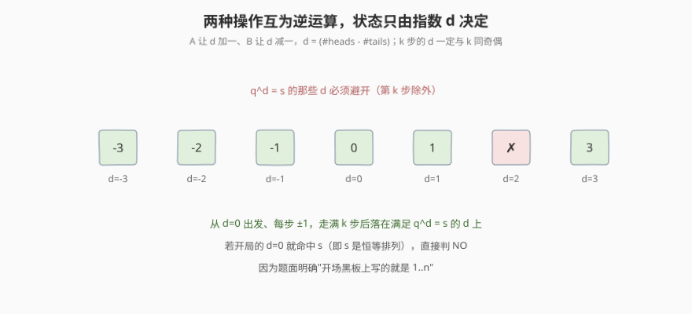
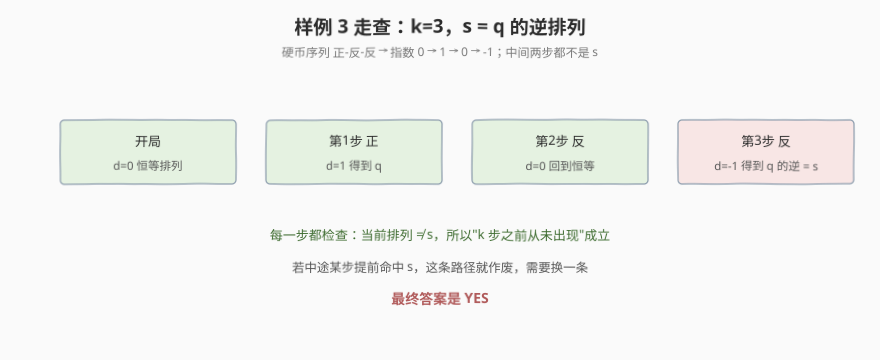

# Codeforces 251B 排列与逆排列 题解

## 1. 题目概述

- **题目链接**：https://codeforces.com/problemset/problem/251/B
- **比赛来源**：Codeforces Round 153 (Div. 1) · Problem B（UTC 2012-12-06）
- **难度**：1800
- **标签**：排列、模拟、可达性、奇偶性
- **评测类型**：普通
- **限制**：时间 2 s / 内存 256 MB

**题意**：黑板上最初写着排列 $1,2,\ldots,n$。Petya 要做**恰好 $k$ 次**操作，每次抛硬币：

- 正面：把黑板上的排列 $p$ 换成 $p_{q_1}, p_{q_2}, \ldots, p_{q_n}$（记为"作用 $q$"）；
- 反面：把 $p$ 换成 $t$，其中 $t_{q_i} = p_i$（记为"作用 $q^{-1}$"）。

给定 $q$ 与 $s$，问是否存在一种抛硬币方式，使得第 $k$ 步后黑板上的排列恰为 $s$，并且**在这之前（包括开局）黑板上从未出现过 $s$**。

**约束**：

- $n, k \le 100$：$2^k$ 种硬币序列是天文数字，不能枚举；但 $k \le 100$ 意味着"指数的取值范围只有 $[-k,k]$ 共 $2k+1$ 种"，状态数极少。
- 答案只有 `YES` / `NO`，没有多解问题。
- 只有一组数据。

## 2. 示例与观察

官方样例 1：

```text
输入：
4 1
2 3 4 1
1 2 3 4

输出：
NO
```

官方样例 2：

```text
输入：
4 1
4 3 1 2
3 4 2 1

输出：
YES
```

官方样例 3：

```text
输入：
4 3
4 3 1 2
3 4 2 1

输出：
YES
```

官方样例 4：

```text
输入：
4 2
4 3 1 2
2 1 4 3

输出：
YES
```

官方样例 5：

```text
输入：
4 1
4 3 1 2
2 1 4 3

输出：
NO
```

**样例 1**：$q$ 是四元循环 $(1\to2\to3\to4\to1)$，$s$ 是恒等排列。一步只能得到 $q$ 或 $q^{-1}$，都等于 $s$ 吗？都不是。而且题面的 note 特别指出：**开局黑板上写的就是恒等排列**，所以 $s$ = 恒等排列本身就意味着"$s$ 在 $k$ 步之前出现过"，直接判 NO。

**样例 2**：$q = (4,3,1,2)$ 的逆排列是 $(3,4,2,1)$（$q$ 把 1 映到 4、2 映到 3、3 映到 1、4 映到 2，所以逆是 $1\to3, 2\to4, 3\to2, 4\to1$，即 $(3,4,2,1)$）。恰好等于 $s$，一步反面对应它，YES。

**样例 3**：同样 $s = q^{-1}$，但 $k = 3$。硬币序列"正、反、反"给出 $q \to$ 恒等 $\to q^{-1}$，三步到达，且中途经过 $q$ 与恒等排列（都不等于 $s$），YES。

**样例 4**：$s = (2,1,4,3)$ 正好是 $q^2$，两步正面即可，中间经过 $q \ne s$，YES。

**样例 5**：同一个 $s = q^2$，但 $k = 1$，一步只能到 $q^{\pm1}$，NO。

**观察 1**：两种操作互为逆运算。"作用 $q$" 与"作用 $q^{-1}$"复合起来是恒等，所以黑板上排列的形式永远是 $q^{d}$，其中 $d = (\text{正面次数}) - (\text{反面次数})$。

**观察 2**：$k$ 步之后 $d$ 的取值范围是 $[-k, k]$，且 $d \equiv k \pmod 2$（因为每步改变 $\pm 1$）。

**观察 3**："$s$ 之前没出现过"这条约束，等价于要求这条指数走法**中途不落在任何满足 $q^d = s$ 的 $d$ 上**（出发时刻 $t = 0$ 也算）。

## 3. 解题思路

### 3.1 朴素做法与瓶颈

直接枚举 $2^k$ 种硬币序列，每种模拟 $k$ 步、每步 $O(n)$。复杂度 $O(2^k \cdot k n)$，$k = 100$ 时是 $10^{30}$ 量级，完全不可行。

但注意：$k \le 100$，而"指数" $d$ 只有 $2k+1 \le 201$ 种取值。这才是真正的状态空间。

### 3.2 核心观察：状态 = 指数



设 $A$ 表示"作用 $q$"、$B$ 表示"作用 $q^{-1}$"。对任意排列 $p$：

$$A(p)_i = p_{q_i}, \qquad B(p)_i = p_{q^{-1}_i}.$$

于是 $A(B(p))_i = B(p)_{q_i} = p_{q^{-1}_{q_i}} = p_i$，即 $A \circ B = \mathrm{id}$，$B = A^{-1}$。所以任意操作序列的复合只取决于"$A$ 的净次数"：

$$p^{(t)} = q^{\,d_t}, \qquad d_t = (\text{前 } t \text{ 步中正面的次数}) - (\text{反面的次数}).$$

而 $d_t$ 就是一个从 $0$ 出发、每步 $\pm 1$ 的随机游走。$t$ 步后有 $|d_t| \le t$，且 $d_t \equiv t \pmod 2$。

**约束的翻译**：设

$$F = \{\, d \in [-k, k] : q^{d} = s \,\}.$$

那么"第 $k$ 步到达 $s$"就是 $d_k \in F$；"之前从未出现 $s$"就是 $d_t \notin F$ 对一切 $0 \le t < k$ 成立。于是问题变成：

> 是否存在一条 $k$ 步的 $\pm 1$ 走法，从 $0$ 出发，$t<k$ 时不落在 $F$ 上，最后落在 $F$ 上？

这是一个 $O(k^2)$ 的可行性 DP。

### 3.3 算法流程

1. 求 $q^{-1}$（`inv[q[i]] = i`）；
2. 预计算 $q^d$（$d = -k \ldots k$）：正向用 $P_{d+1}[i] = P_d[q_i]$，负向用 $P_{d-1}[i] = P_d[\text{inv}_i]$；
3. 对每个 $d$ 判断 $q^d$ 是否等于 $s$，得到布尔数组 `isS[d]`；
4. 若 `isS[0]` 为真（即 $s$ 是恒等排列），输出 `NO` 并结束——开局就撞上了；
5. 否则做 DP：`dp[0][0] = true`；对 $t = 1 \ldots k$，从每个可达的 $d$ 转移到 $d \pm 1$，**若 $t < k$ 且 `isS[d±1]` 为真则跳过**；
6. 最后若存在 $d$ 使 `dp[k][d]` 且 `isS[d]`，输出 `YES`，否则 `NO`。

第 5 步的"跳过"正是"之前从未出现 $s$"的实现：只有最后一步允许落在 $F$ 上。

### 3.4 样例走查



**样例 3**（$q = (4,3,1,2)$，$k = 3$，$s = q^{-1}$）：指数走法 $0 \to 1 \to 0 \to -1$，即"正、反、反"。

| 步 | 指数 $d$ | 黑板上的排列 | 是否等于 $s$ |
|----|----------|----------------|----------------|
| 0 | 0 | 恒等排列 | 否 |
| 1 | 1 | $q = (4,3,1,2)$ | 否 |
| 2 | 0 | 恒等排列 | 否 |
| 3 | $-1$ | $q^{-1} = (3,4,2,1)$ | **是** |

最后一步命中 $s$，中途没有命中，YES。注意这里 $F = \{-1\}$（在 $[-3,3]$ 里只有 $q^{-1}$ 等于 $s$；$q^{1} = q \ne s$，$q^{0} = \mathrm{id} \ne s$）。

**样例 5**（同一 $q$ 与 $s$，$k = 1$）：一步的指数只能是 $\pm 1$，$F = \{-1\}$，所以走 $0 \to -1$ 一步就命中——看似可以，但 $k = 1$ 意味着"第 1 步到达"就是"最终到达"，这本身是允许的。为什么答案是 NO？

因为 $s = q^{2}$（样例 5 的 $s = (2,1,4,3) = q^2$）而不是 $q^{-1}$！在 $k = 1$ 的指数范围 $[-1,1]$ 里没有 $d$ 使 $q^d = s$（$q^2$ 的指数是 2，超出范围），DP 到不了，输出 NO。这也说明**不能只看 $q^d = s$ 是否有解，还要看指数是否落在 $[-k,k]$ 内**。

## 4. 正确性证明

**引理 1（操作只有指数之分）**：设第 $t$ 步后黑板上的排列为 $p^{(t)}$，$d_t$ 为前 $t$ 步"正面数减反面数"，则 $p^{(t)} = q^{d_t}$。

**证明**：对 $t$ 归纳。$t=0$ 时 $p^{(0)}$ 是恒等排列 $= q^0$。设 $p^{(t-1)} = q^{d}$。若第 $t$ 步是正面，则 $p^{(t)}_i = p^{(t-1)}_{q_i} = q^{d}(q_i) = q^{d+1}(i)$；若是反面，$p^{(t)}_i = p^{(t-1)}_{q^{-1}_i} = q^{d}(q^{-1}(i)) = q^{d-1}(i)$。两种情形都符合"指数 $\pm1$"的更新。∎

**引理 2（可达性等价于走法）**：存在合法的抛硬币方式，当且仅当存在整数序列 $d_0, d_1, \ldots, d_k$ 满足：$d_0 = 0$；$|d_t - d_{t-1}| = 1$；$d_t \notin F$（$t < k$）；$d_k \in F$。

**证明**：由引理 1，每次抛硬币决定 $d_t = d_{t-1} \pm 1$，反之给定满足 $|d_t - d_{t-1}| = 1$ 的序列，每步按差值选正面或反面即可实现。条件"第 $k$ 步为 $s$"即 $d_k \in F$；"之前从未出现 $s$"即对 $t<k$ 有 $d_t \notin F$（含 $t=0$，此时 $p^{(0)}$ 是恒等排列）。∎

**引理 3（DP 的正确性）**：算法第 5 步的 `dp[t][d]` 为真，当且仅当存在满足引理 2 前三条的序列 $d_0 \ldots d_t$ 且 $d_t = d$。

**证明**：对 $t$ 归纳。$t=0$ 时只有 $d=0$，与 `dp[0][0] = true` 一致（且第 4 步已保证 $0 \notin F$）。设对 $t-1$ 成立，则 `dp[t][d]` 为真当且仅当存在 $d' \in \{d-1,d+1\}$ 使 `dp[t-1][d']` 为真且（$t<k$ 时）$d \notin F$，这正是把序列延长一步且满足约束。∎

**定理**：算法输出 `YES` 当且仅当所求抛硬币方式存在。

**证明**：由引理 2，方式存在 $\iff$ 存在满足四条要求的指数序列。算法第 6 步检查的正是"$d_k \in F$ 且 `dp[k][d_k]`"，由引理 3 这等价于存在满足前三条且终点在 $F$ 的序列。两个方向都成立。∎

## 5. 复杂度分析

- **时间**：$O(k^2 n)$。预计算 $2k+1$ 个 $q^d$，每个 $O(n)$；DP 有 $k \cdot (2k+1)$ 个状态，每个 $O(1)$ 转移。$n = k = 100$ 时约 $2 \times 10^4$ 次操作。
- **空间**：$O(k n)$ 存 $2k+1$ 个长度为 $n$ 的排列，约 $201 \times 101 \times 4$ 字节 $\approx 80$ KB。
- **与时限的关系**：时限 2 s，最大数据（$n = k = 100$）实测端到端 2.2 ms（含进程启动），Python 版 20.5 ms，余量都极大。

## 6. 参考代码

### C++17

```cpp
#include <bits/stdc++.h>
using namespace std;

int main() {
    int n, k;
    if (scanf("%d %d", &n, &k) != 2) return 0;
    vector<int> q(n + 1), s(n + 1), inv(n + 1);
    for (int i = 1; i <= n; i++) scanf("%d", &q[i]);
    for (int i = 1; i <= n; i++) scanf("%d", &s[i]);
    for (int i = 1; i <= n; i++) inv[q[i]] = i;

    // P[e] = q^e，e 取 -k..k，下标 e+k
    vector<vector<int>> P(2 * k + 1, vector<int>(n + 1));
    for (int i = 1; i <= n; i++) P[k][i] = i;
    for (int e = 1; e <= k; e++)
        for (int i = 1; i <= n; i++) P[k + e][i] = P[k + e - 1][q[i]];
    if (k >= 1) {
        for (int i = 1; i <= n; i++) P[k - 1][i] = inv[i];
        for (int e = 2; e <= k; e++)
            for (int i = 1; i <= n; i++) P[k - e][i] = P[k - e + 1][inv[i]];
    }
    vector<char> isS(2 * k + 1, 0);
    for (int e = 0; e <= 2 * k; e++) {
        bool eq = true;
        for (int i = 1; i <= n && eq; i++)
            if (P[e][i] != s[i]) eq = false;
        isS[e] = eq;
    }
    // 开局黑板上就是恒等排列：它若等于 s，则 s 在 k 步之前就出现过（k>=1）
    if (isS[k]) {
        printf("NO\n");
        return 0;
    }
    // dp[t][e]：t 步后是否可能处在 q^e，且中途（含开局）从未出现 s
    vector<vector<char>> dp(k + 1, vector<char>(2 * k + 1, 0));
    dp[0][k] = 1;
    for (int t = 1; t <= k; t++)
        for (int e = 0; e <= 2 * k; e++) {
            if (!dp[t - 1][e]) continue;
            for (int d = -1; d <= 1; d += 2) {
                int ne = e + d;
                if (ne < 0 || ne > 2 * k) continue;
                if (t < k && isS[ne]) continue;   // 中途撞上 s 不允许
                dp[t][ne] = 1;
            }
        }
    for (int e = 0; e <= 2 * k; e++)
        if (dp[k][e] && isS[e]) {
            printf("YES\n");
            return 0;
        }
    printf("NO\n");
    return 0;
}
```

### Python3

```python
import sys


def main() -> None:
    data = sys.stdin.buffer.read().split()
    if not data:
        return
    n, k = int(data[0]), int(data[1])
    q = [0] + [int(x) for x in data[2:2 + n]]
    s = [0] + [int(x) for x in data[2 + n:2 + 2 * n]]
    inv = [0] * (n + 1)
    for i in range(1, n + 1):
        inv[q[i]] = i

    # P[e] = q^e，e 取 -k..k，下标 e+k
    P = [None] * (2 * k + 1)
    P[k] = list(range(n + 1))
    for e in range(1, k + 1):
        prev = P[k + e - 1]
        P[k + e] = [0] + [prev[q[i]] for i in range(1, n + 1)]
    if k >= 1:
        P[k - 1] = inv[:]
        for e in range(2, k + 1):
            prev = P[k - e + 1]
            P[k - e] = [0] + [prev[inv[i]] for i in range(1, n + 1)]

    is_s = [P[e] == s for e in range(2 * k + 1)]
    if is_s[k]:                     # 开局的恒等排列就是 s
        print("NO")
        return

    dp = [[False] * (2 * k + 1) for _ in range(k + 1)]
    dp[0][k] = True
    for t in range(1, k + 1):
        for e in range(2 * k + 1):
            if not dp[t - 1][e]:
                continue
            for d in (-1, 1):
                ne = e + d
                if not 0 <= ne <= 2 * k:
                    continue
                if t < k and is_s[ne]:
                    continue
                dp[t][ne] = True
    print("YES" if any(dp[k][e] and is_s[e] for e in range(2 * k + 1)) else "NO")


main()
```

## 7. 边界情况与易错点

1. **$s$ 是恒等排列时必须输出 NO**：开局黑板上的就是 $1,2,\ldots,n$，所以 $s$ 在"$k$ 步之前"已经出现。样例 1 就是这个陷阱（虽然它在 $k=1$ 时也到不了）。题面 note 明确写了这一点，不要想当然地用"$k$ 步之后到达即可"。
2. **指数范围只有 $[-k,k]$**：$q^d = s$ 可能在 $|d| > k$ 时也成立（比如 $s = q^2$ 而 $k = 1$），这种解**不可达**，不能算数。样例 5 就是这种情况。
3. **奇偶性**：$d_k \equiv k \pmod 2$。如果唯一的解 $d$ 与 $k$ 奇偶不同，答案必为 NO。本实现靠 DP 自然排除（从 0 出发走 $k$ 步，终点必然同奇偶），不需要额外判断。
4. **$n = 1$**：唯一的排列是恒等排列，任何 $k$ 都输出 NO（因为开局即命中）。代码里由第 4 步处理。
5. **$k$ 步中途命中**：DP 里必须写 `if (t < k && isS[ne]) continue;`，即"最后一步之前不许落在 $F$ 上"。漏掉这个判断会把"中途经过 $s$"也算成可行，样例 1 之外还会在其它数据上出错。
6. **$q^d$ 的递推方向**：正向 $P_{d+1}[i] = P_d[q_i]$，负向 $P_{d-1}[i] = P_d[\text{inv}_i]$。写反等于把 $q$ 与 $q^{-1}$ 互换，样例 2、3 会直接判 NO。
7. **多个 $d$ 对应同一个 $s$**：当 $q$ 的阶小于 $2k$ 时，$q^{d}$ 会周期性重复，于是 $F$ 可能含多个 $d$。代码对每个 $d$ 独立判断，天然支持；但要注意"避开 $F$"必须避开**全部**这些 $d$，不能只避开其中一个。
8. **下标**：存储用 1 基（与题面一致），数组开 $n+1$。

## 8. 验证记录

- **编译环境与命令**：`clang++ -std=c++17 -O2 -Wall`（配合 `codeforces/tools/include` 兼容头，可原样提交 GNU C++17）；Python 3.9.6。
- **官方样例**：5 / 5 通过（NO、YES、YES、YES、NO），C++ 与 Python 一致。
- **独立暴力对拍**：暴力版**枚举全部 $2^k$ 种硬币序列**，逐序列模拟黑板上的排列，检查"$t<k$ 时从未等于 $s$、且 $t=k$ 时等于 $s$"（与参考实现的"指数 DP"完全独立）。随机 250 组：$n \in [1,5]$、$k \in [1,6]$，$q$ 为随机排列；$s$ 一半取随机排列、一半取"由 $q^{d}$（$|d| \le k$）生成的可达排列"以保证 YES 与 NO 两种情况都被覆盖。**250 / 250 全部一致**（C++ 与 Python 各跑一遍，共 500 次比较）。
- **最大约束性能**：$n = k = 100$、$q$ 为随机排列，7 次取最小，C++ 端到端 2.2 ms、Python 20.5 ms（均含进程启动），远低于 2 s。
- **图片校验**：两张 SVG（`cf251b_exponent.svg`、`cf251b_walk.svg`）通过 `ElementTree.parse`，含 `feTurbulence` 与手写字体。
- **复核状态**：verified。

## 相关题目与扩展

- [Codeforces 251A Points on Line](https://codeforces.com/problemset/problem/251/A)：同场 A 题，双指针计数三点组。
- [Codeforces 251C Number Transformation](https://codeforces.com/problemset/problem/251/C)：同场 C 题，$a$ 到 $b$ 的最少操作数。
- [Codeforces 136A Presents](https://codeforces.com/problemset/problem/136/A)：求逆排列的入门题，与本题的第一步完全相同。
- [Codeforces 612E Square Root of Permutation](https://codeforces.com/problemset/problem/612/E)：把排列看成置换、讨论"开平方"，与本题"排列的幂"同一主题但更深。

**延伸思考**：

1. **如果把操作换成"$q$ 的任意次幂"**：状态变成 $\mathbb{Z}$ 上的无界游走，题目会退化成"能否用不超过 $k$ 步达到"，答案由 $q$ 的阶与 $k$ 决定，本质上是"置换的阶"问题。
2. **如果要求恰好经过 $s$ 一次**（而不是"从未经过"）：把 DP 的状态扩展成"是否已经用过那一次"，仍是 $O(k^2)$。
3. **如果 $q$ 的阶很小**（例如 $q$ 是恒等排列）：$F$ 覆盖整个 $[-k,k]$，此时只要 $k \ge 1$ 且 $s$ 是恒等排列就必然"开局命中"，答案 NO；反过来，若 $s$ 不是恒等排列，则永远到不了。这类退化情形最好在实现里单独测试。
4. **如果允许"跳过一步"**（某次不操作）：指数走法允许停顿，可达集合变大，DP 只需加上 $d \to d$ 的转移，其余不变。

