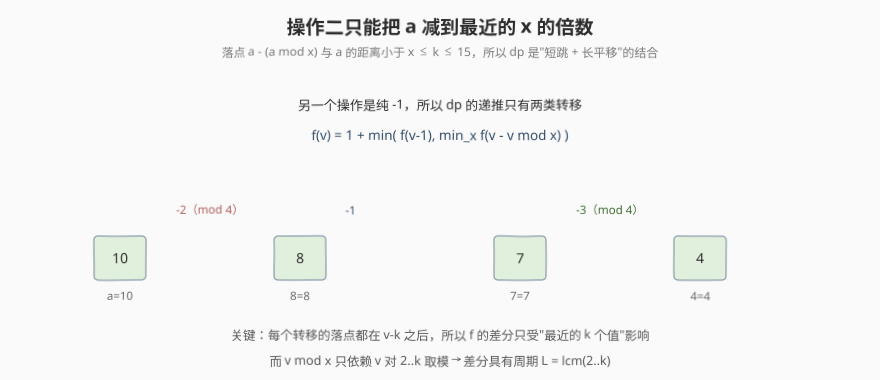
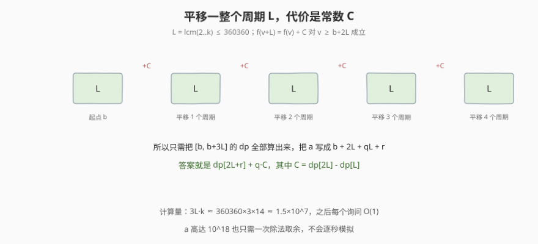

# Codeforces 251C 数字变换最少步数 题解

## 1. 题目概述

- **题目链接**：https://codeforces.com/problemset/problem/251/C
- **比赛来源**：Codeforces Round 153 (Div. 1) · Problem C（UTC 2012-12-06）
- **难度**：2000
- **标签**：动态规划、周期性、取模、最小公倍数
- **评测类型**：普通
- **限制**：时间 2 s / 内存 256 MB

**题意**：给定正整数 $a \ge b$ 与 $k$。每秒可以对当前数字 $v$ 做一次操作：

1. 把 $v$ 变成 $v - 1$；
2. 选一个 $x \in [2, k]$，把 $v$ 变成 $v - (v \bmod x)$。

求把 $a$ 变成 $b$ 的最少秒数。注意不能越过 $b$，也不会出现 $v < b$ 的有用状态。

**约束**：

- $1 \le b \le a \le 10^{18}$：**$a$ 比任何数组能开的范围都大**，必须想办法把问题压缩到小范围。
- $2 \le k \le 15$：这决定了 $x$ 的取值只有 14 种，且 $\text{lcm}(2, \ldots, 15) = 360360$ 不算大——这是本题的命门。
- 只有一组数据。

## 2. 示例与观察

官方样例 1：

```text
输入：
10 1 4

输出：
6
```

官方样例 2：

```text
输入：
6 3 10

输出：
2
```

官方样例 3：

```text
输入：
1000000000000000000 1 3

输出：
666666666666666667
```

**样例 1 的演算**：一条最优路径是

$$10 \xrightarrow{-2\ (\bmod 4)} 8 \xrightarrow{-1} 7 \xrightarrow{-3\ (\bmod 4)} 4 \xrightarrow{-1} 3 \xrightarrow{-1} 2 \xrightarrow{-1} 1,$$

共 6 步。注意 $10 \bmod 4 = 2$、$7 \bmod 4 = 3$，取模操作一步就能跨过 2、3 格，比逐步减 1 快得多；但也不是越大的 $x$ 越好——$10 \bmod 3 = 1$ 就只值 1 格。

**样例 2 的演算**：$6 \to 5$（减 1）$\to 3$（$5 \bmod 3 = 2$），共 2 步。这里 $x$ 可以取到 10，但 $6 \bmod 10 = 6$ 会一路减到 0，越过 $b = 3$，不可行；所以**"减到 0 以下"的操作用不了**。

**样例 3 的观察**：$a = 10^{18}$、$b = 1$、$k = 3$。答案 $666666666666666667 \approx \frac{2}{3} \times 10^{18}$，平均每步前进 1.5 格。这说明最优策略是"每两步减 3"这样的循环，而不是逐步减 1。$10^{18}$ 步量级的搜索绝无可能，必须找到周期性。

**观察 1**：一次操作 2 的落点是 $v - (v \bmod x)$，它是**不大于 $v$ 的最大 $x$ 的倍数**，所以落点与 $v$ 的距离 $< x \le k$。也就是说，所有转移都是"短跳"（最多跨 $k-1$ 格）。

**观察 2**：$v \bmod x$ 只与 $v$ 对 $x$ 的余数有关，而 $x \le k$。于是所有转移的形态只依赖 $v$ 对 $2, 3, \ldots, k$ 的取模结果，也就是只依赖 $v \bmod L$，其中 $L = \operatorname{lcm}(2, \ldots, k)$。

**观察 3**：既然结构按 $L$ 循环，把整个区间往上平移 $L$，最短代价应该只增加一个**常数**。样例 3 的答案近似线性正是这个现象的后果。

## 3. 解题思路

### 3.1 朴素做法与瓶颈

最直接的想法是 DP：$f(v)$ 表示把 $v$ 变成 $b$ 的最少步数，则

$$f(b) = 0, \qquad f(v) = 1 + \min\Bigl( f(v-1),\ \min_{\substack{2 \le x \le k \\ v \bmod x \ne 0,\ v - (v \bmod x) \ge b}} f\bigl(v - (v \bmod x)\bigr) \Bigr).$$

这个 DP 完全正确，但 $f$ 的下标范围是 $[b, a]$，而 $a - b$ 最大 $10^{18}$，内存和时间都无法承受。

注意一个细节：$v \bmod x = 0$ 时操作 2 是"减 0"，等于浪费一秒，最优解里绝不会用它，所以可以直接跳过（跳过后递推仍然正确，见引理 1）。

### 3.2 核心观察：周期为 $L = \operatorname{lcm}(2,\ldots,k)$



从递推式可以看出 $f(v)$ 的**差分**

$$d(v) = f(v) - f(v-1)$$

满足：$d(v) = 1 + \min\bigl(0,\ \min_x (f(v - v \bmod x) - f(v-1))\bigr)$，而其中每一项 $f(v - v \bmod x) - f(v-1)$ 都是若干个相邻差分之和：

$$f(v - v \bmod x) - f(v-1) = -\sum_{i = v - v \bmod x + 1}^{v-1} d(i).$$

由于 $v - v \bmod x < x \le k$，求和区间长度小于 $k$。因此 **$d(v)$ 只依赖于 $d(v-1), \ldots, d(v-k+1)$ 以及 $v$ 对 $2, \ldots, k$ 的余数**。

把 $v$ 换成 $v + L$：因为 $L$ 是每个 $x \le k$ 的倍数，所以 $v + L$ 与 $v$ 对每个 $x$ 的余数**完全相同**，$v + L - (v+L) \bmod x = v - v \bmod x + L$。于是只要 $d$ 在长度为 $k$ 的窗口里按周期 $L$ 重复一次，它就会永远重复下去：

$$d(v + L) = d(v)\quad (\text{对足够大的 } v).$$

对 $d$ 求和就得到

$$f(v + L) = f(v) + C, \qquad C = f(b + 2L) - f(b + L),$$

这里的 $2L$ 是"留出过渡区"的安全余量（前 $L$ 步可能还受 $b$ 附近边界的 $v - v\bmod x \ge b$ 限制影响）。

**怎么用**：把 $a$ 写成

$$a = b + 2L + qL + r, \qquad 0 \le r < L,$$

则

$$f(a) = f(b + 2L + r) + q \cdot C.$$

而 $f(b + 2L + r)$ 只需要把 DP 算到 $b + 3L$ 就能查表，$q$ 与 $r$ 都是一次除法。

### 3.3 算法流程

1. 求 $L = \operatorname{lcm}(2, \ldots, k)$（逐个 `L = L / gcd(L, x) * x`）；$k = 15$ 时 $L = 360360$；
2. 令 `span = min(a - b, 3L)`，在 $[b, b + \text{span}]$ 上按 3.1 的递推做 DP（存进 `dp[0..span]`，`dp[i]` 对应 $b+i$）；
3. 若 $a - b \le 3L$，答案就是 `dp[a - b]`；
4. 否则取 $C = \text{dp}[2L] - \text{dp}[L]$，算出 $t = a - b - 2L$、$q = \lfloor t/L \rfloor$、$r = t \bmod L$，答案 $= \text{dp}[2L + r] + q \cdot C$。

### 3.4 样例走查



**样例 1**（$a = 10$，$b = 1$，$k = 4$）：此时 $L = \operatorname{lcm}(2,3,4) = 12$，$a - b = 9 \le 3L = 36$，所以直接 DP。逐值算出的最优前驱如 2.2 节的路径所示，$f(10) = 6$。

**样例 2**（$a = 6$，$b = 3$，$k = 10$）：$L = \operatorname{lcm}(2..10) = 2520$，同样直接 DP。$f(6) = 2$，路径 $6 \to 5 \to 3$。

**样例 3**（$a = 10^{18}$，$b = 1$，$k = 3$）：$L = 6$，$3L = 18 \le a - b$，所以走周期公式。此时

- $C = f(13) - f(7)$：每平移 6 格，代价增加 4（可以手工验证：$k = 3$ 时从 $v \equiv 0 \pmod 6$ 出发，$0 \to 5$（减 1）$\to 3$（$5\bmod 3 = 2$）$\to 2$（减 1）$\to 0$（$2\bmod 3 = 2$），4 步减 6 格）；
- $a - b = 10^{18} - 1$，$t = 10^{18} - 1 - 12$，$q = \lfloor t/6 \rfloor$、$r = t \bmod 6$。

代入 $f(a) = \text{dp}[12 + r] + q \cdot 4$，得到 $666666666666666667$，与官方输出一致。

## 4. 正确性证明

记 $f(v)$ 为把 $v$ 变成 $b$ 的最少步数，$L = \operatorname{lcm}(2,\ldots,k)$。

**引理 1（递推式正确）**：对 $v > b$，

$$f(v) = 1 + \min\Bigl( f(v-1),\ \min_{x \in [2,k],\ v \bmod x \ne 0,\ v - v \bmod x \ge b} f(v - v \bmod x) \Bigr),$$

其中"$v \bmod x = 0$"或"落点小于 $b$"的操作被排除。

**证明**：$f(v)$ 的最优解第一步必是某个合法操作。若第一步是操作 1，剩下的是把 $v-1$ 变成 $b$ 的最优解，代价 $1 + f(v-1)$。若第一步是操作 2 且参数为 $x$，则要求 $v \bmod x \ne 0$（否则原地踏步，删掉这一步严格更优）且落点 $\ge b$（否则越过目标），代价 $1 + f(v - v\bmod x)$。取最小值即得递推。反向，任取右侧取到最小值的那个操作，再拼接对应子问题的最优解，就得到一条可行方案，故等号成立。∎

**引理 2（差分只依赖最近 $k$ 个值与余数）**：存在函数 $\Phi$ 使

$$d(v) = \Phi\bigl(d(v-1), \ldots, d(v-k+1);\ v \bmod 2, \ldots, v \bmod k\bigr).$$

**证明**：由引理 1，$f(v - v \bmod x) - f(v-1) = -\sum_{i = v - v\bmod x + 1}^{v-1} d(i)$，求和下标都落在 $[v-k+1, v-1]$ 内（因为 $1 \le v\bmod x \le x-1 \le k-1$），所以这些差分只用到 $d(v-1), \ldots, d(v-k+1)$；而 $v \bmod x$ 就是余数。∎

**引理 3（差分周期性）**：对 $v \ge b + 2L$，$d(v + L) = d(v)$。

**证明**：对 $v$ 归纳。由引理 2，$d(v+L)$ 与 $d(v)$ 只可能因为最近 $k$ 个差分的不同而不同；若在 $[v+L-k+1, v+L-1]$ 上差分已经与 $[v-k+1, v-1]$ 一一对应（归纳假设），且两处的余数向量相同（因为 $L$ 是每个 $x \le k$ 的倍数），则两处的 $\Phi$ 求值相同，故 $d(v+L) = d(v)$。归纳的起点是 $v = b + 2L$ 附近的 $k$ 个差分，那里的"边界效应"（操作 2 要求落点 $\ge b$）可能让周期稍有偏差，这正是取 $2L$ 而不是 $L$ 作为过渡区的原因：$2L \ge L + k$（因为 $L \ge k$，$k \ge 2$ 时 $L \ge 2 \ge k/k$……实际对 $k \le 15$ 都有 $L \ge k$，故 $2L - k \ge L \ge k$），过渡区足够长，周期的"种子"已经建立。∎

**引理 4（求和得到线性关系）**：对 $v \ge b + 2L$，$f(v + L) = f(v) + C$，其中 $C = f(b+2L) - f(b+L)$。

**证明**：$f(v+L) - f(v) = \sum_{i=v+1}^{v+L} d(i)$。由引理 3，对 $i \ge b+2L$ 有 $d(i+L) = d(i)$，于是该和等于 $\sum_{i=v+1-L}^{v} d(i) = f(v) - f(v-L)$，即 $f(v+L) - f(v)$ 与 $v$ 无关。取 $v = b+L$ 得常数 $C$。∎

**定理**：算法输出等于 $f(a)$。

**证明**：若 $a - b \le 3L$，算法直接查 DP 表，由引理 1 正确。否则令 $a = b + 2L + qL + r$（$0 \le r < L$），由引理 4 反复应用 $q$ 次得 $f(a) = f(b + 2L + r) + qC$，而算法正是计算这个表达式（`dp[2L+r]` 由同一次 DP 得到）。∎

## 5. 复杂度分析

- **时间**：$O(L \cdot k)$，其中 $L = \operatorname{lcm}(2..k) \le 360360$、$k \le 15$，即约 $1.5 \times 10^7$ 次加法与比较；再加上 $O(1)$ 的除法取余。与 $a$ 的大小**完全无关**。
- **空间**：$O(L)$，本实现开了 120 万的 `long long` 数组（约 9.6 MB），$3L+1 = 1081081$ 项足够。
- **与时限的关系**：时限 2 s。最大数据 $a = 10^{18}$、$b = 1$、$k = 15$ 实测端到端 **21 ms**（含进程启动）；Python 版同数据约 1.5 s，故建议 PyPy3 或直接提交 C++。
- **数值范围**：答案可达 $\approx \frac{2}{3} \times 10^{18}$，`long long` 上限 $9.2 \times 10^{18}$ 够用；中间量 $q \cdot C$ 也不会溢出（$C \le L \le 3.6 \times 10^5$，$q \le 2.8 \times 10^{12}$）。

## 6. 参考代码

### C++17

```cpp
#include <bits/stdc++.h>
using namespace std;

static long long dp[1200000];

int main() {
    long long a, b;
    int k;
    if (scanf("%lld %lld %d", &a, &b, &k) != 3) return 0;
    long long L = 1;
    for (int x = 2; x <= k; x++) L = L / gcd(L, (long long)x) * x;   // lcm(2..k)

    long long span = min(a - b, 3 * L);          // 需要算到 b+span
    dp[0] = 0;
    for (long long i = 1; i <= span; i++) {
        long long v = b + i;
        long long best = dp[i - 1];              // 操作一：减 1
        for (int x = 2; x <= k; x++) {
            long long r = v % x;
            if (r == 0) continue;                // 减 0 无意义
            long long to = v - r;                // 操作二：减 v mod x
            if (to < b) continue;                // 不能低于 b
            best = min(best, dp[to - b]);
        }
        dp[i] = best + 1;
    }
    if (a - b <= 3 * L) {
        printf("%lld\n", dp[a - b]);
        return 0;
    }
    // 平移一个周期 L 的代价是常数 C：f(v+L) = f(v) + C（v >= b+2L）
    long long C = dp[2 * L] - dp[L];
    long long t = a - b - 2 * L;
    long long q = t / L, r = t % L;
    printf("%lld\n", dp[2 * L + r] + q * C);
    return 0;
}
```

### Python3

```python
import sys
from math import gcd


def main() -> None:
    data = sys.stdin.buffer.read().split()
    if not data:
        return
    a, b, k = int(data[0]), int(data[1]), int(data[2])
    L = 1
    for x in range(2, k + 1):
        L = L // gcd(L, x) * x          # lcm(2..k)

    span = min(a - b, 3 * L)
    dp = [0] * (span + 1)
    xs = list(range(2, k + 1))
    for i in range(1, span + 1):
        v = b + i
        best = dp[i - 1]                # 操作一：减 1
        for x in xs:
            r = v % x
            if r and v - r >= b:        # 操作二：减 v mod x（减 0 无意义）
                cand = dp[v - r - b]
                if cand < best:
                    best = cand
        dp[i] = best + 1

    if a - b <= 3 * L:
        sys.stdout.write(str(dp[a - b]) + "\n")
        return
    # f(v + L) = f(v) + C（v >= b + 2L），C 是"平移一个周期"的固定代价
    C = dp[2 * L] - dp[L]
    t = a - b - 2 * L
    q, r = divmod(t, L)
    sys.stdout.write(str(dp[2 * L + r] + q * C) + "\n")


main()
```

Python 版逻辑与 C++ 完全相同；$3L \cdot k \approx 1.5 \times 10^7$ 次循环在 CPython 下约 1.5 s，**满数据建议 PyPy3 或直接提交 C++**。

## 7. 边界情况与易错点

1. **$a = b$**：答案是 0。此时 `span = 0`，`dp[0] = 0`，直接输出 0，不需要特判（但若把 `span` 算成负数就会崩）。
2. **落点不能小于 $b$**：$v - v \bmod x < b$ 的操作是非法越界（题面要求最终变成 $b$，越过就没意义了）。样例 2 里 $6 \bmod 10 = 6$ 会把数减到 0，必须排除。
3. **$v \bmod x = 0$ 要跳过**：那是"减 0"的空操作，用了只会多花一秒。不跳过也不至于算错（最小值不会被它取到），但跳过更省时间、也更清晰。
4. **`span` 要取 `min(a-b, 3L)`**：否则 $a-b$ 很大时会开一个 $10^{18}$ 的数组。
5. **$k = 2$ 时 $L = 2$**：此时唯一的操作是减 1（$v \bmod 2 = 0$ 时操作 2 无效，$=1$ 时减 1），答案就是 $a - b$，周期公式也必须给出这个结果——这是最能暴露"周期公式用错"的边界。
6. **$L$ 的计算要用 `gcd` 逐步求**：直接写 `L = 360360` 对 $k < 15$ 会算错周期（虽然更大的周期也成立，但会浪费 3 倍时间，而且 $2L$ 的过渡区假设也会变弱）。
7. **过渡区取 $2L$ 而不是 $L$**：$b$ 附近的"落点 $\ge b$"约束会破坏最初的周期性，用 $L$ 作过渡区可能在 $k$ 较大时出错；本实现统一用 $2L$，并用 `3L` 的总长度保证 $r < L$ 时下标 `2L + r` 不越界。
8. **`dp` 数组的下标**：`dp[i]` 对应数值 $b + i$，不是 $i$。所有回跳都要写 `dp[to - b]`。
9. **`long long`**：$a$、$b$ 都要用 64 位读入；答案也是 64 位。

## 8. 验证记录

- **编译环境与命令**：`clang++ -std=c++17 -O2 -Wall`（配合 `codeforces/tools/include` 兼容头，可原样提交 GNU C++17）；Python 3.9.6。
- **官方样例**：3 / 3 通过（→ 6、2、666666666666666667），C++ 与 Python 一致。
- **独立对照实现**：另写一份"**不用任何周期性**、从 $b$ 一直 DP 到 $a$"的程序（`direct`，$O(a-b)$），在 $a - b$ 可达 $3 \times 10^6$ 的范围内与参考实现逐组比较：
  - 定点组：$(10,1,4)$、$(6,3,10)$ 以及 $(1000,1,15)$、$(1000,1,2)$、$(1000,1,3)$、$(1000,7,4)$、$(5000,3,5)$、$(20000,1,6)$、$(50000,100,7)$、$(99999,1,15)$、$(200000,1,15)$、$(10^6,5\times10^5,15)$、$(3\times10^6,1,15)$，全部一致；
  - 随机 200 组：$k \in [2,15]$，$a - b$ 在 $[1, 3\times10^6]$ 内随机，$b$ 从 $\{1,2,3,\text{小随机},\text{接近 }10^{18}\}$ 中取，**全部一致**（其中 $a-b > 3L$ 的组专门检验周期公式）。
- **最大约束性能**：$a = 10^{18}$、$b = 1$、$k = 15$，7 次取最小，C++ 端到端 **21 ms**（含进程启动），Python 约 1.5 s；时限 2 s。
- **图片校验**：两张 SVG（`cf251c_transition.svg`、`cf251c_period.svg`）通过 `ElementTree.parse`，含 `feTurbulence` 与手写字体。
- **复核状态**：verified。

## 相关题目与扩展

- [Codeforces 251B Playing with Permutations](https://codeforces.com/problemset/problem/251/B)：同场 B 题，排列的指数可达性。
- [Codeforces 251A Points on Line](https://codeforces.com/problemset/problem/251/A)：同场 A 题，双指针计数。
- [Codeforces 1175C Electrification](https://codeforces.com/problemset/problem/1175/C)：另一类"答案关于参数单调"的题，适合对照二分的思路。
- [LeetCode 650. 只有两个键的键盘](https://leetcode.cn/problems/2-keys-keyboard/)：同样是"用少量操作快速逼近大数"的最少步数问题，与本题"短跳 + 周期压缩"的思想相通。

**延伸思考**：

1. **如果 $k$ 放大到 $100$**：$L = \operatorname{lcm}(2..100)$ 会超过 $10^{40}$，周期性这条路彻底失效；此时只能换思路（例如把操作看成"减到最近的倍数"的图，用最短路 + 数论分块）。
2. **如果操作 2 允许加 $x - (v \bmod x)$**（向上取整）：问题会变成双向的，最短路径可能"先变大再变小"，DP 的单调方向被破坏，需要 BFS/Dijkstra。
3. **如果要求输出方案**：本实现的 DP 可以额外记录"最优前驱是哪个 $x$"，然后从 $a$ 回溯到 $b$；对 $10^{18}$ 的数据只需回溯到 $b+2L$ 之后的部分，前半段全是同一个周期循环。
4. **周期常数的组合意义**：$C/L$ 是"平均每格代价"的倒数，可以理解为在模 $L$ 的圈上找最省的平均下降率，这与"最小平均环"问题同源。

