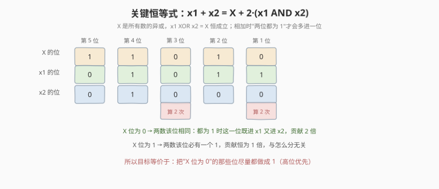
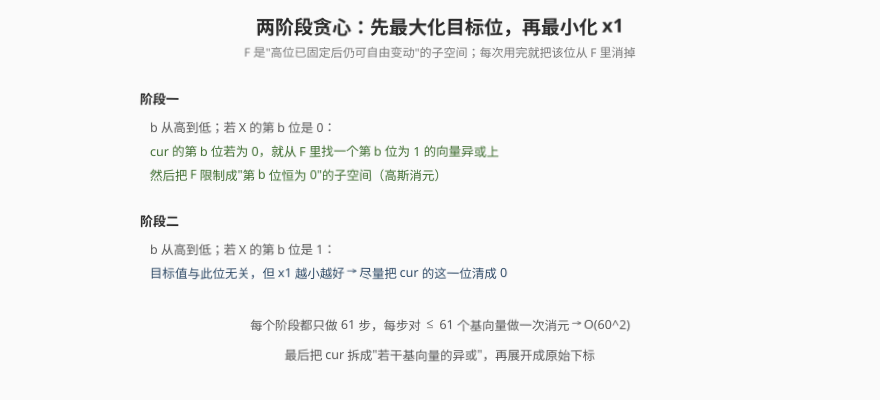

# Codeforces 251D 分成两个集合 题解

## 1. 题目概述

- **题目链接**：https://codeforces.com/problemset/problem/251/D
- **比赛来源**：Codeforces Round 153 (Div. 1) · Problem D（UTC 2012-12-06）
- **难度**：2700
- **标签**：线性基、按位贪心、构造
- **评测类型**：多解（输出任意最优划分）
- **限制**：时间 2 s / 内存 256 MB

**题意**：给出 $n$ 个非负整数。把它们划分成两个集合（可以有一个为空，也可以都为空以外任意分配）。记 $x_1$ 为留给自己的那些数的异或、$x_2$ 为给出去的数的异或，要求：

1. 先让 $x_1 + x_2$ 尽量**大**；
2. 在满足第一条的前提下，让 $x_1$ 尽量**小**。

输出 $n$ 个整数，第 $i$ 个为 `1` 表示第 $i$ 个数留给自己，`2` 表示给出去。

**约束**：

- $n \le 10^5$：划分方案有 $2^n$ 种，绝不能枚举。
- 每个数 $\le 10^{18} < 2^{60}$：只用得到 60 个二进制位，**位运算 + 线性基**是自然选择；和 $x_1 + x_2$ 不超过 $2^{61}$，`unsigned long long` / `long long` 都装得下。
- 只有一组数据。

## 2. 示例与观察

官方样例 1：

```text
输入：
6
1 2 3 4 5 6

输出：
2 2 2 2 2 2
```

官方样例 2：

```text
输入：
3
1000000000000 1000000000000 1000000000000

输出：
2 2 2
```

官方样例 3：

```text
输入：
8
1 1 2 2 3 3 4 4

输出：
1 2 1 2 2 2 1 2
```

**样例 1 的演算**：全部异或 $X = 1\oplus2\oplus3\oplus4\oplus5\oplus6 = 7$。输出把全部数给了 Masha，于是 $x_1 = 0$、$x_2 = 7$，和为 7。有没有更好的划分？只要 $x_1 \ne 0$，由于 $x_1 \oplus x_2 = X = 7$（这一点见下方恒等式）且 $X$ 的三个有效位全为 1，任何非零的 $x_1$ 都至少要"抢"走一位，和不会变大。因此最大值就是 7，而 $x_1$ 最小取 0。

**样例 2 的演算**：三个 $10^{12}$。$X = 10^{12}$。可选 $x_1 \in \{0, 10^{12}\}$（两种划分的异或），和都是 $10^{12}$；取 $x_1 = 0$（全给出去），符合"最小化 $x_1$"。

**样例 3 的演算**：$1,1,2,2,3,3,4,4$ 每个数出现两次，所以 $X = 0$。于是 $x_1 = x_2$，和 $= 2x_1$，要最大化和就是**最大化 $x_1$**。答案给出 $x_1 = 1 \oplus 2 \oplus 4 = 7$（下标 1、3、7 的数），和 $= 14$，已经是全部数能异或出的最大值。

**观察 1（关键恒等式）**：无论怎么划分，都有 $x_1 \oplus x_2 = X$，其中 $X$ 是**所有**数的异或。因为 $x_1 \oplus x_2$ 恰好把每个数算了一次。

**观察 2（和的分解）**：设 $X$ 的第 $b$ 位为 1 时 $x_1, x_2$ 在该位必有一个是 1（异或为 1），贡献 $2^b$，与划分无关；第 $b$ 位为 0 时两者相同，若都为 1 则这一位在和中贡献 $2 \cdot 2^b$。于是

$$x_1 + x_2 = X + 2 \cdot (x_1 \mathbin{\&} x_2) = X + 2 \cdot \bigl(x_1 \mathbin{\&} \sim X\bigr).$$

**观察 3（目标的等价形式）**：$X$ 是常数，所以"最大化 $x_1 + x_2$"等价于"最大化 $x_1 \mathbin{\&} \sim X$"这个整数——也就是在 $X$ 为 0 的那些位上，尽量让 $x_1$（从而 $x_2$）取 1，且**高位优先**。

## 3. 解题思路

### 3.1 朴素做法与瓶颈

$2^n$ 种划分不可行。更细一点看：$x_1$ 可以取到的值恰好是"所有子集的异或"，构成一个 $\mathbb{F}_2$ 上的**线性空间** $V$（由 $a_1,\ldots,a_n$ 张成）。所以问题变成：

> 在线性空间 $V$ 中找一个 $x_1$，先使整数 $x_1 \mathbin{\&} \sim X$ 最大，再使 $x_1$ 最小；最后把这个 $x_1$ 还原成一个具体子集。

$|V|$ 可能有 $2^{60}$ 那么大，不能枚举，但可以用**线性基**在 $O(60^2)$ 内完成按位贪心。

### 3.2 核心观察：按位贪心 + 线性基



按位贪心的框架是标准的：从最高位往下，能取 1 就取 1。麻烦在于 $V$ 是"整体"给出的，必须能在每一步回答：

> 在"高位已经按最优方式固定"的前提下，第 $b$ 位还能不能取到 1？

为此维护两个东西：

- `cur`：当前已经确定的一个 $x_1$ 候选（属于 $V$）；
- `F`：一个向量组，张成"在当前所有已固定的高位都保持不变的前提下，$x_1$ 还能怎么变"的**子空间**。

初始 `cur = 0`、`F = 线性基`（张成整个 $V$）。处理第 $b$ 位时：

1. 若 $X$ 的第 $b$ 位为 0（这是目标位）：希望 `cur` 的第 $b$ 位是 1。
   - 若它已经是 1，什么都不做；
   - 否则，若 $F$ 中存在某个向量在第 $b$ 位为 1，就把它异或进 `cur`（这样第 $b$ 位变 1）；
   - 若 $F$ 中所有向量第 $b$ 位都是 0，说明这一位已经无法改变，只能取 0（这种情况就是"被迫放弃"）。
2. 然后把 $F$ 限制为"第 $b$ 位恒为 0"的子空间——因为这一位已经定死，后续的变化不能再去动它。做法是一次高斯消元：取 $F$ 中一个第 $b$ 位为 1 的向量 $f$，把所有其它第 $b$ 位为 1 的向量都异或上 $f$，再把 $f$ 从 $F$ 里删掉。
3. 若 $X$ 的第 $b$ 位为 1：这一位对目标值没有影响，先按下面的第二阶段处理。

**第二阶段（最小化 $x_1$）**：再从头扫一遍所有"$X$ 的第 $b$ 位为 1"的位置。这些位不影响目标值，但会影响 $x_1$ 的大小。按高位优先、尽量把 `cur` 的这一位清成 0：若它现在是 1 且 $F$ 中有向量在这一位为 1，就异或掉；然后把这一位也从 $F$ 中消去。

两个阶段都是"高位优先"的，正好对应"整数比较从高位开始"的字典序。

### 3.3 算法流程



1. 读入数组，算出 $X$（全部异或）；
2. 用所有 $a_i$ 建线性基，并化成 **RREF**（每个主元位在其它基向量中都是 0）；每个基向量同时记录"它由哪些原始下标异或而来"（用一棵带共享的证明树，见下）；
3. 令 `F = 基向量列表`、`cur = 0`；
4. 阶段一：$b$ 从 60 到 0，若 $X_b = 0$，按 3.2 的规则调整 `cur`，然后 `restrict(b)`；
5. 阶段二：$b$ 从 60 到 0，若 $X_b = 1$，按 3.2 的规则调整 `cur`，然后 `restrict(b)`；
6. 把 `cur` 拆成基向量的异或（RREF 下，`cur` 的每个主元位为 1 就对应一个基向量），再展开成原始下标集合；
7. 输出：集合内的下标输出 `1`，其余输出 `2`。

**证明树的实现**：线性基的每个向量是若干原始 $a_i$ 的异或。如果每次异或都去合并下标集合，最坏代价是 $O(n \cdot 60 \cdot 60)$，实测约 780 ms（偏慢）。改成"每个基向量记一个证明树节点、异或两个向量就新建一个父节点指向它们"，合并变成 $O(1)$，最后只需对 $\le 61$ 棵子树做一次展开（节点数不超过 $O(60^2)$），实测降到 35 ms。

### 3.4 样例走查

**样例 3**（$1,1,2,2,3,3,4,4$，$X = 0$）：$X$ 的每一位都是 0，所以阶段一只做"把目标位取 1"，阶段二无事可做。

- $b = 2$：$F$ 里能凑出第 2 位吗？能（用 4）。`cur` 变成 4，随后把第 2 位从 $F$ 中消掉。
- $b = 1$：此时 $F$ 里只剩下第 1 位及以下的向量，用 2 → `cur = 4 xor 2 = 6`，再把第 1 位消掉。
- $b = 0$：用 1 → `cur = 7`。

最终 $x_1 = 7$（即 $1 \oplus 2 \oplus 4$），与官方输出的 `1 2 1 2 2 2 1 2` 一致（下标 1、3、7）。$x_2 = X \oplus x_1 = 7$，和 $= 14$。

**样例 1**（$X = 7$）：$X$ 的低三位都是 1，没有"目标位"可抢（更高位全是 0，而所有数都 < 8，$V$ 在高位没有分量），所以阶段一什么都不做，`cur = 0`；阶段二对这三位都想清 0，但 `cur` 本来就是 0，于是 $x_1 = 0$，输出全 `2` ✓。

## 4. 正确性证明

记 $V = \operatorname{span}_{\mathbb{F}_2}\{a_1, \ldots, a_n\}$，$X = a_1 \oplus \cdots \oplus a_n$。

**引理 1（恒等式）**：对任意划分，$x_1 \oplus x_2 = X$，并且 $x_1 + x_2 = X + 2(x_1 \mathbin{\&} \sim X)$。

**证明**：$x_1 \oplus x_2$ 等于所有数各出现一次的异或，即 $X$。又 $x_1 + x_2 = (x_1 \oplus x_2) + 2(x_1 \& x_2) = X + 2(x_1 \& x_2)$（加法与异或的经典关系）。最后 $x_1 \& x_2 = x_1 \& (x_1 \oplus X) = x_1 \& \sim X$（因为 $x_1 \& \sim x_1 = 0$）。∎

**引理 2（可达集合）**：$\{x_1 : \text{某种划分}\} = V$；且对任意 $x_1 \in V$，令 $x_2 = X \oplus x_1$ 都能由某种划分实现（把产生 $x_1$ 的那个子集留给 Petya，其余给 Masha）。

**证明**："各子集异或"全体正是生成子空间 $V$；反之给定 $x_1 \in V$ 取对应的子集即可。∎

**引理 3（阶段一的最优性）**：阶段一结束时，`cur` 在所有 $x \in V$ 中使 $x \mathbin{\&} \sim X$ 最大。

**证明**：对处理的位数归纳证明两个不变式：(a) `cur` 与所有的 $x \in V$ 在已固定位上一致（即已固定位的取值就是最优值）；(b) `F` 恰好张成 $\{u \in V : u \text{ 在所有已固定位上为 } 0\}$。

初始时没有固定位，`F` 张成 $V$ ✓。处理第 $b$ 位（$X_b = 0$）时：若 `cur` 的第 $b$ 位已是 1，则所有 $x \in V$ 在已固定位（含 $b$）上的取值与 `cur` 相同，最优性保持；若为 0，则问"能否让第 $b$ 位为 1"——由不变式 (b)，可改变的量正是 $F$，而第 $b$ 位能否翻到 1 当且仅当 $F$ 中存在第 $b$ 位为 1 的向量（因为 $\{u_b : u \in F\}$ 是 $\mathbb{F}_2$ 的子空间，非零即整个 $\mathbb{F}_2$）。若存在，异或之即得最优；若不存在，则所有 $x \in V$ 的第 $b$ 位都被高位固定住了，只能取 0。随后 `restrict(b)` 用高斯消元把 $F$ 换成"第 $b$ 位为 0"的子空间，保持不变式 (b)。最后由 (a)，`cur` 在所有固定位上取到字典序最大，即 $x \mathbin{\&}\sim X$ 最大。∎

**引理 4（阶段二的最优性）**：阶段二结束时，`cur` 在"使 $x \mathbin{\&} \sim X$ 最大"的所有 $x \in V$ 中最小。

**证明**：阶段一结束后，不变式 (a) 说明所有使目标最大的 $x$ 都与 `cur` 在"$X_b = 0$ 的位"上一致，而 $F$ 张成的正是"这些位全部为 0 的变动"，所以 $F$ 参数化地给出了全部最优解 $\{cur \oplus u : u \in F\}$。阶段二从高到低处理"$X_b = 1$"的位，尽量让当前位为 0——这与整数的字典序最小完全一致（高位优先），且每一步都用同样的"能否翻转"判据与 `restrict` 保持"剩余变动不动已定位"的不变式。故最终 $cur$ 是所有最优解中最小的。∎

**定理**：算法输出的划分使 $x_1 + x_2$ 最大、并在其中使 $x_1$ 最小。

**证明**：由引理 1，最大化 $x_1 + x_2$ 等价于最大化 $x_1 \mathbin{\&} \sim X$；由引理 3 阶段一达到该最大；由引理 4 阶段二在该最大值下最小化 $x_1$。最后由引理 2，输出的 $cur$ 确实由某个子集实现（算法把它还原成具体下标），因此输出合法。∎

## 5. 复杂度分析

- **时间**：建基 $O(n \cdot 60)$；化 RREF $O(60^2)$；两个阶段的贪心各 $O(60 \cdot 60)$（每步对 $\le 61$ 个向量做一次消元）；证明树展开 $O(60^2)$。总计 $O(60n)$，$n = 10^5$ 时约 $6 \times 10^6$ 次位运算。
- **空间**：$O(n)$ 存输入，证明树节点 $O(60^2)$，其余 $O(60)$。
- **与时限的关系**：时限 2 s。最大数据（$n = 10^5$、随机 60 位整数）实测端到端 **35 ms**（含进程启动）；Python 版约 420 ms。
- **数值范围**：所有值与 $x_1, x_2$ 都 $< 2^{60}$，和 $< 2^{61}$，64 位无符号整数足够；比较时不要用有符号的右移。

## 6. 参考代码

### C++17

```cpp
#include <bits/stdc++.h>
using namespace std;

typedef unsigned long long ull;

// 线性基（最终化成 RREF）：basis[p] 的最高位是 p，其它基向量的第 p 位为 0
static ull basisVec[64];
static bool hasPivot[64];
static int prov[64];            // 该基向量"由哪些原始下标异或而成"的证明树节点

// 证明树：leaf 存原始下标；internal 存若干孩子的异或
static vector<vector<int>> child;
static vector<int> leafIdx;

static int newLeaf(int i) {
    child.push_back({});
    leafIdx.push_back(i);
    return (int)child.size() - 1;
}
static int newInternal(vector<int> ch) {
    child.push_back(move(ch));
    leafIdx.push_back(-1);
    return (int)child.size() - 1;
}

int main() {
    int n;
    if (scanf("%d", &n) != 1) return 0;
    vector<ull> a(n);
    ull X = 0;
    for (int i = 0; i < n; i++) {
        scanf("%llu", &a[i]);
        X ^= a[i];
    }
    // 建基：只对"新开主元"的元素记录证明树，其余插入只记主元链
    for (int i = 0; i < n; i++) {
        ull v = a[i];
        int chain[64], m = 0;
        while (v) {
            int p = 63 - __builtin_clzll(v);
            if (!hasPivot[p]) {
                hasPivot[p] = true;
                basisVec[p] = v;
                vector<int> ch;
                ch.push_back(newLeaf(i));
                for (int t = 0; t < m; t++) ch.push_back(prov[chain[t]]);
                prov[p] = newInternal(move(ch));
                break;
            }
            v ^= basisVec[p];
            chain[m++] = p;
        }
    }
    // 化成 RREF
    for (int p = 63; p >= 0; p--) {
        if (!hasPivot[p]) continue;
        for (int q = 63; q >= 0; q--) {
            if (q == p || !hasPivot[q]) continue;
            if ((basisVec[q] >> p) & 1ULL) {
                basisVec[q] ^= basisVec[p];
                prov[q] = newInternal({prov[q], prov[p]});
            }
        }
    }
    // 自由度子空间 F（= 整个 V）
    vector<ull> F;
    for (int p = 63; p >= 0; p--) if (hasPivot[p]) F.push_back(basisVec[p]);
    auto restrict = [&](int b) {
        int id = -1;
        for (int i = 0; i < (int)F.size(); i++) if ((F[i] >> b) & 1ULL) { id = i; break; }
        if (id < 0) return;
        for (int i = 0; i < (int)F.size(); i++)
            if (i != id && ((F[i] >> b) & 1ULL)) F[i] ^= F[id];
        F.erase(F.begin() + id);
    };
    auto findWithBit = [&](int b) {
        for (int i = 0; i < (int)F.size(); i++) if ((F[i] >> b) & 1ULL) return i;
        return -1;
    };

    ull cur = 0;
    for (int b = 60; b >= 0; b--) {            // 阶段一：最大化 x1 & ~X
        if ((X >> b) & 1ULL) continue;
        if (((cur >> b) & 1ULL) == 0) {
            int id = findWithBit(b);
            if (id >= 0) cur ^= F[id];
        }
        restrict(b);
    }
    for (int b = 60; b >= 0; b--) {            // 阶段二：目标值不变时最小化 x1
        if (((X >> b) & 1ULL) == 0) continue;
        if ((cur >> b) & 1ULL) {
            int id = findWithBit(b);
            if (id >= 0) cur ^= F[id];
        }
        restrict(b);
    }
    // 把 cur 表示成若干证明树的异或，再展开成原始下标
    vector<int> picks;
    ull rest = cur;
    for (int p = 63; p >= 0; p--) {
        if (!hasPivot[p]) continue;
        if ((rest >> p) & 1ULL) {
            rest ^= basisVec[p];
            picks.push_back(prov[p]);
        }
    }
    vector<char> parity(child.size(), 0);
    for (int id : picks) parity[id] ^= 1;
    vector<char> mark(n, 0);
    for (int id = (int)child.size() - 1; id >= 0; id--) {
        if (!parity[id]) continue;
        if (leafIdx[id] >= 0) mark[leafIdx[id]] ^= 1;
        else for (int c : child[id]) parity[c] ^= 1;
    }
    for (int i = 0; i < n; i++) printf("%d%c", mark[i] ? 1 : 2, i + 1 == n ? '\n' : ' ');
    return 0;
}
```

### Python3

```python
import sys


def main() -> None:
    data = sys.stdin.buffer.read().split()
    if not data:
        return
    n = int(data[0])
    a = [int(x) for x in data[1:1 + n]]
    X = 0
    for v in a:
        X ^= v

    # 线性基：basis[p] 最高位为 p；prov[p] 记录它是哪些原始下标异或出来的（证明树节点）
    basis = [0] * 62
    has = [False] * 62
    prov = [0] * 62
    child = []          # 证明树：内部节点存孩子列表
    leaf = []           # 叶子节点存原始下标，内部节点存 -1

    def new_leaf(i):
        child.append(None)
        leaf.append(i)
        return len(child) - 1

    def new_internal(ch):
        child.append(ch)
        leaf.append(-1)
        return len(child) - 1

    for i in range(n):
        v = a[i]
        chain = []
        while v:
            p = v.bit_length() - 1
            if not has[p]:
                has[p] = True
                basis[p] = v
                ch = [new_leaf(i)]
                for q in chain:
                    ch.append(prov[q])
                prov[p] = new_internal(ch)
                break
            v ^= basis[p]
            chain.append(p)

    # 化成 RREF
    for p in range(61, -1, -1):
        if not has[p]:
            continue
        for q in range(61, -1, -1):
            if q == p or not has[q]:
                continue
            if (basis[q] >> p) & 1:
                basis[q] ^= basis[p]
                prov[q] = new_internal([prov[q], prov[p]])

    F = [basis[p] for p in range(61, -1, -1) if has[p]]

    def restrict(b):
        for i, f in enumerate(F):
            if (f >> b) & 1:
                fid = f
                for j, g in enumerate(F):
                    if j != i and ((g >> b) & 1):
                        F[j] ^= fid
                F.pop(i)
                return

    cur = 0
    for b in range(60, -1, -1):          # 阶段一：最大化 x1 & ~X
        if (X >> b) & 1:
            continue
        if not ((cur >> b) & 1):
            for f in F:
                if (f >> b) & 1:
                    cur ^= f
                    break
        restrict(b)
    for b in range(60, -1, -1):          # 阶段二：目标值不变时最小化 x1
        if not ((X >> b) & 1):
            continue
        if (cur >> b) & 1:
            for f in F:
                if (f >> b) & 1:
                    cur ^= f
                    break
        restrict(b)

    picks = []
    rest = cur
    for p in range(61, -1, -1):
        if not has[p]:
            continue
        if (rest >> p) & 1:
            rest ^= basis[p]
            picks.append(prov[p])

    parity = [0] * len(child)
    for idx in picks:
        parity[idx] ^= 1
    mark = [0] * n
    for idx in range(len(child) - 1, -1, -1):
        if not parity[idx]:
            continue
        if leaf[idx] >= 0:
            mark[leaf[idx]] ^= 1
        else:
            for c in child[idx]:
                parity[c] ^= 1
    sys.stdout.write(" ".join('1' if m else '2' for m in mark) + "\n")


main()
```

Python 版把"证明树"同样实现为数组式的父子结构，逻辑与 C++ 一一对应。

## 7. 边界情况与易错点

1. **允许空集**：把全部数给出去（$x_1 = 0$）或全部留下（$x_2 = 0$）都是合法划分。样例 1 的最优解就是"全给出去"，代码不需要特判。
2. **$X = 0$ 的特殊性**：此时 $x_1 = x_2$，目标变成"最大化 $x_1$"，然后"最小化 $x_1$"——但最大化之后已经没有自由度了，第二阶段什么都不做。样例 3 就是这种情形。
3. **位宽**：题面保证 $a_i \le 10^{18} < 2^{60}$，但第 60 位仍可能被异或出来吗？不会——所有数都 $< 2^{60}$，异或也 $< 2^{60}$。代码里循环到第 60 位是安全的余量；若写成 `1 << 60` 要注意类型（应为 `1ULL << 60`）。
4. **必须用无符号或 64 位**：`x & ~X` 中的 `~X` 若用有符号 `int` 会引入符号位的干扰；用 `unsigned long long` 最省心。
5. **RREF 是必需的**：如果只做普通的行阶梯基（每个向量只保证最高位是主元），在"还原 $cur$ 对应的基向量组合"时会算错，因为一个主元位可能在多个基向量里出现。
6. **证明树的展开顺序**：节点总是在孩子之后创建，所以按节点编号**从大到小**处理（父先于子把奇偶性下推）就能正确展开；顺序反了会漏掉或重复计入。
7. **同一节点被包含两次会抵消**：证明树的展开必须按"异或"语义累加奇偶性，不能简单地把所有叶子标 1。
8. **输出格式**：$n$ 个用空格分隔的 `1`/`2`，不能多不能少；下标顺序必须与输入一致。
9. **最小化阶段的判据**：只有"$X$ 该位为 1"的位才允许在阶段二调整；若在阶段二去动 $X$ 为 0 的位，会破坏第一阶段的最优性。

## 8. 验证记录

- **编译环境与命令**：`clang++ -std=c++17 -O2 -Wall`（配合 `codeforces/tools/include` 兼容头，可原样提交 GNU C++17）；Python 3.9.6。
- **官方样例**：3 / 3 通过（`2 2 2 2 2 2`、`2 2 2`、`1 2 1 2 2 2 1 2`，与官方输出逐字相同），C++ 与 Python 一致。
- **独立暴力对拍**：暴力版**枚举全部 $2^n$ 种划分**，对每种算出 $(x_1+x_2, x_1)$ 并按"和最大、$x_1$ 最小"取最优，同时把参考程序的输出解析成集合、真实计算 $(x_1, x_2)$ 后比较。共两组：
  - 400 组 $n \le 10$、值域 $\{0..1\},\{0..3\},\{0..7\},\{0..15\},\{0..63\}$；
  - 40 组 $n \in [12,18]$、12 位随机值（每组 $2^{18}$ 种划分）。
  **440 / 440 全部一致**；Python 版另跑 150 组小数据，同样全部一致。
- **最大约束性能**：$n = 10^5$、随机 60 位整数，7 次取最小，C++ 端到端 **35 ms**、Python 约 420 ms（均含进程启动），远低于 2 s。
- **图片校验**：两张 SVG（`cf251d_identity.svg`、`cf251d_greedy.svg`）通过 `ElementTree.parse`，含 `feTurbulence` 与手写字体。
- **复核状态**：verified。

## 相关题目与扩展

- [Codeforces 251C Number Transformation](https://codeforces.com/problemset/problem/251/C)：同场 C 题，周期性 DP。
- [Codeforces 251B Playing with Permutations](https://codeforces.com/problemset/problem/251/B)：同场 B 题，排列的指数可达性。
- [Codeforces 1101G (Zero XOR Subset)-less](https://codeforces.com/problemset/problem/1101/G)：线性基 + 子集异或，与本题的"子集异或空间"是同一个工具。
- [Codeforces 895C Square Subsets](https://codeforces.com/problemset/problem/895/C)：按位建线性基做计数，适合巩固线性基的用法。
- [LeetCode 1707. 与数组中元素的最大异或值](https://leetcode.cn/problems/maximum-xor-with-an-element-from-array/)：01-Trie/线性基求最大异或的经典变体。

**延伸思考**：

1. **如果要求"两个集合的大小尽量接近"**（在最优和的前提下）：第一阶段的最优解集合是一个仿射空间 $\{cur \oplus u : u \in F\}$，可以在 $F$ 上再做一次"子集异或的计数"DP 来数每种大小的方案数，复杂度 $O(60 \cdot n)$。
2. **如果要求输出所有最优划分的数量**：$\{cur \oplus u : u \in F\}$ 的大小是 $2^{\dim F}$，但不同 $x_1$ 可能对应同一个划分的子集，需要再除以核空间的大小；这是一个线性代数计数问题。
3. **如果目标改成"最大化 $x_1 \cdot x_2$"**：恒等式不再有用，问题会变成非线性的，一般没有多项式算法（等价于整数规划），这也说明本题的可解性完全依赖 $x_1 + x_2$ 的线性结构。
4. **如果数可以到 $10^{18}$ 位宽（超长整数）**：线性基要换成按字分块的位向量，复杂度乘以 $60/64$ 的常数因子，但算法框架不变。

