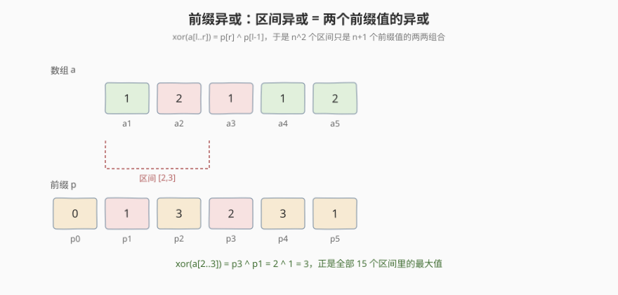
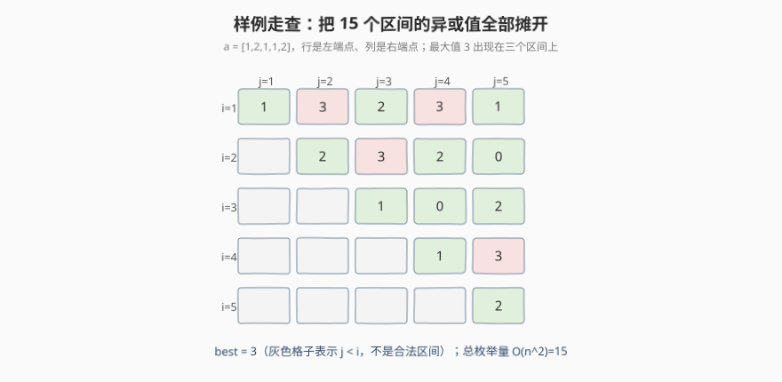

# Codeforces 252A 区间异或最大值 题解

## 1. 题目概述

- **题目链接**：https://codeforces.com/problemset/problem/252/A
- **比赛来源**：Codeforces Round 153 (Div. 2) · Problem A（UTC 2012-12-06）
- **难度**：1100
- **标签**：位运算、前缀异或、枚举
- **评测类型**：普通
- **限制**：时间 2 s / 内存 256 MB

**题意**：小 Petya 得到一个长度为 $n$ 的非负整数数组。他要在其中挑出一段**连续**的子段，使得这段里所有数的按位异或（C++ 里的 `^`）尽可能大，输出这个最大值。子段必须非空。

**约束**：

- $1 \le n \le 100$：区间总数只有 $\binom{100}{2} + 100 = 5050$，$O(n^2)$ 枚举完全够用；甚至带一层内层求异或的 $O(n^3) = 10^6$ 也能过，所以本题不考复杂度，考的是"想到前缀异或"。
- 每个数 $< 2^{30}$，因此任何区间的异或值也 $< 2^{30} < 2^{31}$，`int` 能装下；不过答案与前缀都写成 `long long` 也不会有任何代价。
- 输入只有**一组**数据：第一行 $n$，第二行 $n$ 个数。没有测试组数 $t$，也不是读到 EOF 的多组格式。

## 2. 示例与观察

官方样例 1：

```text
输入：
5
1 2 1 1 2

输出：
3
```

官方样例 2：

```text
输入：
3
1 2 7

输出：
7
```

官方样例 3：

```text
输入：
4
4 2 4 8

输出：
14
```

**样例 1 的演算**：数组是 $1,2,1,1,2$。整体异或 $1 \oplus 2 \oplus 1 \oplus 1 \oplus 2 = 1$，可见"取整段"并不最优；真正的最优段是 $a_2 \ldots a_3 = 2,1$，异或得 $2 \oplus 1 = 3$。另外 $a_1 \ldots a_4$ 与 $a_2 \ldots a_4$ 的异或也都是 3，所以最值被多个区间同时取到。

**样例 2**：$1 \oplus 2 \oplus 7 = 4$，但单取 $7$ 就是 7，取 $1 \ldots 2$ 得 3，所以答案是 7。这说明"更长的段"既不一定更大也不一定更小。

**样例 3**：$4,2,4,8$。全部异或 $4 \oplus 2 \oplus 4 \oplus 8 = 2 \oplus 8 = 10$；而 $a_2 \ldots a_4 = 2,4,8$ 的异或是 $2 \oplus 4 \oplus 8 = 14$，这才是最优。注意 $4 \oplus 2 \oplus 4 = 2$：两个相同的数异或会**互相抵消**，所以"在段里再塞一对相同的数"不改变异或值——这正是前缀异或能起作用的结构性原因。

**观察 1**：设 $p_i = a_1 \oplus a_2 \oplus \cdots \oplus a_i$（$p_0 = 0$），则任意区间 $[l, r]$ 的异或等于 $p_r \oplus p_{l-1}$。

**观察 2**：题目要的东西因此变成了"在 $n+1$ 个前缀值里挑一对下标 $l-1 < r$，使它们的异或最大"。注意必须保证 $l \le r$，即两个前缀值的下标不同且前者更小。

## 3. 解题思路

### 3.1 朴素做法与瓶颈

最直白的写法是三层循环：枚举左端点 $l$、右端点 $r$，再从头把 $a_l \ldots a_r$ 异或一遍。复杂度 $O(n^3)$，对 $n = 100$ 是 $1.7 \times 10^5$ 次运算量级（更准确地说是 $\sum_{l \le r}(r-l+1) \approx n^3/6$），其实直接就能过。

但这份朴素写法没有抓住问题的结构：如果 $n$ 放大到 $10^5$，它就彻底不可用了。所以我们希望把"区间异或"变成一个**常数时间**的查询，这样至少能降到 $O(n^2)$；至于本题的 $n \le 100$，$O(n^2)$ 已经是上限。

关键障碍在于：异或不满足"可减性"，$\text{xor}(l, r)$ 不能像普通前缀和那样用 $S_r - S_{l-1}$ 得到。但异或有一个同样好用的性质——**它自己就是自己的逆运算**。

### 3.2 核心观察：前缀异或



定义前缀异或

$$p_0 = 0, \qquad p_i = a_1 \oplus a_2 \oplus \cdots \oplus a_i .$$

那么

$$p_r \oplus p_{l-1} = (a_1 \oplus \cdots \oplus a_r) \oplus (a_1 \oplus \cdots \oplus a_{l-1}) = a_l \oplus \cdots \oplus a_r .$$

推导只用到两条性质：异或满足交换律、结合律，且 $x \oplus x = 0$。中间那段 $a_1 \ldots a_{l-1}$ 出现了两次，成对抵消，剩下的正好是 $a_l \ldots a_r$。

于是"枚举区间"变成"枚举一对前缀下标"：

$$\text{ans} = \max_{0 \le i < j \le n} \left( p_i \oplus p_j \right).$$

图里把 $a$ 与 $p$ 两排格子对齐画了出来，区间 $[2,3]$ 对应 $p_3 \oplus p_1 = 2 \oplus 1 = 3$。这样每个区间的值只需要一次异或就能读出。

### 3.3 算法流程

1. 读入 $n$ 与数组，边读边算 $p_i = p_{i-1} \oplus a_i$，存入 `pref[0..n]`；
2. `best = 0`；
3. 双重循环枚举 $0 \le i < j \le n$，用 `pref[i] ^ pref[j]` 更新 `best`；
4. 输出 `best`。

因为 $i < j$ 保证区间非空，$i = j$ 的情况（异或为 0 的空区间）被排除。全部非负数的异或也非负，所以 `best` 从 0 起步是安全的下界（空集异或按 0 计，即使所有区间都不如 0 也不会错——实际上不可能发生，因为单元素区间就 $\ge 0$）。

### 3.4 样例走查



对 $a = [1,2,1,1,2]$ 算出 $p = [0,1,3,2,3,1]$，再把所有 $i < j$ 的组合列成一张三角表（行是左端点，列是右端点）：

| 区间 | 异或 | 区间 | 异或 | 区间 | 异或 |
|------|------|------|------|------|------|
| $[1,1]$ | 1 | $[2,2]$ | 2 | $[3,3]$ | 1 |
| $[1,2]$ | 3 | $[2,3]$ | 3 | $[3,4]$ | 0 |
| $[1,3]$ | 2 | $[2,4]$ | 2 | $[3,5]$ | 2 |
| $[1,4]$ | 3 | $[2,5]$ | 0 | $[4,4]$ | 1 |
| $[1,5]$ | 1 |  |  | $[4,5]$ | 3 |
|  |  |  |  | $[5,5]$ | 2 |

最大值是 3，与官方输出一致。可以看到 3 出现了三次，说明最优解不唯一，但这道题只要输出数值，所以不影响。

## 4. 正确性证明

**引理 1**：对每个 $0 \le i \le n$，$p_i$ 就是 $a_1 \oplus \cdots \oplus a_i$（约定 $p_0 = 0$）。

**证明**：对 $i$ 归纳。$i = 0$ 时 $p_0 = 0$ 即空前缀的异或。若 $p_{i-1} = a_1 \oplus \cdots \oplus a_{i-1}$，按定义 $p_i = p_{i-1} \oplus a_i = a_1 \oplus \cdots \oplus a_i$。∎

**引理 2**：对任意 $1 \le l \le r \le n$，有 $a_l \oplus \cdots \oplus a_r = p_r \oplus p_{l-1}$。

**证明**：由引理 1，$p_r \oplus p_{l-1} = (a_1 \oplus \cdots \oplus a_r) \oplus (a_1 \oplus \cdots \oplus a_{l-1})$。利用结合律与交换律把相同项配对，每对 $a_k \oplus a_k = 0$，于是只剩 $a_l \oplus \cdots \oplus a_r$。∎

**引理 3**：对每个 $0 \le i < j \le n$，$p_i \oplus p_j$ 恰好是某个非空区间的异或值，即 $a_{i+1} \oplus \cdots \oplus a_j$。

**证明**：在引理 2 中取 $l = i+1$、$r = j$。由于 $i < j$ 有 $i + 1 \le j$，区间非空且合法。∎

**定理**：算法输出的 `best` 等于所有非空连续子段异或和的最大值。

**证明**：由引理 2，每个非空子段的异或值都等于某个 $p_i \oplus p_j$（$i < j$），故算法枚举到的集合不遗漏任何子段的值，`best` 不小于真值；由引理 3，算法枚举到的每个值都确实对应一个非空子段，故 `best` 不大于真值。两者相等。∎

## 5. 复杂度分析

- **时间**：$O(n^2)$。读入与前缀计算 $O(n)$，双重循环 $\frac{(n+1)n}{2} \le 5050$ 次异或与比较。以 $n = 100$ 计，算法本体不足 $10\ \mu\text{s}$。
- **空间**：$O(n)$，只需要长度 $n+1$ 的前缀数组（本实现用 `static` 数组，占用 840 字节）。
- **数值范围**：所有数与所有异或值都 $< 2^{30}$，`long long` 绰绰有余；换成 `int` 也不会溢出，但保持 `long long` 与常见模板一致。
- **与时限的关系**：时限 2 s，实测端到端约 2.3 ms（其中大部分是进程启动），余量在 800 倍以上。

## 6. 参考代码

### C++17

```cpp
#include <bits/stdc++.h>
using namespace std;

int main() {
    int n;
    if (scanf("%d", &n) != 1) return 0;
    static long long pref[105];   // pref[i] = a[1] ^ a[2] ^ ... ^ a[i]
    for (int i = 1; i <= n; i++) {
        long long x;
        scanf("%lld", &x);
        pref[i] = pref[i - 1] ^ x;
    }
    long long best = 0;
    for (int i = 0; i < n; i++)          // 枚举左端点 i+1
        for (int j = i + 1; j <= n; j++) {  // 枚举右端点 j
            long long v = pref[i] ^ pref[j];  // 区间 (i, j] 的异或
            if (v > best) best = v;
        }
    printf("%lld\n", best);
    return 0;
}
```

### Python3

```python
import sys

def main() -> None:
    data = sys.stdin.buffer.read().split()
    if not data:
        return
    n = int(data[0])
    a = list(map(int, data[1:1 + n]))
    pref = [0] * (n + 1)
    for i in range(n):
        pref[i + 1] = pref[i] ^ a[i]
    best = 0
    for i in range(n):
        for j in range(i + 1, n + 1):
            v = pref[i] ^ pref[j]
            if v > best:
                best = v
    sys.stdout.write(str(best) + "\n")

main()
```

两份实现都是 $O(n^2)$ 枚举前缀对，逻辑完全对应。Python 版本在 $n = 100$ 时只需几千次循环，任何解释器都能瞬间跑完。

## 7. 边界情况与易错点

1. **`best` 的初值**：所有数非负，区间异或也非负，所以 `best` 初始化为 0 是安全的。若题面允许负数（本题不允许），就必须初始化成极小值，否则全负数组会答错。
2. **区间必须非空**：循环写成 `for (i = 0; i < n; i++) for (j = i+1; j <= n; j++)`，$i = j$ 会取到"空区间"（异或 0）。对非负数据这不影响最大值，但概念上必须排除，否则说明里"子段"的含义就被破坏了。
3. **$n = 1$**：答案就是 $a_1$。此时 $p = [0, a_1]$，循环取 $(0,1)$ 得到 $a_1$，正确。
4. **全 0 数组**：所有区间异或都是 0，输出 0。若把 `best` 初始化成 $-1$ 反而会错。
5. **前缀数组下标**：$p$ 有 $n+1$ 项（含 $p_0$），数组要开到 $n+1$；本实现开 105，$n \le 100$ 时刚好。开成 `n` 会越界一位，是最常见的 RE 来源。
6. **把异或写成按位或**：`|` 与 `^` 在样例上有时候会巧合相等（例如 $1,2$ 时 $1|2 = 3 = 1 \oplus 2$），但 $3,1$ 时 $3|1 = 3$ 而 $3 \oplus 1 = 2$，会 WA。
7. **多组输入**：本题只有一组，写成 `while (cin >> n)` 不会错但也没必要；用 `scanf` 判断读入个数更稳。
8. **$a_i$ 的上界**：$a_i < 2^{30}$ 意味着第 30 位（权值 $2^{30}$）永远为 0，答案也 $< 2^{30}$。如果误以为可以到 $10^9$（$< 2^{30}$ 确实成立，两者不冲突）而按 32 位有符号数处理，仍然安全；真正需要小心的是 $a_i$ 达到 $10^{18}$ 的变体题，那时必须用 64 位。

## 8. 验证记录

- **编译环境与命令**：`clang++ -std=c++17 -O2`（本机 `/usr/bin/g++` 实为 Apple clang 21.0.0，配合 `codeforces/tools/include` 下的 `bits/stdc++.h` 兼容头编译；代码只用标准库，可原样提交 GNU C++17）。Python 侧为 `Python 3.9.6`。
- **官方样例**：3 / 3 通过（`5 / 1 2 1 1 2` → 3，`3 / 1 2 7` → 7，`4 / 4 2 4 8` → 14），C++ 与 Python 输出一致。
- **独立暴力对拍**：另写一份**不使用前缀异或**的暴力（对每个区间用内层循环现场累异或，$O(n^3)$），与参考程序逐组比对。随机生成 300 组：$n \in [1, 12]$，数值在 $[0, 2^{30})$ 内随机，其中每 7 组插入一组小值域（$[0,3]$）数据以提高重复值、抵消情形的覆盖率。**300 / 300 全部一致**。
- **最大约束性能**：$n = 100$、数值取满 $2^{30}$ 量级的随机数据，7 次取最小，端到端约 **2.3 ms**（含进程启动；算法本体 $< 10\ \mu\text{s}$），距离 2 s 时限余量 800 倍以上，内存占用约 1.5 MB。
- **图片校验**：两张 SVG（`cf252a_prefix_xor.svg`、`cf252a_walk.svg`）均通过 `xml.etree.ElementTree.parse`，含 `feTurbulence` 抖动滤镜与手写字体，文本未越出 `viewBox`。
- **复核状态**：verified（样例、对拍、性能、图片、公式五项均实跑通过；本机无 GNU g++，已用 clang++ 等价验证）。

## 相关题目与扩展

- [Codeforces 252B Unsorting Array](https://codeforces.com/problemset/problem/252/B)：同场 B 题，交换两个不同数把数组打乱。
- [Codeforces 665E Beautiful Subarrays](https://codeforces.com/problemset/problem/665/E)：数异或和 $\ge k$ 的区间个数，把本题的"枚举前缀对"换成 01-Trie，是前缀异或最经典的后继题。
- [Codeforces 1101D GCD Counting](https://codeforces.com/problemset/problem/1101/D)：另一类"前缀信息 + 枚举"的题，思路对照明显。
- [LeetCode 421. 数组中两个数的最大异或值](https://leetcode.cn/problems/maximum-xor-of-two-numbers-in-an-array/)：把本题的 $O(n^2)$ 前缀对枚举换成 Trie 后正是这道题。
- [LeetCode 1442. 形成两个异或相等数组的三元组数目](https://leetcode.cn/problems/count-triplets-that-can-form-two-arrays-of-equal-xor/)：直接使用"区间异或 = 两个前缀值异或"这一恒等式。

**延伸思考**：

1. **如果 $n$ 放大到 $10^5$**：$O(n^2)$ 就不行了，此时把 $n+1$ 个前缀值塞进 01-Trie，按位贪心求"最大异或对"，复杂度降到 $O(n \log A)$。本题的样例 3 恰好演示了 Trie 的思路——高位优先，能取 1 就取 1。
2. **如果要求的是"异或和恰好等于 $k$ 的区间个数"**：用哈希表记录每个前缀值出现次数，扫一遍统计 $p_i \oplus k$ 的已出现次数即可，$O(n)$。
3. **如果允许删除至多一个数**：问题会变成"在前缀序列上做带一次容错的最大异或对"，需要同时维护两套 Trie，或者退化成 $O(n \cdot 30)$ 的分情况讨论。
4. **异或的"抵消"性质是许多题的钥匙**：出现两次的数自动消失、区间异或的可差分性、$\text{xor}$ 的线性基（见 251D）都源于 $x \oplus x = 0$。把这条性质背成直觉，比记公式更管用。
