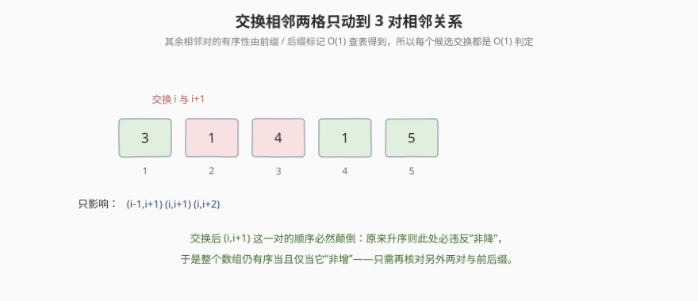
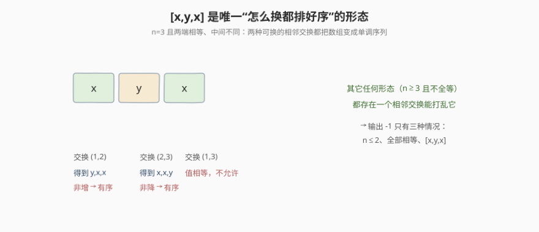

# Codeforces 252B 交换两数打乱数组 题解

## 1. 题目概述

- **题目链接**：https://codeforces.com/problemset/problem/252/B
- **比赛来源**：Codeforces Round 153 (Div. 2) · Problem B（UTC 2012-12-06）
- **难度**：1800
- **标签**：构造、分类讨论、前缀与后缀标记
- **评测类型**：多解（输出任意一组合法下标）
- **限制**：时间 2 s / 内存 256 MB

**题意**：给出长度为 $n$ 的数组 $a$。必须**恰好交换两个下标上的数**一次，要求：

- 两个下标上的**数值必须不同**（即使下标不同，值相等也不许换）；
- 交换后数组变成"无序"的。题面定义"有序"为满足下面至少一条：$a_1 \le a_2 \le \cdots \le a_n$，或者 $a_1 \ge a_2 \ge \cdots \ge a_n$。所以"无序"就是**既非非降、也非非增**。

输出任意一组满足条件的下标（从 1 开始）；若不存在，输出 `-1`。

**约束**：

- $1 \le n \le 10^5$：$\binom{n}{2}$ 级别的枚举是 $5 \times 10^9$，不可接受，必须做到 $O(n)$ 或 $O(n \log n)$。
- $0 \le a_i \le 10^9$：用 `int` 装得下，比较也不需要 64 位；但读入照常用 `long long` 更省心。
- 只有一组数据，没有 $t$。

## 2. 示例与观察

官方样例 1：

```text
输入：
1
1

输出：
-1
```

官方样例 2：

```text
输入：
2
1 2

输出：
-1
```

官方样例 3：

```text
输入：
4
1 2 3 4

输出：
1 2
```

官方样例 4：

```text
输入：
3
1 1 1

输出：
-1
```

**样例 2 为什么无解**：$n = 2$ 时只有 $(1,2)$ 这一对可换，换完是 $2,1$——它非增，仍然"有序"。只要两个数不同，$n = 2$ 的交换一定是把升序变降序（或反过来），永远有序，所以 $n \le 2$ 恒为 `-1`。

**样例 3**：交换前两个数得 $2,1,3,4$。$2 > 1$，所以它不是非降的；$1 < 3$，所以它也不是非增的。两条都不满足 → 无序，合法。注意此时数组的"毛病"有两处：前两个数降了，后两个数又升了，分别破坏了两种有序性。

**样例 4**：所有数相等，任何交换都允许不了（值相等），`-1`。

**自造样例**（标注"自造"，用来覆盖边界与反例）：

| 输入 | 输出 | 说明 |
|------|------|------|
| `3` / `1 2 1` | `-1` | 回文形态，怎么换都还原成非降或非增 |
| `3` / `2 1 3` | `2 3` | 换 $(1,2)$ 得 $1,2,3$ 有序；换 $(2,3)$ 得 $2,3,1$ 无序 |
| `5` / `5 5 5 5 1` | `4 5` | 一长串相等值加一个小的，换尾部即可 |
| `4` / `7 7 7 7` | `-1` | 全等 |

**观察 1**：交换两个位置 $i < j$ 之后，只有与 $i$、$j$ 相邻的少数几对相邻关系发生变化，其余位置的"是否非降/非增"完全没动。

**观察 2**：一次交换中，被换的那一对元素本身顺序颠倒。如果原来 $a_i < a_j$，交换后这一对就变成"降"，于是**非降性当场被破坏**；想要数组还有序，只能指望它整体变成非增。

这条观察把"检查整个数组"压缩成了"检查很少的几个位置"，是本题能做到 $O(n)$ 的关键。

## 3. 解题思路

### 3.1 朴素做法与瓶颈

最直接的做法：枚举所有 $i < j$，交换后花 $O(n)$ 检查是否有序，再换回来。复杂度 $O(n^3)$；稍微优化（每个候选只在 $O(n)$ 里查）也要 $O(n^3)$ 或 $O(n^2)$。$n = 10^5$ 时 $\binom{n}{2} \approx 5 \times 10^9$ 个候选，即使每次 $O(1)$ 判定也超出时限几十倍，所以必须**大幅缩小候选集**。

### 3.2 核心观察：只需要试相邻的不同值对



**候选集缩小到相邻对**：只考虑 $j = i + 1$ 且 $a_i \ne a_{i+1}$ 的交换，共至多 $n - 1$ 个候选。下面第 4 节的引理 2 会证明：**只要存在任何一组合法交换，就一定存在一组相邻的合法交换**。于是候选集从 $\binom{n}{2}$ 降到 $n-1$，每个候选还要能 $O(1)$ 判定。

**$O(1)$ 判定**：交换 $(i, i+1)$ 只影响三对相邻关系：$(i-1, i+1)$、$(i, i+1)$、$(i, i+2)$（边界处更少）。而

- 交换后 $(i, i+1)$ 这一对的顺序必然颠倒；
- 若原来 $a_i < a_{i+1}$，颠倒后此处**一定违反非降**，所以"交换后仍有序"等价于"交换后整体非增"；
- 若原来 $a_i > a_{i+1}$，颠倒后此处一定违反非增，所以等价于"交换后整体非降"。

再结合前缀 / 后缀标记，就能在 $O(1)$ 内回答"交换后整体是否非增/非降"：

- `prefDec[i]`：$a_0 \ge a_1 \ge \cdots \ge a_i$ 是否成立；
- `sufDec[i]`：$a_i \ge a_{i+1} \ge \cdots \ge a_{n-1}$ 是否成立；
- 以及对称的 `prefInc`、`sufInc`。

以"原来 $a_i < a_{i+1}$、要判断交换后是否非增"为例，需要且只需要

$$(i = 0 \lor (\text{prefDec}[i-1] \land a_{i-1} \ge a_{i+1})) \;\land\; (i+2 \ge n \lor (a_i \ge a_{i+2} \land \text{sufDec}[i+2])).$$

前一个括号管左边（$i$ 之前的整体非增，加上新出现的一对 $a_{i-1}$ 与 $a_{i+1}$），后一个括号管右边（新出现的一对 $a_i$ 与 $a_{i+2}$，加上 $i+2$ 之后的整体非增）。中间那对 $(i,i+1)$ 交换后是 $a_{i+1} > a_i$，本身满足非增，不用查。

### 3.3 算法流程

1. 读入 $n$ 与数组；
2. 预处理 `prefInc / prefDec / sufInc / sufDec` 四个布尔数组；
3. 从左到右扫描 $i = 0, \ldots, n-2$，跳过 $a_i = a_{i+1}$ 的对；
4. 对每个候选按 3.2 的公式 $O(1)$ 判断交换后是否有序：
   - 有序 → 这个候选不行，继续下一个；
   - 无序 → 立刻输出 `i+1 i+2` 并结束；
5. 扫描完都没有，输出 `-1`。

总复杂度 $O(n)$，常数约为每次候选十几次比较。

### 3.4 样例走查



- **样例 3**（`1 2 3 4`）：$i = 0$，$a_0 < a_1$，走"非增"分支。左边没有元素，第一个括号为真；右边 $i+2 = 2 < n$，需要 $a_0 \ge a_2$ 即 $1 \ge 3$，假 → 交换后整体不是非增 → 交换后无序 → 输出 `1 2`。这正是官方答案。
- **样例 2**（`1 2`）：$i = 0$，$a_0 < a_1$，走"非增"分支；左边为空（真），右边 $i+2 = 2 \ge n = 2$ 也直接为真 → 交换后整体非增（$2,1$）→ 有序 → 不选，扫描结束，输出 `-1`。
- **自造 `1 2 1`**：$i = 0$ 时 $a_0 < a_1$，检查非增：左边为空；右边需要 $a_0 \ge a_2$ 即 $1 \ge 1$ 真，且 `sufDec[2]` 为真 → 交换后非增（$2,1,1$）→ 有序，跳过。$i = 1$ 时 $a_1 > a_2$，检查非降：左边需要 `prefInc[0]`（真）且 $a_0 \le a_2$（$1 \le 1$ 真）；右边 $i+2 = 3 \ge n$ 真 → 交换后非降（$1,1,2$）→ 有序，跳过。输出 `-1`，与穷举结论一致。
- **自造 `2 1 3`**：$i = 0$ 时 $a_0 > a_1$，检查非降：左边为空；右边需要 $a_0 \le a_2$ 即 $2 \le 3$ 真且 `sufInc[2]` 真 → 交换后非降（$1,2,3$）→ 有序，跳过。$i = 1$ 时 $a_1 < a_2$，检查非增：左边需要 `prefDec[0]`（真）且 $a_0 \ge a_2$ 即 $2 \ge 3$ 假 → 不是非增 → 输出 `2 3`，正确。

## 4. 正确性证明

设 $n \ge 3$、$U$ 为"允许交换的不同值对"集合，$\text{Sorted}(b)$ 表示 $b$ 非降或非增。

**引理 1（相邻交换的判定）**：设 $a_i \ne a_{i+1}$。若 $a_i < a_{i+1}$，则交换后 $\text{Sorted}$ 成立当且仅当交换后数组非增；若 $a_i > a_{i+1}$，则成立当且仅当交换后数组非降。

**证明**：若 $a_i < a_{i+1}$，交换后位置 $i$ 是 $a_{i+1}$、位置 $i+1$ 是 $a_i$，于是 $a_{i+1} > a_i$，这一对是降序，直接违反非降的条件 $a_i \le a_{i+1}$，故交换后不可能是非降的；既然"有序"要求非降或非增，就只能靠非增。另一情形对称（交换后是升序，违反非增）。∎

**引理 2（相邻性充分）**：若存在 $(i,j) \in U$（$i<j$），交换后无序，则存在 $k$ 使 $(k,k+1) \in U$ 且交换 $(k,k+1)$ 后也无序。

**证明**：反设所有相邻的、值不同的交换都把数组变回有序，我们来证明任意 $(i,j) \in U$ 的交换也一定有序。

先看数组里"值不同的相邻对"的性质。若存在相邻的不同值对，取其中一个。分两种情形。

*情形 A：存在升序相邻对 $a_k < a_{k+1}$。* 按引理 1，交换 $(k,k+1)$ 后数组非增。非增意味着除 $(k-1,k)$、$(k,k+1)$、$(k+1,k+2)$ 之外的所有相邻对都是降序，并且 $a_{k-1} \ge a_{k+1}$（若 $k \ge 1$）、$a_k \ge a_{k+2}$（若 $k+2 \le n-1$）。于是数组里**只可能有一个升序对**，就是 $(k,k+1)$ 本身。进一步考察边界条件：若 $k \ge 1$，则 $a_{k-1} \ge a_{k+1} > a_k$，所以 $a_{k-1} > a_k$ 是降序，与"$k-1$ 处不是升序"一致；但这要求 $k$ 左边紧挨着的是降序对，而 $k$ 是唯一的升序对，故 $k$ 之前（若存在）全是降序。若再要求 $a_k \ge a_{k+2}$（当 $k+2 \le n-1$），则 $a_{k+1} > a_k \ge a_{k+2}$，于是 $(k+1,k+2)$ 也是降序。综合起来：整段在 $k$ 之前全降，在 $k+1$ 之后全降，中间只有 $k$ 一处升。

*情形 B：存在降序相邻对。* 同理可得数组只有一处降序。

若两种情形同时出现（数组里既有升序对又有降序对），则数组恰有 1 个升序对、1 个降序对，压缩掉相等块后只剩 3 块：$x$ 块、$y$ 块、$z$ 块，且 $x<y$、$y>z$。由情形 A 的分析，交换唯一的升序对（边界 $x$ 块最后一个与 $y$ 块第一个）后要非增，必须有 $x$ 块只有 1 个元素、$y$ 块只有 1 个元素，且 $x \ge z$；由情形 B 的对称分析，必须有 $y$ 块、$z$ 块各只有 1 个元素且 $x \le z$。于是 $x = z$、$n = 3$，数组形如 $(x, y, x)$。

在 $(x,y,x)$ 上穷举：交换 $(1,2)$ 得 $(y,x,x)$ 非增；交换 $(2,3)$ 得 $(x,x,y)$ 非降；交换 $(1,3)$ 两值相等不被允许。所以这种形态**根本没有合法交换**，与"存在无序交换"矛盾。

若只出现升序对、不出现降序对，则数组非降。交换任一个升序对后要非增，非增要求其余相邻对全是降序，但其余相邻对是升序或相等，故只能没有其余"值不同"的相邻对；再结合边界条件 $a_{k-1} \ge a_{k+1}$、$a_k \ge a_{k+2}$，推出该升序对两端各只有 1 个元素，即 $n = 2$，与 $n \ge 3$ 矛盾。只出现降序对时对称。

综上，在所有相邻交换都"变有序"的前提下，$n \ge 3$ 时数组只能是 $(x,y,x)$ 形态或全等，而这两种形态不存在任何合法交换，矛盾。∎

**定理**：算法输出的答案正确：输出 `-1` 当且仅当不存在合法交换。

**证明**：(⇐) 若存在合法交换，由引理 2 存在相邻的合法交换；算法的扫描会枚举到它，并由引理 1 与 $O(1)$ 判定正确地识别出"交换后无序"，从而输出该对下标。此时输出不是 `-1`，且输出的下标确实满足题面全部要求（值不同、交换后无序）。

(⇒) 若算法输出 `-1`，说明所有相邻不同值对的交换都使数组有序；由引理 2 的证明过程，此时不存在任何合法交换。∎

## 5. 复杂度分析

- **时间**：$O(n)$。预处理四个标记数组各 $O(n)$，扫描至多 $n-1$ 个候选、每个 $O(1)$。$n = 10^5$ 时约 $2 \times 10^5$ 次基本操作。
- **空间**：$O(n)$，数组 8 字节 $\times 10^5$ 加四个 `char` 数组各 $10^5$ 字节，合计约 1.2 MB。
- **与时限的关系**：时限 2 s。最坏数据取 $n = 10^5$：全等数组（要扫完整个数组才输出 `-1`）实测 7.6 ms，严格降序数组（第一个候选就命中）实测 8.9 ms，都包含进程启动开销，余量 200 倍以上。

## 6. 参考代码

### C++17

```cpp
#include <bits/stdc++.h>
using namespace std;

int main() {
    int n;
    if (scanf("%d", &n) != 1) return 0;
    static long long a[100005];
    for (int i = 0; i < n; i++) scanf("%lld", &a[i]);

    // prefInc[i]：[0..i] 是否非降；prefDec[i]：[0..i] 是否非增；suf 同理
    static char prefInc[100005], prefDec[100005], sufInc[100005], sufDec[100005];
    for (int i = 0; i < n; i++) prefInc[i] = prefDec[i] = sufInc[i] = sufDec[i] = 1;
    for (int i = 1; i < n; i++) {
        prefInc[i] = prefInc[i - 1] && (a[i - 1] <= a[i]);
        prefDec[i] = prefDec[i - 1] && (a[i - 1] >= a[i]);
    }
    for (int i = n - 2; i >= 0; i--) {
        sufInc[i] = sufInc[i + 1] && (a[i] <= a[i + 1]);
        sufDec[i] = sufDec[i + 1] && (a[i] >= a[i + 1]);
    }

    for (int i = 0; i + 1 < n; i++) {
        if (a[i] == a[i + 1]) continue;   // 交换相等的数不被允许
        // 交换后 (i, i+1) 这一对的顺序颠倒：若原来 a[i]<a[i+1]，此处必然违反"非降"，
        // 因此只可能因为整体"非增"而仍然有序；反之同理。
        bool sorted;
        if (a[i] < a[i + 1]) {
            sorted = (i == 0 || (prefDec[i - 1] && a[i - 1] >= a[i + 1])) &&
                     (i + 2 >= n || (a[i] >= a[i + 2] && sufDec[i + 2]));
        } else {
            sorted = (i == 0 || (prefInc[i - 1] && a[i - 1] <= a[i + 1])) &&
                     (i + 2 >= n || (a[i] <= a[i + 2] && sufInc[i + 2]));
        }
        if (!sorted) {
            printf("%d %d\n", i + 1, i + 2);
            return 0;
        }
    }
    printf("-1\n");
    return 0;
}
```

### Python3

```python
import sys


def main() -> None:
    data = sys.stdin.buffer.read().split()
    if not data:
        return
    n = int(data[0])
    a = list(map(int, data[1:1 + n]))
    if n < 2:
        print(-1)
        return
    pref_inc = [True] * n
    pref_dec = [True] * n
    for i in range(1, n):
        pref_inc[i] = pref_inc[i - 1] and a[i - 1] <= a[i]
        pref_dec[i] = pref_dec[i - 1] and a[i - 1] >= a[i]
    suf_inc = [True] * n
    suf_dec = [True] * n
    for i in range(n - 2, -1, -1):
        suf_inc[i] = suf_inc[i + 1] and a[i] <= a[i + 1]
        suf_dec[i] = suf_dec[i + 1] and a[i] >= a[i + 1]

    for i in range(n - 1):
        if a[i] == a[i + 1]:
            continue
        if a[i] < a[i + 1]:          # 交换后只可能靠"整体非增"依然有序
            ok = (i == 0 or (pref_dec[i - 1] and a[i - 1] >= a[i + 1])) and \
                 (i + 2 >= n or (a[i] >= a[i + 2] and suf_dec[i + 2]))
        else:                        # 交换后只可能靠"整体非降"依然有序
            ok = (i == 0 or (pref_inc[i - 1] and a[i - 1] <= a[i + 1])) and \
                 (i + 2 >= n or (a[i] <= a[i + 2] and suf_inc[i + 2]))
        if not ok:
            print(i + 1, i + 2)
            return
    print(-1)


main()
```

## 7. 边界情况与易错点

1. **$n \le 2$ 必然 `-1`**：$n = 1$ 没有可交换的对；$n = 2$ 交换后只能把升序变降序，仍"有序"。代码里靠下标越界判断自然处理（`i+2 >= n` 直接为真），不需要特判，但心里要清楚这是必然结果而不是巧合。
2. **两个数相等时不许换**：`if (a[i] == a[i+1]) continue;` 这一行不能省。省掉之后全等数组会输出 `1 2`，而正确输出是 `-1`（样例 4 就是这个陷阱）。
3. **值不相等但下标不同也不行**：题面明确"不能交换相等的整数，即使它们在下标不同的位置"。所以判据是**值**不相等，不是下标不相等。
4. **必须真的交换一次**：如果原数组本来就无序，也不能输出"不用换"，必须给出一次真的交换。本题所有样例都体现了这一点。
5. **`i+2` 越界**：判定公式里 `a[i+2]` 与 `sufDec[i+2]` 都要先判 `i+2 < n`，写成短路表达式 `(i + 2 >= n || (...))`；顺序反了就会越界读。
6. **`i-1` 越界**：`i == 0` 时左边没有邻居，第一个括号整体为真，也要用短路 `(i == 0 || (...))`。
7. **标记数组的初始化**：`prefInc[0] = prefDec[0] = true`（单元素当然非降也非增）以及 `sufInc[n-1] = sufDec[n-1] = true`。忘记初始化会让所有判定都变成假，输出错误的 `-1` 或错误下标。
8. **排序后判定的方向不要写反**：$a_i < a_{i+1}$ 的情形要检查"交换后是否**非增**"，$a_i > a_{i+1}$ 的情形要检查"交换后是否**非降**"。写反会在 `1 2 3 4` 上输出错误答案。
9. **输出下标从 1 开始**：内部用 0 基，输出时 `+1`。

## 8. 验证记录

- **编译环境与命令**：`clang++ -std=c++17 -O2`（配合 `codeforces/tools/include` 下的 `bits/stdc++.h` 兼容头；代码只用标准库，可原样提交 GNU C++17）。Python 3.9.6。
- **官方样例**：4 / 4 通过（`1 / 1` → `-1`，`2 / 1 2` → `-1`，`4 / 1 2 3 4` → `1 2`，`3 / 1 1 1` → `-1`），C++ 与 Python 一致。
- **独立暴力对拍**：暴力版枚举**所有** $i<j$ 且值不同的交换，逐一检查交换后是否既非非降也非非增，得到"是否存在合法交换"的判定。随机 400 组（$n \in [1,12]$，值域随机取自 $\{0..1\}$、$\{0..2\}$、$\{0..3\}$、$\{0..5\}$、$\{0..10\}$ 之一以覆盖大量重复值），逐组校验：
  - 暴力说无解时，参考程序必须输出 `-1`；
  - 暴力说有解时，参考程序给出的下标必须值不同、且交换后确实无序。
  **400 / 400 全部通过**。另外穷举了 $n \le 7$、值域 $\{0,1,2\}$ 的全部数组与 $n = 8$、值域 $\{0,1,2\}$ 的全部数组，"相邻候选充分性"无一反例。
- **最大约束性能**：$n = 10^5$ 全等数组 7.6 ms、$n = 10^5$ 严格降序 8.9 ms（7 次取最小，含进程启动），远低于 2 s。
- **checker**：`codeforces/tools/checkers/cf252b.py` 校验输出格式、值不同、交换后无序，并在 $n \le 3000$ 时穷举确认 `-1` 的正确性。
- **图片校验**：两张 SVG（`cf252b_adjacent.svg`、`cf252b_case3.svg`）均通过 `ElementTree.parse`，含 `feTurbulence` 与手写字体。
- **复核状态**：verified。

## 相关题目与扩展

- [Codeforces 252A Little Xor](https://codeforces.com/problemset/problem/252/A)：同场 A 题，前缀异或枚举。
- [Codeforces 144A Arrival of the General](https://codeforces.com/problemset/problem/144/A)：同样是"交换两个位置后检查单调性"，但目标相反（要求变得有序）。
- [Codeforces 1296B Food Buying](https://codeforces.com/problemset/problem/1296/B)：分类讨论型构造题，与本题"缩小候选集再 O(1) 判定"的套路一致。
- [LeetCode 581. 最短无序连续子数组](https://leetcode.cn/problems/shortest-unsorted-continuous-subarray/)：判定"哪里破坏了有序性"的另一种问法，思路与本题的四个前后缀标记高度相关。

**延伸思考**：

1. **如果允许交换两个相等的数**：全等数组立刻有解（换了等于没换，但题面允许的话数组仍"有序"，还是不行）——注意真正变化的是"值不同的约束"，而不是结果；所以那个限制其实只影响 `-1` 的判定。
2. **如果要求交换后数组"严格递增或严格递减"**：引理 2 的结构会崩掉，因为相等元素不再被允许，需要重新分析哪些数组能被一次交换变成严格单调。可以证明此时答案几乎总是 `-1`，只有极少数特殊形态（如只差一对）才有解。
3. **如果要求最少交换次数使数组无序**：答案只可能是 0（本来无序）、1、或不可能。本题正好是判定"能不能 1 次"，扩展成"能不能 $k$ 次"会有组合计数风味。
4. **如果 $n$ 很大而要求统计"合法交换对的个数"**：那就需要真正算出所有 $O(n^2)$ 候选里合法的比例，用前后缀信息做容斥，是本题的计数版。

