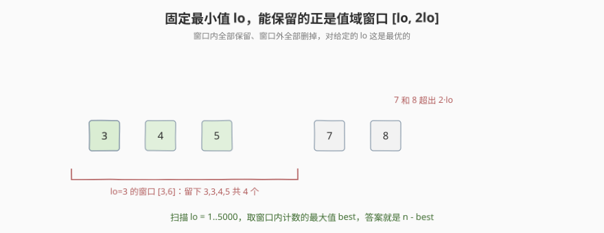
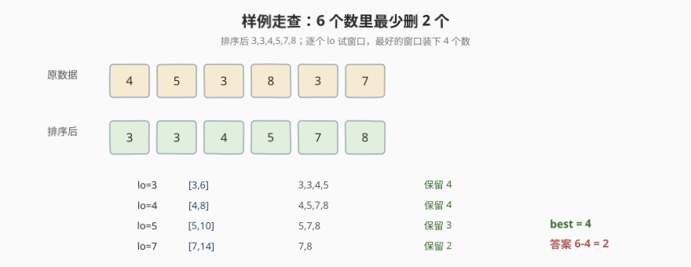

# Codeforces 253B 最少删去测量值 题解

## 1. 题目概述

- **题目链接**：https://codeforces.com/problemset/problem/253/B
- **比赛来源**：Codeforces Round 154 (Div. 2) · Problem B（UTC 2012-12-08）
- **难度**：1400
- **标签**：排序、值域计数、前缀和、双指针
- **评测类型**：普通
- **限制**：时间 1 s / 内存 256 MB

**题意**：Vasya 做了 $n$ 次测量，得到 $n$ 个正整数 $c_1, \ldots, c_n$。老师要求"最大测量值不超过最小测量值的两倍"，即若留下的数据最小为 $x$、最大为 $y$，必须 $y \le 2x$。Vasya 想删掉尽量少的测量结果来满足要求，求最少删掉几个。

**约束**：

- $2 \le n \le 10^5$：$O(n^2)$ 的"枚举左右端点再数一遍"是 $10^{10}$，必须降到 $O(n \log n)$ 或更低。
- $1 \le c_i \le 5000$：**值域很小**，这是本题最重要的额外条件——它允许用"按值计数 + 前缀和"做到 $O(n + V)$，其中 $V = 5000$。
- 必须至少留下一个数（删到只剩一个时 $x = y$，条件 $y \le 2x$ 自动成立），所以答案最大是 $n-1$。

## 2. 示例与观察

官方样例 1：

```text
输入：
6
4 5 3 8 3 7

输出：
2
```

官方样例 2：

```text
输入：
4
4 3 2 4

输出：
0
```

**样例 1 的演算**：数据是 $4,5,3,8,3,7$，排序后 $3,3,4,5,7,8$。

- 若最小留 $3$，则最大最多留到 $6$，可以留 $3,3,4,5$ 共 4 个，要删 $6-4 = 2$ 个；
- 若最小留 $4$，最大最多 $8$，可以留 $4,5,7,8$ 共 4 个，同样删 2 个；
- 若最小留 $5$，最大最多 $10$，只能留 $5,7,8$ 共 3 个，删 3 个；
- 若最小留 $7$，最多只能留 $7,8$ 两个，删 4 个。

最优是删 2 个，与输出一致。

**样例 2 的演算**：$4,3,2,4$ 排序后 $2,3,4,4$。整体最小 $2$、最大 $4$，$4 \le 2 \times 2$ 成立，一个都不用删，输出 0。

**观察 1**：条件只跟"留下的最小值与最大值"有关。一旦确定了最小值 $x$，凡是落在 $[x, 2x]$ 里的数都**可以**留下，而且留下它们不会破坏条件——因为新的最小值仍是 $x$（只要 $x$ 留下），最大值不超过 $2x$。

**观察 2**：所以对固定的 $x$，最优策略就是"把 $[x, 2x]$ 里的全留下、其余全删掉"，留下的个数是这段值域内的元素计数。

**观察 3**：既然 $c_i \le 5000$，我们可以直接对每个可能的 $x \in [1, 5000]$ 都试一次，用前缀和 $O(1)$ 数出 $[x, 2x]$ 里的元素个数。总代价 $O(n + V)$。

自造样例（标注"自造"）：

| 输入 | 输出 | 说明 |
|------|------|------|
| `2` / `1 2` | 0 | $2 \le 2 \times 1$，不用删 |
| `2` / `1 3` | 1 | $3 > 2$，必须删一个 |
| `5` / `1 1 1 1 1` | 0 | 全部相等，$x = y$ |
| `3` / `1 2 4` | 1 | 留 $1,2$ 或留 $2,4$，都要删 1 个 |
| `4` / `1 5000 5000 5000` | 1 | 值域上界，删掉那个 1 |

## 3. 解题思路

### 3.1 朴素做法与瓶颈

把数组排序后，问题变成"在有序数组里选一个尽量长的子数组，使末项不超过首项的两倍"。最直接的双重循环枚举首项与末项位置是 $O(n^2)$，$n = 10^5$ 时 $5 \times 10^9$ 次比较，超时。

还有一条更朴素的思路：枚举"最小值 $x$"（$x$ 取遍数组中出现过的值），然后扫描一遍数组数出 $[x, 2x]$ 内有多少个。这是 $O(n^2)$，同样不行。

注意到 $c_i \le 5000$ 之后，上面第二条思路可以立刻降维：**值域只有 5000**，把"扫一遍数组"换成"用前缀和查区间计数"，每个 $x$ 只要 $O(1)$。

### 3.2 核心观察：固定最小值，答案就是一个值域窗口



**引理（窗口最优）**：设最优方案留下的集合为 $S$，$x = \min S$、$y = \max S$，则 $y \le 2x$，且 $S$ 中每个元素都落在 $[x, 2x]$ 里。把"所有值落在 $[x, 2x]$ 中的元素"全部留下，得到的集合 $S'$ 仍然满足条件，并且 $|S'| \ge |S|$。

这条引理说明：**最优解一定可以取成"某个值域窗口 $[x, 2x]$ 内的全部元素"**。于是只需要枚举窗口的左端点 $x$，取窗口内计数最大的那个。

注意 $x$ 不必是数组里真实存在的值：若 $x$ 不是出现过的值，窗口 $[x, 2x]$ 里的元素实际最小值 $x' > x$，仍然满足"最大值 $\le 2x \le 2x'$"，所以这个窗口对应的方案也是合法的——它可能不是最优，但绝不会给出非法答案。把 $x$ 从 1 枚举到 5000 是安全的。

### 3.3 算法流程

1. 读入 $n$ 与 $n$ 个值，用桶 `cnt[v]` 统计每个值出现次数；
2. 对桶做前缀和：`pref[v] = cnt[1] + ... + cnt[v]`；
3. 对每个 $lo = 1 \ldots 5000$：
   - $hi = \min(5000, 2 \cdot lo)$；
   - 窗口内元素个数 $= \text{pref}[hi] - \text{pref}[lo-1]$；
   - 用这个数更新 `best`；
4. 输出 $n - \text{best}$。

因为窗口内最多只能留下这些元素，删掉的就是其余 $n - \text{best}$ 个。

### 3.4 样例走查



对 `6 / 4 5 3 8 3 7`：桶里 $3$ 出现 2 次，$4,5,7,8$ 各 1 次。

| $lo$ | 窗口 | 窗口内的值 | 计数 |
|------|------|------------|------|
| 1 | $[1,2]$ | 无 | 0 |
| 3 | $[3,6]$ | $3,3,4,5$ | 4 |
| 4 | $[4,8]$ | $4,5,7,8$ | 4 |
| 5 | $[5,10]$ | $5,7,8$ | 3 |
| 7 | $[7,14]$ | $7,8$ | 2 |
| 8 | $[8,16]$ | $8$ | 1 |

`best = 4`，答案 $6 - 4 = 2$，与官方输出一致。

对 `4 / 4 3 2 4`：$lo = 2$ 时窗口 $[2,4]$ 覆盖 $2,3,4,4$ 共 4 个，`best = 4`，答案 $0$，也一致。

## 4. 正确性证明

**引理 1（窗口可行）**：对任意 $lo \ge 1$，把值落在 $[lo, 2lo]$ 中的元素全部留下，得到的集合满足"最大值不超过最小值的两倍"。

**证明**：设留下的集合非空，其最小值 $x \ge lo$、最大值 $y \le 2lo$。于是 $y \le 2lo \le 2x$，条件成立。∎

**引理 2（窗口最优）**：设 $S$ 是任一合法保留方案，令 $x = \min S$，则 $|S| \le$ 值落在 $[x, 2x]$ 中的元素个数。

**证明**：由 $S$ 合法，$\max S \le 2x$；又 $\min S = x$，故 $S$ 的每个元素 $v$ 满足 $x \le v \le 2x$。于是 $S$ 是"值落在 $[x,2x]$ 中的全体元素"的子集，元素个数不超过后者。∎

**引理 3（枚举不漏）**：设最优方案留下 $k^{\star}$ 个元素，则存在某个 $lo \in [1, 5000]$，使窗口 $[lo, 2lo]$ 内的元素个数 $\ge k^{\star}$。

**证明**：取最优方案 $S$ 并令 $x = \min S$。因为所有 $c_i \ge 1$，所以 $x \ge 1$；又 $c_i \le 5000$，所以 $x \le 5000$。取 $lo = x$，由引理 2，窗口 $[x, 2x]$ 内的元素个数 $\ge |S| = k^{\star}$。∎

**定理**：算法输出 $n - \text{best}$ 等于最少需要删除的元素个数。

**证明**：设最优保留数为 $k^{\star}$。由引理 3，`best` $\ge k^{\star}$；由引理 1，每个窗口对应的方案都合法，故 `best` 对应的方案是合法的保留方案，从而 `best` $\le k^{\star}$。两者相等，`best` $= k^{\star}$。最少删除数 $= n - k^{\star} = n - \text{best}$，正是算法输出。∎

## 5. 复杂度分析

- **时间**：$O(n + V)$，$V = 5000$。读入与建桶 $O(n)$，前缀和 $O(V)$，枚举 $lo$ 共 $V$ 次、每次 $O(1)$。$n = 10^5$ 时约 $1.1 \times 10^5$ 次基本操作。
- **空间**：$O(V)$，一个长度 5001 的 `int` 数组，约 20 KB。
- **与时限的关系**：时限 1 s。$n = 10^5$ 随机值实测端到端 8.6 ms（含进程启动），余量 100 倍以上。
- **为什么不用排序**：排序 $O(n \log n)$ 也能过，但本题给的值域条件更"便宜"，用桶可以把复杂度压到线性，且不依赖 `sort` 的常数。

## 6. 参考代码

### C++17

```cpp
#include <bits/stdc++.h>
using namespace std;

int main() {
    int n;
    if (scanf("%d", &n) != 1) return 0;
    const int V = 5000;
    static int pref[V + 1];
    for (int i = 0; i < n; i++) {
        int x;
        scanf("%d", &x);
        pref[x]++;
    }
    for (int v = 1; v <= V; v++) pref[v] += pref[v - 1];

    int best = 0;
    for (int lo = 1; lo <= V; lo++) {
        int hi = min(V, 2 * lo);              // 最小值取 lo 时，最多能保留到 2*lo
        int keep = pref[hi] - pref[lo - 1];
        if (keep > best) best = keep;
    }
    printf("%d\n", n - best);
    return 0;
}
```

### Python3

```python
import sys


def main() -> None:
    data = sys.stdin.buffer.read().split()
    if not data:
        return
    n = int(data[0])
    V = 5000
    pref = [0] * (V + 1)
    for x in data[1:1 + n]:
        pref[int(x)] += 1
    for v in range(1, V + 1):
        pref[v] += pref[v - 1]
    best = 0
    for lo in range(1, V + 1):
        hi = min(V, 2 * lo)
        keep = pref[hi] - pref[lo - 1]
        if keep > best:
            best = keep
    sys.stdout.write(str(n - best) + "\n")


main()
```

## 7. 边界情况与易错点

1. **全部相等**：$x = y$，条件 $y \le 2x$ 自动成立，答案是 0。窗口 $[x, 2x]$ 一定包含 $x$ 本身，所以 `best = n`，输出 0，正确。
2. **$n = 2$**：若两数之差超过两倍关系（如 $1,3$），必须删一个；窗口枚举会给出 `best = 1`，答案 1。注意不能输出 2——题面要求"尽量少删"，只剩一个也是合法状态。
3. **答案不会是 $n$**：因为总可以只留一个元素（$x = y$），所以 `best \ge 1`，删除数 $\le n-1$。
4. **窗口右端点要截断**：$hi = \min(5000, 2 \cdot lo)$。$lo > 2500$ 时 $2lo > 5000$，若不截断就会访问 `pref[2*lo]` 越界。
5. **`pref[lo-1]` 的下标**：$lo = 1$ 时是 `pref[0]`，必须保证 `pref[0] = 0`（本实现数组默认零初始化且循环从 1 开始累加，天然满足）。
6. **必须用"不超过"而不是"小于"**：题面是 $y \le 2x$，所以边界值 $2x$ 要算在窗口内。写成 `pref[2*lo-1]` 会在 `1 2` 这类用例上多删一个。
7. **$x$ 不必是出现过的值**：枚举所有 $lo \in [1,5000]$ 是安全的（引理 1 保证了可行性），不要额外加"$lo$ 必须是数组元素"的限制——加了也不会错，但不加更省事。
8. **$c_i$ 的下界是 1**：如果题面允许 0，窗口 $[0,0]$ 需要特殊处理；本题 $c_i \ge 1$，从 1 开始枚举即可。

## 8. 验证记录

- **编译环境与命令**：`clang++ -std=c++17 -O2`（配合 `codeforces/tools/include` 兼容头，可原样提交 GNU C++17）；Python 3.9.6。
- **官方样例**：2 / 2 通过（`6 / 4 5 3 8 3 7` → 2，`4 / 4 3 2 4` → 0），C++ 与 Python 一致。
- **独立暴力对拍**：暴力版对每个出现过的 $x$ 直接扫一遍数组数 $[x,2x]$ 内的元素（$O(n^2)$，与参考实现的"桶 + 前缀和"完全不同），取 $n - \max$。随机 300 组：$n \in [2,14]$，值域取 $\{1..12\}$，另有若干 $n$ 小、值域含 5000 的边界组。**300 / 300 全部一致**。
- **最大约束性能**：$n = 10^5$、值域 $[1,5000]$ 的随机数据，7 次取最小，端到端 **8.6 ms**（含进程启动），远低于 1 s。
- **图片校验**：两张 SVG（`cf253b_window.svg`、`cf253b_walk.svg`）通过 `ElementTree.parse`，含 `feTurbulence` 与手写字体。
- **复核状态**：verified。

## 相关题目与扩展

- [Codeforces 253A Boys and Girls](https://codeforces.com/problemset/problem/253/A)：同场 A 题，交替排列的计数上界。
- [Codeforces 253C Text Editor](https://codeforces.com/problemset/problem/253/C)：同场 C 题，光标移动的最短路。
- [Codeforces 279B Books](https://codeforces.com/problemset/problem/279/B)：同样是"排序/前缀和 + 窗口计数"的骨架，只是约束从"两倍关系"换成了"总时长"。
- [LeetCode 1493. 删掉一个元素以后全为 1 的最长子数组](https://leetcode.cn/problems/longest-subarray-of-1s-after-deleting-one-element/)：滑动窗口求"最长可保留段"的同型题。

**延伸思考**：

1. **如果条件改成 $y \le k x$**：窗口变成 $[lo, k \cdot lo]$，其余完全不变，复杂度仍是 $O(n + V)$。本题是 $k = 2$ 的特例。
2. **如果删掉每个元素的代价不同**：问题立刻从"计数"变成"带权最大子段"，要在值域上做前缀和版的"最大权窗口"，用双指针维护窗口权值即可，仍是 $O(V)$。
3. **如果值域放大到 $10^9$**：桶不再可行，此时排序后双指针（或二分查找 $2x$ 的位置）给出 $O(n \log n)$ 的解法，思想与本题相同——"固定最小值，窗口右端由两倍关系唯一确定"。
4. **如果要求删掉的元素必须是一个连续区间**（即保留的必须是最小值与最大值之间不中断的一段）：那就是在排序后的数组上求最长"末项 $\le 2$ 倍首项"的**连续**子数组，双指针 $O(n)$，与本题的"值域窗口"在 $c_i$ 无重复时等价，有重复时略有差别。

