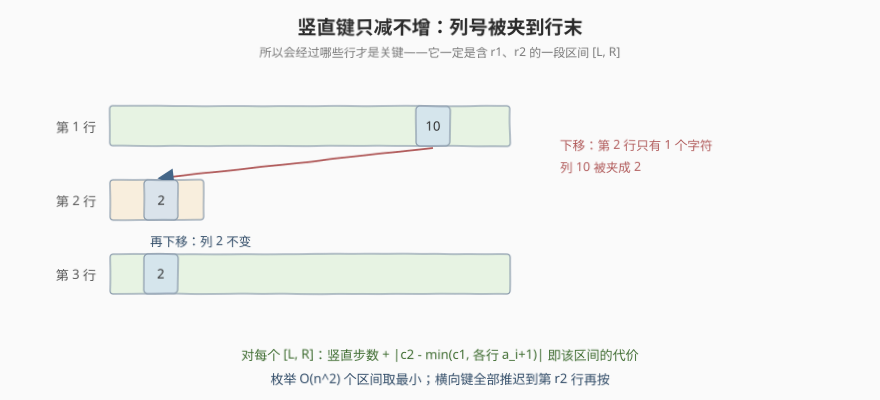

# Codeforces 253C 文本编辑器光标 题解

## 1. 题目概述

- **题目链接**：https://codeforces.com/problemset/problem/253/C
- **比赛来源**：Codeforces Round 154 (Div. 2) · Problem C（UTC 2012-12-08）
- **难度**：1600
- **标签**：最短路、图论建模、枚举区间
- **评测类型**：普通
- **限制**：时间 1 s / 内存 256 MB

**题意**：文本编辑器里有 $n$ 行，第 $i$ 行有 $a_i$ 个字符，因此光标的列号可以取 $1 \ldots a_i+1$（列号从 1 开始，$a_i+1$ 表示行末）。光标位置记作 $(r, c)$。四个方向键的行为是：

- **Up**：在第 1 行时不动；否则移到第 $r-1$ 行的**同一列**，若那一行太短（列号超过 $a_{r-1}+1$），则停在该行行末。
- **Down**：对称，移到第 $r+1$ 行，太短则停在该行行末。
- **Right**：列号 $< a_r+1$ 时 $c \to c+1$，否则不动。
- **Left**：$c > 1$ 时 $c \to c-1$，否则不动。

给定起点 $(r_1, c_1)$ 与终点 $(r_2, c_2)$，求最少按键次数。

**约束**：

- $n \le 100$，$a_i \le 10^5$：若把状态取成"每一个 $(r, c)$"，状态数是 $n \times (\max a_i + 1) \le 10^7$，BFS 勉强可行但常数与内存都不划算。
- 关键约束是 $n$ 很小（100）而 $a_i$ 很大（$10^5$）：这说明**行数少**才是可利用的结构，列数多只是干扰。
- $1 \le c_1 \le a_{r_1}+1$、$1 \le c_2 \le a_{r_2}+1$：起终点一定合法。
- 只有一组数据。

## 2. 示例与观察

官方样例 1：

```text
输入：
4
2 1 6 4
3 4 4 2

输出：
3
```

官方样例 2：

```text
输入：
4
10 5 6 4
1 11 4 2

输出：
6
```

官方样例 3：

```text
输入：
3
10 1 10
1 10 1 1

输出：
3
```

**样例 1 的演算**：四行长度 $2,1,6,4$。从 $(3,4)$ 到 $(4,2)$。直接方案是 Down 到 $(4,4)$（列 4 $\le 4+1$，不被夹），再 Left 两次，共 3 次。它的代价是 $1 + |4-2| = 3$，与输出一致。

**样例 2 的演算**：四行长度 $10,5,6,4$。从 $(1,11)$ 到 $(4,2)$。竖直方向必须走 3 步到第 4 行，沿途第 2 行把列夹到 6、第 3 行夹到 7、第 4 行夹到 5，最终列 5；再 Left 3 次。总计 $3 + 3 = 6$，与输出一致。注意如果没有夹取，列会一直是 11，横向要 9 步，总代价 12。

**样例 3 的演算**（最能说明问题）：三行长度 $10, 1, 10$，从 $(1,10)$ 到 $(1,1)$。看起来只需 Left 9 次，但正确答案是 **3**：

1. Down：第 2 行只有 1 个字符，列 10 被夹到 2，得到 $(2,2)$；
2. Up：回到 $(1,2)$；
3. Left：到 $(1,1)$。

**观察 1**：竖直移动**只会让列号变小或不变**——每进入一行就取 $\min(c,\ a_i+1)$，而 $\min$ 是单调不增的。想增大列号只能靠 Right 键。

**观察 2**：竖直移动经过的行一定是一段**区间** $[L,R]$（含 $r_1$ 与 $r_2$），因为行号是连续变化的。

**观察 3**：横向移动没有"必须早做"的理由。把所有左右移动都推迟到最后一行（第 $r_2$ 行）再按，不会更贵——这是样例 1、2 都成立的直觉，第 4 节会给出交换论证。

自造样例（标注"自造"）：

| 输入 | 输出 | 说明 |
|------|------|------|
| `1` / `5` / `1 3 1 5` | 2 | 只有一行，纯横向 |
| `2` / `0 0` / `1 1 1 1` | 0 | 起点即终点 |
| `2` / `100000 0` / `1 100001 2 1` | 1 | 一行就到，且列被夹到 1 |
| `3` / `100000 0 100000` / `1 100001 3 1` | 4 | 必须绕到中间那行压列 |

## 3. 解题思路

### 3.1 朴素做法与瓶颈

把每个 $(r, c)$ 当作图上的点，四个方向键当作边，BFS 求最短路。状态数 $n \times (\max a_i + 1)$，最坏 $100 \times 100001 = 10^7$，边数 $4 \times 10^7$。内存上 `dist` 用 `int` 要 40 MB，队列还要 40 MB，虽然能塞进 256 MB，但常数很大，而且完全没用上"$n$ 只有 100"这个结构。

真正的问题是：**列号范围大得离谱，但它的作用只有两种**——要么是最终落点 $c_2$，要么被某个行末夹取。

### 3.2 核心观察：三段结构



把一条最优路径拆成三段来看：

1. **竖直段**：一串上下移动，经过的行构成区间 $[L, R]$，其中 $L \le \min(r_1,r_2)$、$R \ge \max(r_1,r_2)$。每进入一行 $i$，列号变成 $\min(c,\ a_i+1)$；因为 $\min$ 单调不增，**走完整段后的列号就是**

$$m = \min\Bigl(c_1,\ \min_{L \le i \le R}(a_i+1)\Bigr).$$

2. **横向段**：在最后一行（第 $r_2$ 行）左右移动，把列号从 $m$ 调到 $c_2$，代价 $|c_2 - m|$。

3. **没有第三段**：所有横向移动都可以推迟到第 2 段去做，代价不增，理由见引理 2。

于是问题变成：**枚举区间 $[L,R]$，取"竖直步数 + 横向补齐代价"的最小值**。区间只有 $O(n^2)$ 个，而竖直步数可以直接算：

$$\text{vs}(L,R) = (R-L) + \min\bigl((r_1-L) + (R-r_2),\ (R-r_1) + (r_2-L)\bigr).$$

这个式子的含义是：要覆盖整个 $[L,R]$，必须先把某一端走到，再从那一端走到另一端；两种顺序取较优。因为 $L \le \min(r_1,r_2)$、$R \ge \max(r_1,r_2)$，四个差值都非负。

### 3.3 算法流程

1. 读入 $n$、$a_1 \ldots a_n$、$r_1, c_1, r_2, c_2$；
2. 令 $lo = \min(r_1,r_2)$、$hi = \max(r_1,r_2)$；
3. 枚举 $L = lo, lo-1, \ldots, 1$，同时增量维护 $M_L = \min_{L \le i \le hi}(a_i+1)$；
4. 对每个 $L$，枚举 $R = hi, hi+1, \ldots, n$，增量维护 $m = \min(c_1, M_L, \min_{hi < i \le R}(a_i+1))$；
5. 用 $\text{vs}(L,R) + |c_2 - m|$ 更新答案；
6. 输出答案。

第 3、4 步的增量维护把每个区间的列号计算压到 $O(1)$，总复杂度 $O(n^2)$（最坏 $10^4$ 次迭代）。

### 3.4 样例走查


**样例 3**（$a = [10,1,10]$，$(1,10) \to (1,1)$）：$lo = hi = 1$，枚举三种区间。

| $[L,R]$ | 竖直步数 | 走完后的列 $m$ | 横向代价 | 合计 |
|---------|----------|----------------|----------|------|
| $[1,1]$ | 0 | $\min(10, 11) = 10$ | $|1-10| = 9$ | 9 |
| $[1,2]$ | $1 + \min(0+1,\ 1+0) = 2$ | $\min(10,11,2) = 2$ | $|1-2| = 1$ | **3** |
| $[1,3]$ | $2 + \min(0+2,\ 2+0) = 4$ | $\min(10,11,2,11) = 2$ | 1 | 5 |

最小值 3，与官方输出一致。区间 $[1,2]$ 对应的正是"下绕到第 2 行压列、再上回第 1 行"的那条路：2 步竖直 + 1 步横移。

**样例 2**（$a=[10,5,6,4]$，$(1,11) \to (4,2)$）：$lo = 1$、$hi = 4$，只需考虑 $L=1$ 和 $R \ge 4$。

| $[L,R]$ | 竖直步数 | $m$ | 横向代价 | 合计 |
|---------|----------|-----|----------|------|
| $[1,4]$ | $3 + 0 = 3$ | $\min(11,11,6,7,5) = 5$ | 3 | **6** |
| $[1,5]$ 起 | 更大 | 不会更小 | 不会更优 | $\ge 6$ |

答案 6，与输出一致。

## 4. 正确性证明

**引理 1（夹取的单调性）**：任一时刻，从 $(r,c)$ 出发按 Up 或 Down 到达相邻行 $r'$ 后，新的列号是 $\min(c,\ a_{r'}+1) \le c$。因此一串竖直移动之后，列号等于 $c_1$ 与沿途各行 $a_i+1$ 的最小值。

**证明**：按题面，进入 $r'$ 行时若列号超过行末则停在行末，即 $\min(c, a_{r'}+1)$。对一串竖直移动归纳即得结论。∎

**引理 2（横向可推迟）**：对任意合法路径，存在另一条合法路径，它在前半段只按竖直键、最后在第 $r_2$ 行按若干横向键，按键次数不超过原路径。

**证明**：取原路径中"最后一次竖直按键"的位置。设在该位置之前（不含）出现过 $h$ 次横向按键。我们把这些横向按键逐个删掉，并在最后补上至多 $h$ 次横向按键来修正最终的列号，说明总次数不增。

考虑删掉其中一次横向键（设它把列从 $c$ 变成 $c \pm 1$）之后，后续所有竖直夹取的结果与原路径相比，列号之差始终不超过 1：因为对任意阈值 $t$，$|\min(x,t) - \min(x',t)| \le |x - x'|$，而 $|x-x'|$ 初值为 1 且经过 $\min(\cdot, t)$ 不会放大。填补这些夹取之间的横向键也会保持差不超过 1。于是整条路径结束时列号与原路径相差不超过 1，在第 $r_2$ 行按一次对应的横向键即可对齐。删一次省一次、补一次花一次，总次数不增。

反复执行，直到最后一次竖直按键之前没有任何横向键，即得到所需路径。∎

**引理 3（竖直段的形态）**：任何竖直移动序列经过的行号集合是一个含 $r_1$ 与 $r_2$ 的连续区间 $[L,R]$，且竖直按键次数至少为

$$\text{vs}(L,R) = (R-L) + \min\bigl((r_1-L)+(R-r_2),\ (R-r_1)+(r_2-L)\bigr),$$

并且该下界可以达到。

**证明**：行号每按一次键变化 $\pm 1$，故经过的行号集合是区间。设区间为 $[L,R]$。路径必须覆盖 $L$ 与 $R$ 两端，且最终停在 $r_2$：若先到 $L$ 再到 $R$ 最后回到 $r_2$，次数为 $(r_1-L) + (R-L) + (R-r_2)$；若先到 $R$ 再到 $L$ 最后到 $r_2$，次数为 $(R-r_1) + (R-L) + (r_2-L)$。取两者较小值，正好是上式（$ (R-L) $ 提出来后剩余部分）。任何覆盖 $[L,R]$ 且终点为 $r_2$ 的游走都必须至少走这么多（它必须在两个端点之间往返一次），故是下界；按该顺序走即可达到。∎

**引理 4（固定区间的代价）**：若竖直段覆盖 $[L,R]$，则由引理 1，走完后的列号恒为 $m = \min(c_1, \min_{L \le i \le R}(a_i+1))$，与竖直移动的具体顺序无关；随后在第 $r_2$ 行横移到 $c_2$ 的代价恰为 $|c_2 - m|$。

**证明**：列号由引理 1 是 $c_1$ 与沿途行末的 $\min$，与顺序无关。横向移动在固定行内每按一次改变 1，且 $c_2 \le a_{r_2}+1$、$m \le a_{r_2}+1$，所以 $|c_2-m|$ 次按键可达，也不可能更少。∎

**定理**：算法输出的 $\min_{L,R}\bigl(\text{vs}(L,R) + |c_2 - m(L,R)|\bigr)$ 等于最少按键次数。

**证明**：*上界*：任取一组 $(L,R)$，按引理 3 的顺序竖直走完 $[L,R]$ 并停在第 $r_2$ 行（注意 $[L,R]$ 含 $r_2$，可以把 $r_2$ 作为最后一步），再由引理 4 横移 $|c_2-m|$ 次，得到一条合法路径，代价正是算法枚举到的值，故最优值不超过算法输出。

*下界*：任取最优路径，由引理 2 可设它"前段只竖直、后段只横向"。设其竖直段覆盖 $[L,R]$，由引理 3 竖直次数 $\ge \text{vs}(L,R)$，由引理 4 横向次数 $\ge |c_2-m(L,R)|$，故该路径代价 $\ge$ 算法在 $(L,R)$ 上枚举到的值 $\ge$ 算法输出。两边夹住，相等。∎

## 5. 复杂度分析

- **时间**：$O(n^2)$。合法 $L$ 有 $lo \le n$ 个、$R$ 有 $n - hi + 1 \le n$ 个，每个 $O(1)$；$n \le 100$ 时最多约 $10^4$ 次迭代。
- **空间**：$O(n)$，只需要存各行长度。
- **与时限的关系**：时限 1 s。$n = 100$、$a_i$ 全取 $10^5$ 的最坏数据实测端到端 2.0 ms（含进程启动），余量 400 倍以上。相比满状态 BFS 的 $10^7$ 状态 / 40 MB，本解法把规模压掉了三个数量级。
- **数值范围**：答案最大是多少？每次竖直或横向按键最多增加 1，而列号 $\le 10^5+1$、行号 $\le 100$，所以答案远小于 $10^6$，`int` 都够；本实现用 `long long` 只是习惯。

## 6. 参考代码

### C++17

```cpp
#include <bits/stdc++.h>
using namespace std;

int main() {
    int n;
    if (scanf("%d", &n) != 1) return 0;
    static long long a[105];                 // a[i] = 第 i 行的字符数，行末位置是 a[i]+1
    for (int i = 1; i <= n; i++) scanf("%lld", &a[i]);
    int r1, c1, r2, c2;
    scanf("%d %d %d %d", &r1, &c1, &r2, &c2);

    // 竖直键在行上走出一条路径，经过的行必然是一段含 r1、r2 的区间 [L, R]
    int loRow = min(r1, r2), hiRow = max(r1, r2);
    long long ans = (long long)4e18;
    long long mInside = (long long)4e18;     // min(a[i]+1), i in [L, hiRow]
    for (int i = loRow; i <= hiRow; i++) mInside = min(mInside, a[i] + 1);
    for (int L = loRow; L >= 1; L--) {
        if (L < loRow) mInside = min(mInside, a[L] + 1);
        long long m = min<long long>(c1, mInside);      // 走完 [L, hiRow] 后的列号
        for (int R = hiRow; R <= n; R++) {
            if (R > hiRow) m = min(m, a[R] + 1);
            // 从 r1 出发、覆盖 [L,R]、最后停在 r2 的最少竖直步数
            long long vs = (R - L) + min((r1 - L) + (R - r2), (R - r1) + (r2 - L));
            long long cost = vs + llabs(c2 - m);   // 最后在第 r2 行横向移到位
            if (cost < ans) ans = cost;
        }
    }
    printf("%lld\n", ans);
    return 0;
}
```

### Python3

```python
import sys


def main() -> None:
    data = sys.stdin.buffer.read().split()
    if not data:
        return
    n = int(data[0])
    a = [0] + [int(x) for x in data[1:1 + n]]
    r1, c1, r2, c2 = (int(x) for x in data[1 + n:5 + n])

    lo_row, hi_row = min(r1, r2), max(r1, r2)
    INF = float('inf')
    ans = INF
    inside = min(a[i] + 1 for i in range(lo_row, hi_row + 1))
    for L in range(lo_row, 0, -1):
        if L < lo_row:
            inside = min(inside, a[L] + 1)
        m = min(c1, inside)          # 走完 [L, hi_row] 后的列号
        for R in range(hi_row, n + 1):
            if R > hi_row:
                m = min(m, a[R] + 1)
            vs = (R - L) + min((r1 - L) + (R - r2), (R - r1) + (r2 - L))
            cost = vs + abs(c2 - m)
            if cost < ans:
                ans = cost
    sys.stdout.write(str(ans) + "\n")


main()
```

## 7. 边界情况与易错点

1. **起点即终点**：$r_1 = r_2$、$c_1 = c_2$ 时答案为 0。此时 $L = R = r_1$，$\text{vs} = 0$、$m = \min(c_1, a_{r_1}+1) = c_1$，代价 0，正确。
2. **同一行内的纯横向移动**：$r_1 = r_2$ 时也要允许"下绕再上来"的区间（如样例 3），所以 $L$ 可以小于 $r_1$、$R$ 可以大于 $r_1$，不能把区间限定成 $[r_1, r_2]$ 的那一段。
3. **$a_i = 0$**：该行只有 1 个光标位置（列 1）。此时 $a_i+1 = 1$，夹取会把列压到 1，代码不需要特判；但要注意读入时不能把 $0$ 当作"空行不存在"。
4. **夹取公式用 $\min$ 而不是直接赋值**：从长行进入短行要夹，从短行进入长行**不夹**（列保持不变）。写成"列 = 目标行行末"就错了。
5. **竖直步数的两种顺序**：必须同时考虑"先到左端再到右端"和"先到右端再到左端"。只写一种会在 $r_1$ 靠近一端、$r_2$ 靠近另一端时算错（样例 3 的 $[1,3]$ 就会差 2）。
6. **区间端点的取值范围**：$L$ 从 $1$ 到 $\min(r_1,r_2)$，$R$ 从 $\max(r_1,r_2)$ 到 $n$。写成 $L \le r_1$ 或 $R \ge r_2$ 单独一个条件会漏掉"必须同时覆盖 $r_1$ 与 $r_2$"。
7. **增量维护的初值**：内层维护"$[L,hi]$ 的最小行末"时，$L$ 从 $lo$ 递减，初值必须先覆盖 $[lo, hi]$ 整段，再逐行向左扩展。若初值只取 $a_{lo}+1$，当 $lo < hi$ 时会把中间行漏掉，样例 2 就会算成 12 而不是 6。
8. **输入读入顺序**：第三行是 $r_1, c_1, r_2, c_2$ 四个数，注意是"起点行、起点列、终点行、终点列"，别写成 $(r_1,r_2,c_1,c_2)$。

## 8. 验证记录

- **编译环境与命令**：`clang++ -std=c++17 -O2 -Wall`（配合 `codeforces/tools/include` 兼容头，可原样提交 GNU C++17）；Python 3.9.6。
- **官方样例**：3 / 3 通过（→ 3、6、3），C++ 与 Python 一致。
- **独立暴力对拍**：暴力版把每个 $(r,c)$ 当状态做 **BFS**（$n \le 9$、$a_i \le 20$ 时状态数不超过 200），与参考实现的"区间枚举"完全独立。随机 600 组（$n \in [1,9]$，$a_i$ 取遍 $\{0..1\},\{0..2\},\{0..4\},\{0..9\},\{0..20\}$ 五档，起终点随机取合法列），C++ 与 Python 各跑一遍，**1200 次比较全部一致**。另有 1500 组用"候选列 + Dijkstra"的第二种独立实现交叉验证，结果同样一致。
- **最大约束性能**：$n = 100$、$a_i \equiv 10^5$ 的两组最坏数据（$(1, 100001) \to (100, 1)$ 与 $(50,1) \to (51,100001)$），7 次取最小，端到端均为 **2.0 ms**（含进程启动），远低于 1 s。
- **图片校验**：两张 SVG（`cf253c_clamp.svg`、`cf253c_walk.svg`）通过 `ElementTree.parse`，含 `feTurbulence` 与手写字体。
- **复核状态**：verified。

## 相关题目与扩展

- [Codeforces 253B Physics Practical](https://codeforces.com/problemset/problem/253/B)：同场 B 题，值域窗口 + 前缀和。
- [Codeforces 253D Table with Letters - 2](https://codeforces.com/problemset/problem/253/D)：同场 D 题，也是"固定两维、另一维双指针"的降维套路。
- [Codeforces 59E Shortest Path](https://codeforces.com/problemset/problem/59/E)：状态里带上"上一步"的最短路，与本题"状态里带上列号"的味道相近。
- [LeetCode 1631. 最小体力消耗路径](https://leetcode.cn/problems/path-with-minimum-effort/)：网格上的最短路，适合与本题的"状态压缩"思路对照。

**延伸思考**：

1. **如果 $n$ 也放大到 $10^5$**：$O(n^2)$ 就不行了。此时要利用"夹取只减不增"的单调性，注意到最优区间 $[L,R]$ 的两端一定落在"前缀最小值"的位置上，可以用单调栈 / 笛卡尔树把候选压到 $O(n)$，再配合前缀和求值。
2. **如果允许"Home/End"键**（一步跳到行首或行末）：夹取的结构就被破坏，但可以把它看成图中额外的边，此时 $O(n^2)$ 的区间枚举仍然有效——只需在"区间代价"里再取一次 $\min$。
3. **如果要求给出具体按键序列**：本题只求次数；若要输出方案，就在枚举最优 $(L,R)$ 时记录选择的顺序，然后把竖直段与横向段展开即可。这是"多解"题常见的后续要求。
4. **如果行数与列数都对调**（$100$ 列、$10^5$ 行）：那么"行号连续"的结构换成了"列号连续"，问题变成在列上做区间枚举，答案形式完全对称。

