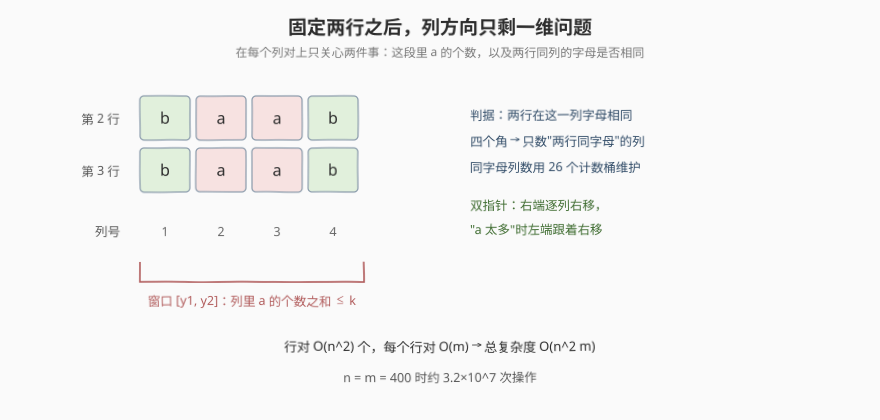
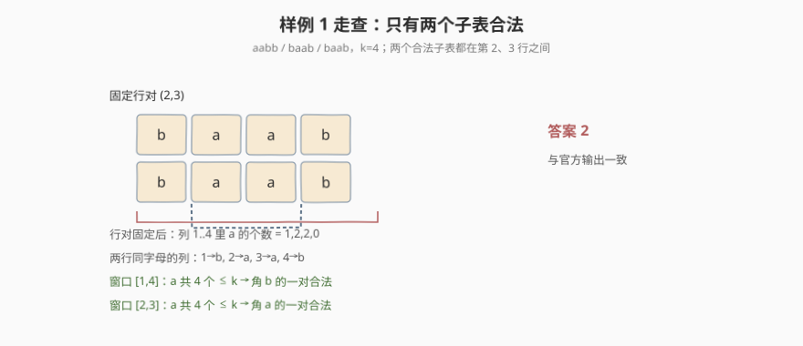

# Codeforces 253D 字母表格计数 题解

## 1. 题目概述

- **题目链接**：https://codeforces.com/problemset/problem/253/D
- **比赛来源**：Codeforces Round 154 (Div. 2) · Problem D（UTC 2012-12-08）
- **难度**：2000
- **标签**：前缀和、双指针、枚举
- **评测类型**：普通
- **限制**：时间 2 s / 内存 256 MB

**题意**：给出 $n \times m$ 的小写字母表格。统计满足下面两条的子表个数：

- 子表由 $x_1 < x_2$、$y_1 < y_2$ 确定，包含行 $x_1 \ldots x_2$、列 $y_1 \ldots y_2$ 的所有格子；
- 子表里字母 `a` 的个数不超过 $k$；
- 子表的四个角 $(x_1,y_1)$、$(x_1,y_2)$、$(x_2,y_1)$、$(x_2,y_2)$ 上的字母**全都相同**。

**约束**：

- $2 \le n, m \le 400$：四元组 $(x_1,x_2,y_1,y_2)$ 共约 $\binom{n}{2}\binom{m}{2} \approx 6.4 \times 10^9$ 个，逐个枚举必然超时。
- $0 \le k \le nm$：$k$ 可以很大（此时"a 的个数"约束几乎是废的），也可以是 0。
- 答案是子表个数，最多约 $6.4 \times 10^9$，超过 `int`，必须用 `long long`。
- 只有一组数据。

## 2. 示例与观察

官方样例 1：

```text
输入：
3 4 4
aabb
baab
baab

输出：
2
```

官方样例 2：

```text
输入：
4 5 1
ababa
ccaca
ccacb
cbabc

输出：
1
```

**样例 1 的演算**：把两个合法子表列出来（1 基）：

| 行范围 | 列范围 | 四角字母 | 内部 `a` 的个数 |
|--------|--------|----------|------------------|
| 2..3 | 1..4 | `b` | 4 |
| 2..3 | 2..3 | `a` | 4 |

恰好 2 个，与输出一致。注意第一个子表的四角是 $(2,1),(2,4),(3,1),(3,4)$，字母依次是 `b`,`b`,`b`,`b`。

**样例 2 的演算**：唯一的合法子表是行 2..3、列 1..2，四角都是 `c`，内部一个 `a` 也没有（$0 \le k = 1$）。其余候选要么四角不齐，要么内部 `a` 的个数超过 1。

**观察 1**：四角相同这个条件可以拆开。记两个行号 $x_1 < x_2$，则在列 $y$ 上"这一列能否充当左右边界"只取决于 $(g_{x_1,y}, g_{x_2,y})$ 这一对字母。四角全等 $\iff$ 两列的这一对字母相同，且这一对的两个分量也相同，即两列上下字母都等于同一个字母 $c$。

**观察 2**：`a` 的个数是"列前缀和"可以回答的量。固定行对 $(x_1,x_2)$ 后，令 $c_y$ 为第 $y$ 列在行 $x_1 \ldots x_2$ 内 `a` 的个数，那么子表内 `a` 的个数就是 $\sum_{y=y_1}^{y_2} c_y$。

**观察 3**：固定行对之后，问题变成一维的："数有多少对 $y_1 < y_2$，使列区间和不超过 $k$，且两列同属一个字母 $c$（上下都等于 $c$）"。这是**双指针 + 桶计数**的经典形状。

## 3. 解题思路

### 3.1 朴素做法与瓶颈

四层循环枚举 $x_1,x_2,y_1,y_2$，再用二维前缀和 $O(1)$ 判定，总复杂度 $O(n^2 m^2) \approx 6.4 \times 10^9$，超时十倍以上。

瓶颈在于"两个行号 + 两个列号"一共四个自由度。$n, m \le 400$ 意味着 $O(n^2 m) = 6.4 \times 10^7$ 是可行的，于是目标就明确了：**把四个自由度压到三个**，也就是"枚举行对（$O(n^2)$），再在列方向上用线性时间统计（$O(m)$）"。

### 3.2 核心观察：固定行对后的一维问题



固定 $x_1 < x_2$ 后，定义

$$c_y = \#\{\, i \in [x_1, x_2] : g_{i,y} = \texttt{a} \,\}, \qquad \text{bad}_y = \bigl[\, g_{x_1,y} \ne g_{x_2,y} \,\bigr].$$

- 子表的 `a` 计数 $= \sum_{y=y_1}^{y_2} c_y$，所以"不超过 $k$"是关于列区间的一个**和约束**；
- 四角相同 $\iff$ `bad`$_{y_1} = $ `bad`$_{y_2} = 0$ 且 $g_{x_1,y_1} = g_{x_1,y_2}$。

于是问题变成：数对 $y_1 < y_2$，满足

$$\sum_{y=y_1}^{y_2} c_y \le k, \qquad \text{bad}_{y_1} = \text{bad}_{y_2} = 0,\qquad g_{x_1,y_1} = g_{x_1,y_2}.$$

**双指针处理和约束**：对每个右端点 $y_2$，设 $L(y_2)$ 是最小的下标使 $\sum_{L}^{y_2} c_y \le k$。由于 $c_y \ge 0$，$L(y_2)$ 随 $y_2$ 单调不减，可以用一个只右移的指针维护。合法的左端点就是区间 $[L(y_2), y_2 - 1]$ 里那些"合格"的列。

**桶计数处理字母约束**：维护 `cnt[c]` = 当前窗口 $[L(y_2), y_2]$ 内"合格列"中字母为 $c$ 的列数（合格 = 上下两格相同且等于 $c$）。那么以 $y_2$ 为右端点的合法对数就是 `cnt[c] - 1`（减去 $y_2$ 自己）。

### 3.3 算法流程

1. 读入表格；
2. 枚举 $x_1 = 0 \ldots n-1$：
   - 用 $c_y \leftarrow [g_{x_1,y} = \texttt{a}]$ 初始化列计数；
   - 枚举 $x_2 = x_1+1 \ldots n-1$：
     - 把第 $x_2$ 行的 `a` 累加进 $c_y$（增量维护，$O(m)$）；
     - 清空桶 `cnt[0..25]`，令 `sum = 0`、`L = 0`；
     - 对 $y_2 = 0 \ldots m-1$：
       - `sum += c[y2]`；若 $g_{x_1,y_2} = g_{x_2,y_2}$ 则 `cnt[该字母]++`；
       - `while (sum > k)`：把第 $L$ 列移出窗口（`sum -= c[L]`，若该列合格则 `cnt--`），`L++`；
       - 若 $L \le y_2$ 且 $y_2$ 这一列合格，则 `ans += cnt[该字母] - 1`；
3. 输出 `ans`。

注意"先把自己放进桶、再统计、最后减 1"的顺序：这样 `cnt[c]` 里恰好包含 $[L, y_2]$ 的全部合格列，减去自身就只剩合法的左端点。

### 3.4 样例走查



**样例 1**（`aabb` / `baab` / `baab`，$k = 4$）：只看行对 $(2,3)$（1 基），两行是 `baab` 与 `baab`。

- 列 `a` 计数：第 1 列 0 个（`b`,`b`）、第 2 列 2 个（`a`,`a`）、第 3 列 2 个（`a`,`a`）、第 4 列 0 个（`b`,`b`）；
- 四条列的上下字母都相同，所以全部合格，字母分别是 `b`,`a`,`a`,`b`；
- $y_2 = 1$：窗口 $\{1\}$，`cnt[b] = 1`，贡献 $1-1 = 0$；
- $y_2 = 2$：`cnt[a] = 1`，贡献 0；
- $y_2 = 3$：`cnt[a] = 2`，贡献 1（对应列对 $(2,3)$，和 $0+2 \le 4$）；
- $y_2 = 4$：窗口 $[1,4]$ 的和 $= 0+2+2+0 = 4 \le 4$，`cnt[b] = 2`，贡献 1（对应列对 $(1,4)$）。

小计 2。其余行对的合格列都不足两列，所以总数也是 2，与官方输出一致。这也说明为什么"和约束"必须用双指针：窗口会随着 $y_2$ 增大而向右滑动，而不是固定不动。

## 4. 正确性证明

固定行对 $(x_1,x_2)$。称一列 $y$ 为**好列**，若 $g_{x_1,y} = g_{x_2,y}$，此时记它的字母为 $\text{let}(y)$。

**引理 1（四角条件的等价形式）**：对 $y_1 < y_2$，子表四角字母全等，当且仅当 $y_1, y_2$ 都是好列且 $\text{let}(y_1) = \text{let}(y_2)$。

**证明**：四角是 $g_{x_1,y_1}, g_{x_1,y_2}, g_{x_2,y_1}, g_{x_2,y_2}$。若 $y_1,y_2$ 都是好列且字母相同，则四者都等于该字母，全等。(⇒) 若四角全等，则 $g_{x_1,y_1} = g_{x_2,y_1}$，说明 $y_1$ 是好列；同理 $y_2$ 是好列；进而 $\text{let}(y_1) = g_{x_1,y_1} = g_{x_1,y_2} = \text{let}(y_2)$。∎

**引理 2（窗口正确）**：记 $S(y_1,y_2) = \sum_{y=y_1}^{y_2} c_y$。由于 $c_y \ge 0$，对每个 $y_2$，集合 $\{y_1 \le y_2 : S(y_1,y_2) \le k\}$ 是形如 $[L(y_2), y_2]$ 的区间，且 $L(y_2)$ 关于 $y_2$ 单调不减；双指针（只右移的 `L`）恰好求出所有 $L(y_2)$。

**证明**：若 $S(y_1,y_2) \le k$ 且 $y_1' > y_1$，则 $S(y_1',y_2) \le S(y_1,y_2) \le k$（非负项），所以可行集是后缀。单调性：设 $y_2' > y_2$，对任意 $y_1 < L(y_2)$ 有 $S(y_1,y_2) > k$，故 $S(y_1,y_2') \ge S(y_1,y_2) > k$，于是 $L(y_2') \ge L(y_2)$。双指针在内层 `while` 停止时，窗口和 $\le k$ 而（若 $L>0$）去掉 $L-1$ 后 $>k$，正是最小可行下标。∎

**引理 3（不重不漏）**：算法对每个 $y_2$ 恰好统计一次以 $y_2$ 为右端点的合法列对，且每个合法列对恰被一个 $y_2$ 统计。

**证明**：列对由 $y_1 < y_2$ 唯一确定右端点，故按 $y_2$ 分类是划分。对固定 $y_2$，桶 `cnt[c]` 在统计时刻记录了 $[L(y_2), y_2]$ 内所有好列按字母的计数（先插入 $y_2$，再把 $[0, L-1]$ 的列全部移除），因此 `cnt[c] - 1` 正是 $[L(y_2), y_2-1]$ 内字母为 $c$ 的好列个数，由引理 1、2 这正是以 $y_2$ 为右端点、字母为 $c$ 的合法列对数。∎

**定理**：算法输出的 `ans` 等于满足全部条件的子表个数。

**证明**：每个子表由行对 $(x_1,x_2)$ 与列对 $(y_1,y_2)$ 唯一确定，算法外层枚举了所有行对、内层由引理 3 统计了该行对下所有合法列对，故总数正确。∎

## 5. 复杂度分析

- **时间**：$O(n^2 m)$。行对约 $n^2/2$ 个，每个行对做一次 $O(m)$ 的列扫描（内层 `L` 只右移，总移动量 $O(m)$）。$n = m = 400$ 时约 $3.2 \times 10^7$ 次基本操作。
- **空间**：$O(nm + m + 26)$，即表格本体（约 160 KB 字符）加两个长度 $m$ 的数组与 26 个计数器。
- **与时限的关系**：时限 2 s。最大数据（$400 \times 400$、随机 `a`/`b`、$k = 20000$）实测端到端 **195 ms**，不到时限的 $1/10$。
- **为什么不是 $O(n^2 m \log m)$**：和约束与字母约束都能用"只右移的指针 + 桶"处理，不需要二分或树状数组。

## 6. 参考代码

### C++17

```cpp
#include <bits/stdc++.h>
using namespace std;

static char g[405][405];
static int colA[405];   // 当前行对 (x1,x2) 下，每列里 'a' 的个数
static int cnt[26];     // 窗口内的列里，上下两格字母相同且等于 c 的列数

int main() {
    int n, m, k;
    if (scanf("%d %d %d", &n, &m, &k) != 3) return 0;
    for (int i = 0; i < n; i++) scanf("%s", g[i]);

    long long ans = 0;
    for (int x1 = 0; x1 < n; x1++) {
        for (int y = 0; y < m; y++) colA[y] = (g[x1][y] == 'a');
        for (int x2 = x1 + 1; x2 < n; x2++) {
            for (int y = 0; y < m; y++) colA[y] += (g[x2][y] == 'a');
            memset(cnt, 0, sizeof(cnt));
            long long sum = 0;
            int L = 0;
            for (int y2 = 0; y2 < m; y2++) {
                sum += colA[y2];
                // 只有上下两格字母相同的列才可能充当"角"
                int c = (g[x1][y2] == g[x2][y2]) ? g[x1][y2] - 'a' : -1;
                if (c >= 0) cnt[c]++;
                while (sum > k) {                        // 窗口内 'a' 超过 k，左端右移
                    sum -= colA[L];
                    int cl = (g[x1][L] == g[x2][L]) ? g[x1][L] - 'a' : -1;
                    if (cl >= 0) cnt[cl]--;
                    L++;
                }
                if (L <= y2 && c >= 0) ans += cnt[c] - 1;  // 与 [L, y2-1] 中同字母的列配对
            }
        }
    }
    printf("%lld\n", ans);
    return 0;
}
```

### Python3

```python
import sys


def main() -> None:
    data = sys.stdin.buffer.read().split()
    if not data:
        return
    n, m, k = int(data[0]), int(data[1]), int(data[2])
    g = [data[3 + i].decode() for i in range(n)]

    ans = 0
    for x1 in range(n):
        row1 = g[x1]
        col_a = [1 if row1[y] == 'a' else 0 for y in range(m)]
        for x2 in range(x1 + 1, n):
            row2 = g[x2]
            for y in range(m):
                if row2[y] == 'a':
                    col_a[y] += 1
            cnt = [0] * 26
            total = 0
            L = 0
            for y2 in range(m):
                total += col_a[y2]
                c = ord(row1[y2]) - 97 if row1[y2] == row2[y2] else -1
                if c >= 0:
                    cnt[c] += 1
                while total > k:
                    total -= col_a[L]
                    cl = ord(row1[L]) - 97 if row1[L] == row2[L] else -1
                    if cl >= 0:
                        cnt[cl] -= 1
                    L += 1
                if L <= y2 and c >= 0:
                    ans += cnt[c] - 1
    sys.stdout.write(str(ans) + "\n")


main()
```

Python 版的算法与 C++ 完全相同，但 $400^3/2 \approx 3.2 \times 10^7$ 次循环在 CPython 下要 8.7 s（实测），**满数据请用 PyPy3 或直接提交 C++**。

## 7. 边界情况与易错点

1. **列计数要包含起始行**：固定行对 $(x_1,x_2)$ 时，$c_y$ 统计的是行 $x_1$ **到** $x_2$（含两端）的 `a`。若增量维护时只从 $x_1+1$ 开始累加，会漏掉第 $x_1$ 行——本实现的第一版就栽在这里（样例 2 输出 3 而不是 1）。
2. **四角必须**同时**相等**：只保证"上下两格各自相等"是不够的，还要两列字母相同。等价写法是"两列都是好列且字母相同"，用 26 个桶统计即可；若用二维桶（记录字母对），就必须只取对角元素。
3. **先插入再统计再减一**：`cnt[c]` 里包含 $y_2$ 自己，所以贡献是 `cnt[c] - 1`。若改成"先统计再插入"，则统计的是 $[L, y_2-1]$，贡献就是 `cnt[c]`——两种写法都对，但不能混。
4. **`L` 可能越过 `y_2`**：当 $c_{y_2} > k$ 时，窗口被清空、$L$ 变成 $y_2+1$。此时不能统计（否则 `cnt[c] - 1` 可能变成 $-1$），必须用 `if (L <= y2)` 保护。
5. **`sum` 的类型**：$k$ 最大 $nm = 160000$，`int` 够；但答案最大约 $6.4 \times 10^9$，`ans` 必须 `long long`。
6. **桶的清空**：每个行对都要把 26 个桶清零。用 `memset(cnt, 0, sizeof(cnt))` 一次清完，别只清用到的几个字母（残留值会串行）。
7. **双指针的方向**：`while (sum > k)` 里减的是第 `L` 列，然后把 `L` 加一；顺序反了会减错列。另外 `L` 不能在每个 $y_2$ 重新置 0，否则复杂度退化到 $O(n^2 m^2)$。
8. **读入表格**：用 `scanf("%s", g[i])` 逐行读，注意每行长度正好 $m$、不含空格；若行末有 `\r`（Windows 数据）需要忽略。
9. **行对的下界**：子表要求 $x_1 < x_2$、$y_1 < y_2$，即至少 $2 \times 2$。单行或单列的子表**不算**，所以 $x_2$ 从 $x_1+1$ 开始。

## 8. 验证记录

- **编译环境与命令**：`clang++ -std=c++17 -O2 -Wall`（配合 `codeforces/tools/include` 兼容头，可原样提交 GNU C++17）；Python 3.9.6。
- **官方样例**：2 / 2 通过（→ 2、1），C++ 与 Python 一致。
- **独立暴力对拍**：暴力版四重循环枚举所有 $(x_1,x_2,y_1,y_2)$，直接比较四个角的字母、并现场数 `a` 的个数（$O(n^2m^2)$，与参考实现完全独立）。随机 300 组：$n,m \in [2,5]$，字母表取 `a` / `ab` / `abc` 三档，$k$ 在 $[0, nm]$ 内随机。**300 / 300 全部一致**（C++ 与 Python 各跑一遍，共 600 次比较）。
- **最大约束性能**：$n = m = 400$、随机 `a`/`b` 表格、$k = 20000$，答案 691225101，7 次取最小端到端 **195 ms**（含进程启动），约为 2 s 时限的 $1/10$。Python 同数据 8.7 s，故正文注明建议 PyPy3/C++。
- **图片校验**：两张 SVG（`cf253d_rowpair.svg`、`cf253d_walk.svg`）通过 `ElementTree.parse`，含 `feTurbulence` 与手写字体。
- **复核状态**：verified。

## 相关题目与扩展

- [Codeforces 253C Text Editor](https://codeforces.com/problemset/problem/253/C)：同场 C 题，也是"枚举一部分、另一部分用最短路/双指针"。
- [Codeforces 253E Printer](https://codeforces.com/problemset/problem/253/E)：同场 E 题，优先级队列模拟 + 二分。
- [Codeforces 1191D Tokitsukaze, CSL and Stone Game](https://codeforces.com/problemset/problem/1191/D)：计数类游戏题，与本篇无直接关系但同为"先想约束等价形式"的训练。
- [LeetCode 1504. 统计全 1 子矩形](https://leetcode.cn/problems/count-submatrices-with-all-ones/)：同样是"固定上下边界、在列方向做线性统计"的降维套路，与本篇骨架一致。

**延伸思考**：

1. **如果要求"四角字母各不相同"**：桶要变成"字母对集合"的容斥，或者对每个字母 $c$ 单独统计后再用总对数减去，复杂度不变但常数上升。
2. **如果要求"子表里 `a` 的个数恰好等于 $k$"**：双指针的单调性依然成立（和非负），只需把 `while (sum > k)` 改成 `while (sum > k) 移左端`，再单独处理 `sum == k` 的窗口，或者在左端用"和等于某值"的计数技巧。
3. **如果 $n, m$ 都放大到 $2000$**：$O(n^2 m)$ 不可行，需要换思路，例如按字母分组、对每个字母单独统计"四角为该字母"的子表，再用二维前缀和与某种分块，难度会显著上升。
4. **如果表格只有两种字母**：可以把"四角相同"翻译成"两个角列的模式相同"，用位运算打包每列的模式，桶的规模降到 4 种，常数大幅下降——这是本题在 $n$ 较大时的优化方向。

