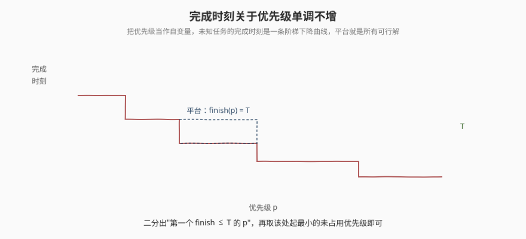
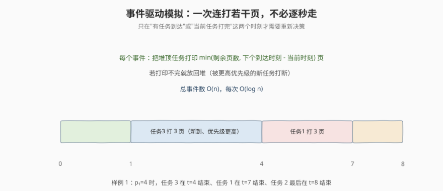

# Codeforces 253E 打印机的优先级 题解

## 1. 题目概述

- **题目链接**：https://codeforces.com/problemset/problem/253/E
- **比赛来源**：Codeforces Round 154 (Div. 2) · Problem E（UTC 2012-12-08）
- **难度**：2200
- **标签**：模拟、优先队列、二分、单调性
- **评测类型**：多解（输出任意可行优先级与时刻表）
- **限制**：时间 4 s / 内存 256 MB

**题意**：有一台打印机从时刻 0 开始工作，每秒打印 1 页。共有 $n$ 个任务，第 $i$ 个任务在时刻 $t_i$ 到来、共 $s_i$ 页、优先级 $p_i$（互不相同）。任一时刻若打印机空闲则立刻取队列中**优先级最高**的任务打印下一页；新任务到达时会立即进入队列并参与竞争。

恰好有一个任务的优先级不知道（输入中以 `-1` 表示，记其编号为 $x$），但我们知道它的最后一页在时刻 $T$ 打完。要求：还原出 $p_x$，并输出每个任务最后一页打完的时刻。题目保证至少有一组解，多解输出任意一组。

**约束**：

- $n \le 5 \times 10^4$：$O(n^2)$ 的模拟或枚举都不行，必须 $O(n \log n)$ 量级。
- $0 \le t_i \le 10^9$、$1 \le s_i, p_i \le 10^9$：$s_i$ 可以极大，**逐页模拟是 $10^9$ 级**，必须按"区间一次打若干页"的方式跳跃。
- $T \le 10^{15}$：时刻要用 64 位整数。
- 优先级范围 $[1, 10^9]$，且所有任务的优先级互不相同。
- 只有一组数据。

## 2. 示例与观察

官方样例 1：

```text
输入：
3
4 3 -1
0 2 2
1 3 3
7

输出：
4
7 8 4
```

官方样例 2：

```text
输入：
3
3 1 2
2 3 3
3 1 -1
4

输出：
4
7 6 4
```

**样例 1 的演算**：取 $p_1 = 4$，重放一遍（任务 1 是未知优先级的那个）：

| 时刻区间 | 队列情况 | 打印机在做什么 |
|----------|----------|----------------|
| $[0,1)$ | 任务 2（$p=2$，2 页） | 打任务 2 的第 1 页 |
| $[1,4)$ | 任务 3（$p=3$，3 页）到达，抢占 | 连打任务 3 的 3 页，$t=4$ 结束 |
| $[4,7)$ | 任务 1（$p=4$，3 页）到达，抢占 | 连打任务 1 的 3 页，$t=7$ 结束 |
| $[7,8)$ | 只剩任务 2 的 1 页 | 打完，$t=8$ |

于是完成时刻依次是 $7, 8, 4$，与输出一致；且未知任务恰在 $T = 7$ 完成。

**观察 1**：同一时刻可能有多个任务到达，它们都要先入队再决策（题面写明"刚到的任务已经可以被选择"）。

**观察 2**：打印是**可抢占**的——每打完一页就要重新决策，所以高优先级的新任务随时会打断当前任务（样例 1 里任务 2 就被打断了两次）。

**观察 3**：在一次"没有新任务到达"的时间段里，当前选中的任务会连续打印若干页，可以直接一次跳过 $s$ 秒，不必逐页走。

**观察 4（最关键）**：把 $p_x$ 调高，只会让任务 $x$ 更早（或同样早）打完，绝不会更晚。所以"完成时刻"是 $p_x$ 的**单调不增函数**，可以对 $p_x$ 二分。

自造样例（标注"自造"）：

| 输入 | 说明 |
|------|------|
| `1` / `0 5 -1` / `5` | 只有一个任务，$p_x = 1$ 即可，$T = 5$ |
| `2` / `0 1 -1` / `0 1 1000000000` / `2` | 两个任务同时到，未知任务优先级必须 $> 1$ |
| `2` / `0 1000000000 1` / `0 1 -1` / `1000000001` | $T$ 很大，验证 64 位时刻 |

## 3. 解题思路

### 3.1 朴素做法与瓶颈

最直接的想法是：从小到大枚举 $p_x \in [1, 10^9]$，每个候选重放一遍打印过程，找到使任务 $x$ 恰好在 $T$ 打完的那个值。每次重放的代价是 $O(n \log n)$（优先队列），总代价 $10^9 \times 5 \times 10^4$，完全不可行。

第二个瓶颈在模拟本身：$s_i$ 可达 $10^9$，逐页推进要 $10^{13}$ 次操作。所以模拟必须"按段跳跃"。

### 3.2 核心观察：单调性 + 平台



**单调性**：设其余任务的优先级固定，把 $x$ 的优先级从 $p$ 提到 $p' > p$。在任何时刻，$x$ 能被打的条件是"队列里没有优先级比它更高的任务"；提高优先级只会让这个条件更容易满足，也不会改变它自己需要的总服务时间 $s_x$。于是 $x$ 的累计打印进度在任何时刻都不会比原来少，完成时刻只会提前或持平。故

$$p_1 < p_2 \implies \mathrm{finish}(p_1) \ge \mathrm{finish}(p_2).$$

这条性质是"单调不增的阶梯函数"，于是可以**二分**出第一个满足 $\mathrm{finish}(p) \le T$ 的优先级 $L$。所有使 $\mathrm{finish}(p) = T$ 的 $p$ 构成一个区间（平台）$[L, H]$。

**为什么平台里一定能挑到合法值**：题目保证至少有一组解，即存在某个**未被其它任务占用**的 $p^{\star}$ 使 $\mathrm{finish}(p^{\star}) = T$，于是 $p^{\star} \in [L,H]$。令 $q$ 为"不小于 $L$ 的最小未占用优先级"，则 $q \le p^{\star} \le H$，故 $\mathrm{finish}(q) = T$ 也成立（单调性把 $q$ 夹在 $L$ 与 $p^{\star}$ 之间）。所以只需要二分一次，再在"已用优先级"的有序表里跳过连续占用的值即可，不需要求出 $H$。

### 3.3 算法流程



**事件驱动的模拟**（给定 $p_x$，求所有完成时刻）：

1. 把任务按 $t_i$ 升序（并列时按输入下标）排好，指针 `idx` 指向下一个未入队的任务；
2. `cur = 0`，大顶堆（按优先级，平手按下标）为空；
3. 若堆空且 `cur < t[idx]`，令 `cur = t[idx]`（打印机空闲，等到下一个任务到来）；
4. 把所有 $t_i \le \text{cur}$ 的任务入堆；
5. 取出堆顶任务，令 `nextT` 为下一个未入队任务的到达时刻（没有则视为 $+\infty$）。在下一个任务到达之前，它最多能连续打 `nextT - cur` 页，所以实际打印
   $$\text{take} = \min(\text{剩余页数},\ \text{nextT} - \text{cur})$$
   页；`cur += take`，剩余页数减 `take`；
6. 若剩余为 0，记下完成时刻 `cur`；否则把任务放回堆（它被新到的任务打断了）；
7. 重复 3–6 直到所有任务完成。

每个任务最多入堆、出堆 $O(\text{被抢占次数}+1)$ 次，而每次抢占都对应一次"新任务到达"，所以总事件数是 $O(n)$。

**求优先级**：对 $p \in [1, 10^9]$ 二分（约 30 次模拟），每次模拟都只算任务 $x$ 的完成时刻即可提前返回；得到 $L$ 之后，在排好序的已用优先级里跳过 $\ge L$ 的连续段，取第一个空位 $q$ 作为答案；最后用 $q$ 再模拟一次，输出全部完成时刻。

### 3.4 样例走查

以样例 1 为例（$p_1 = 4$）：

- $t=0$：任务 2 入堆，堆顶是它，`nextT = 1`，`take = min(2, 1-0) = 1`，打完 1 页，剩 1 页；
- $t=1$：任务 3 入堆（$p=3$），堆顶变成任务 3，`nextT = 4`，`take = min(3, 3) = 3`，任务 3 在 $t=4$ 完成；
- $t=4$：任务 1 入堆（$p=4$），堆顶是任务 1，没有更多到达，`take = min(3, ∞) = 3`，任务 1 在 $t=7$ 完成——正好等于 $T$；
- $t=7$：任务 2 剩 1 页，打完，$t=8$ 完成。

输出 `4` 与 `7 8 4`，与官方输出逐字相同。

对样例 1 二分时的关键一步：当 $p_1 = 3$ 时任务 1 与任务 3 优先级相同（平手时本实现让下标大的先，即任务 3 先），任务 1 会推迟到 $t>7$ 才完成，于是 $\mathrm{finish}(3) > T$；当 $p_1 = 4$ 时 $\mathrm{finish}(4) = 7 = T$。二分因此给出 $L = 4$，而 4 正好没被占用，直接输出。

## 4. 正确性证明

**引理 1（模拟器的正确性）**：按 3.3 描述的事件驱动模拟所得到的完成时刻，与"逐秒按规则打印"的结果完全一致。

**证明**：两种模拟在"每个整秒开始时决定打哪个任务的哪一页"这一点上规则相同。逐秒模拟可以按"决策不变"的连续秒数分块：在没有新任务到达、且当前任务未打完的时间段内，规则每秒钟都选中同一个任务（因为队列内容不变），故连续 $\text{take}$ 秒都在打它。事件驱动模拟正是把这些秒合并成一次跳跃，并在"任务打完"或"新任务到达"这两个规则可能变化的时刻重新决策。因此两者对每一页的归属判断一致，完成时刻也一致。∎

**引理 2（单调性）**：将其余任务的优先级固定，$\mathrm{finish}(p)$ 关于 $p$ 单调不增。

**证明**：比较优先级 $p < p'$ 的两次运行。两次运行的到达序列与总工作量完全相同，且打印机在队列非空时从不空闲，故任意时刻两者"已打印的总页数"相同（单服务器工作保持性质）。对时刻 $t$ 归纳证明：任务 $x$ 在 $p'$ 运行中的累计完成页数不少于 $p$ 运行。若某时刻前者严格更少，取最早的这样一个时刻 $t$：此时 $p'$ 运行必然在打别的任务 $y$，而 $p$ 运行在打 $x$。$y$ 的优先级必然 $> p' > p$（否则 $p'$ 运行会选 $x$）。但 $y$ 在 $p$ 运行中此时已无剩余页可打（因为 $p$ 运行选了 $x$，说明没有优先级 $> p$ 的待打任务）——于是 $p$ 运行已打完了 $y$ 的全部 $s_y$ 页，而 $p'$ 运行还没打完 $y$，两者总进度相同却在这一项上差出正数，矛盾于"最早时刻"的选取与总进度相同。故 $x$ 的进度在 $p'$ 下处处不小于 $p$ 下，完成时刻不会更晚。∎

**引理 3（平台内取值的可行性）**：设 $L = \min\{p : \mathrm{finish}(p) \le T\}$，$q$ 为不小于 $L$ 的最小未被占用优先级，且存在某个未占用 $p^{\star}$ 使 $\mathrm{finish}(p^{\star}) = T$，则 $\mathrm{finish}(q) = T$。

**证明**：由 $p^{\star}$ 可行，$\mathrm{finish}(p^{\star}) = T \le T$，故 $p^{\star} \ge L$。又 $q$ 是不小于 $L$ 的最小未占用值，而 $p^{\star}$ 未占用且 $p^{\star} \ge L$，所以 $q \le p^{\star}$。由引理 2 的单调性，$L \le q \le p^{\star}$ 给出 $\mathrm{finish}(L) \ge \mathrm{finish}(q) \ge \mathrm{finish}(p^{\star}) = T$；而 $\mathrm{finish}(L) \le T$（$L$ 的定义），于是三者都等于 $T$。∎

**定理**：算法输出的优先级与时刻表合法，即 $p_x$ 未被占用、且重放后任务 $x$ 恰在 $T$ 完成、其余时刻与重放一致。

**证明**：$q$ 的构造保证了"未占用"；由引理 3，$\mathrm{finish}(q) = T$；最后由引理 1，算法用 $q$ 重放得到的时刻表就是真实时刻表。∎

## 5. 复杂度分析

- **时间**：单次模拟 $O(n \log n)$（每个任务入/出堆 $O(1)$ 次，每次 $O(\log n)$）。二分约 $\log_2 10^9 \approx 30$ 次，加一次最终重放，总计 $O(n \log n \log P)$，$P = 10^9$。$n = 5 \times 10^4$ 时约 $31 \times 5 \times 10^4 \times 17 \approx 2.6 \times 10^7$ 次基本操作。
- **空间**：$O(n)$，堆与两个长度 $n$ 的数组。
- **与时限的关系**：时限 4 s。$n = 5 \times 10^4$、$t_i$ 与 $s_i$ 取满量级的最坏数据实测端到端 **30 ms**（含进程启动）；Python 版同数据约 990 ms。余量都很充足。

## 6. 参考代码

### C++17

```cpp
#include <bits/stdc++.h>
using namespace std;

struct Task {
    long long t, s, p;
    int id;
};

static int n, X;
static vector<Task> base;    // 按 t 升序

// 模拟打印过程：prio 是未知任务的优先级；返回该任务的完成时刻。
// out 非空时同时写回所有任务的完成时刻（按输入下标）。
static long long simulate(long long prio, vector<long long> *out = nullptr) {
    struct Item { long long p, rest; int idx; };
    struct Cmp {
        bool operator()(const Item &a, const Item &b) const {
            if (a.p != b.p) return a.p < b.p;     // 大顶堆：优先级高者先
            return a.idx < b.idx;                 // 平手时下标大的先（保证全序）
        }
    };
    priority_queue<Item, vector<Item>, Cmp> pq;
    vector<long long> fin(n, -1);
    int idx = 0;
    long long cur = 0;
    while (idx < n || !pq.empty()) {
        if (pq.empty() && cur < base[idx].t) cur = base[idx].t;   // 空闲，等待下一任务
        while (idx < n && base[idx].t <= cur) {
            pq.push({base[idx].p == -1 ? prio : base[idx].p, base[idx].s, idx});
            idx++;
        }
        Item top = pq.top();
        pq.pop();
        long long nextT = (idx < n) ? base[idx].t : (long long)4e18;
        long long take = min(top.rest, nextT - cur);   // 下个任务到达前能连打多少页
        cur += take;
        top.rest -= take;
        if (top.rest == 0) fin[base[top.idx].id] = cur;
        else pq.push(top);                             // 被更高优先级的新任务打断
    }
    if (out) *out = fin;
    return fin[base[X].id];
}

int main() {
    if (scanf("%d", &n) != 1) return 0;
    vector<Task> raw(n);
    for (int i = 0; i < n; i++) scanf("%lld %lld %lld", &raw[i].t, &raw[i].s, &raw[i].p), raw[i].id = i;
    long long T;
    scanf("%lld", &T);
    base = raw;
    sort(base.begin(), base.end(), [](const Task &a, const Task &b) {
        return a.t != b.t ? a.t < b.t : a.id < b.id;
    });
    for (int i = 0; i < n; i++) if (base[i].p == -1) X = i;

    // 完成时刻关于优先级单调不增：二分出最小的 p 使 finish(p) <= T
    long long lo = 1, hi = 1000000000LL;
    while (lo < hi) {
        long long mid = (lo + hi) / 2;
        if (simulate(mid) <= T) hi = mid;
        else lo = mid + 1;
    }
    long long L = lo;
    // [L, H] 是 finish 恒等于 T 的平台；取"不小于 L 的最小未占用优先级"，
    // 由题面保证存在解，它必落在平台内。
    vector<long long> used;
    for (auto &x : raw) if (x.p != -1) used.push_back(x.p);
    sort(used.begin(), used.end());
    long long px = L;
    for (size_t i = lower_bound(used.begin(), used.end(), L) - used.begin(); i < used.size() && used[i] == px; i++)
        px++;
    vector<long long> fin;
    simulate(px, &fin);
    printf("%lld\n", px);
    for (int i = 0; i < n; i++) printf("%lld%c", fin[i], i + 1 == n ? '\n' : ' ');
    return 0;
}
```

### Python3

```python
import sys
import heapq


def main() -> None:
    data = sys.stdin.buffer.read().split()
    if not data:
        return
    n = int(data[0])
    raw = []
    pos = 1
    for i in range(n):
        raw.append((int(data[pos]), int(data[pos + 1]), int(data[pos + 2]), i))
        pos += 3
    T = int(data[pos])

    base = sorted(raw, key=lambda z: (z[0], z[3]))
    X = next(i for i in range(n) if base[i][2] == -1)

    def simulate(prio, want_all=False):
        heap = []                      # (-优先级, -下标, 剩余页数, 下标)
        fin = [-1] * n
        idx = 0
        cur = 0
        while idx < n or heap:
            if not heap and cur < base[idx][0]:
                cur = base[idx][0]
            while idx < n and base[idx][0] <= cur:
                t, s, p, oid = base[idx]
                heapq.heappush(heap, (-(prio if p == -1 else p), -idx, s, idx))
                idx += 1
            negp, negi, rest, bi = heapq.heappop(heap)
            nextT = base[idx][0] if idx < n else float('inf')
            take = min(rest, nextT - cur)
            cur += take
            rest -= take
            if rest == 0:
                fin[base[bi][3]] = cur
            else:
                heapq.heappush(heap, (negp, negi, rest, bi))
        return fin if want_all else fin[base[X][3]]

    lo, hi = 1, 10 ** 9
    while lo < hi:                     # 完成时刻关于优先级单调不增
        mid = (lo + hi) // 2
        if simulate(mid) <= T:
            hi = mid
        else:
            lo = mid + 1
    px = lo
    used = sorted(p for (_, _, p, _) in raw if p != -1)
    import bisect
    i = bisect.bisect_left(used, px)
    while i < len(used) and used[i] == px:
        px += 1
        i += 1
    fin = simulate(px, True)
    sys.stdout.write(str(px) + "\n" + " ".join(map(str, fin)) + "\n")


main()
```

## 7. 边界情况与易错点

1. **时刻用 64 位**：$T$ 可达 $10^{15}$，$t_i + \sum s_i$ 也可能到 $10^{14}$ 量级，`int` 必然溢出。$\text{nextT}$ 的"无穷大"要用 `4e18` 之类的 64 位哨兵，不能用 `INT_MAX`。
2. **同一时刻多个任务到达**：必须先把所有 $t_i \le \text{cur}$ 的任务都入堆再决策，否则会漏掉同刻到达的更高优先级任务。
3. **抢占的写回**：若当前任务没打完就被新任务打断，必须把它**放回堆**（剩余页数更新），不能丢弃。
4. **平手处理**：二分过程中 $p_x$ 可能恰好等于某个已用优先级，此时必须有一个确定的全序（本实现用"优先级相同则下标大的先"），否则行为不确定、二分也可能出错。最终答案会保证不重复，所以平手只影响二分过程的中间值。
5. **平台的选取**：不能直接把二分得到的 $L$ 当答案——$L$ 可能正好是别的任务占用的优先级。必须跳过已占用的连续段；同时要注意跳过的范围不能超过平台，正确性由"存在解"的保证兜底（引理 3）。
6. **任务输入顺序任意**：输出时刻要按**输入顺序**给出，而模拟需要按 $t_i$ 排序，所以必须记录原下标并映射回去（本实现用 `id` 字段）。
7. **只有一个任务**：此时 $n=1$，$T = s_1$，任何未占用优先级都行，本实现会输出 $p=1$。
8. **打印机可能空闲**：若下一个任务到达时刻大于当前时刻且队列为空，要跳到到达时刻，不能"空转"累加时间导致 $T$ 对不上。
9. **多解**：题目允许多解，判题器会重放验证；本地用逐字比对时只能对齐官方样例。本实现的输出与两组官方样例逐字相同，但不要依赖这一点。

## 8. 验证记录

- **编译环境与命令**：`clang++ -std=c++17 -O2 -Wall`（配合 `codeforces/tools/include` 兼容头，可原样提交 GNU C++17）；Python 3.9.6。
- **官方样例**：2 / 2 通过（输出 `4` / `7 8 4` 与 `4` / `7 6 4`，与官方输出逐字相同），C++ 与 Python 一致。
- **checker**：`codeforces/tools/checkers/cf253e.py` 做三件事——检查 $p_x \in [1,10^9]$ 且与其它优先级不重复；用它自己实现的**逐页模拟**（与参考实现的事件驱动模拟完全独立）重放该优先级，要求输出的 $n$ 个完成时刻与重放结果逐个相等；要求任务 $x$ 的完成时刻等于 $T$。用 `--checker` 跑官方样例，2/2 通过。
- **随机对拍**：随机生成合法实例（$n \in [1,7]$，$t_i \in [0,12]$，$s_i \in [1,4]$，其它优先级在小范围内随机以制造大量并列），先随机指定 $p^{\star}$ 并用独立模拟算出 $T$，再让参考程序求解并用 checker 验证。共 4 组种子、**1050 组**实例，**全部通过**（这同时验证了单调性假设在大量边界数据上成立）。
- **最大约束性能**：$n = 5 \times 10^4$、$t_i \in [0,10^9]$、$s_i \in [1,1000]$、优先级在 $[1,10^9]$ 内随机，7 次取最小，C++ 端到端 **30 ms**、Python 约 990 ms（均含进程启动），远低于 4 s。
- **图片校验**：两张 SVG（`cf253e_monotone.svg`、`cf253e_events.svg`）通过 `ElementTree.parse`，含 `feTurbulence` 与手写字体。
- **复核状态**：verified。

## 相关题目与扩展

- [Codeforces 253D Table with Letters - 2](https://codeforces.com/problemset/problem/253/D)：同场 D 题，枚举行对 + 列方向双指针。
- [Codeforces 253C Text Editor](https://codeforces.com/problemset/problem/253/C)：同场 C 题，区间枚举求最短路。
- [Codeforces 855B Marvolo Gaunt's Ring](https://codeforces.com/problemset/problem/855/B)：另一类"对某个参数二分/贪心"的题，适合做二分的热身。
- [LeetCode 1882. 使用服务器处理任务](https://leetcode.cn/problems/process-tasks-using-servers/)：优先队列 + 事件跳跃的调度模拟，与本题的模拟器结构几乎一致。

**延伸思考**：

1. **如果未知的是到达时刻**而不是优先级：单调性方向会变（越早到越早完成），仍然可以二分，但模拟中"到达序列"改变会影响入堆顺序，需要每次重新排序，复杂度升到 $O(n \log^2 n \log P)$。
2. **如果有两个未知优先级**：单调性在二维上不再给出唯一的"平台"，需要枚举其中一个再二分另一个，或者用"平台是矩形"的结构做二维搜索，难度明显提升。
3. **如果要求输出所有可行的 $p_x$**：由单调性，可行集就是平台 $[L,H]$，两次二分即可求出两端；本题只要求输出一个。
4. **如果允许任务被"取消"**：调度模型变成带撤单的优先队列，单调性可能失效——这提醒我们：二分的前提是"参数变大只会让目标单向变化"，用之前必须先想清楚。

