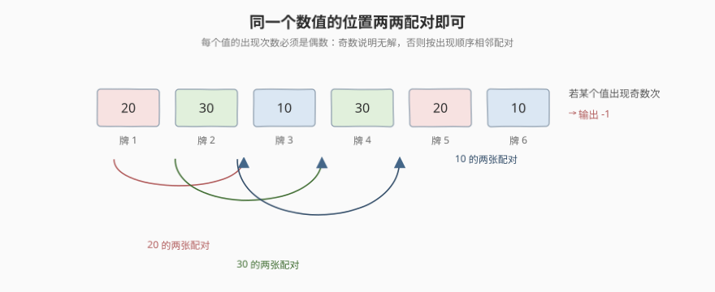
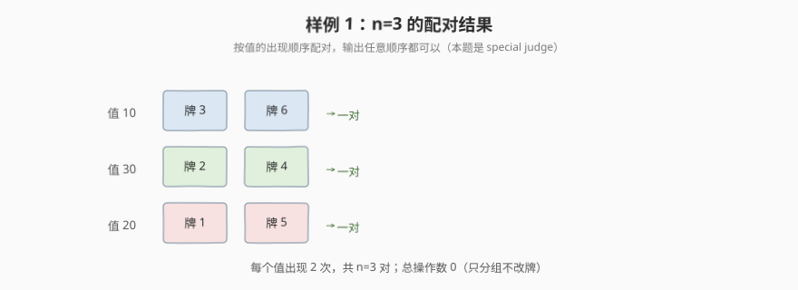

# Codeforces 254A 成对分牌 题解

## 1. 题目概述

- **题目链接**：https://codeforces.com/problemset/problem/254/A
- **比赛来源**：Codeforces Round 155 (Div. 2) · Problem A（UTC 2012-12-09）
- **难度**：1200
- **标签**：构造、计数、分组
- **评测类型**：多解（输出任意合法配对）
- **限制**：时间 1 s / 内存 256 MB

**题意**：有 $2n$ 张牌，第 $i$ 张上写着 $a_i$。要把它们分成 $n$ 对，要求**每一对的两张牌数值相同**。输出 $n$ 行，每行两个下标表示一对（下标从 1 开始，行与行、对内的顺序任意）。做不到就输出 `-1`。

**约束**：

- $n \le 3 \times 10^5$，即牌数 $2n \le 6 \times 10^5$：需要 $O(n)$ 的做法，输出本身就有 $3 \times 10^5$ 行。
- $1 \le a_i \le 5000$：值域很小，可以直接开长度为 5001 的数组按下标分组。
- 只有一组数据。

## 2. 示例与观察

官方样例 1：

```text
输入：
3
20 30 10 30 20 10

输出：
4 2
1 5
6 3
```

官方样例 2：

```text
输入：
1
1 2

输出：
-1
```

**样例 1 的演算**：六张牌的值依次是 $20,30,10,30,20,10$。

| 值 | 出现位置 | 能否配对 |
|----|----------|----------|
| 20 | 1, 5 | ✓ 一对 |
| 30 | 2, 4 | ✓ 一对 |
| 10 | 3, 6 | ✓ 一对 |

每个值都出现偶数次，于是可以两两配成 3 对。官方输出 `4 2`（30 的第二张与第一张）、`1 5`（20）、`6 3`（10）——注意对内的顺序与行序都可以任意。

**样例 2 的演算**：两张牌是 1 和 2，数值不同，无论怎么分都不能满足"每对数值相同"，输出 `-1`。

**观察 1（存在性判定）**：一个值出现了奇数次，那么它必然有一张牌找不到同伴——因为配对只在**相同值**之间进行，奇数次永远配不完。

**观察 2（充分性）**：只要每个值都出现偶数次，把所有同值的牌按出现顺序两两配对（第 1 与第 2、第 3 与第 4……）就得到合法方案，且方案数总是恰好 $n$ 对。

**观察 3**：这是 special judge 题——任何合法配对都算对，所以不必模仿官方输出的顺序。

## 3. 解题思路

### 3.1 朴素做法与瓶颈

最直接的想法是双重循环：对每张还没配对的牌，往后找一张同值的牌。复杂度 $O(n^2)$，$2n = 6 \times 10^5$ 时是 $3.6 \times 10^{11}$ 次比较，必然超时。

瓶颈在于"找同伴"这一步。由于值域只有 5000，可以用**桶**把同值的牌聚在一起，找同伴就变成 $O(1)$。

### 3.2 核心观察与流程



1. 开 5001 个桶，扫描一遍把所有同值牌的下标按顺序存进去（`pos[v]` 是一个下标列表）；
2. 检查是否每个桶的大小都是偶数；只要有一个是奇数，立刻输出 `-1`；
3. 否则对每个桶，按列表顺序两两输出（第 $2k-1$ 个与第 $2k$ 个）。

复杂度 $O(n)$（读入）$+ O(\text{输出量})$，额外空间 $O(n)$。

### 3.3 样例走查



按桶聚合后：`pos[10] = {3, 6}`、`pos[20] = {1, 5}`、`pos[30] = {2, 4}`（这里的下标是 1 基）。三个桶大小都是 2，于是输出三对：

- 值 10：3 与 6
- 值 20：1 与 5
- 值 30：2 与 4

与官方输出 `4 2 / 1 5 / 6 3` 内容一致（只是行序与对内顺序不同）✓。

**自造样例**（标注"自造"）：

| 输入 | 输出 | 说明 |
|------|------|------|
| `1` / `5 5` | `1 2` | 最小规模 |
| `2` / `1 1 2 2` | `1 2`、`3 4` | 两对都成立 |
| `2` / `1 1 1 2` | `-1` | 值 1 出现 3 次 |
| `3` / `7 7 7 7 7 7` | 三对 | 同一个值也能配多对 |

## 4. 正确性证明

**引理 1（必要性）**：若存在合法配对，则每个值的出现次数都是偶数。

**证明**：每一对的两张牌数值相同，所以对任意值 $v$，出现 $v$ 的牌被一些完整的对覆盖；每对贡献 2 张，故 $v$ 的出现次数必为偶数。∎

**引理 2（充分性与构造）**：若每个值的出现次数都是偶数，则按同值列表顺序两两配对得到的方案合法，且恰好 $n$ 对。

**证明**：设值 $v$ 出现 $2k_v$ 次，按顺序配成 $k_v$ 对，每对数值相同 ✓、两张牌的下标不同 ✓（列表里存的是不同的牌）。所有对互不重叠，因为每张牌只在它所属值的列表里出现一次。对数量为 $\sum_v k_v = \frac{1}{2}\sum_v 2k_v = \frac{1}{2}(2n) = n$ ✓。∎

**定理**：算法输出的方案正确；当且仅当存在合法配对时算法不输出 `-1`。

**证明**：由引理 1，若有某个值出现奇数次则必定无解，算法输出 `-1` 正确；由引理 2，所有值都是偶数次时算法给出的配对合法，且覆盖全部 $2n$ 张牌、共 $n$ 对。∎

## 5. 复杂度分析

- **时间**：$O(n)$。建桶一遍 $O(2n)$，输出 $O(n)$ 行；没有循环嵌套。
- **空间**：$O(n)$ 存下标（$6 \times 10^5$ 个 `int`，约 2.4 MB）加 5001 个桶的头指针。
- **与时限的关系**：时限 1 s。最大数据（$n = 3\times10^5$，输出 30 万行）实测端到端 85.6 ms，余量 10 倍以上；其中大部分时间花在输出上。

## 6. 参考代码

### C++17

```cpp
#include <bits/stdc++.h>
using namespace std;

int main() {
    int n;
    if (scanf("%d", &n) != 1) return 0;
    vector<vector<int>> pos(5001);
    for (int i = 1; i <= 2 * n; i++) {
        int x;
        scanf("%d", &x);
        pos[x].push_back(i);
    }
    for (int v = 1; v <= 5000; v++)
        if (pos[v].size() % 2) { printf("-1\n"); return 0; }
    for (int v = 1; v <= 5000; v++)
        for (size_t k = 0; k + 1 < pos[v].size(); k += 2)
            printf("%d %d\n", pos[v][k], pos[v][k + 1]);
    return 0;
}
```

### Python3

```python
import sys


def main() -> None:
    data = sys.stdin.buffer.read().split()
    if not data:
        return
    n = int(data[0])
    a = [int(x) for x in data[1:1 + 2 * n]]
    pos = {}
    for i, v in enumerate(a, 1):
        pos.setdefault(v, []).append(i)
    if any(len(p) % 2 for p in pos.values()):
        print(-1)
        return
    out = []
    for v in sorted(pos):
        p = pos[v]
        for k in range(0, len(p) - 1, 2):
            out.append("%d %d" % (p[k], p[k + 1]))
    sys.stdout.write("\n".join(out) + "\n")


main()
```

Python 版用字典把值映射到下标列表，逻辑与 C++ 一致。

## 7. 边界情况与易错点

1. **奇数次的值**：必须先完整检查所有桶再输出，不能边输出边发现无解（否则会先打印一半再打印 `-1`）。
2. **`-1` 的输出**：只有一行 `-1`，不要带额外的空行或说明。
3. **下标从 1 开始**：桶里存的是 1 基下标；用 0 基存的话输出时全部加 1，别漏。
4. **同一个值配多对**：例如 4 张 7，要输出 `1 2` 与 `3 4`，不能重复用同一张牌。
5. **行数必须恰好 $n$**：多一行 / 少一行都会被判错。
6. **读入规模**：$6\times10^5$ 个整数，用 `scanf` 或 `sys.stdin.buffer.read()`；`cin` 逐个数读也可以但要关同步。
7. **值域**：$a_i \le 5000$ 才可以开桶数组；如果值域更大（比如 $10^9$）就要改用排序或哈希表。
8. **输出缓冲**：30 万行输出用 `printf` 足够；Python 用 `sys.stdout.write` 一次性拼接更快。

## 8. 验证记录

- **编译环境与命令**：`clang++ -std=c++17 -O2 -Wall`（配合 `codeforces/tools/include` 兼容头，可原样提交 GNU C++17）；Python 3.9.6。
- **官方样例**：2 / 2 通过（第一组输出内容与官方一致、第二组 `-1`），C++ 与 Python 一致。
- **checker**：`codeforces/tools/checkers/cf254a.py` 校验：无解时必须输出 `-1`；有解时必须恰好 $n$ 行、下标合法且不重复、每对数值相同、覆盖全部 $2n$ 张牌。用 `--checker` 跑官方样例 2/2 通过。
- **随机对拍**：随机 300 组（$n \le 8$，一半构造"必定可配"的数据、一半随机数据），C++ 与 Python 各跑一遍并用 checker 校验，**600 次校验全部通过**。
- **最大约束性能**：$n = 3\times 10^5$（$6\times 10^5$ 张牌、30 万行输出），7 次取最小端到端 85.6 ms，远低于 1 s。
- **图片校验**：两张 SVG（`cf254a_pair.svg`、`cf254a_walk.svg`）通过 `ElementTree.parse`，含 `feTurbulence` 与手写字体。
- **复核状态**：verified。

## 相关题目与扩展

- [Codeforces 254B Jury Size](https://codeforces.com/problemset/problem/254/B)：同场 B 题，区间覆盖求峰值。
- [Codeforces 4C Registration system](https://codeforces.com/problemset/problem/4/C)：同样用哈希/计数处理"重复元素"。
- [LeetCode 49. 字母异位词分组](https://leetcode.cn/problems/group-anagrams/)：把"同值元素聚在一起"的另一种问法。

**延伸思考**：

1. **如果要求每对的两张牌**位置相邻**：那就是另一个问题，需要检查原数组中同值元素能否两两相邻，判定会变成"每个值必须构成连续段且段长为偶数"。
2. **如果值域放大到 $10^9$**：把桶换成哈希表（或先排序再配对），复杂度变为 $O(n \log n)$ 或期望 $O(n)$。
3. **如果要求配对数最大**（允许多余的牌扔掉）：每个值贡献 $\lfloor \text{cnt}/2 \rfloor$ 对，答案与构造都更简单。
4. **如果改成"每对的数值之和相等"**：问题立刻变难（接近划分问题），说明本题的可解性依赖"相同值配对"这一强约束。

