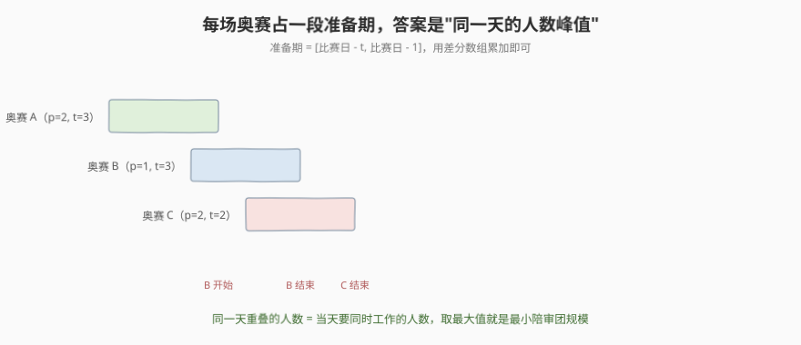
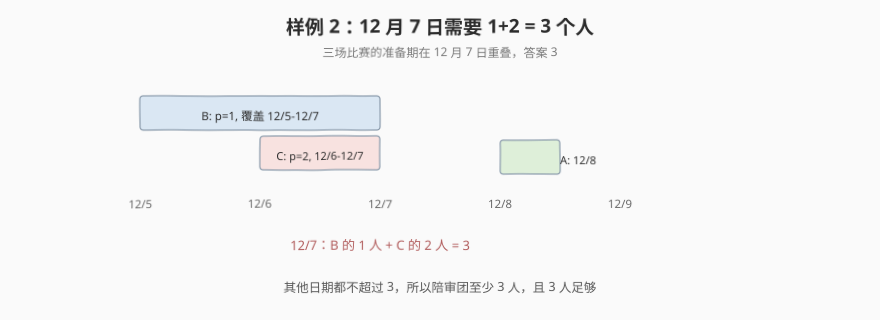

# Codeforces 254B 陪审团人数 题解

## 1. 题目概述

- **题目链接**：https://codeforces.com/problemset/problem/254/B
- **比赛来源**：Codeforces Round 155 (Div. 2) · Problem B（UTC 2012-12-09）
- **难度**：1500
- **标签**：区间覆盖、差分数组、贪心
- **评测类型**：普通
- **限制**：时间 1 s / 内存 256 MB

**题意**：有 $n$ 场奥赛，第 $i$ 场在 2013 年的 $m_i$ 月 $d_i$ 日举行，需要 $p_i$ 名陪审员准备 $t_i$ 天。准备期是**连续**的，且必须在比赛前一天结束：即占用的日子是

$$[\,d_i - t_i,\ d_i - 1\,] \quad (\text{按"年内第几天"计}).$$

同一个陪审员在同一天不能为两场不同的奥赛工作。求最少的陪审员总数。

**约束**：

- $n \le 100$：规模很小，可以放心枚举每一天。
- $p_i, t_i \le 100$：单个需求不大；准备期可能跨到 2012 年（$t_i$ 最大 100，而 1 月 1 日的比赛准备期会落到上一年 9 月）。
- 日期只涉及 2013 年（平年，2 月 28 天），可以用"年内第几天"统一编号。
- 只有一组数据。

## 2. 示例与观察

官方样例 1：

```text
输入：
2
5 23 1 2
3 13 2 3

输出：
2
```

官方样例 2：

```text
输入：
3
12 9 2 1
12 8 1 3
12 8 2 2

输出：
3
```

官方样例 3：

```text
输入：
1
1 10 1 13

输出：
1
```

**样例 1 的演算**：第一场 5 月 23 日，准备 2 天 → 5 月 21、22 日；第二场 3 月 13 日，准备 3 天 → 3 月 10、11、12 日。两段完全不重叠，所以"最多同时需要几个人"就是各自的需求 1 与 2 的最大值 2。

**样例 2 的演算**：三场都在 12 月：

| 场次 | 比赛日 | 准备期 | 人数 |
|------|--------|--------|------|
| 1 | 12/9 | 12/8 | 2 |
| 2 | 12/8 | 12/5 ~ 12/7 | 1 |
| 3 | 12/8 | 12/6 ~ 12/7 | 2 |

12 月 7 日同时有第 2、3 场在准备，需要 $1 + 2 = 3$ 人；其它日子最多 2 人。所以答案 3。

**样例 3**：只有一场，准备 13 天（从 2012 年 12 月 28 日到 2013 年 1 月 9 日），只需要 1 人。

**观察 1**：若某一天同时有若干场奥赛在准备，需要的人数相加；这些人当天不能复用，所以陪审团规模**至少**是"单日需求总和"的最大值。

**观察 2**：这个下界是可达的——因为每场奥赛的准备期是**连续区间**，而区间图的"加权着色数 = 最大加权团"（区间图是完美图）。直观地：把所有准备期按开始日排序，依次给每场分配"最早空出来"的 $p_i$ 个人，只要单日需求不超过 $M$，就总能分到人。

**观察 3**：所以本题只需要算出"每一天的重叠需求"，取最大值。$n \le 100$、天数 $\le 365$，直接对每天的区间做差分会非常快。

## 3. 解题思路

### 3.1 朴素做法与瓶颈

朴素做法：枚举 2013 年的每一天（还能跨到 2012 年），对每场奥赛判断是否覆盖这一天，把 $p_i$ 累加，取最大值。复杂度 $O(\text{天数} \times n)$，天数约 $465$、$n \le 100$，总量 $5 \times 10^4$——其实完全够用。

真正要注意的不是复杂度，而是**日期换算**：要把"月/日"变成"年内第几天"，且准备期可能落到 2012 年（负数天）。

### 3.2 核心观察：区间 + 差分



把每场奥赛看成一个区间 $[L_i, R_i]$，其中

$$R_i = \text{doy}(m_i, d_i) - 1, \qquad L_i = R_i - t_i + 1 = \text{doy}(m_i,d_i) - t_i .$$

对每个区间在差分数组上做 `+p_i`（左端）与 `-p_i`（右端 +1），扫一遍取前缀和的最大值即为答案。

由于 $L_i$ 可能为负（准备期跨年），差分数组整体加一个偏移量（本实现取 200）。

### 3.3 算法流程

1. 预处理 2013 年每个月的累计天数 `start[m]`，于是 `doy = start[m] + d`；
2. 对每场奥赛：`diff[doy - t + OFF] += p`、`diff[doy + OFF] -= p`；
3. 从左到右求前缀和，记录最大值；
4. 输出这个最大值。

### 3.4 样例走查



**样例 2**：12 月 1 日的 `doy` 是 $334$（前 11 个月共 334 天），所以 12 月 8 日是 342、12 月 9 日是 343。

- 第 1 场：$[342, 342]$，$p=2$；
- 第 2 场：$[339, 341]$，$p=1$；
- 第 3 场：$[340, 341]$，$p=2$。

前缀和在 340、341 两天达到 $1 + 2 = 3$（第 2、3 场重叠），其它日子不超过 3，所以最大值 3 ✓。

**自造样例**（标注"自造"）：

| 输入 | 输出 | 说明 |
|------|------|------|
| `2` / `1 1 1 1` / `1 1 5 1` | 6 | 同一天比赛，准备期都是 2012/12/31，需求 1+5 |
| `1` / `1 1 100 100` | 100 | 准备期跨年（2012 年 9 月下旬起） |
| `3` / `3 1 1 1` / `3 1 1 1` / `3 1 1 1` | 3 | 三场完全重合 |

## 4. 正确性证明

记 $J$ 为所有"单日需求总和"的最大值，即

$$J = \max_{\text{天 } \tau} \sum_{i:\ \tau \in [L_i, R_i]} p_i .$$

**引理 1（下界）**：任何合法安排至少需要 $J$ 名陪审员。

**证明**：取达到最大值的那一天 $\tau$。当天有若干场奥赛在准备，第 $i$ 场需要 $p_i$ 名陪审员，且这些人在当天都必须为**这一场**工作。题面规定同一个人同一天不能为两场不同的奥赛工作，所以这些人的集合两两不交，总数 $\sum p_i = J$，故陪审团规模 $\ge J$。∎

**引理 2（上界）**：存在使用 $J$ 名陪审员的合法安排。

**证明**：把各场奥赛的准备期按左端点 $L_i$ 升序排序（相同则任意）。维护每个陪审员"最后一次工作的结束日"。依次处理每场奥赛 $i$：此时在第 $L_i$ 天，正在工作的陪审员恰好是那些区间覆盖 $L_i$ 且已安排的场次所用的全部人，其人数为

$$\sum_{j\ \text{已安排},\ L_j \le L_i \le R_j} p_j \le J - p_i ,$$

（最后一步因为把第 $i$ 场也算进 $L_i$ 这天的需求里，总和不超过 $J$。）所以至少有 $p_i$ 名陪审员在第 $L_i$ 天是空闲的。从中任取 $p_i$ 名，让他们负责第 $i$ 场的整个准备期 $[L_i, R_i]$，并把他们的"结束日"更新为 $R_i$。由归纳，每一步都能成功；分配互不冲突，因为同一人负责的两场区间不交（后一场开始时前一场已结束）。故 $J$ 人足够。∎

**定理**：最少陪审员人数等于 $J$，即算法输出的"单日需求总和的最大值"。

**证明**：引理 1 给出下界、引理 2 给出上界，两者相等。算法用差分数组正确计算了每一天的需求总和并取最大值，故输出正确。∎

## 5. 复杂度分析

- **时间**：$O(n + D)$，$D \approx 465$ 是天数范围（含 2012 年的 100 天余量）。$n \le 100$ 时总量不足 $10^3$ 次运算。
- **空间**：$O(D)$ 的差分数组。
- **与时限的关系**：时限 1 s，实测端到端 2.2 ms（几乎全是进程启动）。

## 6. 参考代码

### C++17

```cpp
#include <bits/stdc++.h>
using namespace std;

int main() {
    static int mlen[13] = {0, 31, 28, 31, 30, 31, 30, 31, 31, 30, 31, 30, 31};
    int start[14] = {0};
    for (int m = 1; m <= 12; m++) start[m + 1] = start[m] + mlen[m];   // 第 m 月 1 日的 day-of-year - 1
    int n;
    if (scanf("%d", &n) != 1) return 0;
    const int OFF = 200;                     // 允许准备期跨到 2012 年
    vector<int> diff(1000, 0);
    for (int i = 0; i < n; i++) {
        int m, d, p, t;
        scanf("%d %d %d %d", &m, &d, &p, &t);
        int doy = start[m] + d;              // 第 doy 天（1 基）
        int L = doy - t, R = doy - 1;        // 准备期 [L, R]
        diff[L + OFF] += p;
        diff[R + 1 + OFF] -= p;
    }
    int ans = 0, cur = 0;
    for (int i = 0; i < 1000; i++) { cur += diff[i]; ans = max(ans, cur); }
    printf("%d\n", ans);
    return 0;
}
```

### Python3

```python
import sys


def main() -> None:
    data = sys.stdin.buffer.read().split()
    if not data:
        return
    mlen = [0, 31, 28, 31, 30, 31, 30, 31, 31, 30, 31, 30, 31]
    start = [0] * 14
    for m in range(1, 13):
        start[m + 1] = start[m] + mlen[m]
    n = int(data[0])
    OFF = 200
    diff = [0] * 1000
    pos = 1
    for _ in range(n):
        m, d, p, t = (int(x) for x in data[pos:pos + 4])
        pos += 4
        doy = start[m] + d
        diff[doy - t + OFF] += p
        diff[doy + OFF] -= p           # R+1 = doy
    cur = 0
    best = 0
    for v in diff:
        cur += v
        if cur > best:
            best = cur
    sys.stdout.write(str(best) + "\n")


main()
```

## 7. 边界情况与易错点

1. **准备期跨年**：1 月 1 日的比赛、准备 100 天，起点在 2012 年 9 月，`doy - t` 是负数。差分数组必须留出偏移（本实现取 200），否则下标越界。
2. **同一天多场比赛**：直接在差分里累加即可，不需要特判。
3. **"结束于比赛前一天"**：区间右端是 `doy - 1`，不是 `doy`。写错会让答案偏大（把比赛当天也算进准备期）。
4. **平年 2 月**：2013 年不是闰年，2 月只有 28 天；如果按 29 天算，后面所有日期都会错位一天。
5. **差分右端的下标**：区间 $[L,R]$ 的差分为 `diff[L] += p`、`diff[R+1] -= p`，即 `diff[doy] -= p`（因为 $R + 1 = doy$）。
6. **输入任意顺序**：题面说明奥赛给出顺序任意，算法不依赖顺序。
7. **答案类型**：每人每天最多 100 人 × 100 场 = 10000，`int` 足够。

## 8. 验证记录

- **编译环境与命令**：`clang++ -std=c++17 -O2 -Wall`（配合 `codeforces/tools/include` 兼容头，可原样提交 GNU C++17）；Python 3.9.6。
- **官方样例**：3 / 3 通过（2、3、1），C++ 与 Python 一致。
- **独立暴力对拍**：暴力版枚举从 2012 年 9 月到 2013 年 12 月的**每一天**，对每场奥赛判断区间是否覆盖该天并累加 $p_i$，取最大值（与差分的实现完全独立）。随机 250 组（$n \le 6$，月份/日期合法，$p_i \le 20$、$t_i \le 30$），**250 / 250 全部一致**（C++ 与 Python 各跑一遍共 500 次比较）。
- **最大约束性能**：$n = 100$ 的随机数据，7 次取最小端到端 2.2 ms。
- **图片校验**：两张 SVG（`cf254b_intervals.svg`、`cf254b_walk.svg`）通过 `ElementTree.parse`，含 `feTurbulence` 与手写字体。
- **复核状态**：verified。

## 相关题目与扩展

- [Codeforces 254A Cards with Numbers](https://codeforces.com/problemset/problem/254/A)：同场 A 题，配对构造。
- [Codeforces 4C Registration system](https://codeforces.com/problemset/problem/4/C)：简单计数类题的入门对照。
- [LeetCode 253. 会议室 II](https://leetcode.cn/problems/meeting-rooms-ii/)：本题的原型——求同一时刻最多有多少个区间重叠。
- [LeetCode 1094. 拼车](https://leetcode.cn/problems/car-pooling/)：带权重的区间重叠峰值，正是本题的差分做法。

**延伸思考**：

1. **如果准备期不要求连续**（可以在任意 $t_i$ 天里安排）：问题变成更一般的调度，区间图不再适用，需求可能变小；本解法的下界不再一定可达。
2. **如果要求输出具体分配方案**：引理 2 的贪心可以直接实现（按左端点排序，每次取"最早空闲"的 $p_i$ 人），复杂度 $O(n \log n + n \cdot \max p)$。
3. **如果时间跨度是多年**：把日期换成"绝对天数"即可，差分数组按总天数开；本题只需处理 2012 年 9 月到 2013 年 12 月。
4. **如果同一个人可以在同一天为同一场奥赛之外的工作**（例如半天制）：模型会变成带容量约束的流问题，不再是简单的峰值。

