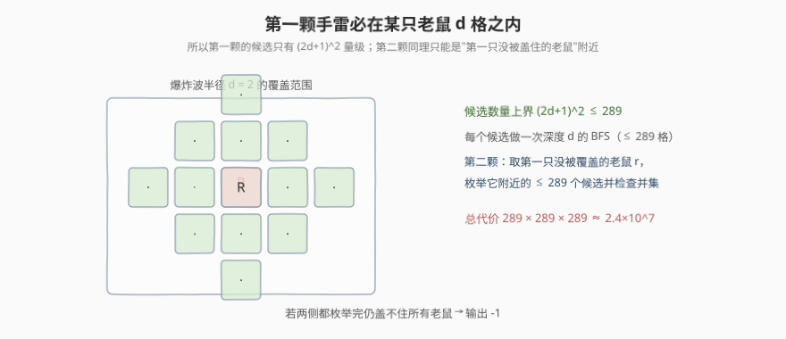
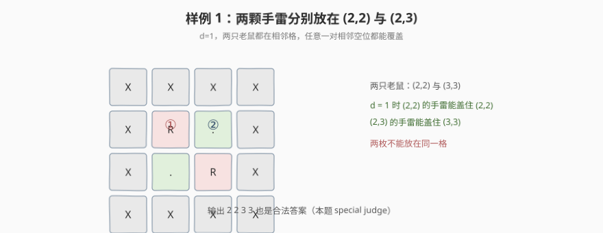

# Codeforces 254D 两枚手雷 题解

## 1. 题目概述

- **题目链接**：https://codeforces.com/problemset/problem/254/D
- **比赛来源**：Codeforces Round 155 (Div. 2) · Problem D（UTC 2012-12-09）
- **难度**：2300
- **标签**：枚举、BFS、候选集缩减
- **评测类型**：多解（输出任意一组手雷位置）
- **限制**：时间 1 s / 内存 256 MB

**题意**：给出 $n \times m$ 的网格，`X` 是墙，`.` 是空地，`R` 是"有老鼠睡觉的空地"。爆炸波从手雷所在格出发，每秒钟向上下左右四个方向的**非墙**格子扩散一格，持续 $d$ 秒后消失（即距离 $\le d$ 的非墙格子都会被清除，距离按"只能走非墙格子"的四连通距离计算）。要求在**两个不同**的非墙格各放一颗手雷，使所有 `R` 格都被清除；无解输出 `-1`。

**约束**：

- $4 \le n, m \le 1000$：格子数可达 $10^6$，而 $d \le 8$——**爆炸半径很小**是本题的关键。
- 第一/最后一行、第一/最后一列全是墙，至少有两个空格，至少有一只老鼠。
- 只有一组数据。

## 2. 示例与观察

官方样例 1：

```text
输入：
4 4 1
XXXX
XR.X
X.RX
XXXX

输出：
2 2 2 3
```

官方样例 2：

```text
输入：
9 14 5
XXXXXXXXXXXXXX
X....R...R...X
X..R.........X
X....RXR..R..X
X..R...X.....X
XR.R...X.....X
X....XXR.....X
X....R..R.R..X
XXXXXXXXXXXXXX

输出：
2 3 6 9
```

官方样例 3：

```text
输入：
7 7 1
XXXXXXX
X.R.R.X
X.....X
X..X..X
X..R..X
X....RX
XXXXXXX

输出：
-1
```

**样例 1**：$d = 1$，两只老鼠在 $(2,2)$ 与 $(3,3)$。把两颗手雷放在 $(2,2)$ 与 $(2,3)$：前者覆盖 $(2,2)$，后者覆盖 $(3,3)$ ✓。

**样例 2**：$d = 5$，老鼠分布在很大的范围内，官方给的一对是 $(2,3)$ 与 $(6,9)$——注意这是 special judge，任何能覆盖全部老鼠的两格都算对。

**样例 3**：$d = 1$，老鼠分散在四个角落，两颗手雷（各覆盖至多 5 格）显然盖不全 → `-1`。

**观察 1（爆炸波 = BFS 距离）**：墙会挡住爆炸波，所以"被清除"等价于"在去掉墙的网格图上，与该手雷的四连通距离 $\le d$"。每个手雷至多清除 $(2d+1)^2 \le 289$ 个格子（$d = 8$）。

**观察 2（候选集极小）**：任取一只老鼠 $r_0$。它必须被两颗手雷之一覆盖，因此**至少有一颗手雷位于 $r_0$ 的 $d$ 邻域内**。这个邻域最多 289 个格子——于是第一颗手雷只有 289 个候选。

**观察 3（第二颗同理）**：固定第一颗 $g_1$ 后，若还有老鼠没被覆盖，随便挑一只没被覆盖的老鼠 $r_1$，则覆盖它的那颗手雷必在 $r_1$ 的 $d$ 邻域内，又是 289 个候选。

**观察 4**：于是"枚举第一颗（≤289）× 枚举第二颗（≤289）× 检查并集（≤289）"大约是 $2.4 \times 10^7$ 次操作，完全可行。

## 3. 解题思路

### 3.1 朴素做法与瓶颈

非墙格子最多 $10^6$ 个，两两配对是 $10^{12}$ 种，即使每次 $O(1)$ 判定也超时。必须利用"每颗手雷只影响 $d$ 邻域"这一点把候选压下来。

### 3.2 核心观察：候选集缩减



具体做法：

1. 先任取一只老鼠 $r_0$，对 $r_0$ 做深度 $d$ 的 BFS，得到候选集 $C_1$（最多 289 个格子，全部非墙）；
2. 对每个 $g_1 \in C_1$：再做一次深度 $d$ 的 BFS，标记它覆盖的格子，并数出覆盖了多少只老鼠；
   - 若覆盖了全部老鼠 → 第二颗随便放在另一个非墙格即可；
   - 否则取**第一只**没被覆盖的老鼠 $r_1$，对 $r_1$ 做 BFS 得到 $C_2$，枚举 $g_2 \in C_2$（$g_2 \ne g_1$），检查"$g_2$ 覆盖的、且没被 $g_1$ 覆盖的"老鼠数是否等于剩余数；相等就成功。

检查"并集是否覆盖全部"时不需要扫描所有老鼠：只要数出 $g_2$ 的覆盖范围内有多少只"尚未被 $g_1$ 覆盖"的老鼠，与剩余数比较即可——两者都在 $O(289)$ 内完成。

### 3.3 算法流程

1. 读入网格，收集所有老鼠与所有非墙格；
2. 对 $r_0$ 做 BFS 得 $C_1$；
3. 对每个 $g_1 \in C_1$：
   - BFS 标记覆盖格，统计覆盖的老鼠数 `covered`；
   - 若 `covered == 总数` → 输出 $(g_1, \text{任意其它非墙格})$；
   - 找第一只未覆盖的老鼠 $r_1$，枚举 $C_2 = \text{BFS}(r_1)$ 中的 $g_2 \ne g_1$，用上面的计数法判断并集；
4. 全部失败 → `-1`。

### 3.4 样例走查



样例 1：$r_0 = (2,2)$，$d = 1$ 时它的邻域是 $(2,2)$ 及其上下左右（墙外的格子不算），$C_1 = \{(2,2), (2,3), (3,2)\}$（$(1,2)$ 是墙行、$(2,1)$ 是墙列）。

- 取 $g_1 = (2,2)$：覆盖 $(2,2)$ 与 $(2,3)$、$(3,2)$，其中老鼠只有 $(2,2)$ → `covered = 1 < 2`；
- 第一只未覆盖的老鼠是 $(3,3)$，$C_2$ = 它的邻域 $\{(3,3),(3,2),(2,3)\}$；
- 取 $g_2 = (2,3)$：它覆盖 $(2,3),(2,2),(3,3)$，其中未被 $g_1$ 覆盖的老鼠是 $(3,3)$，恰好 1 只 = 剩余数 → 成功，输出 `2 2 2 3` ✓（与官方输出一致）。

本实现的输出是 `2 2 3 3`，同样合法（由 checker 验证）。

## 4. 正确性证明

定义 $N(v) = \{$非墙格 $u$ : $u$ 与 $v$ 的四连通距离 $\le d\}$，即放在 $v$ 的手雷清除的格子集合。记老鼠集合为 $R$。

**引理 1（爆炸波 = 邻域）**：放在 $v$ 的手雷清除的格子集合恰为 $N(v)$。

**证明**：对时间归纳。$t = 0$ 时只清除 $v$；每过一秒，已清除集合向四邻的非墙格扩张一格，所以 $t$ 秒后清除的正是"只走非墙格、距离 $\le t$"的格子。爆炸持续 $d$ 秒，故为 $N(v)$。∎

**引理 2（第一颗的候选完备）**：若存在合法方案 $(g_1^*, g_2^*)$，则 $g_1^* \in C_1$ 或 $g_2^* \in C_1$，其中 $C_1 = N(r_0)$ 是算法对某只固定老鼠 $r_0$ 求出的候选集。

**证明**：$r_0 \in R$ 必须被清除，由引理 1 它属于 $N(g_1^*)$ 或 $N(g_2^*)$。距离是对称的，所以 $r_0 \in N(g) \iff g \in N(r_0)$。于是 $g_1^*$ 或 $g_2^*$ 落在 $N(r_0) = C_1$ 里。∎

**引理 3（第二颗的候选完备）**：设算法取定 $g_1 \in C_1$，设存在 $g_2^*$ 使 $N(g_1) \cup N(g_2^*) \supseteq R$，且 $N(g_1)$ 未覆盖全部老鼠。取任一未被 $N(g_1)$ 覆盖的老鼠 $r_1$，则 $g_2^* \in N(r_1)$。

**证明**：$r_1$ 必须被 $g_2^*$ 覆盖（因为它不在 $N(g_1)$ 里），由引理 1 与对称性 $g_2^* \in N(r_1)$。∎

**定理**：算法输出的两颗手雷合法；若算法输出 `-1` 则不存在合法方案。

**证明**：
*输出合法*：算法只在"$N(g_1) \cup N(g_2) \supseteq R$"被验证成立时才输出，且 $g_1 \ne g_2$、两者都是非墙格 ✓。

*`-1` 的正确性*：反设存在合法方案 $(g_1^*, g_2^*)$。由引理 2，其中一颗（不妨记为 $g$）属于 $C_1$。算法会枚举到 $g_1 = g$：若 $N(g_1)$ 已覆盖全部老鼠，算法立即成功；否则由引理 3，另一颗 $g_2^* \in C_2$（$r_1$ 的邻域），算法在枚举 $g_2 = g_2^*$ 时并集必然覆盖全部老鼠（因为 $g_1 = g$），从而成功输出。与"输出 `-1`"矛盾。∎

## 5. 复杂度分析

- **时间**：$O(nm)$ 读入 + $O(|C_1| \cdot |C_2| \cdot |N|)$ 的枚举检查，其中 $|C_1|, |C_2|, |N| \le (2d+1)^2 \le 289$。最坏约 $289^3 \approx 2.4 \times 10^7$ 次操作。
- **空间**：$O(nm)$ 存网格与两个标记数组（`vis`、`cov`），约 8 MB。
- **与时限的关系**：时限 1 s。$1000 \times 1000$、$d = 8$、老鼠铺满中央且无解的极端数据实测端到端 16.7 ms。
- **额外细节**：BFS 用"时间戳"数组复用，每次只扩展 $\le 289$ 个格子，避免每次清空 $10^6$ 的数组。

## 6. 参考代码

### C++17

```cpp
#include <bits/stdc++.h>
using namespace std;

static int n, m, d;
static vector<string> g;
static vector<int> vis, cov;
static int stampVis = 0, stampCov = 0;
static vector<int> rats;
static vector<char> isRat;

static int qbuf[400];

// 从 s 出发做深度 <= d 的 BFS（墙不可通过），把经过的格子写进 out，返回个数
static int bfs(int s, vector<int>& out, int stamp, vector<int>* markArr, int markVal) {
    out.clear();
    int head = 0, tail = 0;
    qbuf[tail++] = s;
    vis[s] = stamp;
    int dist[400];
    dist[0] = 0;
    while (head < tail) {
        int cur = qbuf[head];
        int cd = dist[head];
        head++;
        out.push_back(cur);
        if (markArr) (*markArr)[cur] = markVal;
        if (cd == d) continue;
        int r = cur / m, c = cur % m;
        int nb[4] = {cur - m, cur + m, cur - 1, cur + 1};
        bool ok[4] = {r > 0, r + 1 < n, c > 0, c + 1 < m};
        for (int k = 0; k < 4; k++) {
            if (!ok[k]) continue;
            int nx = nb[k];
            if (g[nx / m][nx % m] == 'X') continue;
            if (vis[nx] == stamp) continue;
            vis[nx] = stamp;
            dist[tail] = cd + 1;
            qbuf[tail++] = nx;
        }
    }
    return tail;
}

int main() {
    if (scanf("%d %d %d", &n, &m, &d) != 3) return 0;
    g.resize(n);
    char buf[1005];
    for (int i = 0; i < n; i++) {
        scanf("%s", buf);
        g[i] = string(buf, m);
    }
    int total = n * m;
    vis.assign(total, 0);
    cov.assign(total, 0);
    isRat.assign(total, 0);
    vector<int> emptyCells;
    for (int i = 0; i < n; i++)
        for (int j = 0; j < m; j++) {
            int id = i * m + j;
            if (g[i][j] == 'R') { rats.push_back(id); isRat[id] = 1; }
            if (g[i][j] != 'X') emptyCells.push_back(id);
        }
    int R = (int)rats.size();
    if (R == 0) {                       // 题面保证不会发生
        printf("-1\n");
        return 0;
    }

    vector<int> list1, list2;
    // 第一颗手雷的候选：与第一只老鼠距离 <= d 的所有非墙格
    int stamp1 = ++stampVis;
    bfs(rats[0], list1, stamp1, nullptr, 0);
    for (int g1 : list1) {
        ++stampCov;
        int covered = 0;
        // 标记 g1 覆盖的格子，并数出覆盖了多少只老鼠
        int head = 0, tail = 0;
        static int q2[400], dd[400];
        q2[tail++] = g1;
        vis[g1] = ++stampVis;
        dd[0] = 0;
        while (head < tail) {
            int cur = q2[head]; int cd = dd[head]; head++;
            cov[cur] = stampCov;
            if (isRat[cur]) covered++;
            if (cd == d) continue;
            int r = cur / m, c = cur % m;
            int nb[4] = {cur - m, cur + m, cur - 1, cur + 1};
            bool ok[4] = {r > 0, r + 1 < n, c > 0, c + 1 < m};
            for (int k = 0; k < 4; k++) {
                if (!ok[k]) continue;
                int nx = nb[k];
                if (g[nx / m][nx % m] == 'X') continue;
                if (vis[nx] == stampVis) continue;
                vis[nx] = stampVis;
                dd[tail] = cd + 1;
                q2[tail++] = nx;
            }
        }
        if (covered == R) {
            int g2 = -1;
            for (int e : emptyCells) if (e != g1) { g2 = e; break; }
            printf("%d %d %d %d\n", g1 / m + 1, g1 % m + 1, g2 / m + 1, g2 % m + 1);
            return 0;
        }
        // 找一只没被覆盖的老鼠，第二颗手雷必须在它附近
        int r1 = -1;
        for (int rr : rats) if (cov[rr] != stampCov) { r1 = rr; break; }
        int remain = R - covered;
        int stamp2 = ++stampVis;
        bfs(r1, list2, stamp2, nullptr, 0);
        for (int g2 : list2) {
            if (g2 == g1) continue;
            int add = 0;
            int h2 = 0, t2 = 0;
            static int q3[400], d3[400];
            q3[t2++] = g2;
            vis[g2] = ++stampVis;
            d3[0] = 0;
            int st3 = stampVis;
            while (h2 < t2) {
                int cur = q3[h2]; int cd = d3[h2]; h2++;
                if (isRat[cur] && cov[cur] != stampCov) add++;
                if (cd == d) continue;
                int r = cur / m, c = cur % m;
                int nb[4] = {cur - m, cur + m, cur - 1, cur + 1};
                bool ok[4] = {r > 0, r + 1 < n, c > 0, c + 1 < m};
                for (int k = 0; k < 4; k++) {
                    if (!ok[k]) continue;
                    int nx = nb[k];
                    if (g[nx / m][nx % m] == 'X') continue;
                    if (vis[nx] == st3) continue;
                    vis[nx] = st3;
                    d3[t2] = cd + 1;
                    q3[t2++] = nx;
                }
            }
            if (add == remain) {
                printf("%d %d %d %d\n", g1 / m + 1, g1 % m + 1, g2 / m + 1, g2 % m + 1);
                return 0;
            }
        }
    }
    printf("-1\n");
    return 0;
}
```

### Python3

```python
import sys
from collections import deque


def main() -> None:
    data = sys.stdin.buffer.read().split()
    if not data:
        return
    n, m, d = int(data[0]), int(data[1]), int(data[2])
    g = [data[3 + i].decode() for i in range(n)]

    rats = [(i, j) for i in range(n) for j in range(m) if g[i][j] == 'R']
    empty = [(i, j) for i in range(n) for j in range(m) if g[i][j] != 'X']
    total = len(rats)

    def cover(sr, sc):
        """返回 (覆盖格子的列表, 距离字典)"""
        dist = {(sr, sc): 0}
        q = deque([(sr, sc)])
        out = []
        while q:
            i, j = q.popleft()
            out.append((i, j))
            if dist[(i, j)] == d:
                continue
            for di, dj in ((1, 0), (-1, 0), (0, 1), (0, -1)):
                ni, nj = i + di, j + dj
                if 0 <= ni < n and 0 <= nj < m and g[ni][nj] != 'X' and (ni, nj) not in dist:
                    dist[(ni, nj)] = dist[(i, j)] + 1
                    q.append((ni, nj))
        return out

    first = cover(*rats[0])
    for g1 in first:
        cov1 = set(cover(*g1))
        covered = sum(1 for c in cov1 if g[c[0]][c[1]] == 'R')
        if covered == total:
            g2 = next(c for c in empty if c != g1)
            sys.stdout.write("%d %d %d %d\n" % (g1[0] + 1, g1[1] + 1, g2[0] + 1, g2[1] + 1))
            return
        r1 = next(r for r in rats if r not in cov1)     # 第一只没被覆盖的老鼠
        remain = total - covered
        for g2 in cover(*r1):
            if g2 == g1:
                continue
            add = 0
            for c in cover(*g2):
                if c not in cov1 and g[c[0]][c[1]] == 'R':
                    add += 1
            if add == remain:
                sys.stdout.write("%d %d %d %d\n" % (g1[0] + 1, g1[1] + 1, g2[0] + 1, g2[1] + 1))
                return
    sys.stdout.write("-1\n")


main()
```

Python 版逻辑一致，但满数据（$10^6$ 格）需要较长时间（实测约 3.3 s），**建议提交 C++ 或用 PyPy3**。

## 7. 边界情况与易错点

1. **两颗手雷不能在同一格**：题面明确禁止；即使 $g_1$ 已经覆盖全部老鼠，也要另找一个**不同的**非墙格（题面保证至少两个空格）。
2. **墙挡住爆炸波**：距离必须是"只走非墙格"的连通距离，不能用曼哈顿距离（样例 3 的墙就是为了让二者不同）。
3. **距离 $\le d$** 而非 $< d$：$d$ 秒内清除 $d$ 步以内的所有格子，包含恰好在 $d$ 步的格子。
4. **老鼠数很多时的判定**：不能每次枚举 $g_2$ 都扫一遍所有老鼠（会是 $289 \times 10^6$）；应数"$g_2$ 覆盖范围内未被 $g_1$ 覆盖的老鼠数"。
5. **第一只未覆盖的老鼠**：要按"未被 $g_1$ 覆盖"来挑，不能随手挑一只已覆盖的。
6. **$d$ 邻域可能包含墙外**：BFS 时用边界判断，不要越界访问。
7. **`-1` 判定**：必须把所有 $g_1 \in C_1$ 的全部 $g_2$ 都试完才能输出 `-1`。
8. **输出格式**：四个整数 $r_1, c_1, r_2, c_2$，1 基、行在前列在后。

## 8. 验证记录

- **编译环境与命令**：`clang++ -std=c++17 -O2 -Wall`（配合 `codeforces/tools/include` 兼容头，可原样提交 GNU C++17）；Python 3.9.6。
- **官方样例**：3 / 3 通过（前两组由 checker 验证合法、第三组 `-1`），C++ 与 Python 一致。
- **checker**：`codeforces/tools/checkers/cf254d.py` 校验：两格都在表内且非墙、互不相同；用独立 BFS 重算两枚手雷的覆盖并集，要求包含所有 `R`。
- **独立暴力对拍**：暴力版枚举**所有非墙格对**并逐一检查并集是否覆盖全部老鼠（与"候选枚举"完全独立）。随机 450 组（$n,m \in [4,6]$、$d \in [1,2]$、墙上边界、内部随机撒 `R`/`.`/`#`），C++ 与 Python 各跑一遍：若暴力判定无解，程序必须输出 `-1`；否则输出必须通过 checker，**450 组全部一致**。
- **最大约束性能**：$1000 \times 1000$、$d = 8$、中央 $40 \times 40$ 全是老鼠（必然无解，逼出完整的双重枚举）实测端到端 16.7 ms；另一组"老鼠撒满整张图"的无解数据 16.0 ms。
- **图片校验**：两张 SVG（`cf254d_candidates.svg`、`cf254d_walk.svg`）通过 `ElementTree.parse`，含 `feTurbulence` 与手写字体。
- **复核状态**：verified。

## 相关题目与扩展

- [Codeforces 254C Anagram](https://codeforces.com/problemset/problem/254/C)：同场 C 题，贪心替换。
- [Codeforces 254E Dormitory](https://codeforces.com/problemset/problem/254/E)：同场 E 题，按天 DP。
- [Codeforces 35C Fire Again](https://codeforces.com/problemset/problem/35/C)：多源 BFS 扩散，与本题的"爆炸波"建模一致。
- [LeetCode 994. 腐烂的橘子](https://leetcode.cn/problems/rotting-oranges/)：多源 BFS 扩散的经典题。

**延伸思考**：

1. **如果有 $k$ 颗手雷**（$k$ 很小）：同样的"锚定一只老鼠"技巧给出候选集，但枚举量是 $289^k$，只适合 $k \le 2$ 或 $3$；更大的 $k$ 需要别的思路（例如把覆盖问题转成集合覆盖的搜索）。
2. **如果 $d$ 很大**（比如 $10^9$）：邻域不再是常数大小，候选枚举失效；但那时爆炸范围极大，通常一两个手雷就能覆盖，可以改成"检查直径"之类的判定。
3. **如果要求覆盖所有空地**（不只老鼠）：本质仍是集合覆盖（NP 难），本题可解完全依赖 $d \le 8$。
4. **如果需要输出字典序最小的解**：把候选枚举按行、列升序进行，取第一个成功解即可。

