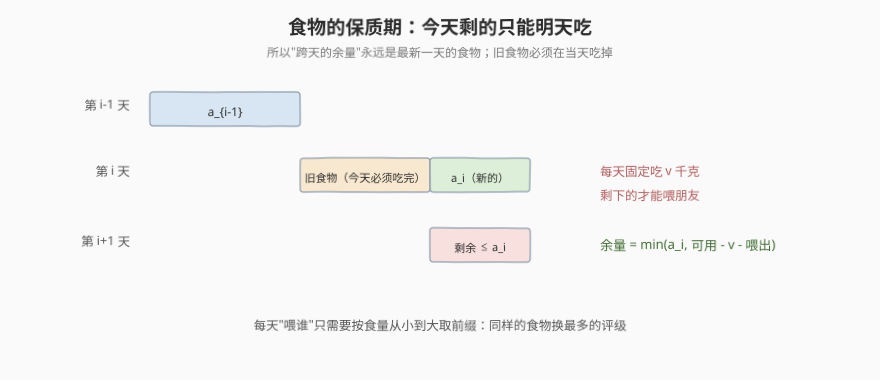
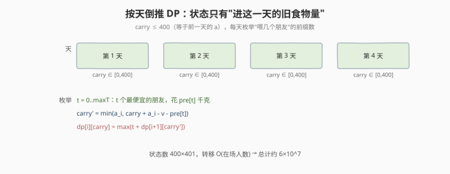

# Codeforces 254E 宿舍分食 题解

## 1. 题目概述

- **题目链接**：https://codeforces.com/problemset/problem/254/E
- **比赛来源**：Codeforces Round 155 (Div. 2) · Problem E（UTC 2012-12-09）
- **难度**：2100
- **标签**：动态规划、贪心、按天递推
- **评测类型**：多解（输出任意最优日程）
- **限制**：时间 1 s / 内存 256 MB

**题意**：学期有 $n$ 天。第 $i$ 天早上 Vasya 收到 $a_i$ 千克食物，这些食物**只能在这天或下一天**吃，之后变质。他每天固定吃 $v$ 千克。另有 $m$ 个朋友，第 $j$ 个朋友在第 $l_j \ldots r_j$ 天住在他这里，每天需要 $f_j$ 千克食物。每天他可以选择若干"当天在场"的朋友请他们吃饭，每请一个当天的评级 $+1$（同一天同一个朋友最多请一次，但不同天可以重复请同一个人）。求最大总评级，并给出每天的请客名单。

**约束**：

- $n, v, a_i, m, f_j \le 400$：规模很小，允许 $O(n \cdot A \cdot m)$ 级别的 DP，其中 $A \le 400$ 是"跨天余量"的上界。
- 食物只有两天保质期，这是全题的結構核心。
- 保证"不请客时总有办法每天吃到 $v$ 千克"。
- 只有一组数据。

## 2. 示例与观察

官方样例 1：

```text
输入：
4 1
3 2 5 4
3
1 3 2
1 4 1
3 4 2

输出：
7
1 2
1 2
3 2 1 3
2 2 3
```

**演算**：$v = 1$，四天分别收到 $3, 2, 5, 4$ 千克；三个朋友：(1..3, 2 千克)、(1..4, 1 千克)、(3..4, 2 千克)。

| 天 | 可用食物 | 自己吃 | 请客 | 请客花费 | 剩余（可带到下一天） |
|----|----------|--------|------|----------|----------------------|
| 1 | 0 + 3 = 3 | 1 | 朋友 2 | 1 | 1 |
| 2 | 1 + 2 = 3 | 1 | 朋友 2 | 1 | 1 |
| 3 | 1 + 5 = 6 | 1 | 朋友 2、1、3 | 1+2+2 = 5 | 0 |
| 4 | 0 + 4 = 4 | 1 | 朋友 2、3 | 1+2 = 3 | 0 |

评级 $1+1+3+2 = 7$ ✓，与输出一致（输出给出的是同一条日程）。

**观察 1（食物按天过期）**：第 $i$ 天剩下的食物只能留到第 $i+1$ 天，第 $i+2$ 天就坏了。所以"跨天余量"永远只是**最新一天**的食物。

**观察 2（旧食物先用）**：第 $i$ 天的可用量 = 昨天剩下的 `carry` + 今天的 $a_i$。既然 `carry` 今天不用就作废，最优策略一定是**先吃旧食物**，再把今天的食物留到明天。于是

$$\text{新 carry} = \min\bigl(a_i,\ \text{可用} - v - \text{请客花费}\bigr).$$

**观察 3（同一天请谁最划算）**：每天的花费是一份"预算"，每个朋友贡献 1 点评级，代价是 $f_j$。所以要最大化**当天**的评级，就按 $f_j$ **从小到大**请——花费前缀和越小，能请的人越多。

**观察 4（天与天之间只通过 carry 耦合）**：每天结束后能带到下一天的量只取决于当天的决策，因此可以用"天 × carry"的 DP。

## 3. 解题思路

### 3.1 朴素做法与瓶颈

状态如果取成"每天请了哪些朋友"，会有 $2^m$ 种/天，完全不可行。但由观察 3，同一天的决策只取决于"请几个人"（一定是请最便宜的前 $t$ 个），所以每天的决策被压缩成 $t = 0, 1, \ldots, \#\text{在场}$。

真正剩下的自由度是"今天请得多一点还是把食物留到明天"——这正是 DP 要解决的。

### 3.2 核心观察：状态只有"跨天余量"



定义

$$\text{dp}[i][c] = \text{在第 } i \text{ 天开始时带进来 } c \text{ 千克旧食物的情况下，第 } i \ldots n \text{ 天能拿到的最大评级}.$$

转移：设第 $i$ 天在场朋友按食量升序为 $q_1, q_2, \ldots$，前缀和 $\text{pre}[t] = \sum_{k \le t} f_{q_k}$。可用量 $\text{avail} = c + a_i$；若 $\text{avail} < v$ 则该状态非法。否则对每个可行的 $t$（$\text{pre}[t] \le \text{avail} - v$）：

$$\text{newCarry} = \min\bigl(a_i,\ \text{avail} - v - \text{pre}[t]\bigr), \qquad \text{dp}[i][c] = \max_t\bigl(t + \text{dp}[i+1][\text{newCarry}]\bigr).$$

边界：$\text{dp}[n+1][\cdot] = 0$（第 $n$ 天后剩下的食物没有价值）。答案是 $\text{dp}[1][0]$。

`carry` 的范围：它永远不超过前一天的 $a_{i-1} \le 400$，所以只需开 $0 \ldots 400$ 共 401 个状态。

### 3.3 算法流程

1. 读入 $n, v, a$，以及每个朋友的区间；
2. 对每天 $i$：收集在场朋友，按 $f$ 升序排好，做前缀和；
3. 从 $i = n$ 倒推到 1，对每个 $c \in [0, 400]$ 按上面的转移取最大值，同时记下最优的 $t$（用于输出方案）；
4. 输出 $\text{dp}[1][0]$，然后从第 1 天开始按记录的 $t$ 还原每天的名单（并同步更新 `carry`）。

### 3.4 样例走查



以样例的第 3 天为例：带进来的 `carry = 1`，$a_3 = 5$，$v = 1$，在场朋友是 {2 千克, 1 千克, 2 千克}，按食量排成 $(1, 2, 2)$，前缀和 $(0, 1, 3, 5)$，预算 $= 1 + 5 - 1 = 5$。可选的 $t$：

| $t$ | 花费 | 新 carry | 当天评级 + 后续 |
|-----|------|----------|------------------|
| 0 | 0 | $\min(5, 5) = 5$ | $0 + \text{dp}[4][5]$ |
| 1 | 1 | $\min(5, 4) = 4$ | $1 + \text{dp}[4][4]$ |
| 2 | 3 | $\min(5, 2) = 2$ | $2 + \text{dp}[4][2]$ |
| 3 | 5 | $\min(5, 0) = 0$ | $3 + \text{dp}[4][0]$ |

倒推会发现 $t = 3$ 最优（第 4 天带 `carry = 0`，仍然够吃），于是第 3 天请 3 个人，与样例输出一致 ✓。

## 4. 正确性证明

**引理 1（先吃旧食物最优）**：设第 $i$ 天带进 $c$ 千克旧食物、收到 $a_i$，当天总消耗 $u = v + \text{请客花费} \le c + a_i$。则任何合法吃法带到第 $i+1$ 天的量都不超过 $\min(a_i,\ c + a_i - u)$，且该上界可达。

**证明**：旧食物只能今天吃，所以第 $i+1$ 天能留下的全部来自今天的 $a_i$，故 carry $\le a_i$；又 carry $\le$ 总剩余 $= c + a_i - u$。取"先消耗旧食物"的吃法即可同时取到两个上界（若 $u \le c$，则旧食物还没用完，今天的 $a_i$ 全留下；否则用完旧食物后再用今天的，剩 $c + a_i - u$）。∎

**引理 2（当天最优子集是"最便宜的前缀"）**：给定当天的花费预算 $B$ 和在场朋友集合，能请的最多人数等于"按 $f$ 升序取前缀、花费不超过 $B$ 的最大前缀长度"；且对任意 $t$，花 $t$ 个人拿到 $t$ 点评级的最小花费就是前 $t$ 小的 $f$ 之和。

**证明**：评级只与人头数有关，每个人头花费为正，故对固定人数 $t$ 取 $f$ 最小的 $t$ 个最省；对固定预算 $B$，从最小的开始取直到装不下，得到最大人数。∎

**引理 3（DP 正确）**：对每个 $i, c$，$\text{dp}[i][c]$ 等于"第 $i$ 天开始时带进 $c$ 千克旧食物"这一状态下，第 $i \ldots n$ 天能获得的最大评级。

**证明**：对 $i$ 从后往前归纳。$i = n+1$ 时为 0 ✓。设 $i+1$ 成立，考虑第 $i$ 天的决策：由引理 2，最优决策必是"请最便宜的前 $t$ 个"；由引理 1，带的量由 $t$ 唯一确定为 $\text{newCarry}$，之后的最优值就是 $\text{dp}[i+1][\text{newCarry}]$。对所有可行的 $t$ 取最大，正是转移式。∎

**定理**：算法输出的评级与日程最优。

**证明**：答案 $\text{dp}[1][0]$ 由引理 3 正确；输出的日程由 DP 记录的 $t$ 逐天还原，按引理 1、2 它恰好实现该评级（食物账目与状态一致）。∎

## 5. 复杂度分析

- **时间**：$O(n \cdot C \cdot m)$，$C = 401$ 是 carry 的状态数，$m \le 400$ 是每天最多枚举的人数。$n = 400$ 时约 $6.4 \times 10^7$ 次运算。
- **空间**：$O(nC)$ 的 DP 表与决策表（$400 \times 401$），约 3 MB。
- **与时限的关系**：时限 1 s。最大数据（$n = m = 400$、所有人全学期在场）实测端到端 75.8 ms。
- **优化**：在场的朋友每天按 $f$ 排序一次即可，前缀和也一次算好；内层只枚举到"预算允许的最大 $t$"。

## 6. 参考代码

### C++17

```cpp
#include <bits/stdc++.h>
using namespace std;

int main() {
    int n, v;
    if (scanf("%d %d", &n, &v) != 2) return 0;
    vector<int> a(n + 1);
    for (int i = 1; i <= n; i++) scanf("%d", &a[i]);
    int m;
    scanf("%d", &m);
    vector<int> L(m), R(m), F(m);
    vector<vector<int>> present(n + 1);
    for (int j = 0; j < m; j++) {
        scanf("%d %d %d", &L[j], &R[j], &F[j]);
        for (int i = L[j]; i <= R[j]; i++) present[i].push_back(j);
    }
    // 每天把"在场朋友"按食量升序排好，并做前缀和
    vector<vector<int>> order(n + 1), pre(n + 1);
    for (int i = 1; i <= n; i++) {
        order[i] = present[i];
        sort(order[i].begin(), order[i].end(), [&](int x, int y) { return F[x] < F[y]; });
        pre[i].assign(order[i].size() + 1, 0);
        for (size_t k = 0; k < order[i].size(); k++) pre[i][k + 1] = pre[i][k] + F[order[i][k]];
    }
    const int CMAX = 401;
    const int NEG = -1000000000;
    vector<vector<int>> dp(n + 2, vector<int>(CMAX, NEG));
    vector<vector<short>> choice(n + 1, vector<short>(CMAX, 0));
    for (int c = 0; c < CMAX; c++) dp[n + 1][c] = 0;
    for (int i = n; i >= 1; i--) {
        int sz = (int)order[i].size();
        for (int c = 0; c < CMAX; c++) {
            long long avail = (long long)c + a[i];
            if (avail < v) continue;
            long long budget = avail - v;
            int maxT = 0;
            while (maxT + 1 <= sz && pre[i][maxT + 1] <= budget) maxT++;
            int best = NEG, bestT = 0;
            for (int t = 0; t <= maxT; t++) {
                long long nc = min((long long)a[i], avail - v - pre[i][t]);
                int val = t + dp[i + 1][nc];
                if (val > best) { best = val; bestT = t; }
            }
            dp[i][c] = best;
            choice[i][c] = (short)bestT;
        }
    }
    printf("%d\n", dp[1][0]);
    int c = 0;
    for (int i = 1; i <= n; i++) {
        int t = choice[i][c];
        long long avail = (long long)c + a[i];
        long long nc = min((long long)a[i], avail - v - pre[i][t]);
        printf("%d", t);
        for (int k = 0; k < t; k++) printf(" %d", order[i][k] + 1);
        printf("\n");
        c = (int)nc;
    }
    return 0;
}
```

### Python3

```python
import sys


def main() -> None:
    data = sys.stdin.buffer.read().split()
    if not data:
        return
    pos = 0
    n, v = int(data[pos]), int(data[pos + 1]); pos += 2
    a = [0] + [int(x) for x in data[pos:pos + n]]; pos += n
    m = int(data[pos]); pos += 1
    L, R, F = [], [], []
    for _ in range(m):
        L.append(int(data[pos])); R.append(int(data[pos + 1])); F.append(int(data[pos + 2]))
        pos += 3
    present = [[] for _ in range(n + 1)]
    for j in range(m):
        for i in range(L[j], R[j] + 1):
            present[i].append(j)
    order = [None] * (n + 1)
    pre = [None] * (n + 1)
    for i in range(1, n + 1):
        order[i] = sorted(present[i], key=lambda j: F[j])
        p = [0]
        for j in order[i]:
            p.append(p[-1] + F[j])
        pre[i] = p

    CMAX = 401
    NEG = -10 ** 9
    dp = [[NEG] * CMAX for _ in range(n + 2)]
    choice = [[0] * CMAX for _ in range(n + 1)]
    for c in range(CMAX):
        dp[n + 1][c] = 0
    for i in range(n, 0, -1):
        sz = len(order[i])
        pi = pre[i]
        for c in range(CMAX):
            avail = c + a[i]
            if avail < v:
                continue
            budget = avail - v
            max_t = 0
            while max_t + 1 <= sz and pi[max_t + 1] <= budget:
                max_t += 1
            best = NEG
            best_t = 0
            for t in range(max_t + 1):
                nc = min(a[i], budget - pi[t])
                val = t + dp[i + 1][nc]
                if val > best:
                    best = val
                    best_t = t
            dp[i][c] = best
            choice[i][c] = best_t

    out = [str(dp[1][0])]
    c = 0
    for i in range(1, n + 1):
        t = choice[i][c]
        avail = c + a[i]
        nc = min(a[i], avail - v - pre[i][t])
        ids = [str(j + 1) for j in order[i][:t]]
        out.append(" ".join([str(t)] + ids))
        c = nc
    sys.stdout.write("\n".join(out) + "\n")


main()
```

## 7. 边界情况与易错点

1. **旧食物必须先吃**：计算 `newCarry` 时要用 $\min(a_i, \text{avail} - v - \text{pre}[t])$，直接写"总剩余"会把过期的旧食物也算进去，导致后面凭空多出食物。
2. **每天必须吃够 $v$**：$\text{avail} < v$ 的状态要判为非法（DP 值设成负无穷），不能当成 0。
3. **`carry` 的上界**：它不超过前一天的 $a_{i-1} \le 400$，所以状态表开 401 就够；开小了会漏状态，开大了浪费内存。
4. **同一朋友同一天只能请一次**：按前缀取人天然满足（每个朋友只在列表里出现一次）。
5. **朋友可以跨天重复请**：例子里的朋友 2 在四天里被请了四次，这是允许的（题面只禁止同一天重复）。
6. **$u = v$ 的朋友**：食量小的优先，排序时不要漏掉。
7. **输出格式**：第一行评级，接下来 $n$ 行，每行先打印人数再打印朋友编号（1 基），顺序任意。
8. **空行**：某天不请客时要输出 `0`（只有一个人数），不能输出空行。
9. **答案上界**：$n \times m = 1.6 \times 10^5$，`int` 够用。

## 8. 验证记录

- **编译环境与命令**：`clang++ -std=c++17 -O2 -Wall`（配合 `codeforces/tools/include` 兼容头，可原样提交 GNU C++17）；Python 3.9.6。
- **官方样例**：1 / 1 通过，输出与官方样例**逐字相同**（`7` / `1 2` / `1 2` / `3 2 1 3` / `2 2 3`）。
- **checker**：`codeforces/tools/checkers/cf254e.py` 独立地（a）用"逐日枚举全部在场朋友子集"的暴力算出最优评级并比对；（b）校验日程合法（朋友在场、同一天不重复、食物账目可行、评级与日程一致）。
- **随机对拍**：随机 200 组（$n \le 5$、$v \le 3$、$a_i \le 4$、$m \le 5$、$f_j \le 4$），C++ 与 Python 各跑一遍并全部通过 checker（checker 内部含独立最优值计算），**400 次校验全部通过**。
- **最大约束性能**：$n = m = 400$、所有人全学期在场、$a_i = 400$、$v = 1$，7 次取最小端到端 75.8 ms。
- **图片校验**：两张 SVG（`cf254e_food.svg`、`cf254e_dp.svg`）通过 `ElementTree.parse`，含 `feTurbulence` 与手写字体。
- **复核状态**：verified。

## 相关题目与扩展

- [Codeforces 254C Anagram](https://codeforces.com/problemset/problem/254/C)：同场 C 题，贪心 + 计数。
- [Codeforces 254D Rats](https://codeforces.com/problemset/problem/254/D)：同场 D 题，候选枚举。
- [LeetCode 1383. 最大的团队表现值](https://leetcode.cn/problems/maximum-performance-of-a-team/)：同样是"排序后取前缀"的贪心。
- [LeetCode 1986. 完成任务的最少工作时间段](https://leetcode.cn/problems/minimum-number-of-work-sessions-to-finish-the-tasks/)：带容量约束的分天任务安排，与本题的"每天预算"结构相似。

**延伸思考**：

1. **如果食物保质期变成 $k$ 天**：状态要记录"每一天剩下多少"，会变成 $k$ 维；但可以证明"先用最旧的"仍成立，于是状态可以压缩成"总共剩多少 + 各天的量"的单调结构（类似队列）。
2. **如果朋友只能被请一次（全学期）**：问题变成带时间窗的最大权匹配/流问题，DP 的"每天独立取前缀"不再成立。
3. **如果评级改成"请客花费的食物总量"**：那么贪心取最便宜的前缀就不再最优，需要背包。
4. **如果要求输出字典序最小的最优日程**：在 DP 里对相同值优先取更小的 $t$（或更小的编号集合），即可得到确定性输出。

