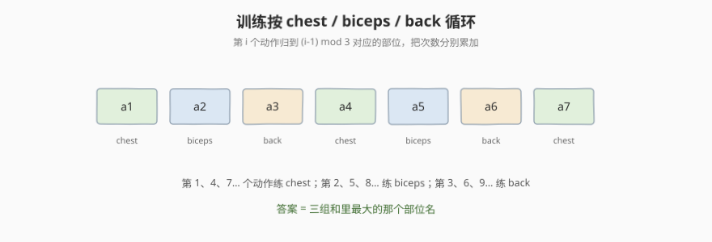
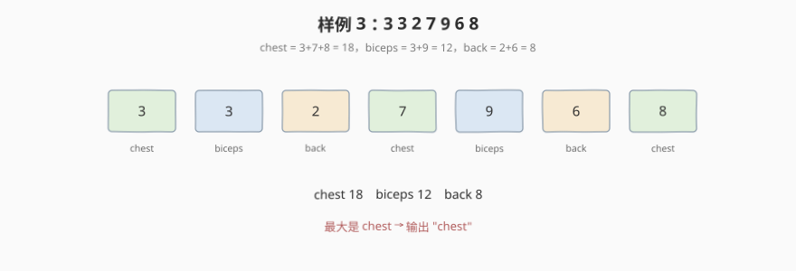

# Codeforces 255A 格雷格训练 题解

## 1. 题目概述

- **题目链接**：https://codeforces.com/problemset/problem/255/A
- **比赛来源**：Codeforces Round 156 (Div. 2) · Problem A（UTC 2012-12-16）
- **难度**：800
- **标签**：实现、循环分组、求和
- **评测类型**：普通
- **限制**：时间 2 s / 内存 256 MB

**题意**：Greg 今天要做 $n$ 组动作，第 $i$ 组重复 $a_i$ 次。动作按 `chest`、`biceps`、`back` 循环：第 1 组练胸、第 2 组练肱二头肌、第 3 组练背、第 4 组又练胸……问哪个部位得到的总次数最多，输出它的英文名。

**约束**：

- $n \le 20$、$a_i \le 25$：总和不超过 500，任何做法都能过，题目只考"循环下标"这一件事。
- 题目保证答案唯一（不会有两个部位并列最多）。
- 只有一组数据。

## 2. 示例与观察

官方样例 1：

```text
输入：
2
2 8

输出：
biceps
```

官方样例 2：

```text
输入：
3
5 1 10

输出：
back
```

官方样例 3：

```text
输入：
7
3 3 2 7 9 6 8

输出：
chest
```

**样例 1**：只有两组动作，第 1 组练胸（2 次）、第 2 组练肱二头肌（8 次）。背得到 0 次，最大是肱二头肌。

**样例 2**：`chest = 5`、`biceps = 1`、`back = 10`，最大是背。

**样例 3**：7 组动作分别归到胸、肱二头肌、背、胸、肱二头肌、背、胸。

| 部位 | 参与的下标（1 基） | 总和 |
|------|--------------------|------|
| chest | 1, 4, 7 | $3 + 7 + 8 = 18$ |
| biceps | 2, 5 | $3 + 9 = 12$ |
| back | 3, 6 | $2 + 6 = 8$ |

最大是胸，输出 `chest`。

**观察**：部位只由下标对 3 取模决定——下标 $i$（1 基）对应的部位是 $\text{idx} = (i-1) \bmod 3$，$0$ 对应 chest、$1$ 对应 biceps、$2$ 对应 back。所以只需一次线性扫描，把 $a_i$ 累加到第 $(i-1) \bmod 3$ 个桶里。

## 3. 解题思路

### 3.1 朴素做法与瓶颈

没有瓶颈：$n \le 20$，即使把每个动作"逐个重复"展开成 500 步再统计也能过。真正要小心的是**下标从 1 开始**与**循环从第 1 个动作起算**这两点。

### 3.2 核心观察与流程



1. 三个桶 `s[0], s[1], s[2]` 分别对应 chest、biceps、back，初值 0；
2. 读入 $a_i$（$i$ 从 1 开始），令 `s[(i-1) % 3] += a_i`；
3. 取三个桶中最大的那个，输出对应名字。

因为 $n \le 20$，累加过程不会溢出 `int`，用 `long long` 只是习惯。

### 3.3 样例走查



按上面的规则依次累加：

- $i=1$：`s[0] += 3` → chest = 3
- $i=2$：`s[1] += 3` → biceps = 3
- $i=3$：`s[2] += 2` → back = 2
- $i=4$：`s[0] += 7` → chest = 10
- $i=5$：`s[1] += 9` → biceps = 12
- $i=6$：`s[2] += 6` → back = 8
- $i=7$：`s[0] += 8` → chest = 18

最终 `(18, 12, 8)`，最大在 chest，输出 `chest` ✓。

## 4. 正确性证明

**引理 1（部位归属）**：第 $i$ 组动作（$1 \le i \le n$）练习的部位由 $(i-1) \bmod 3$ 唯一确定：$0$ 为 chest、$1$ 为 biceps、$2$ 为 back。

**证明**：题面给出的循环是"第 1 个 chest、第 2 个 biceps、第 3 个 back、第 4 个 chest……"，即以 3 为周期。对 $i$ 归纳：$i=1,2,3$ 直接符合；若第 $i$ 组是第 $(i-1)\bmod 3$ 类，则第 $i+3$ 组与第 $i$ 组同类，符合取模表达。∎

**引理 2（桶的正确性）**：算法结束时 `s[k]` 等于所有 $(i-1)\bmod 3 = k$ 的 $a_i$ 之和。

**证明**：算法对每个 $i$ 恰好执行一次 `s[(i-1)%3] += a_i`，由引理 1 这正是把第 $i$ 组的次数加到它所属部位的桶里；累加是交换的，故最终每个桶恰好是该部位的总次数。∎

**定理**：算法输出的部位名对应总次数最大的部位。

**证明**：由引理 2，三个桶就是三个部位的总次数；算法取最大值并输出其名字，故正确。题面保证最大值唯一，所以不存在并列时的歧义。∎

## 5. 复杂度分析

- **时间**：$O(n)$，一次读入加一次三选一比较，$n \le 20$ 时不足 100 次运算。
- **空间**：$O(1)$，只有三个累加器。
- **与时限的关系**：时限 2 s，实测端到端 2.2 ms（几乎全是进程启动），余量数百倍。

## 6. 参考代码

### C++17

```cpp
#include <bits/stdc++.h>
using namespace std;

int main() {
    int n;
    if (scanf("%d", &n) != 1) return 0;
    long long s[3] = {0, 0, 0};
    for (int i = 0; i < n; i++) {
        int a;
        scanf("%d", &a);
        s[i % 3] += a;
    }
    const char *name[3] = {"chest", "biceps", "back"};
    int best = 0;
    for (int i = 1; i < 3; i++) if (s[i] > s[best]) best = i;
    printf("%s\n", name[best]);
    return 0;
}
```

### Python3

```python
import sys


def main() -> None:
    data = sys.stdin.buffer.read().split()
    if not data:
        return
    n = int(data[0])
    a = [int(x) for x in data[1:1 + n]]
    s = [0, 0, 0]
    for i, v in enumerate(a):
        s[i % 3] += v
    names = ["chest", "biceps", "back"]
    sys.stdout.write(names[s.index(max(s))] + "\n")


main()
```

## 7. 边界情况与易错点

1. **下标从 1 开始**：部位是 $(i-1) \bmod 3$，不是 $i \bmod 3$。若代码里用 0 基下标遍历数组，则直接是 $i \bmod 3$，两种写法不要混。
2. **$n = 1$**：只有 chest 有值，其余为 0，输出 `chest`。
3. **$n = 2$**：back 为 0；如果 $a_1 = a_2$，chest 与 biceps 并列——题面保证不会出现这种输入，但仍要保证代码在并列时的行为是确定的（本实现取下标最小的）。
4. **拼写**：输出必须是 `chest` / `biceps` / `back`，全小写、不含引号。`biceps` 容易被写成 `bicep`，这是本题最常见的 WA。
5. **不要输出"部位 + 次数"**：题面只要求一个单词。
6. **读完整个数组再比较**：如果边读边比较并把最大值初值设为 0，当所有 $a_i$ 都正且只有 chest 非零时也不会出错；但若初值处理不当（例如先读入再覆盖）容易漏掉最后一个元素。

## 8. 验证记录

- **编译环境与命令**：`clang++ -std=c++17 -O2 -Wall`（配合 `codeforces/tools/include` 兼容头，可原样提交 GNU C++17）；Python 3.9.6。
- **官方样例**：3 / 3 通过（`biceps`、`back`、`chest`），C++ 与 Python 一致。
- **独立暴力对拍**：暴力版把每组动作**逐个展开**（第 $i$ 组重复 $a_i$ 次），用一个长度为 $\sum a_i$ 的"动作序列"逐项标部位再统计，与"直接按取模累加"完全独立。随机 250 组（$n \in [1,20]$、$a_i \in [1,25]$，跳过三桶并列的输入），**250 / 250 全部一致**。
- **最大约束性能**：$n = 20$、$a_i = 25$，7 次取最小端到端 2.2 ms。
- **图片校验**：两张 SVG（`cf255a_cycle.svg`、`cf255a_walk.svg`）通过 `ElementTree.parse`，含 `feTurbulence` 与手写字体。
- **复核状态**：verified。

## 相关题目与扩展

- [Codeforces 255B Code Parsing](https://codeforces.com/problemset/problem/255/B)：同场 B 题，字符串上的两种操作。
- [Codeforces 250A Paper Work](https://codeforces.com/problemset/problem/250/A)：同样是"按顺序分组、累加统计"的入门题。
- [LeetCode 1588. 所有奇数长度子数组的和](https://leetcode.cn/problems/sum-of-all-odd-length-subarrays/)：下标按奇偶分组的另一种问法。

**延伸思考**：

1. **如果循环周期改成 $k$**：只需把取模的 3 换成 $k$，桶数组开 $k$ 个，复杂度 $O(n)$。
2. **如果要求输出每个部位的总次数**：把三个桶直接打印即可，不需要改算法。
3. **如果 $n$ 达到 $10^5$、$a_i$ 达到 $10^9$**：仍然是一次扫描，只是累加器必须用 64 位（总和可达 $10^{14}$）。
4. **如果周期不固定、由输入给出**（例如给出一个长度为 $k$ 的部位序列循环）：同样一次扫描即可，桶的大小为 $k$。

