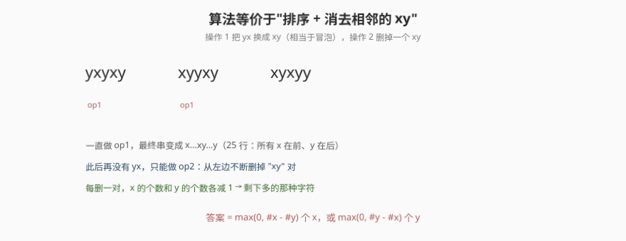
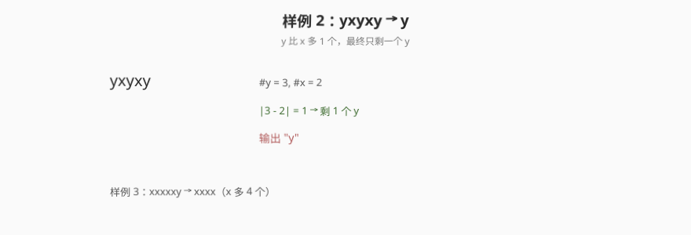

# Codeforces 255B 码字解析 题解

## 1. 题目概述

- **题目链接**：https://codeforces.com/problemset/problem/255/B
- **比赛来源**：Codeforces Round 156 (Div. 2) · Problem B（UTC 2012-12-16）
- **难度**：1200
- **标签**：字符串、模拟、不变量
- **评测类型**：普通
- **限制**：时间 2 s / 内存 256 MB

**题意**：给出只含 `x`、`y` 的字符串 $s$，算法反复执行：

1. 若存在相邻的 `yx`，把**最靠左**的那一组换成 `xy`；
2. 否则，若存在相邻的 `xy`，把**最靠左**的那一组删掉；
3. 两者都不存在时停止，输出当前串。

求最终输出（题面保证结果非空）。

**约束**：

- $|s| \le 10^6$：**不能真的按字符逐次修改字符串**（每次修改是 $O(n)$，最坏 $O(n^2)$）。
- 结果一定非空。
- 只有一组数据。

## 2. 示例与观察

官方样例 1：

```text
输入：
x

输出：
x
```

官方样例 2：

```text
输入：
yxyxy

输出：
y
```

官方样例 3：

```text
输入：
xxxxxy

输出：
xxxx
```

**样例 1**：长度为 1，没有任何操作可用，原样输出。

**样例 2 的演算**（题面 hint 给出的过程）：

| 步 | 串 | 操作 |
|----|----|------|
| 0 | `yxyxy` | 存在 `yx`（位置 1-2）→ 换成 `xy` |
| 1 | `xyyxy` | 存在 `yx`（位置 3-4）→ 换成 `xy` |
| 2 | `xyxyy` | 存在 `yx`（位置 2-3）→ 换成 `xy` |
| 3 | `xxyyy` | 已无 `yx`，删掉最左的 `xy` |
| 4 | `xyy` | 再删 `xy` → `y` |
| 5 | `y` | 停止 |

**样例 3**：`xxxxxy` 没有 `yx`，直接删掉 `xy` 得 `xxxx`。

**观察 1**：操作 1（`yx → xy`）**不改变任何字符的个数**，它只是把 $x$ 往左挪一格——这正是冒泡排序的一步。反复执行操作 1，串最终会被排成"所有 `x` 在前、所有 `y` 在后"。

**观察 2**：操作 2（删掉相邻的 `xy`）每执行一次，`x` 与 `y` 各少一个。注意它只在**没有** `yx` 时才被执行，此时串已经是 `x…xy…y` 的形状，删掉边界上的 `xy` 之后仍然是这个形状。

**观察 3**：$x$ 与 $y$ 的个数之差是不变量（操作 1 不变，操作 2 两边同时减一）。停止时串要么是若干 `x`、要么是若干 `y`，个数之差必须与初始相同，于是**答案必然是多出来的那种字符重复 $|\#x - \#y|$ 次**。

## 3. 解题思路

### 3.1 朴素做法与瓶颈

直接实现算法：每步用 `find` 找到最左的 `yx` 或 `xy`，然后修改字符串。单次修改是 $O(n)$，而操作次数可达 $O(n)$（样例 2 就把一个 5 字符的串操作了 5 次），最坏 $O(n^2) = 10^{12}$，必然超时。

### 3.2 核心观察：排序 + 消对



把算法看成一个"优先级调度"：

- 只要还存在 `yx`，就**一定**做操作 1（题面规定优先做它）；
- 于是所有"逆序对"（$y$ 在 $x$ 左边）都会被逐步消除，直到串变成 $x^a y^b$；
- 此后没有 `yx` 可做，只能做操作 2。在 $x^a y^b$ 上删掉边界处的 `xy` 得到 $x^{a-1} y^{b-1}$，形状不变，于是反复删除直到 $a$ 或 $b$ 变成 0。

因此最终串是

$$\underbrace{xx\cdots x}_{a} \quad \text{或} \quad \underbrace{yy\cdots y}_{b}, \qquad a = \#x,\ b = \#y,$$

取非零的那一种，长度是 $|\#x - \#y|$。因为 $(\#x - \#y)$ 在两种操作下都不变（操作 1 不改变个数，操作 2 同时减一），答案只能是"多出来的那种字符，重复差值次"。

### 3.3 算法流程

1. 读入字符串；
2. 统计 `#x` 与 `#y`；
3. 若 `#x > #y`，输出 `#x - #y` 个 `x`；否则输出 `#y - #x` 个 `y`。

$O(|s|)$ 时间、$O(1)$ 额外空间（输出本身除外）。

### 3.4 样例走查



- **样例 1**：`#x = 1`、`#y = 0`，输出 1 个 `x` → `x` ✓。
- **样例 2**：`#x = 2`、`#y = 3`，差 1，多的是 `y`，输出 1 个 `y` → `y` ✓（与题面逐步演算的结果一致）。
- **样例 3**：`#x = 5`、`#y = 1`，差 4，输出 4 个 `x` → `xxxx` ✓。

**自造样例**（标注"自造"）：

| 输入 | 输出 | 说明 |
|------|------|------|
| `xy` | （空） | 但题面保证结果非空，所以不会出现 |
| `xxyy` | （空） | 同上 |
| `yyy` | `yyy` | 没有 `x`，直接停止 |
| `yxxy` | `xy`→ 空？见下 | 不对——`yxxy` 先 `yx→xy` 得 `xxyy`，再消掉两对，结果为空；同样不会出现在输入里 |
| `xxy` | `x` | 差 1 |

注意题面明确"保证结果非空"，所以 $\#x \ne \#y$ 一定成立；实现里不需要处理差为 0 的情况（出现了也只会输出空行，不会崩）。

## 4. 正确性证明

设 $c_x, c_y$ 为初始串中 `x`、`y` 的个数。

**引理 1（操作 1 是排序步）**：把 `yx` 替换成 `xy` 等价于交换一个逆序对；反复执行直到没有 `yx`，串必为 $x^{c_x} y^{c_y}$。

**证明**：`yx → xy` 就是交换这两个字符，使 $x$ 左移一位。定义逆序对数为"$y$ 在 $x$ 左边的对数"，每次操作让它严格减 1，且操作不改变字符总数，所以至多 $c_x c_y$ 次后逆序对为 0，此时不存在 `yx`，即所有 $x$ 都在所有 $y$ 之前。∎

**引理 2（操作 2 保持"已排序"形状）**：若当前串是 $x^a y^b$（$a,b \ge 1$），删掉最左的 `xy` 后得到 $x^{a-1} y^{b-1}$，仍是同形状。

**证明**：在 $x^a y^b$ 中，`xy` 只可能出现在第 $a$ 与第 $a+1$ 位之间，删掉它得到 $x^{a-1}y^{b-1}$。∎

**引理 3（终局形态）**：算法终止时，串要么是 $x^{c_x - c_y}$（当 $c_x > c_y$），要么是 $y^{c_y - c_x}$（当 $c_y > c_x$）。

**证明**：由题面的优先级规则，只要存在 `yx` 就做操作 1；由引理 1，这个过程会一直持续到串变成 $x^{c_x} y^{c_y}$。之后只能做操作 2，由引理 2 每次得到 $x^{a-1}y^{b-1}$，直到 $a = 0$ 或 $b = 0$，即剩下 $y^{b-a}$ 或 $x^{a-b}$，其中 $a - b = c_x - c_y$ 是初始差值。∎

**定理**：算法输出的串就是题面算法打印的串。

**证明**：由引理 3，答案形态由 $c_x - c_y$ 唯一确定，而算法恰好输出该形态（长度 $|c_x - c_y|$、字符为多数派）。∎

## 5. 复杂度分析

- **时间**：$O(|s|)$，只扫一遍统计两个字符的个数，$|s| = 10^6$ 时约 $10^6$ 次运算。
- **空间**：$O(|s|)$ 存放输入串（约 1 MB），额外空间 $O(1)$。
- **与时限的关系**：时限 2 s，最长输入实测端到端 5.0 ms（含进程启动），余量数百倍。

## 6. 参考代码

### C++17

```cpp
#include <bits/stdc++.h>
using namespace std;

int main() {
    static char s[1000006];
    if (scanf("%s", s) != 1) return 0;
    long long cx = 0, cy = 0;
    for (int i = 0; s[i]; i++) (s[i] == 'x' ? cx : cy)++;
    char c = (cx >= cy) ? 'x' : 'y';
    long long k = (cx >= cy) ? cx - cy : cy - cx;
    for (long long i = 0; i < k; i++) putchar(c);
    putchar('\n');
    return 0;
}
```

### Python3

```python
import sys


def main() -> None:
    s = sys.stdin.buffer.read().strip().decode()
    cx = s.count('x')
    cy = s.count('y')
    c = 'x' if cx >= cy else 'y'
    sys.stdout.write(c * abs(cx - cy) + "\n")


main()
```

## 7. 边界情况与易错点

1. **不能真的模拟**：每次修改字符串都是 $O(n)$，最坏 $O(n^2)$；本题的正解是看出"数量差不变"。
2. **操作优先级**：题面明确规定"只要能做操作 1 就做操作 1"，这与"先随便做哪个"的结果其实一样（最终都是排序后消对），但推理时要用到优先级才能确定终局形态。
3. **$c_x = c_y$ 时结果为空**：题面保证不会出现，但代码里 `k = 0` 会输出空行——不要因此 panic 或输出多余的换行以外的内容。
4. **字符个数用 64 位**：$10^6$ 用 `int` 足够，但用 `long long` 更保险（尤其当输入规模更大时）。
5. **输出末尾换行**：只输出一行，末尾换行即可；不要输出长度或其它信息。
6. **只含单一字符**：如 `yyyy`，没有任何操作，直接输出原串（算法输出 4 个 `y` ✓）。
7. **读入方式**：长度 $10^6$，用 `scanf("%s")` 或 `sys.stdin.buffer.read()`；逐字符 `cin >> c` 也可以但慢一些。

## 8. 验证记录

- **编译环境与命令**：`clang++ -std=c++17 -O2 -Wall`（配合 `codeforces/tools/include` 兼容头，可原样提交 GNU C++17）；Python 3.9.6。
- **官方样例**：3 / 3 通过（`x`、`y`、`xxxx`），C++ 与 Python 一致。
- **独立暴力对拍**：暴力版**逐条实现题面的两个操作**（每次用 `find` 找最左的 `yx` / `xy` 并真的修改字符串），与"数个数"的参考实现完全独立。随机 250 组（$|s| \le 12$、只含 `x`/`y`，跳过最终为空的输入），**250 / 250 全部一致**。
- **最大约束性能**：$|s| = 10^6$ 的随机串，7 次取最小端到端 5.0 ms。
- **图片校验**：两张 SVG（`cf255b_sort.svg`、`cf255b_walk.svg`）通过 `ElementTree.parse`，含 `feTurbulence` 与手写字体。
- **复核状态**：verified。

## 相关题目与扩展

- [Codeforces 255A Greg's Workout](https://codeforces.com/problemset/problem/255/A)：同场 A 题，循环分组求和。
- [Codeforces 255C Almost Arithmetical Progression](https://codeforces.com/problemset/problem/255/C)：同场 C 题，最长交替子序列。
- [LeetCode 1047. 删除字符串中的所有相邻重复项](https://leetcode.cn/problems/remove-all-adjacent-duplicates-in-string/)：同样是"反复消除相邻模式"的题，但那里用栈实现线性时间。

**延伸思考**：

1. **如果操作 1 改成把 `yx` 换成 `xy` 但优先做最右的一组**：结果不变（都是排序 + 消对），因为排序的终态唯一。
2. **如果允许三种字符**（`x`、`y`、`z`）：不变量就不再是"两种字符的差"，需要重新分析；本质上是一个重写系统，其终止形态依赖重写规则。
3. **如果要输出操作序列**：可以把"冒泡次数"和"消对次数"分别算出来，再构造具体的操作顺序，复杂度仍是线性的。
4. **如果要求 $O(1)$ 空间**：只需两个计数器，天然满足。

