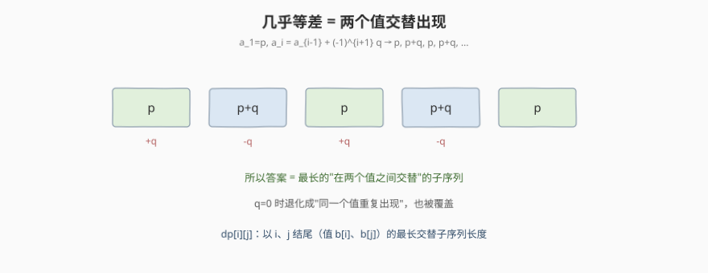
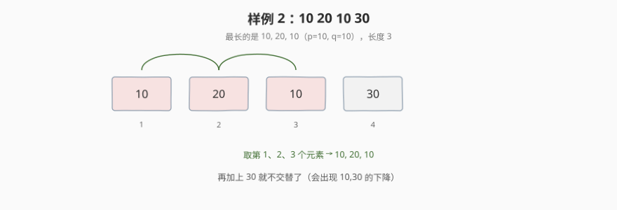

# Codeforces 255C 几乎等差子序列 题解

## 1. 题目概述

- **题目链接**：https://codeforces.com/problemset/problem/255/C
- **比赛来源**：Codeforces Round 156 (Div. 2) · Problem C（UTC 2012-12-16）
- **难度**：1500
- **标签**：动态规划、子序列、交替结构
- **评测类型**：普通
- **限制**：时间 1 s / 内存 256 MB

**题意**：称序列 $s$ 为"几乎等差数列"，如果存在整数 $p, q$ 使得

$$s_1 = p,\qquad s_i = s_{i-1} + (-1)^{i+1} q \quad (i > 1).$$

给定长度为 $n$ 的序列 $b$，求它最长的"几乎等差数列"**子序列**的长度（子序列不必连续）。

**约束**：

- $n \le 4000$：$O(n^2)$ 的 DP 是 $1.6 \times 10^7$，可以接受；$O(n^3)$ 不行。
- $b_i \le 10^6$：值域大，做"以值作为状态"的二维表时要先离散化。
- 只有一组数据。

## 2. 示例与观察

官方样例 1：

```text
输入：
2
3 5

输出：
2
```

官方样例 2：

```text
输入：
4
10 20 10 30

输出：
3
```

**样例 1**：任意两个数都能组成"$q = b_2 - b_1$"的几乎等差数列（长度 2），所以答案是 2。

**样例 2**：取第 1、2、3 个元素得到 $10, 20, 10$：这里 $p = 10$、$q = 10$，满足 $10, 10+10, 10+10-10$。若再加上 $30$，序列变成 $10,20,10,30$，第 4 步要求 $10 + 10 = 20 \ne 30$，不合法。所以答案是 3。

**观察 1（结构极其简单）**：定义展开一下：

$$s = p,\ p+q,\ p,\ p+q,\ p,\ \ldots$$

也就是说，**几乎等差数列 = 在两个值之间来回交替**（特别地，$q = 0$ 时退化成"同一个值重复"）。

**观察 2**：因此问题变成：在 $b$ 中找一个最长的子序列，它在两个值 $u, v$ 之间交替出现（允许 $u = v$）。

**观察 3**：一个子序列的相邻两项必然属于 $\{u, v\}$ 且交替，所以只要固定"当前最后两个位置"，后面的选择就完全确定——这正是 DP 的形状。

## 3. 解题思路

### 3.1 朴素做法与瓶颈

最直接的想法：枚举两种取值 $u, v$，再贪心地在原序列里交替挑选。取值对最多 $O(n^2)$ 种，每种扫描 $O(n)$ → $O(n^3) = 6.4 \times 10^{10}$，超时。

另一个朴素想法是对每个子序列判定，那是指数级的。

### 3.2 核心观察：以"最后两个位置"为状态



定义

$$\text{dp}[i][j] = \text{以位置 } i \text{ 和 } j \ (i < j) \text{ 结尾的最长交替子序列长度},$$

其中两个结尾元素的值分别是 $b_i$（倒数第二个）与 $b_j$（最后一个）。为了继续交替，下一个元素必须取值为 $b_i$。于是转移是

$$\text{dp}[i][j] = \max\Bigl(2,\ 1 + \max_{k < i,\ b_k = b_j} \text{dp}[k][i]\Bigr).$$

直观上：把"$k, i, j$"看成 $\ldots, b_k, b_i, b_j$，因为 $b_k = b_j$，所以三段是交替的，长度加一。

为了让上式 $O(1)$ 转移，对每个固定的 $i$ 预处理

$$B[i][v] = \max_{k < i,\ b_k = v} \text{dp}[k][i],$$

那么 $\text{dp}[i][j] = \max(2,\ B[i][b_j] + 1)$。$B$ 只需在算完第 $i$ 列（即所有 $\text{dp}[k][i]$）后一次性建好，所以整体 $O(n^2)$。

### 3.3 算法流程

1. 把 $b$ 离散化（值域 $10^6$，但不同的值至多 $n$ 个）；
2. 开 $n \times D$ 的 `short` 表 `B`（$D$ 是不同值的个数），初值 0；
3. 依次处理 $j = 1 \ldots n-1$：
   - 对每个 $i < j$：`v = (B[i][id[j]] == 0 ? 2 : B[i][id[j]] + 1)`；
     用 `v` 更新答案，并用它更新 `B[j][id[i]]`（这是 $\text{dp}[i][j]$ 对第 $j$ 列的贡献）；
4. 输出答案（初值 1）。

`B[i][v] == 0` 表示"没有这样的前驱"，此时长度为 2（只有 $i, j$ 两个元素）。

### 3.4 样例走查



$b = 10, 20, 10, 30$（下标 0..3）。

| 处理 $j$ | $i$ | $B[i][b_j]$ | 得到 $\text{dp}[i][j]$ | 更新 |
|----------|-----|-------------|------------------------|------|
| $j=1$ | 0 | $B[0][20] = 0$ | 2 | $B[1][10] = 2$ |
| $j=2$ | 0 | $B[0][10] = 0$ | 2 | $B[2][10] = 2$ |
| $j=2$ | 1 | $B[1][10] = 2$ | 3 | $B[2][20] = 3$ |
| $j=3$ | 0 | $B[0][30] = 0$ | 2 | $B[3][10] = 2$ |
| $j=3$ | 1 | $B[1][30] = 0$ | 2 | $B[3][20] = 2$ |
| $j=3$ | 2 | $B[2][30] = 0$ | 2 | $B[3][10] = \max(2,2)$ |

答案取到 3（对应 $10, 20, 10$），与官方输出一致。

## 4. 正确性证明

**引理 1（等价刻画）**：序列 $s_1 \ldots s_k$ 是几乎等差数列，当且仅当存在 $u, v$ 使得 $s$ 在 $u$ 与 $v$ 之间交替（$s_1 = u,\ s_2 = v,\ s_3 = u,\ldots$；$u = v$ 时即全部相等）。

**证明**：由定义 $s_1 = p$、$s_2 = p + q$，之后每次交替加减 $q$，所以奇数位恒为 $p$、偶数位恒为 $p+q$，即在 $u = p$ 与 $v = p+q$ 之间交替。反之，若序列在 $u, v$ 之间交替，取 $p = u$、$q = v - u$ 即满足定义。∎

**引理 2（DP 语义）**：$\text{dp}[i][j]$ 等于"以 $i, j$ 为最后两个位置的、在 $b_i$ 与 $b_j$ 之间交替的最长子序列长度"。

**证明**：对 $j$ 归纳（内层对 $i$）。长度 2 的子序列 $(i,j)$ 总是合法，对应 $\text{dp} \ge 2$。若长度 $\ge 3$，倒数第三个位置 $k$ 必须满足 $b_k = b_j$（保持交替），且前缀 $k, i$ 本身是一个交替子序列，长度至多 $\text{dp}[k][i]$，故 $\text{dp}[i][j] \le 1 + B[i][b_j]$；反之任取达到 $B[i][b_j]$ 的 $k$，把 $j$ 接在 $k, i$ 之后确实得到长度 $+1$ 的交替子序列，故等号可达。∎

**引理 3（不重不漏）**：任意长度 $\ge 2$ 的交替子序列都有唯一的"最后两个位置" $(i, j)$，因此被 $\text{dp}[i][j]$ 恰好统计一次。

**证明**：子序列的最后两个位置由子序列本身唯一确定。长度为 1 的子序列单独用初值 1 处理。∎

**定理**：算法输出等于最长几乎等差子序列的长度。

**证明**：由引理 1，所求即最长交替子序列；由引理 2、3，所有长度 $\ge 2$ 的交替子序列都被某个 $\text{dp}[i][j]$ 正确表示，算法取最大值即为答案；长度 1 由初值覆盖。∎

## 5. 复杂度分析

- **时间**：$O(n^2)$，$n = 4000$ 时约 $8 \times 10^6$ 次转移（只算 $i<j$ 的部分）。
- **空间**：$O(nD) \le O(n^2)$ 用 `short` 存 `B`，$4000 \times 4000 \times 2$ 字节 $= 32$ MB，符合 256 MB。
- **与时限的关系**：时限 1 s。随机 $n = 4000$ 数据实测端到端 15.8 ms（全不同值的最坏情况 31.1 ms），余量 30 倍以上。
- **为什么用 `short`**：答案不超过 4000，`short` 足够，内存直接减半。

## 6. 参考代码

### C++17

```cpp
#include <bits/stdc++.h>
using namespace std;

int main() {
    int n;
    if (scanf("%d", &n) != 1) return 0;
    vector<int> b(n);
    for (int i = 0; i < n; i++) scanf("%d", &b[i]);
    // 离散化
    vector<int> vals(b);
    sort(vals.begin(), vals.end());
    vals.erase(unique(vals.begin(), vals.end()), vals.end());
    int D = (int)vals.size();
    vector<int> id(n);
    for (int i = 0; i < n; i++) id[i] = (int)(lower_bound(vals.begin(), vals.end(), b[i]) - vals.begin());

    // B[i][v]：以 i 结尾、倒数第二个元素值为 v 的最长交替子序列长度
    vector<vector<short>> B(n, vector<short>(D, 0));
    int ans = 1;
    for (int j = 1; j < n; j++) {
        for (int i = 0; i < j; i++) {
            int val = B[i][id[j]];
            val = (val == 0) ? 2 : val + 1;      // 子序列 (i, j) 至少长度为 2
            if (val > ans) ans = val;
            if (val > B[j][id[i]]) B[j][id[i]] = (short)val;
        }
    }
    printf("%d\n", ans);
    return 0;
}
```

### Python3

```python
import sys
from array import array


def main() -> None:
    data = sys.stdin.buffer.read().split()
    if not data:
        return
    n = int(data[0])
    b = [int(x) for x in data[1:1 + n]]
    vals = sorted(set(b))
    idx = {v: i for i, v in enumerate(vals)}
    D = len(vals)
    ids = [idx[v] for v in b]
    B = [array('h', bytes(2 * D)) for _ in range(n)]   # B[i][v]
    ans = 1
    for j in range(1, n):
        bj = ids[j]
        Bj = B[j]
        for i in range(j):
            v = B[i][bj]
            v = 2 if v == 0 else v + 1
            if v > ans:
                ans = v
            ii = ids[i]
            if v > Bj[ii]:
                Bj[ii] = v
    sys.stdout.write(str(ans) + "\n")


main()
```

## 7. 边界情况与易错点

1. **$n = 1$**：答案是 1，初值必须设为 1，不能设成 0 或 2。
2. **全部相同**：例如 $5,5,5,5$，$q = 0$，可以全取，答案是 $n$。DP 里 $b_i = b_j$ 时转移同样成立（$B$ 里包含同值前驱），所以无需特判。
3. **$q$ 可以为负或零**：题面只要求 $q$ 是整数。所以"递减交替"也合法，DP 不区分方向 ✓。
4. **离散化后的下标**：`B` 的第二维是值的编号（$0 \ldots D-1$），不是原值；直接用 $b_i$ 当下标会越界。
5. **`B[i][v] == 0` 的含义**：0 表示"无前驱"，此时长度是 2；若写成 `B[i][v] + 1` 就会得到 1，漏掉长度 2 的子序列。
6. **内存**：$n^2$ 的 `int` 表是 64 MB，加上其它开销可能吃紧；用 `short` 或滚动数组更稳。
7. **更新顺序**：处理 $j$ 时要先算完所有 $\text{dp}[i][j]$ 再更新 $B[j]$（本实现在同一个循环里先算 $\text{dp}[i][j]$ 再写 $B[j][\cdot]$，是安全的，因为 $B[j]$ 只依赖 $\text{dp}[\cdot][j]$ 而不会反过来被读）。

## 8. 验证记录

- **编译环境与命令**：`clang++ -std=c++17 -O2 -Wall`（配合 `codeforces/tools/include` 兼容头，可原样提交 GNU C++17）；Python 3.9.6。
- **官方样例**：2 / 2 通过（2、3），C++ 与 Python 一致。
- **独立暴力对拍**：暴力版**枚举全部子集**（$n \le 10$），对每个子序列用定义（相邻差交替）判定，取最长。随机 200 组（值域 $\{1..5\}$，提高重复率），**200 / 200 全部一致**（C++ 与 Python 各跑一遍共 400 次比较）。
- **最大约束性能**：$n = 4000$，随机小值域 15.8 ms、全不同值 31.1 ms（7 次取最小，含进程启动）。
- **图片校验**：两张 SVG（`cf255c_alt.svg`、`cf255c_walk.svg`）通过 `ElementTree.parse`，含 `feTurbulence` 与手写字体。
- **复核状态**：verified。

## 相关题目与扩展

- [Codeforces 255B Code Parsing](https://codeforces.com/problemset/problem/255/B)：同场 B 题，字符串操作。
- [Codeforces 255D Mr. Bender and Square](https://codeforces.com/problemset/problem/255/D)：同场 D 题，几何计数 + 二分。
- [LeetCode 1218. 最长定差子序列](https://leetcode.cn/problems/longest-arithmetic-subsequence-of-given-difference/)：等差子序列的 DP，与本题的"状态带最后两个值"形成对照。
- [LeetCode 1027. 最长等差数列](https://leetcode.cn/problems/longest-arithmetic-subsequence/)：经典 $O(n^2)$ 等差子序列 DP。

**延伸思考**：

1. **如果改成"三个值循环"**（$u, v, w$ 轮转）：状态要变成"最后两个位置 + 阶段"，复杂度不变但常数上升。
2. **如果要求子序列连续**：问题退化成一维扫描，$O(n)$。
3. **如果 $n$ 放大到 $10^5$**：$O(n^2)$ 不行；这类"最长交替子序列"在一般情况下没有已知的亚二次算法（与最长公共子序列同级别），所以本题的 $n \le 4000$ 是刻意设计的。
4. **如果需要输出最长子序列本身**：在 DP 里记录前驱即可，空间会翻倍。

