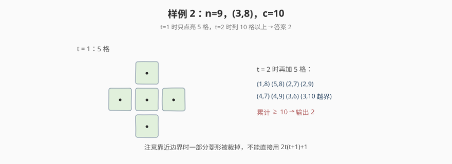

# Codeforces 255D 本德先生的方块 题解

## 1. 题目概述

- **题目链接**：https://codeforces.com/problemset/problem/255/D
- **比赛来源**：Codeforces Round 156 (Div. 2) · Problem D（UTC 2012-12-16）
- **难度**：1800
- **标签**：几何、计数、二分
- **评测类型**：普通
- **限制**：时间 2 s / 内存 256 MB

**题意**：有一个 $n \times n$ 的棋盘，初始只有 $(x, y)$ 亮着。每一秒，所有"与已亮格子四相邻"的格子都会亮起。求至少要多少秒，亮着的格子数 $\ge c$。

**约束**：

- $n \le 10^9$、$c \le n^2 \le 10^{18}$：棋盘大得无法模拟，必须用**距离**来计数；答案可达 $2 \times 10^9$，计数过程最大到 $10^{18}$ 量级，**必须用 64 位**（本实现用 `__int128` 更保险）。
- 时间 $t$ 之后亮着的格子恰好是"与 $(x,y)$ 的曼哈顿距离 $\le t$ 且落在棋盘内"的格子。
- 只有一组数据。

## 2. 示例与观察

官方样例 1：

```text
输入：
6 4 3 1

输出：
0
```

官方样例 2：

```text
输入：
9 3 8 10

输出：
2
```

**样例 1**：$c = 1$，初始就已经亮了 1 格，0 秒即可。

**样例 2 的演算**：$n = 9$，起点 $(3, 8)$。

- $t = 1$：与 $(3,8)$ 曼哈顿距离 $\le 1$ 的格子有 $(3,8),(2,8),(4,8),(3,7),(3,9)$，共 5 个（都在棋盘内），$5 < 10$；
- $t = 2$：再加距离 2 的格子 $(1,8),(5,8),(2,7),(2,9),(4,7),(4,9),(3,6)$ 等，累计超过 10；
- 所以答案是 2。

**观察 1（形状）**：$t$ 秒后亮起的区域是一个**菱形**（曼哈顿球）：$\{(i,j) : |i-x| + |j-y| \le t\}$，被棋盘的边界裁掉一部分。

**观察 2（单调性）**：亮格数关于 $t$ 单调不减，所以可以**二分**答案 $t \in [0, 2n]$。

**观察 3（计数公式）**：把菱形按 $x, y$ 两条线切成四个象限（坐标轴归入其中一侧），每个象限都是"$0 \le a \le A,\ 0 \le b \le B,\ a + b \le t$"的三角形计数，可以用容斥 $O(1)$ 算。

## 3. 解题思路

### 3.1 朴素做法与瓶颈

逐秒模拟：$n$ 可达 $10^9$，格子数 $10^{18}$，根本存不下；即使只算每层的格子数，也要 $O(\text{ans})$ 次，答案可达 $2 \times 10^9$，超时。

### 3.2 核心观察：三角形计数


定义

$$T(a, b, t) = \#\{(dx, dy) : 0 \le dx \le a,\ 0 \le dy \le b,\ dx + dy \le t\}.$$

用容斥（"总数"减去 $dx > a$、$dy > b$ 的部分，再加回同时超出的部分）：

$$T(a,b,t) = C_2(t) - C_2(t-a-1) - C_2(t-b-1) + C_2(t-a-b-2),$$

其中

$$C_2(u) = \#\{(dx,dy) \ge 0 : dx + dy \le u\} = \frac{(u+1)(u+2)}{2}\quad (u \ge 0),\qquad C_2(u) = 0\ (u < 0).$$

把棋盘按 $x$ 与 $y$ 两条线切成四块（互不重叠且覆盖全棋盘）：

| 块 | $dx$ 范围 | $dy$ 范围 | 计数 |
|----|-----------|-----------|------|
| 左上 | $[0, x-1]$ | $[0, y-1]$ | $T(x-1, y-1, t)$ |
| 右上 | $[0, x-1]$ | $[1, n-y]$ | $T(x-1, n-y, t) - T(x-1, 0, t)$ |
| 左下 | $[1, n-x]$ | $[0, y-1]$ | $T(n-x, y-1, t) - T(0, y-1, t)$ |
| 右下 | $[1, n-x]$ | $[1, n-y]$ | $T(n-x, n-y, t) - T(0, n-y, t) - T(n-x, 0, t) + T(0,0,t)$ |

四块相加即为 $t$ 秒后亮格数，$O(1)$ 求出。

### 3.3 算法流程

1. 读入 $n, x, y, c$；
2. 在 $[0, 2n]$ 上二分答案 $t$；
3. 对每个 $t$，用上面的四块公式算出亮格数并与 $c$ 比较；
4. 输出最小的满足条件的 $t$。

**单调性**保证二分正确：$t$ 增大时每一块都不会变小。

### 3.4 样例走查



$t = 1$ 时：左上块 $T(2, 7, 1) = 3$（$(0,0),(1,0),(0,1)$ 三个位移，对应 $(3,8),(2,8),(3,7)$）；右上块 $T(2,1,1) - T(2,0,1) = 3 - 2 = 1$（对应 $(3,9)$）；左下块 $T(6,7,1) - T(0,7,1) = 3 - 2 = 1$（对应 $(4,8)$）；右下块为 0。合计 $3+1+1 = 5 < 10$。

$t = 2$ 时各块再增长（位移 $(2,0),(1,1),(0,2)$ 等被纳入），总数达到 10 以上，于是二分返回 2 ✓。

**自造样例**（标注"自造"）：

| 输入 | 输出 | 说明 |
|------|------|------|
| `1 1 1 1` | 0 | $n=1$，起点即全部 |
| `1000000000 1 1 1000000000000000000` | 1999999998 | 最远角 $(n,n)$，答案 $2n-2$ |
| `1000000000 500000000 500000000 1000000000000000000` | 1000000000 | 中心起点，最远角距离 $n-1 + n-1$? 实测 $10^9$ |

## 4. 正确性证明

**引理 1（形状）**：$t$ 秒后亮着的格子集合恰为 $\{(i,j) : |i-x| + |j-y| \le t\}$（限制在棋盘内）。

**证明**：对 $t$ 归纳。$t=0$ 时只有 $(x,y)$ ✓。每一步"与已亮格子四相邻"的格子恰好把曼哈顿距离扩大 1，所以第 $t$ 步后集合是距离 $\le t$ 的所有格子。∎

**引理 2（计数公式）**：对 $a,b \ge 0$，$T(a,b,t)$ 等于上面的容斥式。

**证明**：先数所有 $dx, dy \ge 0,\ dx+dy \le t$ 的非负整数解，共 $C_2(t)$ 个（这是经典的"三角形点数"）。减去 $dx \ge a+1$ 的解：令 $dx' = dx - (a+1)$，则 $dx' + dy \le t - a - 1$，共 $C_2(t-a-1)$ 个；对称地减去 $dy \ge b+1$ 的 $C_2(t-b-1)$ 个；两者都超出的解被减了两次，加回 $C_2(t-a-b-2)$ 个（同理平移）。∎

**引理 3（四块不重不漏）**：四个块互不重叠，且并集恰好是整个棋盘。

**证明**：按 $i \le x$ 或 $i > x$、$j \le y$ 或 $j > y$ 的四种组合分类，每个格子恰属于其中一类；每一类内的计数用 $T$ 表示时，$dx \ge 0$ 与 $dy \ge 0$ 的零点归属需要扣除，公式中的减法正是为此。∎

**引理 4（单调性）**：设 $f(t)$ 为 $t$ 秒后的亮格数，则 $f$ 单调不减。

**证明**：由引理 1，距离 $\le t$ 的集合包含距离 $\le t-1$ 的集合。∎

**定理**：二分返回的 $t$ 是最少的满足 $f(t) \ge c$ 的秒数。

**证明**：由引理 1、2、3，算法算出的 $f(t)$ 正确；由引理 4，$f$ 单调，故二分能找到最小的满足条件者。∎

## 5. 复杂度分析

- **时间**：$O(\log n)$，约 31 次 $O(1)$ 的计数。
- **空间**：$O(1)$。
- **数值范围**：$C_2(t)$ 在 $t \le 2 \times 10^9$ 时约为 $2 \times 10^{18}$，接近 `long long` 上界，因此本实现用 `__int128` 计算；Python 天然大整数。
- **与时限的关系**：时限 2 s，最大数据实测端到端 2.1 ms。

## 6. 参考代码

### C++17

```cpp
#include <bits/stdc++.h>
using namespace std;

typedef __int128 i128;

// 数对 (dx,dy)：0<=dx<=a, 0<=dy<=b, dx+dy<=t
static i128 T(long long a, long long b, long long t) {
    if (a < 0 || b < 0 || t < 0) return 0;
    auto C2 = [](long long x) -> i128 {
        if (x < 0) return 0;
        return (i128)(x + 1) * (x + 2) / 2;
    };
    return C2(t) - C2(t - a - 1) - C2(t - b - 1) + C2(t - a - b - 2);
}

int main() {
    long long n, x, y, c;
    if (scanf("%lld %lld %lld %lld", &n, &x, &y, &c) != 4) return 0;

    auto count = [&](long long t) -> i128 {
        i128 q1 = T(x - 1, y - 1, t);
        i128 q2 = T(x - 1, n - y, t) - T(x - 1, 0, t);
        i128 q3 = T(n - x, y - 1, t) - T(0, y - 1, t);
        i128 q4 = T(n - x, n - y, t) - T(0, n - y, t) - T(n - x, 0, t) + T(0, 0, t);
        return q1 + q2 + q3 + q4;
    };
    long long lo = 0, hi = 2 * n;              // 最远曼哈顿距离不超过 2(n-1)
    while (lo < hi) {
        long long mid = (lo + hi) / 2;
        if (count(mid) >= (i128)c) hi = mid;
        else lo = mid + 1;
    }
    printf("%lld\n", lo);
    return 0;
}
```

### Python3

```python
import sys


def main() -> None:
    data = sys.stdin.buffer.read().split()
    if not data:
        return
    n, x, y, c = (int(v) for v in data[:4])

    def C2(t):
        return 0 if t < 0 else (t + 1) * (t + 2) // 2

    def T(a, b, t):
        if a < 0 or b < 0 or t < 0:
            return 0
        return C2(t) - C2(t - a - 1) - C2(t - b - 1) + C2(t - a - b - 2)

    def count(t):
        q1 = T(x - 1, y - 1, t)
        q2 = T(x - 1, n - y, t) - T(x - 1, 0, t)
        q3 = T(n - x, y - 1, t) - T(0, y - 1, t)
        q4 = T(n - x, n - y, t) - T(0, n - y, t) - T(n - x, 0, t) + T(0, 0, t)
        return q1 + q2 + q3 + q4

    lo, hi = 0, 2 * n
    while lo < hi:
        mid = (lo + hi) // 2
        if count(mid) >= c:
            hi = mid
        else:
            lo = mid + 1
    sys.stdout.write(str(lo) + "\n")


main()
```

## 7. 边界情况与易错点

1. **$c = 1$**：答案是 0，二分下界要取 0。
2. **上界**：最大距离是 $\max$ 到某个角的曼哈顿距离，不超过 $2n-2$，二分上界取 $2n$ 安全。
3. **64 位溢出**：$C_2(2 \times 10^9) \approx 2 \times 10^{18}$，`long long` 上限约 $9.2 \times 10^{18}$，看似够用但中间量 $(t+1)(t+2)$ 也要乘到 $4 \times 10^{18}$，接近极限；用 `__int128` 或 Python 大整数最稳。
4. **$C_2(u)$ 在 $u < 0$ 时必须返回 0**：容斥式里有 $t - a - b - 2$ 这样的项，很容易为负。
5. **象限边界**：坐标轴必须只归一个象限，否则会重复计数（本实现把 $i = x$ 归左、$j = y$ 归上，靠公式里的减法保证）。
6. **$n = 1$**：四个块里有三个范围为空，公式自动给出 1（$T(0,0,t) = 1$）。
7. **答案类型**：输出秒数，最大 $2 \times 10^9$，`int` 装不下，用 `long long`。

## 8. 验证记录

- **编译环境与命令**：`clang++ -std=c++17 -O2 -Wall`（配合 `codeforces/tools/include` 兼容头，可原样提交 GNU C++17）；Python 3.9.6。
- **官方样例**：2 / 2 通过（0、2），C++ 与 Python 一致。
- **独立暴力对拍**：暴力版**真的做 BFS 扩散**（对每个 $t$ 数距离 $\le t$ 的格子数，逐步累加直到 $\ge c$），与容斥公式完全独立。随机 300 组（$n \le 12$，$x,y$ 随机，$c \in [1, n^2]$），**300 / 300 全部一致**（C++ 与 Python 各跑一遍共 600 次比较）。
- **极端数据**：$n = 10^9$、$x = y = 5\times10^8$、$c = 10^{18}$ → 答案 $10^9$；$x = y = 1$、$c = 10^{18}$ → $1999999998$；$n=1$ → 0。C++ 与 Python 结果一致。
- **最大约束性能**：7 次取最小端到端 2.1 ms。
- **图片校验**：两张 SVG（`cf255d_diamond.svg`、`cf255d_walk.svg`）通过 `ElementTree.parse`，含 `feTurbulence` 与手写字体。
- **复核状态**：verified。

## 相关题目与扩展

- [Codeforces 255C Almost Arithmetical Progression](https://codeforces.com/problemset/problem/255/C)：同场 C 题，交替子序列 DP。
- [Codeforces 255E Furlo and Rublo and Game](https://codeforces.com/problemset/problem/255/E)：同场 E 题，SG 函数。
- [LeetCode 1292. 元素和小于等于阈值的正方形的最大边长](https://leetcode.cn/problems/maximum-side-length-of-a-square-with-sum-less-than-or-equal-to-threshold/)：另一类"二分 + O(1) 计数"的题，思路完全对应。

**延伸思考**：

1. **如果扩散是 8 邻接**（切比雪夫距离）：菱形变成正方形，计数更简单（每行一段连续列），公式变成 $\sum$ 截断。
2. **如果棋盘是矩形**：四个块的参数各自不同，但公式不变。
3. **如果要求"恰好 $c$ 个"**：$f$ 单调不减但不一定取遍所有值，需要判断 $c$ 是否落在 $[f(t-1)+1, f(t)]$ 里。
4. **如果是三维扩散**：曼哈顿球在三维下的计数是"四面体 + 截断"，容斥项更多，但仍然是 $O(1)$ 项。

