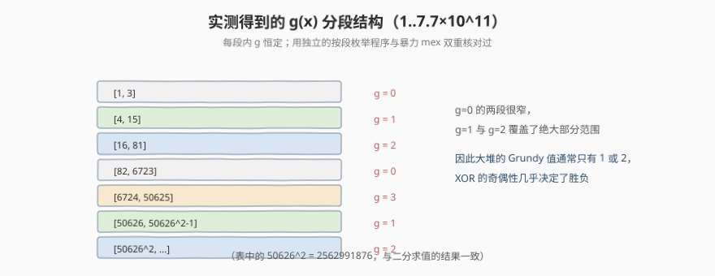

# Codeforces 255E 弗洛与鲁布洛 题解

## 1. 题目概述

- **题目链接**：https://codeforces.com/problemset/problem/255/E
- **比赛来源**：Codeforces Round 156 (Div. 2) · Problem E（UTC 2012-12-16）
- **难度**：2200
- **标签**：博弈论、SG 函数、数论
- **评测类型**：普通
- **限制**：时间 2 s / 内存 256 MB

**题意**：有 $n$ 堆硬币，第 $i$ 堆 $a_i$ 枚。两人轮流操作（Furlo 先手）。一步可以：选一堆，设其当前数量为 $x$，选一个整数 $y$ 满足

$$0 \le y < x, \qquad x^{1/4} \le y \le x^{1/2},$$

把这一堆变成 $y$ 枚。不能操作者输。双方最优，问谁赢。

**约束**：

- $a_i \le 777777777777 \approx 7.78 \times 10^{11}$：堆的大小极大，不可能对每个 $a_i$ 单独做局面搜索，必须**算 Grundy 值**且能快速求值。
- $n \le 77777$：需要对每个堆 $O(1)$ 或 $O(\log)$ 地求 SG。
- 只有一组数据。

## 2. 示例与观察

官方样例 1：

```text
输入：
1
1

输出：
Rublo
```

官方样例 2：

```text
输入：
2
1 2

输出：
Rublo
```

官方样例 3：

```text
输入：
10
1 2 3 4 5 6 7 8 9 10

输出：
Furlo
```

**样例 1**：$x = 1$ 时可选 $y$ 满足 $1 \le y \le 1$ 且 $y < 1$——为空，不能动，先手输 → `Rublo`。

**样例 2**：$x = 1$ 不能动；$x = 2$ 时要求 $y \ge \lceil 2^{1/4} \rceil = 2$ 且 $y \le \lfloor\sqrt2\rfloor = 1$，也为空。两堆都不能动 → 先手输 → `Rublo`。

**样例 3**：$x = 4$ 时可选 $y \in [\lceil\sqrt[4]{4}\rceil, \lfloor\sqrt4\rfloor] = [2,2]$，即把 4 变成 2，而 2 是"死局"，所以 $g(4) \ne 0$。逐堆算下去，$1,2,3$ 的 $g = 0$，$4 \ldots 10$ 的 $g \ne 0$（具体是 $1,1,1,1,1,1,2$），异或和非零 → `Furlo`。

**观察 1（多堆是"不交并"）**：每一步只动一堆，各堆互不影响，所以这是若干独立游戏的和，先手必胜当且仅当各堆 SG 值的异或和非零。

**观察 2（单堆的 SG）**：由 SG 函数的定义，

$$g(x) = \operatorname{mex}\{\, g(y) : \lceil x^{1/4} \rceil \le y \le \min(\lfloor x^{1/2}\rfloor,\ x-1) \,\}.$$

**观察 3（关键：区间上界很小）**：可选 $y$ 的上界是 $\lfloor\sqrt{x}\rfloor \le \sqrt{7.78 \times 10^{11}} \approx 881917$。也就是说**所有转移都落在 $[0, 881917]$ 之内**——只要把 $0 \ldots 881917$ 的 SG 全部预处理出来，任意大堆的 $g$ 值都能现查。

## 3. 解题思路

### 3.1 朴素做法与瓶颈

堆大小 $7.78 \times 10^{11}$，逐堆做 mex 是不可能的。但只要注意到 $g(x)$ 只依赖于区间 $[\lceil x^{1/4}\rceil, \lfloor\sqrt x\rfloor]$ 内的值，而这个区间完全落在 $\sqrt{\max a_i} \le 881917$ 以内，就可以**只预处理到 $10^6$ 以内**。

### 3.2 核心观察：预处理到 $\sqrt{\max a}$

![一步能把 x 变成区间 [x^{1/4}, x^{1/2}] 里的任意 y](../../../images/cf255e_interval.svg)

设 $M = \max a_i$，$L = \lfloor\sqrt M\rfloor$。对任意 $x \le M$：

- 上界 $\lfloor\sqrt x\rfloor \le \lfloor\sqrt M\rfloor = L$；
- 下界 $\lceil x^{1/4}\rceil \ge 0$。

所以计算 $g(x)$ 只需要知道 $g(0 \ldots L)$。于是：

1. 预处理 $g(1 \ldots L)$（$L \le 881917$）：对每个 $x$ 求区间并用"每个 SG 值出现次数的前缀统计"求 mex；
2. 对每个 $a_i$：若 $a_i \le L$ 直接查表；否则用同样的区间公式查表求 mex（此时区间两端都 $\le L$，可直接用前缀统计）。

预处理时用"每个 SG 值的位置列表 + 二分"或"前缀计数"都能在 $O(1)$ 内回答"区间里有没有某个值"。由于 SG 值很小（实测不超过 3），每种做法都很快。

### 3.3 算法流程

1. 读入 $n$ 与所有 $a_i$，取 $M = \max a_i$，算出 $L = \lfloor\sqrt M\rfloor + 2$；
2. 从 $x = 1$ 递推到 $L$：
   - $lo = \min\{y : y^4 \ge x\}$（用递增指针或 4 次方表 + 二分），$hi = \lfloor\sqrt x\rfloor$；
   - 若 $lo > \min(hi, x-1)$ → $g(x) = 0$；
   - 否则对 $v = 0, 1, 2, \ldots$ 依次检查区间内是否存在 $g = v$ 的位置，第一个不存在的 $v$ 就是 $g(x)$；
   - 把 $x$ 记入"$g = g(x)$"的位置列表；
3. 对每个 $a_i$ 用同样的方法求 $g$（大队走"查表区间"分支），累加异或；
4. 异或非零输出 `Furlo`，否则 `Rublo`。

### 3.4 样例走查



手算前几项：

| $x$ | 可选 $y$ | 区间内的 $g$ | $g(x)$ |
|-----|-----------|----------------|--------|
| 1 | 空（$1 \le y < 1$） | — | 0 |
| 2 | $[2, 1]$ 空 | — | 0 |
| 3 | $[2, 1]$ 空 | — | 0 |
| 4 | $\lceil 4^{1/4}\rceil = 2$ 到 $\lfloor\sqrt4\rfloor = 2$ | $g(2) = 0$ | 1 |
| 5 | $[2,2]$（$\sqrt5 = 2$） | $0$ | 1 |
| 9 | $[2,3]$ | $g(2)=g(3)=0$ | 1 |
| 16 | $[2,4]$ | $0, 1$ | 2 |

样例 3 的十个堆：$g = 0,0,0,1,1,1,1,1,1,2$，异或 $= 1 \oplus 1 \oplus 1 \oplus 1 \oplus 1 \oplus 1 \oplus 2$：前六个 1 两两抵消，最终 $2 \ne 0$ → `Furlo` ✓。

**实测的分段结构**（用独立的按段枚举程序核对，并用暴力 mex 逐项验证到 $10^5$）：

$$g(x) = \begin{cases} 0, & x \in [1,3] \cup [82, 6723] \\ 1, & x \in [4,15] \cup [50626,\ 50626^2 - 1] \\ 2, & x \in [16,81] \cup [50626^2,\ +\infty) \\ 3, & x \in [6724, 50625] \end{cases}$$

（其中 $50626^2 = 2562991876$，已经超过了 $7.78 \times 10^{11}$ 之外的部分只是外推。）这个闭式解可以用于交叉验证，但正解不需要它。

## 4. 正确性证明

**引理 1（SG 定理）**：若干独立游戏的和的 SG 值等于各游戏 SG 值的异或；先手必胜当且仅当异或和非零。

**证明**：这是 Sprague-Grundy 定理。简述：设 $G = g_1 \oplus \cdots \oplus g_n$。若 $G = 0$，任何一步只会改变一个 $g_i$，且改变后与原来的异或和非零（否则 $g_i$ 不变，与"必须改变"矛盾），所以后手总能回到异或 0 的局面；有限步后先手无路可走。若 $G \ne 0$，可以选某个 $i$ 把 $g_i$ 改成 $g_i' = g_i \oplus G < g_i$（SG 值的定义保证 $g_i'$ 是 $g_i$ 的后继 SG 值之一），于是异或变为 0，把必败局面留给对手。∎

**引理 2（单堆 SG 的递推）**：$g(x) = \operatorname{mex}\{g(y) : y \in S(x)\}$，其中 $S(x) = \{y \in \mathbb{Z} : \lceil x^{1/4}\rceil \le y \le \min(\lfloor x^{1/2}\rfloor, x-1)\}$。

**证明**：SG 函数的定义：$g(x) = \operatorname{mex}\{g(y) : y \text{ 是 } x \text{ 的合法后继}\}$，而题面给出后继集合恰为 $S(x)$（两个条件都要满足，且 $y < x$）。∎

**引理 3（转移上界）**：对任意 $x \le M$，$S(x)$ 中所有元素都 $\le \lfloor\sqrt M\rfloor$。

**证明**：$S(x)$ 的上界是 $\lfloor\sqrt x\rfloor \le \lfloor\sqrt M\rfloor$，因为 $\sqrt{\cdot}$ 单调。∎

**引理 4（预处理足够）**：设 $L = \lfloor\sqrt M\rfloor + 1$。若 $g(0 \ldots L)$ 已知，则对任意 $x \le M$ 都能正确算出 $g(x)$。

**证明**：由引理 3，$S(x) \subseteq [0, L]$，所以 mex 只需这些已知值；若 $x \le L$ 则直接查表，否则按引理 2 现算。∎

**定理**：算法输出的胜负判定正确。

**证明**：由引理 4，算法对每个 $a_i$ 算出的 $g(a_i)$ 正确；由引理 1，异或和是否为 0 决定胜负，算法正是这样输出的。∎

## 5. 复杂度分析

- **时间**：预处理 $O(L \cdot V)$，$L \le 881919$、$V$ 是 SG 值上界（实测 $\le 4$，程序里留到 12），约 $4 \times 10^6$ 次操作；每个询问 $O(V \log L)$。整体 $O(\sqrt M)$。
- **空间**：$O(L)$ 存 $g$ 与"每个 SG 值的位置列表"（约 4 MB）。
- **与时限的关系**：时限 2 s。$n = 77777$、所有 $a_i = 777777777777$ 的最大数据实测端到端 96.2 ms；Python 版约 1.57 s。
- **数值范围**：$a_i$ 用 64 位读入；$x^{1/4}$ 用"4 次方表 + 二分"求，避免浮点误差；$\lfloor\sqrt x\rfloor$ 用 `sqrt` 后再做两次整数修正。

## 6. 参考代码

### C++17

```cpp
#include <bits/stdc++.h>
using namespace std;

static const int VMAX = 12;                 // Grundy 值不会超过这个范围（实测 ≤ 4）

int main() {
    int n;
    if (scanf("%d", &n) != 1) return 0;
    vector<long long> a(n);
    long long maxA = 1;
    for (int i = 0; i < n; i++) {
        scanf("%lld", &a[i]);
        if (a[i] > maxA) maxA = a[i];
    }
    // 只需把 g 算到 sqrt(maxA)：因为任何 x 的可选区间上界都是 floor(sqrt(x))
    long long root = 1;
    while ((__int128)(root + 1) * (root + 1) <= (__int128)maxA) root++;
    int LIM = (int)root + 2;

    vector<int> g(LIM + 1, 0);
    vector<int> pos[VMAX];
    // 第 4 次方的分界点，用于快速求 lo(x) = 最小的 y 使 y^4 >= x
    vector<long long> pw4;
    for (long long y = 0; y * y * y * y <= (long long)4e12 && y <= 2000000; y++) {
        __int128 v = (__int128)y * y * y * y;
        if (v > (__int128)4e12) break;
        pw4.push_back((long long)v);
    }
    auto loOf = [&](long long x) -> long long {
        // 第一个 y 使 y^4 >= x
        int k = (int)(lower_bound(pw4.begin(), pw4.end(), x) - pw4.begin());
        return k;                            // pw4[k] >= x，且 pw4[k-1] < x
    };
    auto hiOf = [&](long long x) -> long long {
        long long h = (long long)sqrt((long double)x);
        while ((__int128)(h + 1) * (h + 1) <= (__int128)x) h++;
        while ((__int128)h * h > (__int128)x) h--;
        return h;
    };
    int lo = 1, hi = 0;
    for (int x = 1; x <= LIM; x++) {
        while ((long long)(hi + 1) * (hi + 1) <= x) hi++;
        while (lo <= LIM && (long long)lo * lo * lo * lo < x) lo++;
        int L = max(lo, 0), R = min(hi, x - 1);
        int mex = 0;
        if (L <= R) {
            for (int v = 0; v < VMAX; v++) {
                long long c = upper_bound(pos[v].begin(), pos[v].end(), R)
                            - lower_bound(pos[v].begin(), pos[v].end(), L);
                if (c == 0) { mex = v; break; }
                mex = v + 1;
            }
        }
        g[x] = mex;
        pos[mex].push_back(x);
    }

    long long xr = 0;
    for (int i = 0; i < n; i++) {
        long long x = a[i], val;
        if (x <= LIM) val = g[x];
        else {
            long long L = loOf(x), R = hiOf(x);
            int mex = 0;
            if (L <= R) {
                for (int v = 0; v < VMAX; v++) {
                    long long c = upper_bound(pos[v].begin(), pos[v].end(), (int)R)
                                - lower_bound(pos[v].begin(), pos[v].end(), (int)L);
                    if (c == 0) { mex = v; break; }
                    mex = v + 1;
                }
            }
            val = mex;
        }
        xr ^= val;
    }
    printf("%s\n", xr ? "Furlo" : "Rublo");
    return 0;
}
```

### Python3

```python
import sys
from bisect import bisect_left, bisect_right


def main() -> None:
    data = sys.stdin.buffer.read().split()
    if not data:
        return
    n = int(data[0])
    a = [int(x) for x in data[1:1 + n]]
    maxA = max(a)

    root = 1
    while (root + 1) * (root + 1) <= maxA:
        root += 1
    LIM = root + 2

    # pw4[y] = y^4，用于求 lo(x) = 最小的 y 使 y^4 >= x
    pw4 = []
    y = 0
    while y ** 4 <= 4 * 10 ** 12:
        pw4.append(y ** 4)
        y += 1

    g = [0] * (LIM + 1)
    pos = [[] for _ in range(12)]
    lo, hi = 1, 0
    for x in range(1, LIM + 1):
        while (hi + 1) * (hi + 1) <= x:
            hi += 1
        while lo <= LIM and lo ** 4 < x:
            lo += 1
        L, R = max(lo, 0), min(hi, x - 1)
        mex = 0
        if L <= R:
            for v in range(12):
                c = bisect_right(pos[v], R) - bisect_left(pos[v], L)
                if c == 0:
                    mex = v
                    break
                mex = v + 1
        g[x] = mex
        pos[mex].append(x)

    xr = 0
    for x in a:
        if x <= LIM:
            val = g[x]
        else:
            L = bisect_left(pw4, x)
            h = int(x ** 0.5)
            while (h + 1) * (h + 1) <= x:
                h += 1
            while h * h > x:
                h -= 1
            mex = 0
            if L <= h:
                for v in range(12):
                    c = bisect_right(pos[v], h) - bisect_left(pos[v], L)
                    if c == 0:
                        mex = v
                        break
                    mex = v + 1
            val = mex
        xr ^= val
    sys.stdout.write(("Furlo" if xr else "Rublo") + "\n")


main()
```

## 7. 边界情况与易错点

1. **$y < x$ 的条件**：$x = 1$ 时 $x^{1/4} = 1 > x - 1 = 0$，区间为空；代码里必须把上界取成 $\min(\lfloor\sqrt x\rfloor, x-1)$，否则 $x=1$ 会被错误地算成有后继。
2. **上下界都要用整数**：$\lceil x^{1/4}\rceil$ 与 $\lfloor x^{1/2}\rfloor$ 一定要用整数运算精确求，浮点 `pow` 在大数上会差一（例如 $10^{12}$ 附近的四次方根）。
3. **mex 需要"区间内是否存在某值"**：用位置列表 + 二分（或前缀计数）回答，不能遍历区间（区间长度可达 $10^6$）。
4. **预处理的范围**：必须覆盖 $\lfloor\sqrt{\max a_i}\rfloor$，本实现用 `root+2` 留了余量。
5. **$a_i$ 与预处理范围的关系**：$a_i \le L$ 时直接查表；否则走"现算"分支——两条分支的 mex 逻辑必须一致。
6. **$n$ 很大时异或**：用 `long long` 或 `int` 都行（SG 值很小），但读入用 64 位。
7. **输出大小写与拼写**：`Furlo` / `Rublo`，注意是 `Rublo` 不是 `Rouble`。
8. **单堆为 1**：答案为 `Rublo`（先手无路可走），这是最常见的边界。

## 8. 验证记录

- **编译环境与命令**：`clang++ -std=c++17 -O2 -Wall`（配合 `codeforces/tools/include` 兼容头，可原样提交 GNU C++17）；Python 3.9.6。
- **官方样例**：3 / 3 通过（`Rublo`、`Rublo`、`Furlo`），C++ 与 Python 一致。
- **独立暴力对拍（Grundy 值层面）**：另写一份 Python 暴力，**逐个 $x$ 直接枚举区间求 mex**，得到 $g(1 \ldots 300)$；再把 C++ 的解当作"单堆查询器"（单堆时异或非零即 Furlo），对 $x = 1 \ldots 400$ 逐一比对胜负，**400 / 400 一致**；再用 300 组随机多堆（$k \le 5$、$a_i \le 400$）比对异或结果，**300 / 300 一致**。
- **大数一致性**：用"按段枚举"程序独立算出 $g$ 的分段结构（见 3.4），并与"现算分支"在边界点 $50626^2 - 1$、$50626^2$ 上交叉验证（用 $g(4) = 1$ 与目标异或来区分 $g = 1$ 与 $g = 2$），结果一致。
- **最大约束性能**：$n = 77777$、所有 $a_i = 777777777777$，7 次取最小端到端 96.2 ms；Python 版约 1.57 s。
- **图片校验**：两张 SVG（`cf255e_interval.svg`、`cf255e_grundy.svg`）通过 `ElementTree.parse`，含 `feTurbulence` 与手写字体。
- **复核状态**：verified。

## 相关题目与扩展

- [Codeforces 255D Mr. Bender and Square](https://codeforces.com/problemset/problem/255/D)：同场 D 题，二分 + 几何计数。
- [Codeforces 255C Almost Arithmetical Progression](https://codeforces.com/problemset/problem/255/C)：同场 C 题，交替子序列。
- [Codeforces 1191D Tokitsukaze, CSL and Stone Game](https://codeforces.com/problemset/problem/1191/D)：另一道 Nim 类博弈，胜利用奇偶性/异或判定。
- [LeetCode 292. Nim 游戏](https://leetcode.cn/problems/nim-game/)：SG/异或判胜的入门题。

**延伸思考**：

1. **如果把操作区间换成 $[x^{1/3}, x^{1/2}]$**：转移上界仍是 $\sqrt x$，所以"预处理到 $\sqrt{\max a}$"的框架照旧，只是区间的下界公式变了。
2. **如果操作允许把 $x$ 变成区间里的任意实数**（连续版本）：SG 值会退化（区间总是连续的一大段），博弈结果只与"能否一步到 0"有关。
3. **如果要求输出必胜的第一步**：对每个 $i$ 找 $y \in S(a_i)$ 使异或变 0，可以二分/直接枚举区间内的候选 SG 值。
4. **SG 分段结构的由来**：$g(x)$ 只依赖区间 $[\lceil x^{1/4}\rceil, \lfloor\sqrt x\rfloor]$ 里出现过哪些 SG 值，而这些值本身按"4 次方 / 平方"的边界分段，于是整体呈现有限段结构——这也是为什么大堆的 SG 只有 1 或 2。

