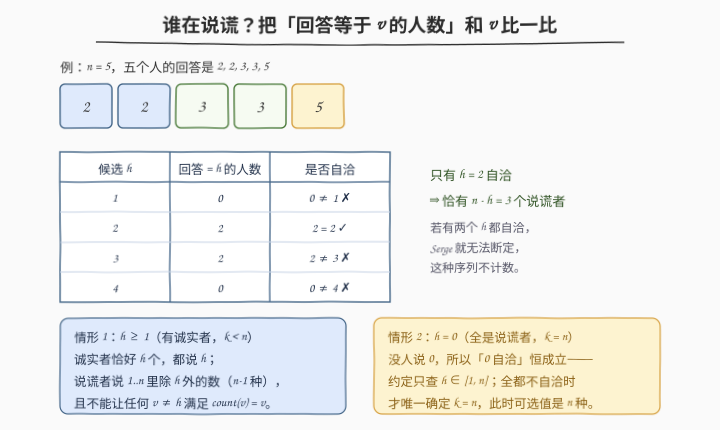
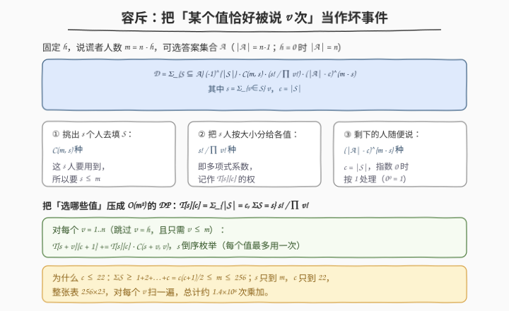

# Codeforces 256D Liars and Serge 题解

## 1. 题目概述

- **题目链接**：https://codeforces.com/problemset/problem/256/D
- **比赛来源**：Codeforces Round 156 (Div. 1) · Problem D（UTC 2012-12-16）
- **难度**：2700
- **标签**：动态规划、组合计数、容斥
- **评测类型**：普通
- **限制**：时间 1 s / 内存 256 MB

**题意**：$n$ 个人坐成一排，每人要么永远说真话，要么永远说谎。Serge 问所有人同一个问题：「你们当中总说真话的有几个？」诚实者会说出正确答案 $h$，说谎者会说出 $1 \sim n$ 中**不等于**正确答案的任意整数（各自独立）。Serge 拿到了 $n$ 个回答 $a_1,\dots,a_n$，并由此断定**恰好有 $k$ 个人在说谎**。求这样的回答序列有多少个，对 $777777777$ 取模。

**约束**：

- $1 \le k \le n \le 2^8 = 256$，且 $n$ 保证是 2 的幂：规模很小，允许 $O(n^3)$ 级别的 DP；而 $n^n$ 级别的枚举（$256^{256}$）绝无可能。
- 答案要对 $777777777 = 3\cdot7\cdot37\cdot333667$ 取模——**不是素数**，任何除法/逆元都不能用，只能用加法与乘法。
- 输入只有一组数据。

## 2. 示例与观察

官方样例 1：

```text
输入：
1 1

输出：
0
```

$n = 1$、$k = 1$：唯一的回答只能是 `1`。若这人是诚实的，则 $h = 1$，但序列里值为 1 的人有 1 个，确实 $=h$，于是「0 个说谎者」也说得通？——注意：说谎者只能说 $1 \sim n$ 中不等于正确答案的数，$n = 1$ 时没有这样的数，因此 $h = 0$（全员说谎）在 $n = 1$ 时确实可以，但此时不存在任何诚实者，而我们对「$h$」的候选只考虑 $1 \le h \le n$。序列 `1` 让 $h = 1$ 自洽，$k = 0$；$k = 1$ 无解，输出 0。

官方样例 2：

```text
输入：
2 1

输出：
2
```

$n = 2$：回答取值 $\{1,2\}$。逐一检查 $2^2 = 4$ 个序列：

| 序列 | 候选 $h=1$（值 1 的个数应为 1） | 候选 $h=2$（值 2 的个数应为 2） | 结论 |
|---|---|---|---|
| (1,1) | 有 2 个，$2 \ne 1$ ✗ | 有 0 个，$0 \ne 2$ ✗ | 无自洽 $h$，$k = 2$ |
| (1,2) | 有 1 个 ✓ | 有 1 个，$1 \ne 2$ ✗ | $h = 1$，$k = 1$ |
| (2,1) | 有 1 个 ✓ | 有 1 个 ✗ | $h = 1$，$k = 1$ |
| (2,2) | 有 0 个 ✗ | 有 2 个 ✓ | $h = 2$，$k = 0$ |

$k = 1$ 的正是 (1,2) 与 (2,1)，共 2 个 ✓。



**观察**：Serge 唯一能做的推理就是——「如果诚实者有 $h$ 个，那么应该有恰好 $h$ 个人回答 $h$」。所以

$$h \text{ 与序列自洽} \iff \#\{i : a_i = h\} = h .$$

「能断定恰好 $k$ 个说谎者」⟺ **恰好有一个** $h \in [1,n]$ 自洽，且 $h = n - k$；若一个都没有，则所有人都在说谎，$k = n$（这时 $h = 0$，见 3.2 的约定）。两个及以上自洽时 Serge 无法判断，这样的序列**不计入任何 $k$**。

## 3. 解题思路

### 3.1 朴素做法与瓶颈

直接枚举所有 $n^n$ 个回答序列，对每个序列统计 $h$ 是否唯一。$n = 256$ 时 $256^{256}$ 是天文数字，连 $n = 8$ 的 $8^8 = 1.6\times 10^7$ 都只能勉强暴力。

必须把「序列」换成「计数」：与其枚举序列，不如**枚举哪些人是诚实者、其余人怎么回答**。

### 3.2 核心观察：固定 $h$ 之后的计数

固定 $h$（$1 \le h \le n$），要数的是「值 $h$ 恰好出现 $h$ 次，并且**对其他任何值 $v \ne h$ 都有** $\#\{a_i = v\} \ne v$」的序列数。

- 先选出哪些人说 $h$：$\binom{n}{h}$ 种；
- 剩下 $m = n - h$ 个说谎者，每人只能说 $1\sim n$ 中**不等于 $h$** 的数，即可选集合
  $$A = \{1,\dots,n\}\setminus\{h\},\qquad |A| = n-1 .$$
  并且对每个 $v \in A$ 都要满足「说 $v$ 的人恰好不是 $v$ 个」，否则 $v$ 也会自洽，Serge 就无法断定。

于是

$$\text{ans}(h) = \binom{n}{h}\cdot D(n-1,\ m),$$

其中 $D(|A|, m)$ 表示「把 $m$ 个有标号的人映射到 $|A|$ 个值，且没有任何值 $v$ 恰被使用 $v$ 次」的方案数。

**$h = 0$ 的约定**：$k = n$ 时没有诚实者，所有 $n$ 个人都在说谎，可选集合是全部 $\{1,\dots,n\}$（大小 $n$，不是 $n-1$！），此时要求对每个 $v \in [1,n]$ 都有 $\#\{a_i = v\} \ne v$——这正是「没有任何 $h \in [1,n]$ 自洽」。所以 $h = 0$ 的情形单独按 $|A| = n$、$m = n$ 计算，并乘上 $\binom{n}{0} = 1$。

> 小提醒：$n$ 是 2 的幂这个条件在本解法里**用不到**，它大概是出题人当初另一种构造解法的副产物。我们的推导只依赖 $n \le 256$。

### 3.3 容斥 + 按「和与个数」分组的 DP



对坏事件「值 $v$ 恰好被说 $v$ 次」（$v \in A$）做容斥。设选出的坏值集合为 $S \subseteq A$，记

$$s = \sum_{v \in S} v,\qquad c = |S| .$$

在「$S$ 中每个 $v$ 都恰好出现 $v$ 次」的前提下，方案数是

$$N(S) = \binom{m}{s}\cdot\frac{s!}{\prod_{v\in S} v!}\cdot\bigl(|A| - c\bigr)^{m-s},$$

- $\binom{m}{s}$：先选出被「定向分配」的 $s$ 个人；
- $s!/\prod v!$：把这 $s$ 个人按大小 $v$ 分给各个值（多项式系数）；
- $(|A|-c)^{m-s}$：剩下的人只要避开 $A \setminus S$ 之外的值即可，每人有 $|A|-c$ 种选择。

由容斥，

$$D = \sum_{S \subseteq A} (-1)^{|S|} N(S).$$

直接枚举 $S$ 是 $2^{n-1}$，但 $N(S)$ 只依赖 $(s, c)$ 两个量！于是定义

$$T[s][c] = \sum_{\substack{S \subseteq A,\ \sum S = s,\ |S| = c}} \frac{s!}{\prod_{v \in S} v!},$$

按值 $v$ 逐个加入做 0/1 背包（$s$ 倒序枚举避免重复使用同一个值）：

$$T[s+v][c+1] \mathrel{+}= T[s][c]\cdot\binom{s+v}{v},$$

因为 $s!/\prod v! \cdot \binom{s+v}{v} = (s+v)!/\bigl(v!\prod v!\bigr)$，正好是把 $v$ 加进集合后的权。

于是

$$D = \sum_{s=0}^{m}\sum_{c=0}^{22} (-1)^c\, \binom{m}{s}\, T[s][c]\, \bigl(|A| - c\bigr)^{m-s} \pmod{777777777}.$$

**为什么 $c \le 22$**：$S$ 是若干**互不相同**的正整数，和 $s \ge 1+2+\cdots+c = c(c+1)/2$，而 $s \le m \le 256$，故 $c \le 22$。

**为什么不需要除法**：$\binom{n}{h}$、$\binom{m}{s}$、$\binom{s+v}{v}$ 全部用 Pascal 三角预先算好（只涉及加法），$T$ 的递推只有乘加，幂用快速幂——模数不是素数也毫无影响。

### 3.4 样例走查：$n = 4$，$k = 2$

$h = n - k = 2$，$m = 2$，$A = \{1,3,4\}$（$|A| = 3$）。约束是：说 1 的人不能恰有 1 个；说 3 的人不可能恰有 3 个（只有 2 人）；说 4 的人同理。所以只需排除「恰好 1 个人说 1」。

- 总映射数 $3^2 = 9$；
- 「恰好 1 人说 1」：选谁（2 种）× 另一人说 3 或 4（2 种）$=4$；
- $D = 9 - 4 = 5$。

$\binom{4}{2} = 6$，故答案 $= 6 \times 5 = 30$。

再用容斥核对一次 $n = 4$、$k = 4$（$h = 0$，$m = 4$，$|A| = 4$，全部 4 个值都可能变坏）：

$$4^4 - \underbrace{\binom41 3^3}_{108} - \underbrace{\binom42 3^2}_{54} - \underbrace{\binom43 3^1}_{12} - \underbrace{\binom44 3^0}_{1} + \underbrace{\binom41\binom32\cdot 2}_{24} + \underbrace{\binom41\binom33}_{4} = 256 - 175 + 28 = 109 .$$

（加回的两项分别是「值 1 恰 1 次且值 2 恰 2 次」$=4\cdot3\cdot2=24$，与「值 1 恰 1 次且值 3 恰 3 次」$=4$；三项同时发生需要 $1+2+3>4$，不可能。）与暴力枚举 $4^4$ 个序列得到的 109 完全一致，可作为公式的独立佐证。

## 4. 正确性证明

**引理 1**：给定回答序列 $a$，诚实者人数 $h$ 与 $a$ 自洽（即存在一种身份分配使 $a$ 合法且恰有 $h$ 个诚实者）当且仅当 $\#\{i : a_i = h\} = h$。

**证明**：（⇒）若恰有 $h$ 个诚实者，他们都说正确答案 $h$；说谎者不许说 $h$，故值 $h$ 出现次数恰为 $h$。（⇐）若值 $h$ 恰出现 $h$ 次，则把这 $h$ 人定为诚实者、其余定为说谎者：诚实者说 $h$ 正确；说谎者说的值都不等于 $h$（因为值为 $h$ 的位置已全部被算作诚实者），符合「说谎者说不等于正确答案的整数」。∎

**引理 2**：Serge 能断定「恰好 $k$ 个说谎者」当且仅当在 $[1,n]$ 中恰有一个 $h$ 满足 $\#\{a_i = h\} = h$ 且 $h = n-k$；或者 $[1,n]$ 中没有任何自洽的 $h$ 且 $k = n$（此时 $h = 0$）。

**证明**：由引理 1，每个自洽的 $h$ 都给出一种可能的身份分配。若自洽的 $h$ 唯一且等于 $n-k$，则说谎者人数 $n-h = k$ 被唯一确定；若不唯一，则不同 $h$ 给出不同的说谎者人数，Serge 无法断定；若一个都没有，则「$h = 0$（全员说谎）」是唯一剩下的一致解释，此时 $k = n$。∎

**引理 3**：固定 $h \ge 1$，满足「值 $h$ 恰出现 $h$ 次且其他值 $v \ne h$ 均不满足 $\#\{a_i = v\} = v$」的序列数为 $\binom{n}{h}D(n-1, n-h)$；$h = 0$ 时对应数量为 $D(n, n)$。

**证明**：选定说 $h$ 的 $h$ 人（$\binom{n}{h}$ 种）后，其余 $n-h$ 人的回答互相独立、取值于 $A$（$h\ge1$ 时 $|A| = n-1$，$h = 0$ 时 $|A| = n$），且要求任何 $v \in A$ 都不被使用恰好 $v$ 次——这正是 $D(|A|, n-h)$ 的定义。不同选择之间不重不漏。∎

**引理 4（容斥公式）**：$D(|A|, m) = \sum_{S\subseteq A}(-1)^{|S|}N(S)$，其中 $N(S)$ 如 3.3 所述。

**证明**：设 $B_v$ 为「值 $v$ 恰被使用 $v$ 次」的事件。$D$ 数的是「所有 $B_v$ 都不发生」的映射数，即 $\sum_{S}(-1)^{|S|}\bigl|\bigcap_{v\in S}B_v\bigr|$。在 $\bigcap_{v \in S}B_v$ 中，$s = \sum_{v\in S}v$ 个位置被强制分配给 $S$ 中的值（先选位置 $\binom{m}{s}$，再按大小分组 $s!/\prod v!$），其余 $m-s$ 个位置可以自由选 $A\setminus S$ 中的值（$(|A|-c)^{m-s}$ 种，$c = |S|$）。这就是 $N(S)$。∎

**定理**：算法的输出等于答案。

**证明**：答案 = $\sum_{k}[\text{能断定 } k \text{ 个说谎者的序列数}]$，由引理 2 与引理 3，$k < n$ 时该项为 $\binom{n}{n-k}D(n-1,k)$，$k = n$ 时为 $D(n,n)$；算法正是对给定的 $k$ 计算这两者之一，$D$ 由引理 4 的容斥（用 $(s,c)$ 分组后的 DP 实现）精确算出，所有算术在模 $777777777$ 下封闭。∎

## 5. 复杂度分析

- 时间：Pascal 三角 $O(n^2)$；对 $v = 1..\min(n,m)$ 做一次 0/1 背包，每次扫 $O(m\cdot 23)$ 个状态，总计 $O(n\,m\cdot 23) \le 256 \times 256 \times 23 \approx 1.5\times 10^6$；最后的求和 $O(m \cdot 23)$ 加 $O(\log m)$ 次快速幂。1 s 时限下余量极大（实测 < 1 ms）。
- 空间：$T$ 为 $(m+1)\times 23$ 的 `long long`，约 $257\times23\times8 \approx 47$ KB；组合数表 $O(n^2)$ 约 0.5 MB。

## 6. 参考代码

### C++17

```cpp
#include <bits/stdc++.h>
using namespace std;
typedef long long ll;
const ll MOD = 777777777LL;
int n, k;
ll C[260][260];      // 组合数 mod MOD（只用加法，模数不必是素数）
ll T[260][280];      // T[s][c] = sum over S (|S|=c, sum=s) of s! / prod v!
int main() {
    if (scanf("%d %d", &n, &k) != 2) return 0;
    for (int i = 0; i <= n; i++) {
        C[i][0] = 1;
        for (int j = 1; j <= i; j++) C[i][j] = (C[i-1][j-1] + C[i-1][j]) % MOD;
    }
    int h = n - k;      // 诚实者人数
    int m = k;          // 说谎者人数 = n - h
    T[0][0] = 1;
    for (int v = 1; v <= n; v++) {
        if (v == h) continue;
        if (v > m) break;              // 和超过 m 的值不可能被选中
        for (int s = m - v; s >= 0; s--)
            for (int c = 0; c <= 22; c++) {
                if (!T[s][c]) continue;
                T[s+v][c+1] = (T[s+v][c+1] + T[s][c] * C[s+v][v]) % MOD;
            }
    }
    int Asz = (h == 0) ? n : n - 1;   // 说谎者可选的答案个数
    ll D = 0;
    for (int s = 0; s <= m; s++)
        for (int c = 0; c <= 22; c++) {
            if (!T[s][c]) continue;
            ll ways = C[m][s] * T[s][c] % MOD;
            ll base = Asz - c;            // 剩余可选答案个数
            ll pw = 1;
            for (int e = 0; e < m - s; e++) pw = pw * base % MOD;
            ll term = ways * pw % MOD;
            if (c & 1) D = (D - term + MOD) % MOD;
            else D = (D + term) % MOD;
        }
    printf("%lld\n", C[n][h] * D % MOD);
    return 0;
}
```

### Python3

```python
import sys

MOD = 777777777

def main():
    n, k = map(int, sys.stdin.buffer.read().split())
    C = [[0] * (n + 2) for _ in range(n + 2)]
    for i in range(n + 1):
        C[i][0] = 1
        for j in range(1, i + 1):
            C[i][j] = (C[i-1][j-1] + C[i-1][j]) % MOD
    h = n - k
    m = k
    T = [[0] * 24 for _ in range(m + 2)]
    T[0][0] = 1
    for v in range(1, n + 1):
        if v == h:
            continue
        if v > m:
            break
        for s in range(m - v, -1, -1):
            row = T[s]
            for c in range(22, -1, -1):
                if row[c]:
                    T[s+v][c+1] = (T[s+v][c+1] + row[c] * C[s+v][v]) % MOD
    Asz = n if h == 0 else n - 1
    D = 0
    for s in range(m + 1):
        for c in range(23):
            if not T[s][c]:
                continue
            ways = C[m][s] * T[s][c] % MOD
            base = Asz - c
            pw = pow(base, m - s, MOD)
            term = ways * pw % MOD
            if c & 1:
                D = (D - term) % MOD
            else:
                D = (D + term) % MOD
    print(C[n][h] * D % MOD)

main()
```

Python 版本与 C++ 完全同构，$n \le 256$ 时约 0.05 s，可以直接提交。

## 7. 边界情况与易错点

1. **$h = 0$（即 $k = n$）时可选答案有 $n$ 个，不是 $n-1$ 个**：说谎者说「$\ne 0$」的数，而 $0$ 本来就不在 $1..n$ 里。这一处最容易写错（笔者第一版就写成了 $n-1$，$n=4,k=4$ 得到 32 而不是 109）。
2. **模数不是素数**：$777777777 = 3\cdot7\cdot37\cdot333667$，不能除；组合数必须用 Pascal 三角而不是「阶乘 + 逆元」。
3. **$0^0 = 1$**：当 $m - s = 0$ 时 $(|A|-c)^0$ 必须按 1 计；快速幂/循环写法 `pw = 1; for (e = 0; e < 0; ...)` 天然正确，但若用库函数要留意。
4. **$c$ 的上界取 22**：$\sum S \ge c(c+1)/2 \le m \le 256$ 给出 $c \le 22$；数组开 23 即可，开小了会漏掉 $1+2+\cdots+22 = 253$ 这种极端组合。
5. **`T[s][c]` 的 $s$ 必须倒序**：这是 0/1 背包（每个值最多进集合一次），正序会变成「同一个值重复选」，答案偏大。
6. **$v > m$ 的值可以直接跳过**：它们的 $v$ 次出现需要 $v > m$ 个人，永远不可能成为坏值。
7. **$n = 1$**：$k = 1$ 时 $h = 0$、$m = 1$、$A = \{1\}$，容斥给出 $1 - 1 = 0$ ✓（唯一序列 `1` 让 $h=1$ 自洽，不是全员说谎）；$k = 0$ 不会出现（$k \ge 1$）。
8. **答案取模要加 `MOD` 再取模**：`D = (D - term + MOD) % MOD`，别直接减出负数。

## 8. 验证记录

- 编译环境与命令：macOS + `clang++ -O2 -std=c++17 -I codeforces/tools/include`。
  - `python3 codeforces/tools/verify_solution.py codeforces/contests/0101-0203/256/D_骗子与Serge.md`
- 官方样例：2 / 2 通过（`0` 与 `2`）。
- 额外测试：
  - **全枚举暴力** `d256_brute.cpp` 枚举全部 $n^n$ 个回答序列（$n \le 8$），按「自洽的 $h$ 唯一/不存在」分类统计；对 $n = 1,2,4,8$ 的**每一个** $k$ 与参考程序逐项比对，完全相同（例如 $n=8$ 的九个值：$1,48,1008,12264,95270,497896,1897056,4898872,7593125$）。
  - **独立第二实现**：不做 $(s,c)$ 背包 DP，而是直接枚举和 $\le m$ 的坏值集合 $S$ 并按容斥公式逐项累加（Python `d256_rand2.py`），对 $n \in \{1,2,4,\dots,256\}$、$k \le 8$ 的 **200 组随机** 输入交叉验证，全部一致。
- 最大约束性能：$n = 256$、$k = 128$ 与 $k = 3$，C++ 运行分别 **3 ms / 2 ms**，1 s 时限下毫无压力。
- 复核状态：样例、全枚举对拍、独立实现交叉验证、性能四项均实测通过；正文代码与实测版本逐字一致。

## 相关题目与扩展

- [Codeforces 256E Lucky Arrays](https://codeforces.com/problemset/problem/256/E)：同一场的另一题，线段树 + 矩阵。
- [Codeforces 109B Lucky Probability](https://codeforces.com/problemset/problem/109/B)：同样是「枚举 + 容斥」的计数。
- [AtCoder ABC 213 G Connectivity 2](https://atcoder.jp/contests/abc213/tasks/abc213_g)：容斥 + 子集卷积的经典练习。

**延伸思考**：

1. 如果不要求「自洽的 $h$ 唯一」，而是问「存在至少一个自洽 $h = n-k$ 的序列数」，答案该怎么改？容斥的外层要多套一层「至少一个」。
2. 本题把「坏事件 $v$」按 $(s, c)$ 分组，前提是 $N(S)$ 只依赖和与个数。如果坏事件变成「值 $v$ 至少出现 $v$ 次」，$N(S)$ 还只依赖 $(s,c)$ 吗？
3. $n$ 是 2 的幂这一条件在原题里到底有什么用？试着查一查当年的题解，看看是否存在一个依赖二进制结构的另一种做法，并与本文的容斥做法比较复杂度。
