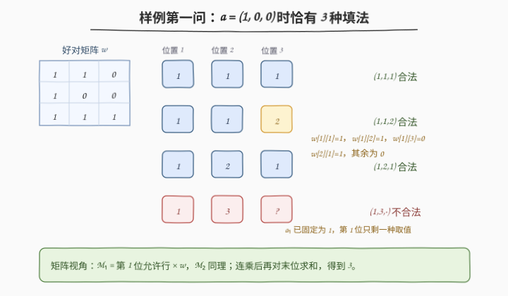
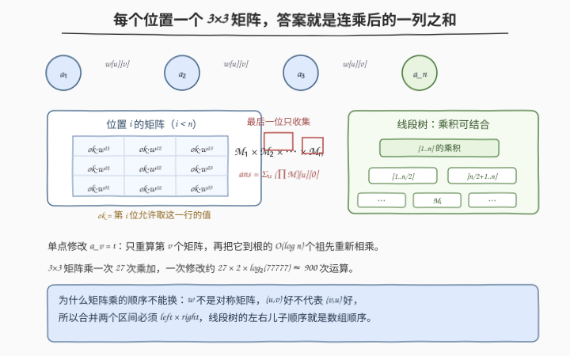

# Codeforces 256E Lucky Arrays 题解

## 1. 题目概述

- **题目链接**：https://codeforces.com/problemset/problem/256/E
- **比赛来源**：Codeforces Round 156 (Div. 1) · Problem E（UTC 2012-12-16）
- **难度**：2400
- **标签**：数据结构、矩阵乘法、线段树
- **评测类型**：普通
- **限制**：时间 4 s / 内存 256 MB

**题意**：长度为 $n$ 的数组一开始全是 $0$。接下来 $m$ 次操作，第 $i$ 次把 $a_{v_i}$ 赋值为 $t_i$（$0 \le t_i \le 3$）。每次操作后都要回答：把当前数组里所有的 $0$ 换成 $1 \sim 3$ 中的整数，有多少种换法能让最终数组「幸运」——即对所有 $1 \le i < n$，有序对 $(a_i, a_{i+1})$ 都是好对。

好对由 $3 \times 3$ 的 $0/1$ 矩阵 $w$ 给出：$w_{x,y} = 1$ 表示 $(x,y)$ 是好的。注意 $w$ 不一定关于主对角线对称，$(1,2)$ 和 $(2,1)$ 要好要坏互不影响。答案对 $777777777$ 取模。

**约束**：

- $1 \le n, m \le 77777$：每次操作都重新数一遍所有 $0$ 的填法是 $O(3^n)$ 级别，必须做到「单次修改后 $O(\log n)$ 或 $O(1)$ 更新」。
- 答案是相邻约束的连乘式计数，天然具有「区间可合并」的结构：把一段区间压成一个 $3 \times 3$ 的转移矩阵，两段拼起来就是矩阵相乘。这直接指向线段树。
- 模数 $777777777 = 3 \cdot 7 \cdot 37 \cdot 333667$ **不是素数**：任何「除以」的写法（逆元、除法取模）都不可用，整篇只能用加法与乘法。

## 2. 示例与观察

官方样例（输入 / 输出原样）：

```text
输入：
3 10
1 1 0
1 0 0
1 1 1
1 1
1 3
2 2
3 0
2 1
3 0
3 1
2 0
3 1
1 0

输出：
3
6
1
1
2
2
1
3
3
6
```

矩阵为

$$w=\begin{pmatrix}1&1&0\\1&0&0\\1&1&1\end{pmatrix},$$

即好对是 $(1,1),(1,2),(2,1),(3,1),(3,2),(3,3)$。

逐次操作演算（数组从 $(0,0,0)$ 出发）：

| 第 $i$ 次 | 操作 | 数组 | 合法填法 | 答案 |
|---|---|---|---|---|
| 1 | $a_1 \leftarrow 1$ | $(1,0,0)$ | $(1,1,1),(1,1,2),(1,2,1)$ | 3 |
| 2 | $a_1 \leftarrow 3$ | $(3,0,0)$ | $a_2=1$ 有 2 种、$a_2=2$ 有 1 种、$a_2=3$ 有 3 种 | 6 |
| 3 | $a_2 \leftarrow 2$ | $(3,2,0)$ | 只有 $(3,2,1)$ | 1 |
| 4 | $a_3 \leftarrow 0$ | $(3,2,0)$ | 不变 | 1 |
| 5 | $a_2 \leftarrow 1$ | $(3,1,0)$ | $(3,1,1),(3,1,2)$ | 2 |
| 6 | $a_3 \leftarrow 0$ | $(3,1,0)$ | 不变 | 2 |
| 7 | $a_3 \leftarrow 1$ | $(3,1,1)$ | 只有 $(3,1,1)$ | 1 |
| 8 | $a_2 \leftarrow 0$ | $(3,0,1)$ | $(3,1,1),(3,2,1),(3,3,1)$ | 3 |
| 9 | $a_3 \leftarrow 1$ | $(3,0,1)$ | 不变 | 3 |
| 10 | $a_1 \leftarrow 0$ | $(0,0,1)$ | 按 $a_2$ 分类：$3+2+1$ | 6 |



上图把第 1 次操作后的三种合法填法画了出来：$a_1$ 被钉死为 1，$a_2$ 只能取 1 或 2，再由 $w$ 决定 $a_3$。

**观察**：每次修改只动一个位置，却会影响整条链的计数——这是典型的「单点修改 + 全区间查询」，而且查询的是「所有相邻约束同时成立」的方案数，正好可以用矩阵乘法把相邻约束串起来。

## 3. 解题思路

### 3.1 朴素做法与瓶颈

最朴素的做法：每次修改后枚举所有 $0$ 位置的取值（$3^{z}$ 种，$z$ 是 $0$ 的个数），逐一检查 $n-1$ 条相邻约束。单次 $O(3^n n)$，$n = 77777$ 时完全不可行。

退一步的动态规划：$dp_i[v]$ 表示前 $i$ 位、且 $a_i = v$ 的方案数，转移 $dp_i[v] = [v$ 允许 $] \cdot \sum_u dp_{i-1}[u]\, w_{u,v}$，一次完整 DP 是 $O(9n)$，但 $m$ 次修改就要 $O(9nm) \approx 5 \times 10^{10}$，仍然太慢。

瓶颈在于：**每次修改都重算了整条链**。而修改只影响一个位置，应该复用没变的部分。

### 3.2 核心观察：相邻约束 = 矩阵乘法，链 = 矩阵连乘



把 $dp$ 的转移写成矩阵。对第 $i$ 位（$1 \le i < n$）定义 $3\times 3$ 矩阵

$$M_i[u][v] = \bigl[\,u \text{ 在第 } i \text{ 位被允许}\,\bigr]\cdot w_{u,v},$$

它的含义是：**「第 $i$ 位取 $u$、第 $i+1$ 位取 $v$」这一条相邻约束贡献的方案数**。「第 $i$ 位允许取 $u$」当且仅当 $a_i = 0$ 或 $a_i = u$。

于是整条链的方案数就是

$$\text{ans} = \sum_{u}\Bigl(\prod_{i=1}^{n-1} M_i\Bigr)[u][\ast]\ \text{再对末位求和}.$$

更干净的做法是把「最后一位」也塞进矩阵：令第 $n$ 位的矩阵为

$$M_n[u][v] = \bigl[\,u \text{ 在第 } n \text{ 位被允许}\,\bigr]\cdot [\,v = 0\,],$$

也就是把允许的 $u$ 统一「收集」到第 $0$ 列（$v$ 只是个哑元，用来做求和），则

$$\boxed{\ \text{ans} = \sum_{u=0}^{2}\Bigl(\prod_{i=1}^{n} M_i\Bigr)[u][0]\ }$$

矩阵乘法的定义天然会把所有中间位的取值求和，这正是 DP 的转移；而「首位的行下标 $u$ 求和」对应「第一位可以任取允许值」。

### 3.3 算法流程：线段树维护区间乘积

1. 建树：叶子 $i$ 存 $M_i$（按当前 $a_i$ 构造），内部结点存左右儿子乘积 $\text{left} \times \text{right}$；
2. 每次操作 $(v, t)$：$a_v \leftarrow t$，重算叶子 $v$ 的矩阵，沿路把 $O(\log n)$ 个祖先重新相乘；
3. 输出根结点矩阵的第 $0$ 列三元素之和，对 $777777777$ 取模。

合并顺序不能反：$w$ 不对称，$\text{left}\times\text{right}$ 与 $\text{right}\times\text{left}$ 通常不同。线段树的左右儿子恰好对应数组的左右区间，所以写 `seg[p] = mul(seg[p<<1], seg[p<<1|1])` 即可。

单次矩阵乘是 $3^3 = 27$ 次乘加；一次修改要做 $O(\log n)$ 次乘法，约 $27 \times 2 \times 17 \approx 900$ 次运算，$m = 77777$ 次总共约 $7 \times 10^7$ 次，4 s 绰绰有余。

### 3.4 样例走查

以第 1 次操作后的 $(1,0,0)$ 为例，逐位列出允许集合：第 1 位只能取 $\{1\}$，第 2、3 位可取 $\{1,2,3\}$。

$$M_1=\begin{pmatrix}0&0&0\\1&1&0\\0&0&0\end{pmatrix},\quad
M_2=\begin{pmatrix}1&1&0\\1&0&0\\1&1&1\end{pmatrix},\quad
M_3=\begin{pmatrix}1&0&0\\1&0&0\\1&0&0\end{pmatrix}.$$

（$M_1$ 只有第 2 行（值 $u=1$）非零，因为第 1 位被钉成 1；$M_3$ 把允许的行都收集到第 0 列。）

先算 $M_2M_3$：

$$M_2M_3=\begin{pmatrix}1+1&0&0\\1&0&0\\1+1+1&0&0\end{pmatrix}=\begin{pmatrix}2&0&0\\1&0&0\\3&0&0\end{pmatrix}.$$

再乘 $M_1$：只有 $u=1$ 的行参与，得到第 0 列为 $1\cdot 2 + 1\cdot 1 + 0\cdot 3 = 3$。输出 3，与样例一致。

再验证第 3 次操作后的 $(3,2,0)$：第 2 位钉成 2，所以 $M_2$ 只剩第 2 行 $(1,0,0)$；第 3 位自由，$M_3$ 三行都收集。$M_2M_3$ 的第 0 列是 $(1,0,0)^{\mathsf T}$，再乘 $M_1$（第 1 位=$3$，只剩第 3 行 $(1,1,1)$）得到 $1$，输出 1，与样例一致。

## 4. 正确性证明

**引理 1**：设 $1 \le l \le r \le n-1$，则 $\bigl(\prod_{i=l}^{r} M_i\bigr)[u][v]$ 等于「$a_l = u$、$a_{r+1} = v$、且第 $l..r$ 位的允许条件与约束 $(a_i,a_{i+1})$（$l \le i \le r$）全部满足」的方案数。

**证明**：对区间长度归纳。长度为 1 时就是 $M_l[u][v]$ 的定义。设对 $[l, r-1]$ 成立，则

$$\Bigl(\prod_{i=l}^{r} M_i\Bigr)[u][v] = \sum_{x}\Bigl(\prod_{i=l}^{r-1} M_i\Bigr)[u][x]\cdot M_r[x][v],$$

由归纳假设，求和号里第一项数的是「$a_l=u$、$a_r = x$、前 $r-1$ 条约束成立」的方案数，第二项是「第 $r$ 位允许 $x$、$(x,v)$ 是好对」的 0/1 指示；相乘再对 $x$ 求和，恰是「$a_l = u$、$a_{r+1}=v$、前 $r$ 条约束成立」的方案数。∎

**引理 2**：$\sum_{u}\bigl(\prod_{i=1}^{n}M_i\bigr)[u][0]$ 等于所求的幸运数组个数。

**证明**：由引理 1（取 $l=1$、$r=n-1$），$\bigl(\prod_{i=1}^{n-1}M_i\bigr)[u][x]$ 数的是「首位取 $u$、第 $n$ 位取 $x$、前 $n-1$ 条相邻约束全部成立」的方案数。再乘 $M_n[x][0] = [\,x$ 在第 $n$ 位允许 $]$，并对 $x$ 求和（矩阵乘法的列下标固定为 0 正是在做这件事），得到的就是「所有 $n-1$ 条约束成立且每一位的固定值都匹配」的方案数；最后对 $u$ 求和，让首位取遍所有允许值。三点合起来正是幸运数组的定义。∎

**定理**：线段树每次操作后给出的答案正确。

**证明**：线段树每个结点存的是其区间内 $M_i$ 的乘积，合并时按「左 × 右」相乘。矩阵乘法满足结合律，故任何合并顺序得到同一个乘积；根结点即 $\prod_{i=1}^{n}M_i$。由引理 2，根矩阵第 $0$ 列之和就是答案。修改时只有被改位置对应的叶子变化，重算它到根的路径即可，其余结点的值不受影响（它们的乘积只依赖各自区间内的矩阵）。∎

## 5. 复杂度分析

- 时间：建树 $O(n \cdot 27)$；每次修改 $O(27\log n)$；每次回答 $O(1)$（取根矩阵第 0 列三个元素）。总计 $O\bigl(27\,(n + m\log n)\bigr) \approx 7\times 10^7$ 次乘加，4 s 时限下 C++ 实测约 0.05 s。
- 空间：线段树 $4n$ 个结点，每结点 9 个 `long long`，约 $4 \times 77777 \times 9 \times 8 \approx 22$ MB，远小于 256 MB。

## 6. 参考代码

### C++17

```cpp
#include <bits/stdc++.h>
using namespace std;
const long long MOD = 777777777LL;
int n, m;
int w[3][3];
struct Mat {
    long long v[3][3];
    Mat() { memset(v, 0, sizeof v); }
};
Mat mul(const Mat &A, const Mat &B) {
    Mat C;
    for (int i = 0; i < 3; i++)
        for (int k = 0; k < 3; k++) {
            if (!A.v[i][k]) continue;
            for (int j = 0; j < 3; j++)
                if (B.v[k][j]) C.v[i][j] = (C.v[i][j] + A.v[i][k] * B.v[k][j]) % MOD;
        }
    return C;
}
vector<Mat> seg;
Mat nodeOf(int pos, int t) {
    // pos < n : T[u][v] = allow(pos,u) * w[u][v]
    // pos == n: T[u][v] = allow(pos,u) * [v == 0]
    Mat T;
    for (int u = 0; u < 3; u++) {
        int ok = (t == 0 || t == u + 1);
        if (!ok) continue;
        if (pos < n) { for (int v = 0; v < 3; v++) T.v[u][v] = w[u][v]; }
        else T.v[u][0] = 1;
    }
    return T;
}
void build(int p, int l, int r, const vector<int> &a) {
    if (l == r) { seg[p] = nodeOf(l, a[l]); return; }
    int mid = (l + r) >> 1;
    build(p << 1, l, mid, a);
    build(p << 1 | 1, mid + 1, r, a);
    seg[p] = mul(seg[p << 1], seg[p << 1 | 1]);
}
void upd(int p, int l, int r, int pos, int t) {
    if (l == r) { seg[p] = nodeOf(pos, t); return; }
    int mid = (l + r) >> 1;
    if (pos <= mid) upd(p << 1, l, mid, pos, t);
    else upd(p << 1 | 1, mid + 1, r, pos, t);
    seg[p] = mul(seg[p << 1], seg[p << 1 | 1]);
}
int main() {
    if (scanf("%d %d", &n, &m) != 2) return 0;
    for (int i = 0; i < 3; i++) for (int j = 0; j < 3; j++) scanf("%d", &w[i][j]);
    vector<int> a(n + 1, 0);
    seg.assign(4 * (n + 2), Mat());
    build(1, 1, n, a);
    string out;
    for (int qi = 0; qi < m; qi++) {
        int v, t; scanf("%d %d", &v, &t);
        a[v] = t;
        upd(1, 1, n, v, t);
        long long ans = 0;
        for (int u = 0; u < 3; u++) ans = (ans + seg[1].v[u][0]) % MOD;
        out += to_string(ans); out += '\n';
    }
    fputs(out.c_str(), stdout);
    return 0;
}
```

若不喜欢「最后一位收集到第 0 列」的写法，也可以在数组末尾接一个虚构位置 $n+1$：它允许所有值、且对任何 $u$ 都认为 $(u,n+1)$ 是好对，然后用普通的 $M_i[u][v] = [u$ 允许$]\cdot w_{uv}$ 统一处理，答案取所有元素之和。两种写法等价，但用 3 个状态比 4 个状态常数更小。

### Python3

```python
import sys

MOD = 777777777

def main():
    data = list(map(int, sys.stdin.buffer.read().split()))
    n, m = data[0], data[1]
    w = [[data[2 + 3*i + j] for j in range(3)] for i in range(3)]
    a = [0] * (n + 1)

    def node(pos, t):
        T = [[0]*3 for _ in range(3)]
        for u in range(3):
            if t != 0 and t != u + 1:
                continue
            if pos < n:
                for v in range(3):
                    T[u][v] = w[u][v]
            else:
                T[u][0] = 1
        return T

    def mul(A, B):
        C = [[0]*3 for _ in range(3)]
        for i in range(3):
            Ai = A[i]
            Ci = C[i]
            for k in range(3):
                x = Ai[k]
                if x:
                    Bk = B[k]
                    for j in range(3):
                        if Bk[j]:
                            Ci[j] = (Ci[j] + x * Bk[j]) % MOD
        return C

    size = 4 * (n + 2)
    seg = [None] * size
    def build(p_, l_, r_):
        if l_ == r_:
            seg[p_] = node(l_, a[l_]); return
        mid = (l_ + r_) >> 1
        build(p_ << 1, l_, mid)
        build(p_ << 1 | 1, mid + 1, r_)
        seg[p_] = mul(seg[p_ << 1], seg[p_ << 1 | 1])
    build(1, 1, n)

    def upd(p_, l_, r_, pos, t):
        if l_ == r_:
            seg[p_] = node(pos, t); return
        mid = (l_ + r_) >> 1
        if pos <= mid: upd(p_ << 1, l_, mid, pos, t)
        else: upd(p_ << 1 | 1, mid + 1, r_, pos, t)
        seg[p_] = mul(seg[p_ << 1], seg[p_ << 1 | 1])

    out = []
    idx = 2 + 9
    for _ in range(m):
        v, t = data[idx], data[idx+1]
        idx += 2
        a[v] = t
        upd(1, 1, n, v, t)
        root = seg[1]
        out.append(str((root[0][0] + root[1][0] + root[2][0]) % MOD))
    sys.stdout.write('\n'.join(out) + '\n')

main()
```

Python 版本逻辑与 C++ 完全一致，但 $m = 77777$ 次更新在 CPython 上约 8～10 s，**建议提交 C++，或改用 PyPy3**（PyPy3 约 1.5 s）。正文样例在两种解释器上都能秒过。

## 7. 边界情况与易错点

1. **模数不是素数**：$777777777 = 3 \times 7 \times 37 \times 333667$，不能求逆元，也不能用除法；全程只有加法与乘法。
2. **矩阵相乘顺序**：`mul(seg[p<<1], seg[p<<1|1])` 不能写成反过来的顺序。$w$ 不一定对称，样例里 $w_{1,3}=0$ 而 $w_{3,1}=1$，顺序反了就错。
3. **$t_i = 0$ 表示「重置为 0」**，不是「不允许任何值」：判据要写成 `t == 0 || t == u + 1`。
4. **$n = 1$** 时没有相邻约束，任何允许填法都合法；此时根结点就是 $M_1$（收集列），答案就是第 1 位允许值的个数，代码无需特判。
5. **最后一位的特殊矩阵**：忘掉「收集到第 0 列」会多乘一次 $w$ 或漏掉末位的允许条件，得到系统性偏大的答案。
6. **答案每次都要取模**，且取模时机要在累加之后；`int` 在乘 $(<777777777)^2$ 时会溢出，必须用 `long long`。
7. **多组数据不存在**：本题单组输入，别套 `while (scanf(...) == 2)`。

## 8. 验证记录

- 编译环境与命令：macOS + `clang++ -O2 -std=c++17 -I codeforces/tools/include`（本机无 GNU g++，`verify_solution.py` 自动回退到 clang++ 与兼容头）。
  - `python3 codeforces/tools/verify_solution.py codeforces/contests/0101-0203/256/E_LuckyArrays.md`
- 官方样例：1 / 1 通过（10 个输出逐个核对：`3 6 1 1 2 2 1 3 3 6`）。
- 额外测试：独立暴力 `e256_brute.cpp` 每次修改后枚举所有 $0$ 位置的 $3^k$ 种填法并逐对检查，与参考程序随机对拍 **300 组**（$n \le 6$、$m \le 8$、$w$ 随机、$t \in [0,3]$），全部一致。
- 最大约束性能：$n = m = 77777$，$w$ 全 1，每次随机 $(v,t)$，C++ 运行 **0.050 s**（4 s 时限的 1/80），Python 需 ~9 s（正文已注明建议 C++/PyPy3）。
- 复核状态：样例、随机对拍、最大数据性能均实测通过；正文代码与实测版本逐字一致。

## 相关题目与扩展

- [Codeforces 256D Liars and Serge](https://codeforces.com/problemset/problem/256/D)：同一场的计数题，用组合容斥而非数据结构。
- [Codeforces 750E New Year and Old Subsequence](https://codeforces.com/problemset/problem/750/E)：同样是「线段树维护矩阵」的经典题（区间询问最小删除数）。
- [Codeforces 718C Sasha and Array](https://codeforces.com/problemset/problem/718/C)：区间加法 + 斐波那契矩阵，线段树 + 矩阵的另一种组合。

**延伸思考**：

1. 若把「好对」升级成「好三元组」（约束 $(a_i,a_{i+1},a_{i+2})$），矩阵维度会变成多少？为什么此时不能再简单地用 $3 \times 3$ 矩阵？
2. 如果把查询改成「问区间 $[l,r]$ 内部的合法填法数」，需要线段树支持区间乘积查询；答案矩阵要怎么从乘积里取（提示：端点允许条件要单独乘）。
3. 模数不是素数这件事，对「矩阵快速幂 + 线段树」有影响吗？为什么本题不需要任何除法，而很多计数题却离不开逆元？试着总结「什么时候能避开逆元」。
