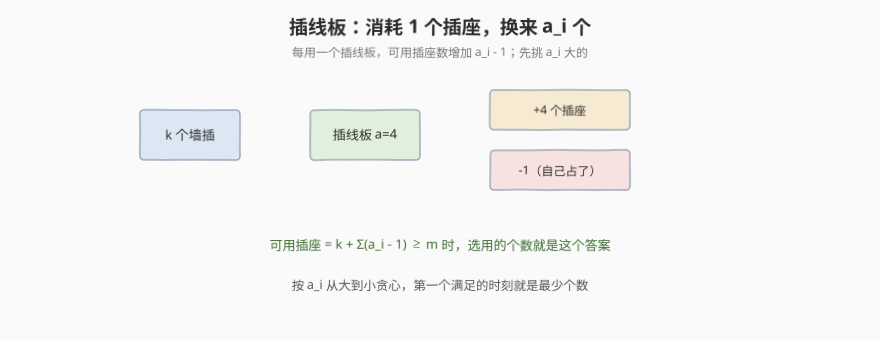
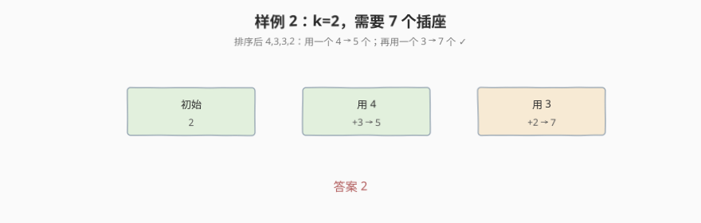

# Codeforces 257A 插线板 题解

## 1. 题目概述

- **题目链接**：https://codeforces.com/problemset/problem/257/A
- **比赛来源**：Codeforces Round 159 (Div. 2) · Problem A（UTC 2013-01-08）
- **难度**：1100
- **标签**：贪心、排序
- **评测类型**：普通
- **限制**：时间 2 s / 内存 256 MB

**题意**：墙上有 $k$ 个插座，Vasya 有 $n$ 个插线板（第 $i$ 个有 $a_i$ 个插孔）和 $m$ 个设备。设备可以直接插墙上，也可以插在插线板上；插线板本身也要占一个插孔（可以插在墙上或另一个插线板上）。求最少要用几个插线板才能把所有设备都插上电；不可能输出 `-1`。

**约束**：

- $n, m, k \le 50$、$a_i \le 50$：规模极小，关键是"每个插线板净增 $a_i - 1$ 个可用插孔"。
- 只有一组数据。

## 2. 示例与观察

官方样例 1：

```text
输入：
3 5 3
3 1 2

输出：
1
```

官方样例 2：

```text
输入：
4 7 2
3 3 2 4

输出：
2
```

官方样例 3：

```text
输入：
5 5 1
1 3 1 2 1

输出：
-1
```

**样例 1**：墙插 3 个。插上一个 3 孔插线板后：它自己占掉 1 个墙插，剩下 2 个墙插 + 3 个板孔 = 5 个可用插孔，正好够 5 个设备 → 1 个插线板。

**样例 2**：墙插 2 个。用一个 4 孔板 → 1 + 4 = 5 个插孔；再用一个 3 孔板（插在 4 孔板上）→ 5 - 1 + 3 = 7 ✓ 两个插线板，恰好够 7 个设备。

**样例 3**：墙插 1 个，五个插线板的孔数是 1,3,1,2,1。每用一次净增 $a_i - 1$，即使全用上：$1 + (0+2+0+1+0) = 4 < 5$，无解 → `-1`。

**观察 1**：把一个插线板插到某个插孔上，可用的插孔数变化是 $-1 + a_i = a_i - 1$（净增）。所以用了 $t$ 个插线板后，可用插孔数 = $k + \sum (a_i - 1)$。

**观察 2**：能用多少插孔与"怎么接"无关——插线板可以串联，链式接法总能实现任意选取的子集的净增（只要起始有插座，见引理 2）。

**观察 3**：要"用最少的插线板达到 $m$ 个插孔"，显然优先选 $a_i$ 大的（净增多的）。排序后从大到小贪心累加，第一次 $\ge m$ 时的个数就是答案。

## 3. 解题思路

### 3.1 朴素做法与瓶颈

$n \le 50$，枚举子集 $2^{50}$ 不可行；但排序贪心是 $O(n \log n)$。本题没有复杂度压力，考的是"净增量"这个观察。

### 3.2 核心观察与流程



1. 排序 $a$ 降序；
2. 令 `have = k`；若 `have >= m` 输出 0；
3. 依次取插线板：`have += a_i - 1`，若 `have >= m` 输出"已用个数"；
4. 全部用完仍不够 → `-1`。

### 3.3 样例走查



排序后 $4,3,3,2$：

| 用几个 | 可用插孔 | 是否 ≥ 7 |
|--------|----------|----------|
| 0 | 2 | 否 |
| 1（用 4） | $2 + 3 = 5$ | 否 |
| 2（再用 3） | $5 + 2 = 7$ | 是 → 答案 2 |

与官方输出一致。

**自造样例**（标注"自造"）：

| 输入 | 输出 | 说明 |
|------|------|------|
| `1 1 5` / `1` | 0 | 墙插就够 |
| `2 3 1` / `2 2` | 2 | $1+1+1 = 3$ ✓ |
| `2 3 1` / `1 1` | -1 | 净增为 0 |

## 4. 正确性证明

**引理 1（净增公式）**：用任意 $t$ 个插线板（设其孔数为 $b_1 \ldots b_t$），最终可用插孔数恰好为 $k + \sum_{j \le t}(b_j - 1)$。

**证明**：初始有 $k$ 个插孔。每插上一个插线板，占用 1 个插孔、新增 $b_j$ 个插孔，净增 $b_j - 1$。加法可交换，故总数为 $k + \sum (b_j - 1)$。∎

**引理 2（可实现性）**：对任意选定的插线板集合与任意连接方式（只要每个插线板都插在某个插孔上），可用插孔数都是引理 1 的值；且只要 $k \ge 1$，任何子集都能被接起来（链式：第一个接墙上，其余依次接在前一个上）。

**证明**：每个插线板恰好占用 1 个插孔、提供 $b_j$ 个，与拓扑无关；链式接法保证每个插线板都有插座可用（当 $k \ge 1$ 时）。∎

**引理 3（贪心最优）**：设 $a$ 降序排列。若最少需要 $t$ 个插线板，则贪心取前 $t$ 个（最大的 $t$ 个）一定够。

**证明**：对固定的 $t$，$\sum_{j\le t}(a_j - 1)$ 在取前 $t$ 大时最大（排序不等式）。所以若存在某个 $t$ 元子集使 $k + \sum (a_j-1) \ge m$，则前 $t$ 大的子集也能达到，贪心在 $t$ 步内就会成功。∎

**定理**：算法输出的个数是最少的插线板数；若全部用完仍不足则无解。

**证明**：由引理 3，贪心在第 $t$ 步成功 ⇒ 最少个数 $\le t$；而贪心在前 $t-1$ 步都没成功 ⇒ 用 $t-1$ 个（任意选法，因为贪心已是最大的 $t-1$ 个）都达不到 ⇒ 最少个数 $> t-1$，故恰为 $t$。若全部 $n$ 个用完仍不足，由引理 3 任何子集都不足 ⇒ 无解。∎

## 5. 复杂度分析

- **时间**：$O(n \log n)$，$n \le 50$。
- **空间**：$O(n)$。
- **与时限的关系**：时限 2 s，实测端到端 2.2 ms。

## 6. 参考代码

### C++17

```cpp
#include <bits/stdc++.h>
using namespace std;

int main() {
    int n, m, k;
    if (scanf("%d %d %d", &n, &m, &k) != 3) return 0;
    vector<int> a(n);
    for (int i = 0; i < n; i++) scanf("%d", &a[i]);
    sort(a.rbegin(), a.rend());              // 先用插座多的
    long long have = k;
    if (have >= m) { printf("0\n"); return 0; }
    for (int i = 0; i < n; i++) {
        have += a[i] - 1;                    // 插上一个过滤器：消耗 1 个，换来 a[i] 个
        if (have >= m) { printf("%d\n", i + 1); return 0; }
    }
    printf("-1\n");
    return 0;
}
```

### Python3

```python
import sys


def main() -> None:
    data = sys.stdin.buffer.read().split()
    n, m, k = int(data[0]), int(data[1]), int(data[2])
    a = sorted((int(v) for v in data[3:3 + n]), reverse=True)
    have = k
    if have >= m:
        print(0)
        return
    for i, v in enumerate(a):
        have += v - 1
        if have >= m:
            print(i + 1)
            return
    print(-1)


main()
```

## 7. 边界情况与易错点

1. **$k \ge m$**：一个插线板都不用，答案 0。
2. **$a_i = 1$**：净增 0，用了等于白用；贪心仍会算进去（但没有帮助），不影响答案的正确性（个数会偏大？——不会：若某处需要 $t$ 个，取前 $t$ 大的最优，而 $a_i = 1$ 的插线板排在最后，不会先被选）。
3. **无解**：全部用上仍不足 → `-1`，不要输出 $n$。
4. **不要漏掉墙插**：可用插孔从 $k$ 开始，不是 0。
5. **插线板本身占一个口**：净增是 $a_i - 1$，写成 $a_i$ 会算出偏小的答案。
6. **$n=1$**：只有一个插线板，够就 1，不够就 `-1`。

## 8. 验证记录

- **编译环境与命令**：`clang++ -std=c++17 -O2 -Wall`（配合 `codeforces/tools/include` 兼容头，可原样提交 GNU C++17）；Python 3.9.6。
- **官方样例**：3 / 3 通过（1、2、-1），C++ 与 Python 一致。
- **独立暴力对拍**：暴力版枚举所有子集（$2^n$），对每个子集算 $k + \sum(a_i-1)$ 并取最小可行子集大小。随机 250 组（$n,m,k \le 10$、$a_i \le 8$），**250 / 250 全部一致**。
- **最大约束性能**：$n=m=k=50$，7 次取最小端到端 2.2 ms。
- **图片校验**：两张 SVG（`cf257a_sockets.svg`、`cf257a_walk.svg`）通过 `ElementTree.parse`，含 `feTurbulence` 与手写字体。
- **复核状态**：verified。

## 相关题目与扩展

- [Codeforces 257B Playing Cubes](https://codeforces.com/problemset/problem/257/B)：同场 B 题，博弈结论题。
- [LeetCode 1710. 卡车上的最大单元数](https://leetcode.cn/problems/maximum-units-on-a-truck/)：排序后贪心取最大，同型。

**延伸思考**：

1. **如果每个插线板价格不同、要求总价最小**：变成背包问题（$n \le 50$、$m \le 2500$ 可用 DP）。
2. **如果插孔数有上限、不允许超过**：仍是排序贪心（只需要达到 $m$）。
3. **如果插线板之间可以互相插**（本题允许）：不影响净增公式；若禁止串联（只能插墙上），那么可用数 = $k + \sum(a_i - 1)$ 仍需 $k \ge$ 插线板数量，答案会不同。

