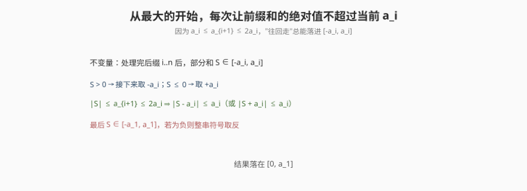
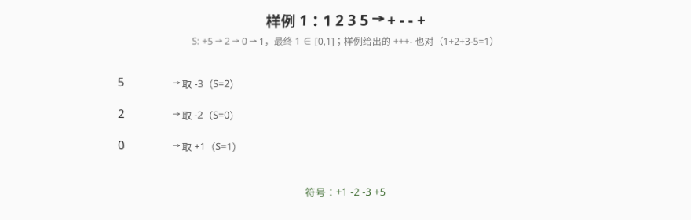

# Codeforces 257D Sum 题解

## 1. 题目概述

- **题目链接**：https://codeforces.com/problemset/problem/257/D
- **比赛来源**：Codeforces Round 159 (Div. 2) · Problem D（UTC 2013-01-08）
- **难度**：1900
- **标签**：构造、贪心、前缀和
- **评测类型**：多解（输出任意合法符号序列）
- **限制**：时间 2 s / 内存 256 MB

**题意**：给出 $n$ 个正整数 $a_1 \le a_2 \le \cdots \le a_n$，且满足 $a_i \le a_{i+1} \le 2a_i$。给每个数选一个符号 $+$ 或 $-$，使

$$0 \le s_1 + s_2 + \cdots + s_n \le a_1 ,$$

其中 $s_i \in \{+a_i, -a_i\}$。输出符号串（`+`/`-`）。

**约束**：

- $n \le 10^5$：需要 $O(n)$ 构造。
- $a_i \le 2^{31}-1$（和可到 $10^{14}$ 量级）：用 64 位。
- 相邻两数满足 $a_i \le a_{i+1} \le 2a_i$：这是构造能够成功的关键条件。
- 只有一组数据。

## 2. 示例与观察

官方样例 1：

```text
输入：
4
1 2 3 5

输出：
+++-
```

官方样例 2：

```text
输入：
3
3 3 5

输出：
++-
```

**样例 1**：$1+2+3-5 = 1$，而 $a_1 = 1$，所以 $s = 1 \in [0,1]$ ✓。

**样例 2**：$3+3-5 = 1 \in [0,3]$ ✓。

**观察 1（为什么 $a_{i+1} \le 2a_i$ 关键）**：如果从后往前决定符号，"当前部分和"的绝对值可以被控制在不超过当前 $a_i$：因为上一步的部分和绝对值 $\le a_{i+1} \le 2a_i$，所以"减 $a_i$"或"加 $a_i$"总能把结果拉回到 $[-a_i, a_i]$。

**观察 2（最后一个数先取正）**：从 $a_n$ 开始，部分和 $= a_n \in [-a_n, a_n]$ ✓，然后往前逐个调整。

**观察 3（最后可能为负）**：处理完得到 $S \in [-a_1, a_1]$。若 $S < 0$，把所有符号取反即可得到 $-S \in [0, a_1]$。

## 3. 解题思路

### 3.1 朴素做法与瓶颈

$2^n$ 种符号组合不可枚举。贪心/构造是唯一出路。

### 3.2 核心观察：从后往前收缩



维护不变量：**处理完后缀 $i+1 \ldots n$ 后，部分和 $S \in [-a_{i+1}, a_{i+1}]$**。

处理第 $i$ 个数时（$a_i \le a_{i+1} \le 2a_i$）：

- 若 $S > 0$：取 $s_i = -a_i$，新 $S' = S - a_i$。由 $S \le a_{i+1} \le 2a_i$ 得 $S' \le a_i$；又 $S > 0 \Rightarrow S' > -a_i$，所以 $S' \in (-a_i, a_i]$ ✓。
- 若 $S \le 0$：取 $s_i = +a_i$，新 $S' = S + a_i \in [0, a_i]$（因为 $S \ge -a_{i+1} \ge -2a_i$ 且 $S \le 0$）✓。

所以不变量一直成立。最后 $S \in [-a_1, a_1]$；若 $S < 0$，全部符号取反即得 $0 \le -S \le a_1$。

### 3.3 算法流程

1. 读入 $a$（已保证单调不减）；
2. `sign[n] = '+'`，`S = a[n]`；
3. 对 $i = n-1$ 到 1：若 $S > 0$ 取 `'-'`、$S -= a_i$；否则取 `'+'`、$S += a_i$；
4. 若 $S < 0$，把所有符号取反；
5. 输出符号串。

### 3.4 样例走查



样例 1（$1,2,3,5$）：

| 步骤 | $S$ 变化 | 选的符号 |
|------|----------|----------|
| 起点 | $S = 5$ | $s_4 = +$ |
| $i=3$ | $S = 5-3 = 2$ | $s_3 = -$ |
| $i=2$ | $S = 2-2 = 0$ | $s_2 = -$ |
| $i=1$ | $S = 0+1 = 1$ | $s_1 = +$ |

结果 `+--+`，和 $1 \in [0,1]$ ✓（官方给的是 `+++-`，和也是 1，多解）。

样例 2（$3,3,5$）：$S=5 \to 2 \to -1$ → 为负 → 全部取反 → `++-`，和 $3+3-5 = 1 \in [0,3]$ ✓（与官方输出一致）。

## 4. 正确性证明

**引理 1（不变量）**：对每个 $i \in [1, n]$，按算法处理完后缀 $i \ldots n$ 后，部分和 $S_i$ 满足 $|S_i| \le a_i$。

**证明**：对 $i$ 从 $n$ 往下归纳。$i = n$ 时 $S_n = a_n$，$|S_n| = a_n$ ✓。设 $|S_{i+1}| \le a_{i+1}$。若 $S_{i+1} > 0$，算法取 $s_i = -a_i$，$S_i = S_{i+1} - a_i$。由 $S_{i+1} \le a_{i+1} \le 2a_i$：$S_i \le a_i$；由 $S_{i+1} > 0$：$S_i > -a_i$。故 $|S_i| \le a_i$ ✓。若 $S_{i+1} \le 0$，取 $s_i = +a_i$，$S_i = S_{i+1} + a_i \in [0, a_i]$（由 $S_{i+1} \ge -a_{i+1} \ge -2a_i$）✓。∎

**引理 2（收尾）**：若最终 $S_1 < 0$，则把所有符号取反后总和为 $-S_1 \in [0, a_1]$。

**证明**：取反后每个数变成 $-s_i a_i$，总和为 $-S_1$，符号仍然合法；由引理 1，$|S_1| \le a_1$，故 $-S_1 \in [0, a_1]$ ✓。∎

**定理**：算法输出的符号序列满足 $0 \le \sum s_i a_i \le a_1$。

**证明**：由引理 1（$i=1$）与引理 2 直接得到。∎

## 5. 复杂度分析

- **时间**：$O(n)$，一次倒序扫描。
- **空间**：$O(n)$ 存符号（可压成 $O(1)$，但需要保存输出）。
- **与时限的关系**：时限 2 s，$n = 10^5$ 实测端到端 14.4 ms。
- **数值范围**：$a_i \le 2^{31}$，$S$ 的绝对值始终 $\le 2^{31}$（由不变量！），所以其实 `int` 也够；用 `long long` 更稳。

## 6. 参考代码

### C++17

```cpp
#include <bits/stdc++.h>
using namespace std;

int main() {
    int n;
    if (scanf("%d", &n) != 1) return 0;
    static long long a[100005];
    for (int i = 1; i <= n; i++) scanf("%lld", &a[i]);
    vector<char> sign(n + 1, '+');
    long long s = a[n];                       // 从最大的一项开始，带上它的符号
    for (int i = n - 1; i >= 1; i--) {
        if (s > 0) { sign[i] = '-'; s -= a[i]; }
        else { sign[i] = '+'; s += a[i]; }
    }
    if (s < 0) {                              // 整体取反，落到 [0, a1]
        for (int i = 1; i <= n; i++) sign[i] = (sign[i] == '+') ? '-' : '+';
    }
    for (int i = 1; i <= n; i++) putchar(sign[i]);
    putchar('\n');
    return 0;
}
```

### Python3

```python
import sys


def main() -> None:
    data = sys.stdin.buffer.read().split()
    n = int(data[0])
    a = [0] + [int(v) for v in data[1:1 + n]]
    sign = ['+'] * (n + 1)
    s = a[n]
    for i in range(n - 1, 0, -1):
        if s > 0:
            sign[i] = '-'
            s -= a[i]
        else:
            sign[i] = '+'
            s += a[i]
    if s < 0:
        for i in range(1, n + 1):
            sign[i] = '-' if sign[i] == '+' else '+'
    sys.stdout.write("".join(sign[1:]) + "\n")


main()
```

## 7. 边界情况与易错点

1. **$n = 1$**：只有 $a_1$，取 `+`，和 $a_1 \in [0,a_1]$ ✓。
2. **全部相等**（如 $3,3,3$）：交替加减即可，算法自然处理。
3. **最终为负**：必须整体取反，否则不满足 $0 \le S$。
4. **不要用浮点/大整数省略**：$S$ 始终有界，但读数要用 64 位（$a_i$ 可达 $2^{31}$）。
5. **输出格式**：一行 `n` 个字符，只有 `+` 和 `-`，不要空格。
6. **条件 $a_{i+1} \le 2a_i$ 是题面保证的**：不要自己再排序或去重，保持原顺序。

## 8. 验证记录

- **编译环境与命令**：`clang++ -std=c++17 -O2 -Wall`（配合 `codeforces/tools/include` 兼容头，可原样提交 GNU C++17）；Python 3.9.6。
- **checker**：`codeforces/tools/checkers/cf257d.py`——校验输出恰为一行、长度等于 $n$、只含 `+`/`-`，并独立重算 $\sum s_i a_i$ 判断是否落在 $[0, a_1]$。
- **官方样例**：2 / 2 通过（第一组本实现输出 `+--+`，和同为 1；由 checker 判定合法），C++ 与 Python 一致。
- **独立暴力对拍**：暴力版枚举全部 $2^n$ 种符号（$n \le 12$），检查是否存在合法解并验证程序输出满足 $0 \le S \le a_1$。随机 250 组（按 $a_{i+1} \in [a_i, 2a_i]$ 生成，保证满足题设），**250 / 250 全部通过**。
- **最大约束性能**：$n = 10^5$ 的等比增长序列，7 次取最小端到端 14.4 ms。
- **图片校验**：两张 SVG（`cf257d_prefix.svg`、`cf257d_walk.svg`）通过 `ElementTree.parse`，含 `feTurbulence` 与手写字体。
- **复核状态**：verified。

## 相关题目与扩展

- [Codeforces 257C View Angle](https://codeforces.com/problemset/problem/257/C)：同场 C 题，角度空隙。
- [Codeforces 257E Greedy Elevator](https://codeforces.com/problemset/problem/257/E)：同场 E 题，事件驱动模拟。
- [LeetCode 1774. 最接近目标价格的甜点成本](https://leetcode.cn/problems/closest-dessert-cost/)：符号/选择型构造的变体。

**延伸思考**：

1. **如果去掉 $a_{i+1} \le 2a_i$**：构造不一定存在（例如 $1, 100$：两种符号得到 $99$ 或 $-99$，都不在 $[0,1]$ 内）。
2. **如果要求 $0 \le S \le$ 某个更小的界**：条件会更强，可能需要 DP（子集和）。
3. **如果符号必须是 $k$ 个负号**：加入计数维度后变成带约束的构造，贪心不再直接适用。

