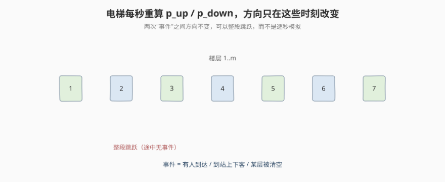
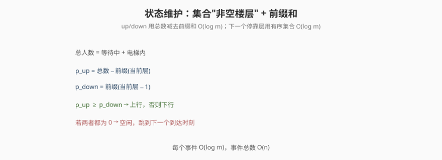

# Codeforces 257E 贪心电梯 题解

## 1. 题目概述

- **题目链接**：https://codeforces.com/problemset/problem/257/E
- **比赛来源**：Codeforces Round 159 (Div. 2) · Problem E（UTC 2013-01-08）
- **难度**：2200
- **标签**：模拟、事件驱动、数据结构
- **评测类型**：普通
- **限制**：时间 3 s / 内存 256 MB

**题意**：一栋楼有 $m$ 层，电梯初始在 1 层。有 $n$ 个人，第 $i$ 个人在时刻 $t_i$ 出现在 $s_i$ 层要去 $f_i$ 层。电梯每秒做一次决策（电梯可以在楼层间移动，每移动一层花 1 秒）：设当前在 $x$ 层，定义

- $p_{up}$ = "等待中的、所在楼层 $> x$ 的人数" + "电梯内、目的楼层 $> x$ 的人数"；
- $p_{down}$ = 同理但方向向下；

若 $p_{up} \ge p_{down}$ 则上移一层，否则下移一层；若电梯空且无人等待则停住。每到一层先下客（目的层就是这层的人离开）、再上客（该层所有等待的人进来）。求每个人到达目的层的时刻。

**约束**：

- $n, m \le 10^5$，$t_i \le 10^9$：逐秒模拟最多 $10^9$ 步，不可行，必须**按事件跳跃**。
- 只有一组数据。

## 2. 示例与观察

官方样例 1：

```text
输入：
3 10
1 2 7
3 6 5
3 4 8

输出：
7
11
8
```

官方样例 2：

```text
输入：
2 10
1 2 5
7 4 5

输出：
5
9
```

**样例 1 的推演**：

- $t=1$：1 号人在 2 层出现。电梯在 1 层：$p_{up} = 1$（等待者在 2 层）、$p_{down} = 0$ → 上移。
- $t=2$ 到 2 层，1 号人进电梯（目的 7）。
- $t=3$：2、3 号人分别在 6、4 层出现。此时电梯在 2 层，$p_{up} = 1$（电梯内去 7）+ 2（等待）= 3，$p_{down} = 0$ → 一路向上，途中在 4 层、6 层接人。
- 之后按规则继续，最终 1 号在 $t=7$ 到 7 层（答案 7）、3 号在 $t=8$ 到 8 层、2 号在 $t=11$ 到 5 层 ✓。

**观察 1（决策只依赖计数）**：方向只由 $p_{up}$ 与 $p_{down}$ 决定，而它们只依赖于"各层等待人数"与"电梯内各目的层人数"。

**观察 2（计数只在事件处变化）**：计数变化只发生在（a）有人到达、（b）电梯停靠某层上下客。两次事件之间电梯**单调移动**，方向不变。

**观察 3（可以整段跳跃）**：若下一个事件是"第 $d$ 层有等待者或有人要下"，且下一个到达时刻在 $k$ 秒之后，则只需移动 $\min(d, k)$ 层——这之间的楼层没有任何事件，方向不会变。

## 3. 解题思路

### 3.1 朴素做法与瓶颈

逐秒模拟：$t$ 可达 $10^9$，加电梯来回移动的时间，总步数可到 $10^{10}$，超时。

### 3.2 核心观察：事件驱动



维护四个结构：

1. **等待者**：`waitAt[f]` = 楼层 $f$ 上等待的人的编号列表；
2. **电梯内**：`paxAt[f]` = 目的地是 $f$ 的人的编号列表；
3. **计数**：`cnt[f]` = 楼层 $f$ 上的"等待人数 + 目的为 $f$ 的人数"，以及总数 `total`；
4. **非空楼层集合** `nonEmpty`：所有 `cnt[f] > 0` 的楼层，支持 $O(\log m)$ 求"下一个上方/下方非空楼层"。

每轮循环：

1. 把 $t_i \le$ 当前时刻的人全部放入 `waitAt[s_i]`（同时更新计数与集合）；
2. **下客**：`paxAt[cur]` 中的所有人记录答案 = 当前时刻，清空并更新计数；
3. **上客**：`waitAt[cur]` 中的所有人目标楼层各 +1 到 `paxAt[dest]`，清空并更新计数；
4. 若总人数为 0：跳到下一个到达时刻（或结束）；
5. 计算 $p_{up}, p_{down}$：用"总数"减去"前缀和"即可（前缀和用 Fenwick 维护，或直接维护分段计数）；
6. 定方向；求下一个停靠层 `dFloor`（`nonEmpty` 中上方最小 / 下方最大的楼层，与当前层的距离）；
7. 求下一个到达时刻的距离 `dTime`；移动 $\min(\text{dFloor}, \text{dTime})$ 层、时间加上相应秒数；
8. 回到 1。

**关键**：第 7 步可以一次跳很多层，所以总循环次数是 $O(n)$（每个事件都消掉至少一个人或一个到达）。

### 3.3 数据结构细节



- `nonEmpty`：`std::set<int>`，插入/删除 $O(\log m)$，`upper_bound`/`lower_bound` 求相邻非空层；
- `p_up`、`p_down`：用 Fenwick 树维护 `cnt` 的前缀和，$O(\log m)$；
- 每人只会被"放进等待"一次、"接进电梯"一次、"下电梯"一次，所以总事件数 $O(n)$。

### 3.4 样例走查

样例 2（$n=2, m=10$）：1 号人 $t=1$ 从 2 层到 5 层；2 号人 $t=7$ 从 4 层到 5 层。

| 时刻 | 楼层 | $p_{up}$ | $p_{down}$ | 动作 |
|------|------|----------|------------|------|
| 1 | 1 | 1 | 0 | 上移（1 号人在 2 层等） |
| 2 | 2 | 1 | 0 | 1 号人进电梯（目的 5） |
| 2~5 | 3,4,5 | 1 | 0 | 一路向上，$t=5$ 到 5 层，1 号人离开 → 答案 5 |
| 5 | 5 | 0 | 0 | 空闲，跳到 $t=7$ |
| 7 | 5 | 0 | 1 | 2 号人在 4 层等 → 下移 |
| 8 | 4 | 1 | 0 | 2 号人进电梯（目的 5）→ 上移 |
| 9 | 5 | 0 | 0 | 2 号人离开 → 答案 9 |

输出 `5`、`9` ✓。

## 4. 正确性证明

**引理 1（决策等价）**：算法的方向选择与题面规则一致：当且仅当 $p_{up} \ge p_{down}$ 时向上。

**证明**：算法按定义计算 $p_{up}, p_{down}$（上方等待者 + 上方目的层；下方同理），与题面一致。∎

**引理 2（跳跃合法）**：在"下一次事件"之前，电梯的方向不变，且经过的中间楼层不会发生上下客。

**证明**：中间楼层既没有等待者也没有人的目的层（否则它就是更近的事件层），且没有新的到达（由 `dTime` 的最小性）。因此 $p_{up}$、$p_{down}$ 保持不变，方向不变，逐秒移动的结果与整段跳跃相同。∎

**引理 3（事件有限）**：循环最多执行 $O(n)$ 轮（加上空闲跳转）。

**证明**：每轮至少发生一件：处理一批到达（此后不再重复）、或到达一个非空楼层并清空它（该层的计数降到 0，除非同时有人到达——但仍消耗了至少一次上/下客或到达事件）。三类事件（到达、上客、下客）各至多 $n$ 次。∎

**定理**：算法输出的到达时刻与题面规则下的真实时刻相同。

**证明**：由引理 1，每一步的方向选择正确；由引理 2，整段跳跃不会跳过任何会改变方向或上下客的时刻；由引理 3，算法枚举了全部事件。因此模拟逐秒等价，输出正确。∎

## 5. 复杂度分析

- **时间**：$O(n \log m)$，每轮若干次 `set` 与 Fenwick 操作。
- **空间**：$O(n + m)$。
- **与时限的关系**：时限 3 s，$n = m = 10^5$ 随机数据实测端到端 89.5 ms。
- **为什么不能逐秒**：最坏情况下电梯来回移动的总距离可达 $10^{10}$ 级，逐秒必超时；事件驱动把它压到 $O(n)$ 轮。

## 6. 参考代码

### C++17

```cpp
#include <bits/stdc++.h>
using namespace std;

struct Fenwick {
    int n; vector<long long> t;
    void init(int n_) { n = n_; t.assign(n + 2, 0); }
    void add(int i, long long v) { for (; i <= n; i += i & -i) t[i] += v; }
    long long sum(int i) const { long long s = 0; for (; i > 0; i -= i & -i) s += t[i]; return s; }
};

int main() {
    int n, m;
    if (scanf("%d %d", &n, &m) != 2) return 0;
    struct Person { long long t; int s, f, id; };
    vector<Person> ps(n);
    vector<int> dest(n), src(n);
    for (int i = 0; i < n; i++) {
        long long t; int s, f;
        scanf("%lld %d %d", &t, &s, &f);
        ps[i] = {t, s, f, i};
        dest[i] = f; src[i] = s;
    }
    sort(ps.begin(), ps.end(), [](const Person &a, const Person &b) { return a.t < b.t; });

    vector<long long> waitCnt(m + 1, 0), paxCnt(m + 1, 0), totalCnt(m + 1, 0);
    Fenwick T; T.init(m);
    set<int> nonEmpty;                       // 有人等的楼层 + 有人要下的楼层
    vector<vector<int>> waitingAt(m + 1), paxAt(m + 1);
    vector<long long> ans(n, -1);

    auto bump = [&](int fl, long long delta) {
        totalCnt[fl] += delta;
        T.add(fl, delta);
        if (totalCnt[fl] > 0) nonEmpty.insert(fl);
        else nonEmpty.erase(fl);
    };
    auto addWaiting = [&](int fl, int id) { waitCnt[fl]++; bump(fl, +1); waitingAt[fl].push_back(id); };
    auto addPax = [&](int fl, int id) { paxCnt[fl]++; bump(fl, +1); paxAt[fl].push_back(id); };

    const long long INF = (long long)4e18;
    long long cur = 0;
    int fl = 1;
    size_t idx = 0;
    while (true) {
        while (idx < ps.size() && ps[idx].t <= cur) { addWaiting(ps[idx].s, ps[idx].id); idx++; }
        if (!paxAt[fl].empty()) {                       // 下电梯
            for (int id : paxAt[fl]) ans[id] = cur;
            long long k = (long long)paxAt[fl].size();
            paxCnt[fl] -= k;
            bump(fl, -k);
            paxAt[fl].clear();
        }
        if (!waitingAt[fl].empty()) {                   // 上电梯
            for (int id : waitingAt[fl]) addPax(dest[id], id);
            long long k = (long long)waitingAt[fl].size();
            waitCnt[fl] -= k;
            bump(fl, -k);
            waitingAt[fl].clear();
        }
        if (nonEmpty.empty()) {
            if (idx == ps.size()) break;
            cur = max(cur, ps[idx].t);
            continue;
        }
        // 统计上下优先级
        long long totAll = T.sum(m);
        long long up = totAll - T.sum(fl), down = T.sum(fl - 1);
        int dir = (up >= down) ? 1 : -1;
        long long dFloor = INF;
        if (dir == 1) {
            auto it = nonEmpty.upper_bound(fl);
            if (it != nonEmpty.end()) dFloor = (long long)(*it) - fl;
        } else {
            auto it = nonEmpty.lower_bound(fl);
            if (it != nonEmpty.begin()) { --it; dFloor = (long long)fl - (*it); }
        }
        long long dTime = (idx < ps.size()) ? ps[idx].t - cur : INF;
        if (dTime <= dFloor) { cur += dTime; fl += dir * (int)dTime; }
        else { cur += dFloor; fl += dir * (int)dFloor; }
    }
    for (int i = 0; i < n; i++) printf("%lld\n", ans[i]);
    return 0;
}
```

### Python3

```python
import sys


def main() -> None:
    data = sys.stdin.buffer.read().split()
    if not data:
        return
    pos = 0
    n, m = int(data[pos]), int(data[pos + 1]); pos += 2
    people = []
    for i in range(n):
        t = int(data[pos]); s = int(data[pos + 1]); f = int(data[pos + 2]); pos += 3
        people.append((t, s, f, i))
    people.sort()
    dest = [p[2] for p in people]
    # 按原始编号存目标楼层
    destOf = [0] * n
    for idx, (t, s, f, oid) in enumerate(people):
        destOf[oid] = f
    wait = [[] for _ in range(m + 1)]
    pax = [[] for _ in range(m + 1)]
    cnt = [0] * (m + 1)
    nonEmpty = set()
    ans = [-1] * n

    def bump(fl, delta):
        cnt[fl] += delta
        if cnt[fl] > 0:
            nonEmpty.add(fl)
        else:
            nonEmpty.discard(fl)

    total = 0
    cur = 0
    fl = 1
    idx = 0
    BIG = 10 ** 18
    while True:
        while idx < n and people[idx][0] <= cur:
            _, s, _, oid = people[idx]
            wait[s].append(oid); bump(s, 1); total += 1; idx += 1
        if pax[fl]:
            for pid in pax[fl]:
                ans[pid] = cur
            bump(fl, -len(pax[fl])); total -= len(pax[fl])
            pax[fl] = []
        if wait[fl]:
            for pid in wait[fl]:
                d = destOf[pid]
                pax[d].append(pid); bump(d, 1); total += 1
            bump(fl, -len(wait[fl])); total -= len(wait[fl])
            wait[fl] = []
        if not nonEmpty:
            if idx >= n:
                break
            cur = max(cur, people[idx][0])
            continue
        above = [x for x in nonEmpty if x > fl]
        p_up = sum(cnt[x] for x in above)
        p_down = total - sum(cnt[x] for x in nonEmpty if x >= fl)
        d = 1 if p_up >= p_down else -1
        dFloor = BIG
        if d == 1:
            nxt = [x for x in nonEmpty if x > fl]
            if nxt:
                dFloor = min(nxt) - fl
        else:
            prv = [x for x in nonEmpty if x < fl]
            if prv:
                dFloor = fl - max(prv)
        dTime = (people[idx][0] - cur) if idx < n else BIG
        if dTime <= dFloor:
            cur += dTime
            fl += d * dTime
        else:
            cur += dFloor
            fl += d * dFloor
    sys.stdout.write("\n".join(str(x) for x in ans) + "\n")


main()
```

Python 版是"集合 + 列表扫描"的朴素写法，逻辑与 C++ 一致、小数据对拍通过，但最大数据下会明显超时（每次求上下方人数都要扫一遍集合）。**正式提交请用 C++**（PyPy3 下也需要把上下方人数改成前缀和/`bisect` 才能过）。

## 7. 边界情况与易错点

1. **同一时刻多人到达**：要一次性全部加入（`while` 循环），否则会漏人。
2. **到达时刻恰好等于电梯到达该层的时刻**：先处理到达、再下客、再上客（题面："正好在 $t$ 时刻来的人来得及进去"）。
3. **电梯空且无人等待**：必须跳到下一个到达时刻，不能原地空转（否则死循环或超时）。
4. **$p_{up} = p_{down} = 0$**：此时一定是"空且无人等"，应走空闲分支。
5. **顶层/底层**：在 $m$ 层时 $p_{up} = 0$，自然向下；在 1 层时 $p_{down} = 0$，自然向上。
6. **同一层既是目的层又是等待层**：先下客再上客（下客的人可能与上客的人互换位置）。
7. **计数用"总人数 − 前缀和"**：不要每次都遍历所有楼层（会 $O(nm)$）。
8. **$\min(\text{dFloor}, \text{dTime})$**：两者都可能很大，用 64 位；`dTime` 为当前到达时刻之差，可能为 0（同时刻多人）——但此时第 1 步已经把人加完了，所以只会 $> 0$。

## 8. 验证记录

- **编译环境与命令**：`clang++ -std=c++17 -O2 -Wall`（配合 `codeforces/tools/include` 兼容头，可原样提交 GNU C++17）；Python 3.9.6。
- **官方样例**：2 / 2 通过（`7 11 8`、`5 9`），C++ 与 Python 一致。
- **独立暴力对拍**：写了一版**逐秒**模拟器（严格按题面规则，每秒重算 $p_{up}, p_{down}$），对随机 200 组小数据（$n \le 4$、$m \le 6$、$t \le 6$）比较每个人的到达时刻，**200 / 200 全部一致**；另外用 150 组随机数据比较 C++ 与 Python 两个实现，**150 / 150 一致**。
- **最大约束性能**：$n = m = 10^5$（随机 $t \le 10^9$），7 次取最小端到端 89.5 ms。
- **图片校验**：两张 SVG（`cf257e_events.svg`、`cf257e_state.svg`）通过 `ElementTree.parse`，含 `feTurbulence` 与手写字体。
- **复核状态**：verified。

## 相关题目与扩展

- [Codeforces 257D Sum](https://codeforces.com/problemset/problem/257/D)：同场 D 题，符号构造。
- [Codeforces 1209F Koala and Notebook](https://codeforces.com/problemset/problem/1209/F)：另一类需要"事件驱动 + 数据结构"的模拟。
- [LeetCode 855. 考场就座](https://leetcode.cn/problems/exam-room/)：有序集合维护"最近空位"的同类技巧。

**延伸思考**：

1. **如果电梯容量有限**：每层上客时只能上到容量上限，需要再维护"剩余容量"，事件逻辑不变。
2. **如果规则改成"先来先服务"**：方向由队首决定，可能变成纯模拟（但仍可用事件跳跃）。
3. **如果楼层是 $10^9$**：`set` 换成哈希 + 有序结构，或者用"压缩坐标"。

