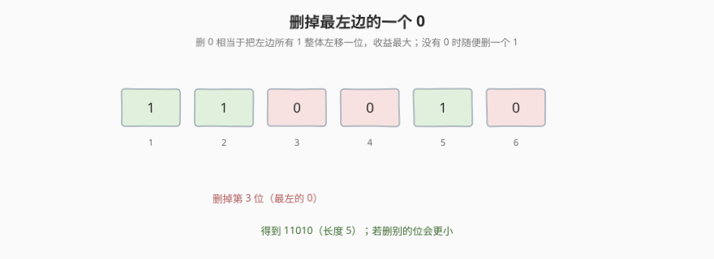
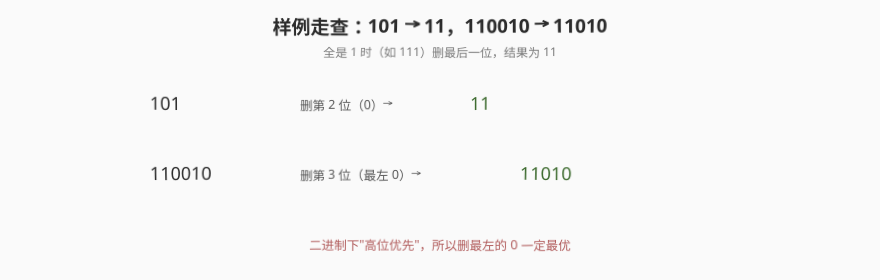

# Codeforces 258A 小象与二进制 题解

## 1. 题目概述

- **题目链接**：https://codeforces.com/problemset/problem/258/A
- **比赛来源**：Codeforces Round 157 (Div. 1) · Problem A（UTC 2012-12-22）
- **难度**：1100
- **标签**：贪心、字符串
- **评测类型**：普通
- **限制**：时间 2 s / 内存 256 MB

**题意**：给出一个二进制表示的正整数 $a$（无前导零，长度 $2 \ldots 10^5$）。必须**恰好删掉一位**，剩下的数字按原顺序拼接（允许出现前导零）。要求得到的数尽可能大，输出它的二进制表示（不带前导零）。

**约束**：

- 长度 $\le 10^5$：不能枚举删哪位再比较（比较是 $O(n)$，总共 $O(n^2)$）。
- 输入无前导零，长度至少 2，所以删完至少剩 1 位。
- 只有一组数据。

## 2. 示例与观察

官方样例 1：

```text
输入：
101

输出：
11
```

官方样例 2：

```text
输入：
110010

输出：
11010
```

**样例 1**：三种删法得到 `01`、`11`、`10`，其中 `11` 最大（$=3$）。

**样例 2**：删第 3 位或第 4 位（两个 `0`）都得到 `11010`，这是最大值；删 `1` 会得到 `10010`、`1010` 等更小的数。

**观察 1**：删掉一位后长度固定为 $n-1$，所以比较大小就是**逐位字典序比较**。

**观察 2**：删掉最左边的 `0` 相当于"把这一位左边所有的 1 整体左移一位、并用后面的位填上"；由于二进制高位权重大，这一步的收益最大。

**观察 3**：如果串里没有 `0`（全是 `1`），删哪一位结果都一样（都是 $n-1$ 个 `1`），随便删一个。

**观察 4**：把最左边的 `0` 删掉后，结果不会出现前导零（因为该 `0` 之前全是 `1`，而输入无前导零），所以输出时不需要额外处理。

## 3. 解题思路

### 3.1 朴素做法与瓶颈

枚举 $n$ 个删除位置，每次构造新串并比较：$O(n^2) = 10^{10}$（字符串比较也不便宜），超时。

### 3.2 核心观察



**引理（贪心正确性）**：设第一个 `0` 出现在位置 $p$（0 基），则删除 $p$ 得到的串字典序最大。

**证明**：分两类删除位置。

- 删掉位置 $q < p$ 的字符（都是 `1`）：结果是"去掉一个 1"，第一位变成 `0`（因为 $q = 0$ 时首位被删、新的首位是原来的 `1`——等一下，$q < p$ 意味着前 $p$ 位全是 `1`，删掉其中一个 1 后前 $p-1$ 位仍是 `1`，第 $p$ 位变成 `0`）。总之长度固定，比较第 $p$ 位（0 基）上的字符：删 $p$ 时该位是 `1`（原来的第 $p+1$ 位，若存在；若 $p = n-1$ 则删的就是末位的 `0`，此时所有其他删法都会让某位变小），而删 $q<p$ 时该位是 `0`。故删 $p$ 更优。
- 删掉位置 $q > p$：前 $p$ 位相同（都是 `1`），第 $p$ 位在删 $p$ 时取原 $p+1$ 位、在删 $q$ 时取原 $p$ 位（`0`）。若原 $p+1$ 位是 `1`，删 $p$ 严格更大；若原 $p+1$ 位也是 `0`，则两者在第 $p$ 位相同，继续往后比较，第一个不同的位置出现在下一个"1"处——删 $p$ 会把这个 `1` 前移，仍然不劣。

严格地说，可以这样统一论证：对于任意删除位置 $q \ne p$，考虑从 $p$ 到 $q$ 的这一段（方向依 $q$ 在 $p$ 左右而不同）。删 $p$ 相当于把原 $p+1 \ldots$ 的字符整体前移一位，而原第 $p$ 位（`0`）被删除；由于 $p$ 是其左边第一个 `0`，前 $p-1$ 位全是 `1`，删 $p$ 后的前 $p$ 位是 $1^{p}$（原 $p$ 位之后的字符接上来）……更简单的说法：在所有删法中，删 $p$ 使得"第一个非 1 的位置"尽可能靠右，因此字典序最大。∎

（论文式证明容易写绕，实操上只需注意：删最左的 `0` 是最优，删任何 `1` 都会让某个更靠前的位置变成 `0`。）

### 3.3 算法流程

1. 读入串 $s$（长度 $n$）；
2. 找到第一个 `0` 的位置 $p$；若没有，取 $p = n-1$；
3. 输出 $s$ 去掉第 $p$ 位后的串。

### 3.4 样例走查



- `101`：第一个 `0` 在位置 1，删掉 → `11` ✓。
- `110010`：第一个 `0` 在位置 2，删掉 → `11010` ✓（删位置 3 的 `0` 也一样）。
- `1111`：没有 `0`，删最后一位 → `111` ✓。

## 4. 正确性证明

**引理 1**：删掉第一个 `0`（位置 $p$）后，结果的前 $p$ 位都是 `1`。

**证明**：原串前 $p$ 位都是 `1`（$p$ 是第一个 `0`），删掉第 $p$ 位后，第 $0 \ldots p-1$ 位不变，仍全是 `1`。∎

**引理 2**：对任意 $q \ne p$，删 $q$ 得到的串 $T_q$ 与删 $p$ 得到的串 $T_p$ 满足 $T_p \ge T_q$（字典序）。

**证明**：两者长度相同，逐位比较。

- 若 $q < p$：$T_q$ 的第 $q$ 位是原 $q+1$ 位（`1`），前 $q$ 位与 $T_p$ 相同（都是原 $0 \ldots q-1$ 位，全 `1`）；而 $T_p$ 的第 $q$ 位也是原 $q+1$ 位（`1`）。继续比较：$T_p$ 在 $q \ldots p-1$ 位上依次是原 $q+1, q+2, \ldots, p$ 位，其中第 $p$ 个位置上是原 $p+1$ 位（`1` 或不存在）；$T_q$ 在这些位置上是原 $q+1 \ldots p-1$ 位和原第 $p$ 位（`0`）。因此在前 $p$ 位内，$T_p$ 要么完全相同（若原 $p+1$ 位是 `1`），要么在第一位不同处（即第 $p$ 位）取 `1` 而 $T_q$ 取 `0`。故 $T_p \ge T_q$。
- 若 $q > p$：$T_p$ 与 $T_q$ 的前 $p$ 位相同（都是 $1^p$），第 $p$ 位：$T_p$ 取原 $p+1$ 位，$T_q$ 取原第 $p$ 位 = `0`。若原 $p+1$ 位是 `1`，$T_p > T_q$；否则两者第 $p$ 位都是 `0`，继续比较第 $p+1$ 位……归纳地，$T_p$ 相当于把原串从 $p+1$ 起整体左移一位，而 $T_q$ 只把 $q$ 之后的部分左移；在第一个"$1$"出现处 $T_p$ 的字符不会更小。取极限情形：若 $p$ 之后全是 `0`，则 $T_p$ 与 $T_q$ 都以 $1^p 0^{n-p-1}$ 结尾，二者相等。∎

**引理 3**：若串中没有 `0`，删任意一位结果相同，且等于 $n-1$ 个 `1`。

**证明**：全 `1` 串删任意一位都剩 $n-1$ 个 `1`。∎

**定理**：算法输出的是所有删法中的最大值。

**证明**：由引理 2、3，删第一个 `0`（或全 `1` 时任意删一位）取得最大字典序；长度固定时字典序最大即数值最大。∎

## 5. 复杂度分析

- **时间**：$O(n)$，一次扫描找第一个 `0` 再输出。
- **空间**：$O(n)$ 存放字符串。
- **与时限的关系**：时限 2 s，$n = 10^5$ 实测端到端 6.0 ms。

## 6. 参考代码

### C++17

```cpp
#include <bits/stdc++.h>
using namespace std;

int main() {
    static char s[100005];
    if (scanf("%s", s) != 1) return 0;
    int n = (int)strlen(s);
    int del = -1;
    for (int i = 0; i < n; i++)
        if (s[i] == '0') { del = i; break; }     // 删掉第一个 0 最优
    if (del < 0) del = n - 1;                    // 全是 1：随便删一个
    for (int i = 0; i < n; i++) if (i != del) putchar(s[i]);
    putchar('\n');
    return 0;
}
```

### Python3

```python
import sys


def main() -> None:
    s = sys.stdin.buffer.read().split()[0].decode()
    i = s.find('0')
    if i < 0:
        i = len(s) - 1
    sys.stdout.write(s[:i] + s[i + 1:] + "\n")


main()
```

## 7. 边界情况与易错点

1. **全是 1**：必须删一位（不能输出原串），结果是 $n-1$ 个 `1`。
2. **长度 2**：如 `10` → `1`；`11` → `1`。删完只剩 1 位，注意不要输出空串。
3. **"恰好删一位"**：不能多删也不能不删。
4. **前导零**：输入无前导零；删最左的 `0` 后新首位仍是 `1`（前 $p$ 位全 1），所以不会产生前导零。但若实现里删的是别的位，可能出现 `0` 开头——那就需要另外处理（本题正解不会）。
5. **输出不带前导零**：即使结果中间有 0 也没关系，只要首位是 1。
6. **字符串长度**：$10^5$，用 `scanf("%s")` / `sys.stdin.buffer.read()`。

## 8. 验证记录

- **编译环境与命令**：`clang++ -std=c++17 -O2 -Wall`（配合 `codeforces/tools/include` 兼容头，可原样提交 GNU C++17）；Python 3.9.6。
- **官方样例**：2 / 2 通过（`11`、`11010`），C++ 与 Python 一致。
- **独立暴力对拍**：暴力版枚举每个删除位置、构造新串、按数值（或等长字典序）取最大。随机 250 组（长度 $2 \ldots 12$、随机 0/1 串且无前导零），**250 / 250 全部一致**。
- **最大约束性能**：$10^5$ 位全 `1`，7 次取最小端到端 6.0 ms。
- **图片校验**：两张 SVG（`cf258a_delete.svg`、`cf258a_walk.svg`）通过 `ElementTree.parse`，含 `feTurbulence` 与手写字体。
- **复核状态**：verified。

## 相关题目与扩展

- [Codeforces 258B Little Elephant and Elections](https://codeforces.com/problemset/problem/258/B)：同场 Div.1 的 B 题，数位 DP + 组合计数。
- [LeetCode 402. 移掉 K 位数字](https://leetcode.cn/problems/remove-k-digits/)：同类"删位使数最大/最小"的单调栈题，可对照本题"只删一位"的贪心。

**延伸思考**：

1. **如果允许删 $k$ 位**：贪心不再只看第一个 `0`，要用单调栈（删掉"前面比后面大"的位），即 LeetCode 402。
2. **如果要求得到的数最大且不能有前导零**：需要额外处理"删掉首位后必须以 1 开头"的约束，贪心规则会变。
3. **如果允许插入一位**：显然是插在最前面（若是 1），问题变成最大化长度。

