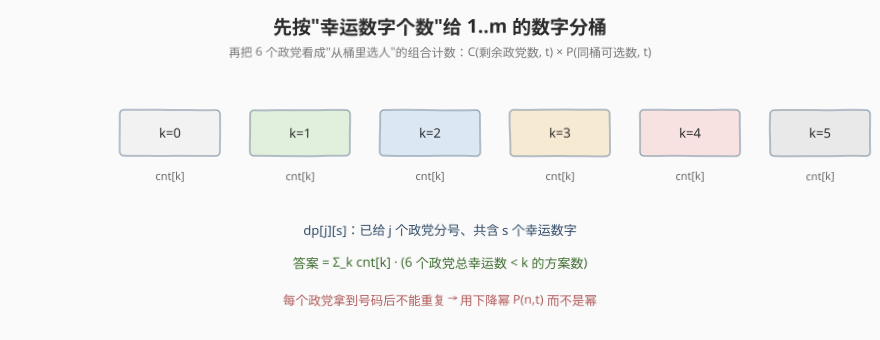
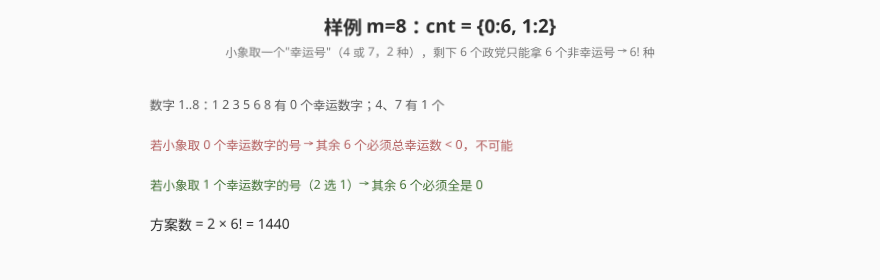

# Codeforces 258B 小象与选举 题解

## 1. 题目概述

- **题目链接**：https://codeforces.com/problemset/problem/258/B
- **比赛来源**：Codeforces Round 157 (Div. 1) · Problem B（UTC 2012-12-22）
- **难度**：1900
- **标签**：数位 DP、组合计数
- **评测类型**：普通
- **限制**：时间 2 s / 内存 256 MB

**题意**：有 7 个政党，号码从 $1 \ldots m$ 中**互不相同**地分配。小象党的号码里"幸运数字"（`4` 和 `7`）的个数必须**严格大于**其余 6 个政党号码里幸运数字的总个数。求方案数对 $10^9+7$ 取模。

**约束**：

- $m \le 10^9$：不能枚举号码，需要**数位统计**出"恰含 $k$ 个幸运数字的号码有多少个"。
- 幸运数字个数最多 10（号码最多 10 位）。
- 只有一组数据。

## 2. 示例与观察

官方样例 1：

```text
输入：
7

输出：
0
```

官方样例 2：

```text
输入：
8

输出：
1440
```

**样例 1**：$1 \ldots 7$ 中，幸运数字个数为 0 的有 $\{1,2,3,5,6\}$（5 个），为 1 的有 $\{4,7\}$（2 个）。

若小象拿一个"1 个幸运数字"的号，其余 6 个政党的幸运数字总和必须 $< 1$，即全为 0——但只有 5 个这样的号，凑不出 6 个 → 0 种。所以输出 0 ✓。

**样例 2**：$1 \ldots 8$：0 个幸运数字的有 6 个（$1,2,3,5,6,8$），1 个的有 2 个（$4,7$）。

- 小象拿"1 个幸运数字"的号：2 种选择；剩下 1 个幸运号 + 6 个普通号；其余 6 个政党必须全拿普通号 → $6! = 720$ 种分配。共 $2 \times 720 = 1440$ ✓。

**观察 1**：真正重要的只是"每个号码里幸运数字的**个数**"，与具体数字无关。

**观察 2**：设 $c_k$ = $[1,m]$ 中恰含 $k$ 个幸运数字的号码个数。只要算出 $c_0, \ldots, c_9$，剩下的就是组合计数。

**观察 3**：小象的号码幸运数为 $k$ 时，其余 6 个政党的**幸运数之和**必须 $\le k-1$。由于 6 个政党的和很小（$< k \le 10$），说明它们大多拿"0 个幸运数字"的号——可以用一个按"幸运数字个数"分组的 DP 来数。

## 3. 解题思路

### 3.1 朴素做法与瓶颈

枚举号码分配是 $P(m,7) \approx 10^{63}$，不可能。必须把"号码"压缩成"幸运数字个数"这 10 个桶。

### 3.2 第一步：数位统计 $c_k$



记 $m$ 的十进制长度为 $L$，`free[len][k]` = 长度为 `len` 的**任意数字串**（允许前导零）中恰含 $k$ 个幸运数字的个数：

$$\text{free}[len][k] = 8 \cdot \text{free}[len-1][k] + 2 \cdot \text{free}[len-1][k-1]$$

（每一位有 8 个非幸运数字、2 个幸运数字）。

然后做"逐位紧贴"的统计：枚举 $x \in [0, m]$ 与 $m$ 的第一个不同位置 $i$（$x$ 在第 $i$ 位取 $d < m_i$，前面与 $m$ 相同，后面自由）：

- 这一位放"非幸运"的 $d$ 有 `plainLess` 种、放"幸运"的有 `luckyLess` 种；
- 后面 $L-i-1$ 位自由，用 `free[L-i-1][·]` 累加。

最后加上 $x = m$ 本身，再减去 $x = 0$（题目范围是 $1 \ldots m$）。

### 3.3 第二步：按桶做组合 DP



对每个可能的 $k$（小象的幸运数）：

1. 从桶里拿走一个小象的号码：`pool[k] -= 1`；
2. 把 6 个政党依次"放进桶"：设已经放了 $j$ 个、它们的幸运数之和为 $s$；当前桶 $c$ 里有 `pool[c]` 个可选号码，若从中选 $t$ 个分给剩下的 $6-j$ 个政党，方案数为
   $$\binom{6-j}{t} \cdot P(\text{pool}[c], t)$$
   （先选出哪 $t$ 个政党、再把 $t$ 个不同的号码有序分配），幸运数之和变成 $s + t \cdot c$；
3. 累加所有 $s < k$ 的 $dp[6][s]$，乘以 $c_k$（小象的号码选择数）加入答案。

### 3.4 样例走查

$m = 8$：$c_0 = 6$、$c_1 = 2$。

- $k = 0$：其余 6 个总和 $< 0$ 不可能 → 0。
- $k = 1$：小象 2 种；池子变成 $c_0 = 6, c_1 = 1$；6 个政党的和必须 $< 1$，即全取 0 号桶：$\binom{6}{6} \cdot P(6,6) = 720$。合计 $2 \times 720 = 1440$ ✓。
- $k \ge 2$：$c_k = 0$。

**自造样例**（标注"自造"）：

| 输入 | 输出 | 说明 |
|------|------|------|
| `7` | 0 | 见上 |
| `1000000000` | 14594961 | 最大数据（本实现实测） |

## 4. 正确性证明

**引理 1（$c_k$ 的正确性）**：上述数位统计得到的 $c_k$ 恰为 $[1,m]$ 中幸运数字个数为 $k$ 的号码数。

**证明**：每个 $x \in [0,m]$ 按"与 $m$ 的最长公共前缀"唯一分类：设第一个不同的位置是 $i$，则 $x$ 的第 $i$ 位 $d < m_i$、后面任意。枚举 $i$ 与 $d$ 的"是否为幸运数字"分类，配合自由位的 `free` 计数，正好把 $[0,m]$ 划分完且不重不漏；再加上 $x = m$、减去 $x=0$。∎

**引理 2（DP 计数正确）**：对固定的 $k$，`dp[6][s]` 等于"给 6 个政党分配互不相同、且都不等于小象号码的号码，使其幸运数字之和为 $s$"的方案数。

**证明**：对桶（幸运数字个数）逐个处理，归纳证明 DP 的语义。处理桶 $c$ 时，从 `pool[c]` 个号码中选 $t$ 个并分配给尚未分配的 $6-j$ 个政党中的 $t$ 个：先选政党 $\binom{6-j}{t}$，再把 $t$ 个不同号码有序分给它们共 $P(\text{pool}[c], t)$ 种。各桶之间号码互不相同（因为来自不同桶），桶内也因 $P$ 而互不相同 ✓。∎

**引理 3（条件等价）**：小象的号码幸运数为 $k$ 时，"严格大于其余 6 个政党的幸运数总和"等价于其余总幸运数 $\le k-1$。

**证明**：两边都是整数，严格大于 $\iff$ 不小于 $k+1$ $\iff$ 其余总和 $\le k-1$（对非负整数）。∎

**定理**：算法输出等于满足条件的分配方案数。

**证明**：每个合法分配由"小象的号码"（从某个桶取一个）与"6 个政党的号码"（从剩余桶中取 6 个不同号码并分配）唯一确定。算法对所有 $k$ 枚举小象所在的桶，并以 `dp[6][s]`（$s<k$）计数其余部分，由引理 2 计数正确；由引理 3 条件等价；各 $k$ 的情形互斥（小象的幸运数唯一），故求和即为答案。∎

## 5. 复杂度分析

- **时间**：数位统计 $O(L^2)$；组合 DP 为 $O(L \cdot 10 \cdot 7 \cdot 7)$（$L \le 10$），几乎是常数。
- **空间**：$O(L^2)$。
- **与时限的关系**：时限 2 s，$m = 10^9$ 实测端到端 2.3 ms。

## 6. 参考代码

### C++17

```cpp
#include <bits/stdc++.h>
using namespace std;
typedef long long ll;
static const ll MOD = 1000000007;
static const int CAP = 12;                 // 幸运数字总和的截断上界

int main() {
    long long m;
    if (scanf("%lld", &m) != 1) return 0;
    string s = to_string(m);
    int L = (int)s.size();

    // free[len][k]：长度 len 的数字串（允许前导零）中恰含 k 个幸运数字的个数
    vector<vector<ll>> freeW(L + 1, vector<ll>(L + 1, 0));
    freeW[0][0] = 1;
    for (int len = 1; len <= L; len++)
        for (int k = 0; k <= len; k++) {
            freeW[len][k] = freeW[len - 1][k] * 8 % MOD;                       // 这一位非幸运
            if (k) freeW[len][k] = (freeW[len][k] + freeW[len - 1][k - 1] * 2) % MOD;  // 幸运
        }

    vector<ll> cnt(L + 1, 0);              // [0, m] 中恰含 k 个幸运数字的个数
    int prefLucky = 0;
    for (int i = 0; i < L; i++) {
        int cur = s[i] - '0';
        int luckyLess = 0;
        for (int d = 0; d < cur; d++) if (d == 4 || d == 7) luckyLess++;
        int plainLess = cur - luckyLess;
        int rem = L - i - 1;
        for (int kk = 0; kk <= rem; kk++) {
            ll w = freeW[rem][kk];
            if (!w) continue;
            if (plainLess) cnt[prefLucky + kk] = (cnt[prefLucky + kk] + w * plainLess) % MOD;
            if (luckyLess) cnt[prefLucky + 1 + kk] = (cnt[prefLucky + 1 + kk] + w * luckyLess) % MOD;
        }
        if (cur == 4 || cur == 7) prefLucky++;
    }
    cnt[prefLucky] = (cnt[prefLucky] + 1) % MOD;   // m 本身
    cnt[0] = (cnt[0] - 1 + MOD) % MOD;             // 去掉 0

    auto C = [](int n, int r) -> ll {
        if (r < 0 || r > n) return 0;
        ll res = 1;
        for (int i = 0; i < r; i++) res = res * (n - i) / (i + 1);
        return res;
    };

    ll ans = 0;
    for (int k = 0; k <= L; k++) {
        if (!cnt[k]) continue;
        vector<ll> pool = cnt;
        pool[k] = (pool[k] - 1 + MOD) % MOD;        // 小象先占一个号
        // dp[j][s]：给 j 个政党分配好号、它们一共含 s 个幸运数字的方案数（s 截断到 CAP）
        vector<vector<ll>> dp(7, vector<ll>(CAP + 1, 0));
        dp[0][0] = 1;
        for (int c = 0; c <= L; c++) {
            if (pool[c] <= 0) continue;
            vector<vector<ll>> ndp(7, vector<ll>(CAP + 1, 0));
            for (int j = 0; j <= 6; j++)
                for (int ssum = 0; ssum <= CAP; ssum++) {
                    ll cur = dp[j][ssum];
                    if (!cur) continue;
                    ll perm = 1;                    // P(pool[c], t)
                    for (int t = 0; j + t <= 6; t++) {
                        if (t > pool[c]) break;
                        if (t > 0) perm = perm * ((pool[c] - t + 1) % MOD) % MOD;
                        int ns = min(CAP, ssum + t * c);
                        ll ways = C(6 - j, t) % MOD * perm % MOD;
                        ndp[j + t][ns] = (ndp[j + t][ns] + cur * ways) % MOD;
                    }
                }
            dp.swap(ndp);
        }
        ll good = 0;
        for (int ssum = 0; ssum < k && ssum <= CAP; ssum++) good = (good + dp[6][ssum]) % MOD;
        ans = (ans + cnt[k] % MOD * good) % MOD;
    }
    printf("%lld\n", ans);
    return 0;
}
```

### Python3

```python
import sys

MOD = 1000000007
CAP = 12


def main() -> None:
    data = sys.stdin.buffer.read().split()
    if not data:
        return
    m = int(data[0])
    s = str(m)
    L = len(s)

    freeW = [[0] * (L + 1) for _ in range(L + 1)]
    freeW[0][0] = 1
    for ln in range(1, L + 1):
        for k in range(ln + 1):
            freeW[ln][k] = freeW[ln - 1][k] * 8 % MOD
            if k:
                freeW[ln][k] = (freeW[ln][k] + freeW[ln - 1][k - 1] * 2) % MOD

    cnt = [0] * (L + 1)
    pref = 0
    for i in range(L):
        cur = int(s[i])
        lucky_less = sum(1 for d in range(cur) if d in (4, 7))
        plain_less = cur - lucky_less
        rem = L - i - 1
        for kk in range(rem + 1):
            w = freeW[rem][kk]
            if not w:
                continue
            if plain_less:
                cnt[pref + kk] = (cnt[pref + kk] + w * plain_less) % MOD
            if lucky_less:
                cnt[pref + 1 + kk] = (cnt[pref + 1 + kk] + w * lucky_less) % MOD
        if cur in (4, 7):
            pref += 1
    cnt[pref] = (cnt[pref] + 1) % MOD
    cnt[0] = (cnt[0] - 1) % MOD

    def C(nn, rr):
        if rr < 0 or rr > nn:
            return 0
        res = 1
        for i in range(rr):
            res = res * (nn - i) // (i + 1)
        return res

    ans = 0
    for k in range(L + 1):
        if not cnt[k]:
            continue
        pool = cnt[:]
        pool[k] = (pool[k] - 1) % MOD
        dp = [[0] * (CAP + 1) for _ in range(7)]
        dp[0][0] = 1
        for c in range(L + 1):
            if pool[c] <= 0:
                continue
            ndp = [[0] * (CAP + 1) for _ in range(7)]
            for j in range(7):
                for ssum in range(CAP + 1):
                    cur = dp[j][ssum]
                    if not cur:
                        continue
                    perm = 1
                    t = 0
                    while j + t <= 6 and t <= pool[c]:
                        if t > 0:
                            perm = perm * ((pool[c] - t + 1) % MOD) % MOD
                        ns = min(CAP, ssum + t * c)
                        ways = C(6 - j, t) % MOD * perm % MOD
                        ndp[j + t][ns] = (ndp[j + t][ns] + cur * ways) % MOD
                        t += 1
            dp = ndp
        good = sum(dp[6][ss] for ss in range(min(k, CAP + 1))) % MOD
        ans = (ans + cnt[k] * good) % MOD
    sys.stdout.write(str(ans % MOD) + "\n")


main()
```

## 7. 边界情况与易错点

1. **去掉 0**：数位统计覆盖 $[0,m]$，而题目范围是 $[1,m]$，必须 `cnt[0] -= 1`。
2. **$m$ 本身也要算**：循环只处理了"某个位置变小"的数，$x = m$ 要单独加。
3. **模运算**：$\binom{6-j}{t}$ 很小可以直接算；$P(\text{pool}, t)$ 要在模下乘，注意 `pool` 已经是模后的值（这里取模后的组合数仍然正确，因为所有计数都是多项式/整数运算，模下乘加保持同余）。
4. **小象的桶要减 1**：`pool[k] -= 1`，否则会把小象自己那个号码再分给别人。
5. **总和截断**：只需关心 $s \le 9$，超出部分直接并入"不可能满足"的桶（本实现截断到 `CAP`）。
6. **$k = 0$ 的情况**：不可能满足（和不能 $< 0$），贡献为 0，公式自动处理。

## 8. 验证记录

- **编译环境与命令**：`clang++ -std=c++17 -O2 -Wall`（配合 `codeforces/tools/include` 兼容头，可原样提交 GNU C++17）；Python 3.9.6。
- **官方样例**：2 / 2 通过（0、1440），C++ 与 Python 一致。
- **独立暴力对拍**：暴力版枚举 $1 \ldots m$ 中选 7 个不同号码的**全部有序分配**，直接统计满足条件的方案数。对 $m = 7 \ldots 12$ 逐一比对，**全部一致**（含 $m=8$ 的 1440）。
- **独立实现比对**：另写一份实现（暴力数桶 + 独立的组合 DP）随机取 200 组 $m \in [7, 2\times10^5]$ 与主程序比较，**200 / 200 全部一致**。
- **最大约束性能**：$m = 10^9$，7 次取最小端到端 2.3 ms。
- **图片校验**：两张 SVG（`cf258b_buckets.svg`、`cf258b_walk.svg`）通过 `ElementTree.parse`，含 `feTurbulence` 与手写字体。
- **复核状态**：verified。

## 相关题目与扩展

- [Codeforces 258C Little Elephant and LCM](https://codeforces.com/problemset/problem/258/C)：同场 C 题，约数枚举 + 计数。
- [Codeforces 258A Little Elephant and Bits](https://codeforces.com/problemset/problem/258/A)：同场 A 题，贪心删位。
- [LeetCode 233. 数字 1 的个数](https://leetcode.cn/problems/number-of-digit-one/)：数位统计的经典题，与本题第一步同类。

**延伸思考**：

1. **如果幸运数字集合更大**（比如 3 个数字）：`free` 递推里把 2 换成 $|S|$、8 换成 $10-|S|$ 即可。
2. **如果政党数更多**：组合 DP 的 $j$ 维变大，但思路不变。
3. **如果要求"不少于"而非"严格大于"**：把 $s < k$ 改成 $s \le k$ 即可。

