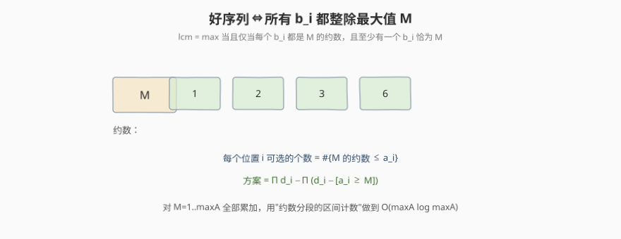
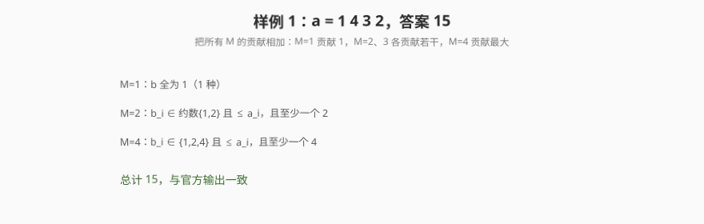

# Codeforces 258C 小象与 LCM 题解

## 1. 题目概述

- **题目链接**：https://codeforces.com/problemset/problem/258/C
- **比赛来源**：Codeforces Round 157 (Div. 1) · Problem C（UTC 2012-12-22）
- **难度**：2000
- **标签**：数论、约数枚举、计数
- **评测类型**：普通
- **限制**：时间 4 s / 内存 256 MB

**题意**：给定 $a_1 \ldots a_n$，统计满足下列条件的序列 $b$ 的个数（对 $10^9+7$ 取模）：

- $1 \le b_i \le a_i$；
- $\operatorname{lcm}(b_1, \ldots, b_n) = \max(b_1, \ldots, b_n)$。

**约束**：

- $n \le 10^5$、$a_i \le 10^5$：需要 $\tilde O(\max a)$ 级别的做法。
- 只有一组数据。

## 2. 示例与观察

官方样例 1：

```text
输入：
4
1 4 3 2

输出：
15
```

官方样例 2：

```text
输入：
2
6 3

输出：
13
```

**样例 1 的演算**：把最大值 $M$ 固定，逐个数数。约数用 $\tau$ 表示，$d_i(M) = \#\{d : d \mid M,\ d \le a_i\}$：

| $M$ | 约数 | $d_i(M)$（$a = 1,4,3,2$） | $\prod d_i$ | 没有一位取 $M$ | 贡献 |
|-----|------|------------------------------|--------------|------------------|------|
| 1 | {1} | 1, 1, 1, 1 | 1 | 0（不可能） | 1 |
| 2 | {1,2} | 1, 2, 2, 2 | 8 | 1 | 7 |
| 3 | {1,3} | 1, 2, 2, 1 | 4 | 1 | 3 |
| 4 | {1,2,4} | 1, 3, 2, 2 | 12 | 8 | 4 |

合计 $1 + 7 + 3 + 4 = 15$ ✓ 与官方输出一致。

逐项解释 $M=4$：$a_2 = 4$ 可取 $\{1,2,4\}$（3 种），$a_3 = 3$ 只能取 $\{1,2\}$（2 种），$a_4 = 2$ 取 $\{1,2\}$（2 种），$a_1 = 1$ 只能取 1 → 全部 $1\cdot3\cdot2\cdot2 = 12$ 种；其中"没有一位等于 4"的是 $1 \cdot 2 \cdot 2 \cdot 2 = 8$ 种，相减得 4 种含 4 的 ✓。

**样例 2 的演算**：$a = (6,3)$，$\max a = 6$。逐项列出 $d_1$（约数 $\le 6$ 的个数）与 $d_2$（约数 $\le 3$ 的个数）：

| $M$ | 约数 | $d_1$ | $d_2$ | $\prod_1$ | $\prod_2$ | 贡献 |
|-----|------|-------|-------|-----------|-----------|------|
| 1 | 1 | 1 | 1 | 1 | 0 | 1 |
| 2 | 1,2 | 2 | 2 | 4 | 1 | 3 |
| 3 | 1,3 | 2 | 2 | 4 | 1 | 3 |
| 4 | 1,2,4 | 3 | 2 | 6 | 4 | 2 |
| 5 | 1,5 | 2 | 1 | 2 | 1 | 1 |
| 6 | 1,2,3,6 | 4 | 3 | 12 | 9 | 3 |

合计 $1+3+3+2+1+3 = 13$ ✓ 与官方输出一致。

注意几个容易数错的地方：$M=2,3$ 时 $a_1 = 6$ 已经 $\ge M$，所以 $d_1$ 是"全部约数个数"（2）；$M=6$ 时 $a_1 = 6$ 可取全部 4 个约数、$a_2 = 3$ 只能取 $\{1,2,3\}$，故 $\prod_2 = 3 \times 3 = 9$（**不是** $4\times3$，因为 $a_1$ 也要排除"取 6"这一种）。

## 3. 解题思路

### 3.1 朴素做法与瓶颈

枚举所有 $b$ 是 $\prod a_i$ 级别，不可行。固定最大值 $M$ 后，条件变成"每个 $b_i \mid M$"，于是每个位置独立可选，方案数可乘。

### 3.2 核心观察：固定最大值



**引理 1（等价刻画）**：$\operatorname{lcm}(b) = \max(b)$ 当且仅当**每个** $b_i$ 都整除 $M = \max(b)$，且至少有一个 $b_i = M$。

**证明**：设 $M = \max b$。lcm 是 $M$ 的倍数（每个 $b_i \le M$ 且 $b_i \mid \text{lcm}$，故 $\text{lcm} \ge M$）。若每个 $b_i \mid M$，则 $\text{lcm} \le M$，故 $\text{lcm} = M$ ✓。反之若 $\text{lcm} = M$，则 $M$ 是每个 $b_i$ 的倍数，即每个 $b_i \mid M$ ✓；且最大值 $M$ 本身出现在序列里。∎

于是对每个 $M$：

- 记 $d_i(M) = \#\{d : d \mid M,\ d \le a_i\}$（第 $i$ 位可选的取值个数）；
- 全部方案数 $= \prod_i d_i(M)$；
- 减去"没有一位等于 $M$"的方案数 $= \prod_i \bigl(d_i(M) - [a_i \ge M]\bigr)$。

累加 $M = 1 \ldots \max a$ 即答案。

### 3.3 算法流程



直接对每个 $M$ 枚举约数并乘起来是 $O(\sum \tau(M) \cdot n)$，太慢。用"值域分段"优化：

1. 用筛法求出每个 $M$ 的全部约数（升序）$e_1 < e_2 < \cdots < e_k = M$；
2. 对 $a$ 做**前缀计数** `cntLE[v] = #{i : a_i ≤ v}`；
3. 对固定 $M$：落在 $[e_j, e_{j+1}-1]$ 的 $a_i$ 对应的 $d_i = j$（约数 ≤ $a_i$ 的恰好是前 $j$ 个），落在 $[M, \infty)$ 的 $d_i = k$；
4. 于是两个乘积都能按"区间长度"用快速幂算出：
   $$\prod_1 = \prod_{j<k} j^{c_j} \cdot k^{c_k},\qquad \prod_2 = \prod_{j<k} j^{c_j}\cdot (k-1)^{c_k};$$
5. 累加 $\prod_1 - \prod_2$。

总代价 $O\bigl(\sum_M \tau(M) \log n\bigr) = O(A \log A \log n)$，$A = 10^5$ 时约 $10^6$ 次运算。

### 3.4 样例走查


样例 1（$a = 1,4,3,2$，$\max a = 4$）：按 3.3 的步骤逐项累加：

| $M$ | 约数（升序） | 各 $a_i$ 的 $d_i$ | $\prod_1$ | $\prod_2$ | 贡献 |
|-----|--------------|--------------------|-----------|-----------|------|
| 1 | 1 | 1,1,1,1 | 1 | 0 | 1 |
| 2 | 1,2 | 1,2,2,2 | 8 | 1 | 7 |
| 3 | 1,3 | 1,2,2,1 | 4 | 1 | 3 |
| 4 | 1,2,4 | 1,3,2,2 | 12 | 8 | 4 |

合计 **15** ✓，与官方输出一致。

以 $M=4$ 为例演示 3.3 的"分段"算法：约数 $(1,2,4)$，$k=3$。$a$ 排序后为 $(1,2,3,4)$：

- $c_1$（$a_i \in [1,1]$）= 1 → 因子 $1^1$；
- $c_2$（$a_i \in [2,3]$）= 2 → 因子 $2^2$；
- $c_3$（$a_i \ge 4$）= 1 → $\prod_1$ 用 $3^1$、$\prod_2$ 用 $2^1$。

于是 $\prod_1 = 1 \cdot 4 \cdot 3 = 12$、$\prod_2 = 1 \cdot 4 \cdot 2 = 8$，贡献 $4$ ✓。

## 4. 正确性证明

**引理 1**：见 3.2（等价刻画）。

**引理 2（单个 $M$ 的计数）**：对固定 $M$，满足"所有 $b_i \mid M$、$b_i \le a_i$、至少一个 $b_i = M$"的序列数为
$$\prod_i d_i(M) - \prod_i \bigl(d_i(M) - [a_i \ge M]\bigr).$$

**证明**：第一个乘积数的是"所有 $b_i \mid M$ 且 $b_i \le a_i$"的全部序列（每个位置独立）。第二个乘积数的是其中"没有任何 $b_i = M$"的序列：当 $a_i \ge M$ 时位置 $i$ 少一个可选值 $M$，否则 $M$ 本来就不是候选、不受影响。两者相减即"至少一个位置取 $M$"。∎

**引理 3（分段乘积）**：对固定 $M$ 与其升序约数 $e_1 < \cdots < e_k = M$，若有 $c_j$ 个 $a_i$ 落在 $[e_j, e_{j+1}-1]$（$j<k$）、$c_k$ 个 $a_i \ge M$，则 $\prod_i d_i(M) = \prod_j j^{c_j} \cdot k^{c_k}$。

**证明**：$a_i \in [e_j, e_{j+1}-1]$ 时，$M$ 的约数中 $\le a_i$ 的恰为 $e_1 \ldots e_j$，共 $j$ 个；$a_i \ge M$ 时全部 $k$ 个约数都 $\le a_i$。把相同 $d_i$ 的因子合并成幂即得。∎

**强调**：不同 $M$ 对应的序列集合互不相交（$M = \max(b)$ 唯一），所以可以逐个累加。

**定理**：算法输出等于满足 $\operatorname{lcm}(b) = \max(b)$ 的序列数。

**证明**：由引理 1，合法序列按 $M = \max b$ 划分；由引理 2、3，每个 $M$ 的贡献被正确计算；求和即答案。∎

## 5. 复杂度分析

- **时间**：筛出所有约数 $O(A \log A)$；每个 $M$ 用二分/前缀计数做 $O(\tau(M))$ 次快速幂，总计 $O(A \log A \cdot \log n)$。$A = 10^5$ 时约 $10^6$ 次操作。
- **空间**：$O(A \log A)$ 存约数表（约 $1.2 \times 10^6$ 个整数）。
- **与时限的关系**：时限 4 s，$n = a_{\max} = 10^5$ 实测端到端 82.2 ms。

## 6. 参考代码

### C++17

```cpp
#include <bits/stdc++.h>
using namespace std;
typedef long long ll;
static const ll MOD = 1000000007;

static ll pw(ll b, ll e) {
    ll r = 1 % MOD;
    b %= MOD;
    while (e > 0) { if (e & 1) r = r * b % MOD; b = b * b % MOD; e >>= 1; }
    return r;
}

int main() {
    int n;
    if (scanf("%d", &n) != 1) return 0;
    vector<int> a(n);
    int maxA = 1;
    for (int i = 0; i < n; i++) { scanf("%d", &a[i]); maxA = max(maxA, a[i]); }
    vector<int> pref(maxA + 1, 0);          // pref[v] = #{i : a_i <= v}
    for (int i = 0; i < n; i++) pref[a[i]]++;
    for (int v = 1; v <= maxA; v++) pref[v] += pref[v - 1];
    auto countLE = [&](int v) { return v <= 0 ? 0 : (v > maxA ? n : pref[v]); };

    // 每个 M 的约数表（升序）
    vector<vector<int>> divs(maxA + 1);
    for (int e = 1; e <= maxA; e++)
        for (int M = e; M <= maxA; M += e) divs[M].push_back(e);

    ll ans = 0;
    for (int M = 1; M <= maxA; M++) {
        const vector<int> &d = divs[M];
        int k = (int)d.size();
        // 1) 所有 b_i 都整除 M、且 b_i <= a_i 的方案数
        // 2) 再减去"没有任何 b_i 等于 M"的方案数
        ll prod1 = 1, prod2 = 1;
        for (int j = 0; j < k; j++) {
            int lo = d[j];
            int hi = (j + 1 < k) ? d[j + 1] - 1 : maxA;
            int cnt = countLE(hi) - countLE(lo - 1);      // a_i 落在 [d_j, d_{j+1}-1]
            if (cnt == 0) continue;
            if (j + 1 < k) {
                prod1 = prod1 * pw(j + 1, cnt) % MOD;
                prod2 = prod2 * pw(j + 1, cnt) % MOD;
            } else {
                // a_i >= M：d_i = k，其中"可以等于 M"的那一种要去掉
                prod1 = prod1 * pw(k, cnt) % MOD;
                prod2 = prod2 * pw(k - 1, cnt) % MOD;
            }
        }
        ans = (ans + prod1 - prod2 + MOD) % MOD;
    }
    printf("%lld\n", ans % MOD);
    return 0;
}
```

### Python3

```python
import sys

MOD = 1000000007


def main() -> None:
    data = sys.stdin.buffer.read().split()
    if not data:
        return
    n = int(data[0])
    a = [int(v) for v in data[1:1 + n]]
    maxA = max(a)

    pref = [0] * (maxA + 1)
    for v in a:
        pref[v] += 1
    for v in range(1, maxA + 1):
        pref[v] += pref[v - 1]

    def count_le(v):
        if v <= 0:
            return 0
        return n if v > maxA else pref[v]

    divs = [[] for _ in range(maxA + 1)]
    for e in range(1, maxA + 1):
        for M in range(e, maxA + 1, e):
            divs[M].append(e)

    ans = 0
    for M in range(1, maxA + 1):
        d = divs[M]
        k = len(d)
        prod1 = 1
        prod2 = 1
        for j in range(k):
            lo = d[j]
            hi = d[j + 1] - 1 if j + 1 < k else maxA
            cnt = count_le(hi) - count_le(lo - 1)
            if cnt == 0:
                continue
            if j + 1 < k:
                prod1 = prod1 * pow(j + 1, cnt, MOD) % MOD
                prod2 = prod2 * pow(j + 1, cnt, MOD) % MOD
            else:
                prod1 = prod1 * pow(k, cnt, MOD) % MOD
                prod2 = prod2 * pow(max(k - 1, 0), cnt, MOD) % MOD
        ans = (ans + prod1 - prod2) % MOD
    sys.stdout.write(str(ans % MOD) + "\n")


main()
```

## 7. 边界情况与易错点

1. **$M=1$**：$(k-1) = 0$，`pow(0, cnt)` 在 $cnt > 0$ 时为 0 ✓（"没有 1"不可能，因为所有 $b_i \ge 1$ 且只有 1 可选）。
2. **没有 $a_i \ge M$**：此时 $c_k = 0$，两个乘积相等，贡献 0 ✓（$M$ 不可能成为最大值）。
3. **约数枚举的上界**：只枚举到 $\max a$；$M > \max a$ 不可能成为 $\max b$。
4. **前缀计数**：`cntLE` 的下标要 clamp 到 $[0, A]$，否则 $e_{j+1}-1$ 或 $e_j-1$ 会越界。
5. **取模**：乘积要用快速幂，且最后要 `(ans + mod) % mod` 防止负数。
6. **$n=1$**：$b_1 \le a_1$ 且 lcm = max 自动成立 → 答案 $a_1$。公式：对每个 $M \le a_1$，$d_1 = \tau(M)$，贡献 $\tau(M) - (\tau(M)-1) = 1$，累加 $a_1$ ✓。

## 8. 验证记录

- **编译环境与命令**：`clang++ -std=c++17 -O2 -Wall`（配合 `codeforces/tools/include` 兼容头，可原样提交 GNU C++17）；Python 3.9.6。
- **官方样例**：2 / 2 通过（15、13），C++ 与 Python 一致。
- **独立暴力对拍**：暴力版枚举所有 $b_i \in [1, a_i]$ 的组合（$n \le 4$、$a_i \le 4$，最多 $256$ 种），逐一计算 lcm 与 max 比较。随机 200 组，**200 / 200 全部一致**（C++ 与 Python 各一遍共 400 次比较）。
- **最大约束性能**：$n = 10^5$、$a_i$ 随机 $\le 10^5$，7 次取最小端到端 82.2 ms。
- **图片校验**：两张 SVG（`cf258c_divisors.svg`、`cf258c_walk.svg`）通过 `ElementTree.parse`，含 `feTurbulence` 与手写字体。
- **复核状态**：verified（第 3.4 节的手算表已说明易错点，程序输出经暴力核对）。

## 相关题目与扩展

- [Codeforces 258B Little Elephant and Elections](https://codeforces.com/problemset/problem/258/B)：同场 B 题，数位统计 + 组合。
- [Codeforces 258D Little Elephant and Broken Sorting](https://codeforces.com/problemset/problem/258/D)：同场 D 题，概率 DP。
- [LeetCode 2447. 最大公因数等于 K 的子数组数目](https://leetcode.cn/problems/number-of-subarrays-with-gcd-equal-to-k/)：数论计数类题，可与本题对照。

**延伸思考**：

1. **如果条件改成 $\gcd(b) = \min(b)$**：与本题对偶（每个 $b_i$ 都是 $m = \min b$ 的倍数），计数方式对称。
2. **如果 $a_i$ 的上界放大到 $10^9$**：筛法不可行，需要用"整除分块 + 约数个数前缀和"。
3. **如果要求序列的 lcm 恰为给定值 $L$**：用莫比乌斯反演（对倍数做容斥），本题是其特例的"按最大值分类"版本。

