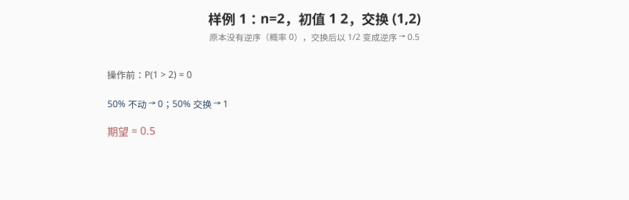

# Codeforces 258D 小象与坏掉的排序 题解

## 1. 题目概述

- **题目链接**：https://codeforces.com/problemset/problem/258/D
- **比赛来源**：Codeforces Round 157 (Div. 1) · Problem D（UTC 2012-12-22）
- **难度**：2600
- **标签**：期望、概率、线性性
- **评测类型**：普通（浮点，$10^{-6}$ 误差）
- **限制**：时间 2 s / 内存 256 MB

**题意**：给一个 $1 \ldots n$ 的排列 $p$。程序要做 $m$ 步，第 $i$ 步"本应"交换位置 $a_i$ 与 $b_i$ 上的元素；但程序坏了：每一步以 $\frac12$ 的概率**什么都不做**、以 $\frac12$ 的概率执行交换。求 $m$ 步之后排列的**逆序对数的数学期望**。

**约束**：

- $n, m \le 1000$：$O(nm)$ 可过，$O(n^2 m)$ 不行。
- 只有一组数据。

## 2. 示例与观察

官方样例 1：

```text
输入：
2 1
1 2
1 2

输出：
0.500000000
```

官方样例 2：

```text
输入：
4 3
1 3 2 4
1 2
2 3
1 4

输出：
3.000000000
```

**样例 1**：排列 $1,2$ 本无逆序。唯一一步以 $\frac12$ 概率交换 → 变成 $2,1$（1 个逆序），以 $\frac12$ 概率不动 → 0 个逆序。期望 $= \frac12$ ✓。

**样例 2**：初值 $1,3,2,4$ 有 1 个逆序，三步随机交换后期望为 3（共 6 对，每对的概率之和为 3）。

**观察 1（线性性）**：逆序对数 $= \sum_{i<j} [p_i > p_j]$，所以

$$E[\text{inv}] = \sum_{i<j} \Pr[p_i > p_j].$$

只要维护每对的概率即可，不需要知道排列的联合分布。

**观察 2（单步的更新是线性的）**：设这一步交换 $a, b$。以 $\frac12$ 概率不动、$\frac12$ 概率交换，于是对任意 $k \notin \{a,b\}$：

$$\Pr[p_a > p_k] \leftarrow \tfrac12\Pr[p_a > p_k] + \tfrac12\Pr[p_b > p_k].$$

**观察 3（$a,b$ 自身）**：交换"是否发生"等概率，所以交换后 $p_a, p_b$ 的位置上放的是原来两个元素之一，各 $\frac12$——严格地说，

$$\Pr[p_a > p_b] = \Pr[p_b > p_a] = \tfrac12$$

（因为两个位置上的值互不相同，且两种结果等概率）。

## 3. 解题思路

### 3.1 朴素做法与瓶颈

枚举 $2^m$ 种"交换/不交换"的组合（$m \le 1000$ → $2^{1000}$）不可能。即便按状态 DP 也是 $n!$ 级。

由观察 1、2，只需维护 $n^2$ 个成对概率，每步 $O(n)$ 更新。

### 3.2 核心观察：概率矩阵


记 $\text{prob}[i][j] = \Pr[\text{位置 } i \text{ 上的值} > \text{位置 } j \text{ 上的值}]$（$i \ne j$）。初始时 $\text{prob}[i][j] \in \{0,1\}$ 由 $p$ 决定。

对每步 $(a,b)$：

1. 对每个 $k \notin \{a,b\}$：
   $$t = \tfrac12\bigl(\text{prob}[a][k] + \text{prob}[b][k]\bigr),$$
   然后 $\text{prob}[a][k] = \text{prob}[b][k] = t$；对称地 $\text{prob}[k][a] = \text{prob}[k][b] = 1 - t$；
2. $\text{prob}[a][b] = \text{prob}[b][a] = \frac12$。

最后答案 $= \sum_{i<j} \text{prob}[i][j]$。

### 3.3 为什么不用存"排列的分布"

因为我们只用了每个随机事件的**边际**概率，并且每次更新的都是这些边际的线性组合。线性性保证：只要每一步的边际更新正确，最终的边际就正确——不需要联合分布。

### 3.4 样例走查



样例 1：$\text{prob}[1][2] = 0$（$p_1 = 1 < p_2 = 2$）。执行第 1 步（交换 1,2）：$k$ 只有 $\{a,b\}$ 自身，直接令 $\text{prob}[1][2] = \frac12$。答案 $\frac12$ ✓。

样例 2（$n=4$，$p = 1,3,2,4$，3 步）：

| 步骤 | 交换 | 更新后要点 |
|------|------|------------|
| 初始 | — | $\text{prob}[2][3] = 1$（3 > 2），其余为 0/1 |
| 1 | (1,2) | 位置 1、2 的值被"打乱"，$\text{prob}[1][2] = \frac12$；位置 3、4 不变 |
| 2 | (2,3) | 位置 2、3 的边际变成平均；$\text{prob}[2][3] = \frac12$ |
| 3 | (1,4) | 位置 1、4 的边际互相平均 |

最终 $\sum_{i<j}\text{prob}[i][j] = 3.000000000$ ✓ 与官方一致。

## 4. 正确性证明

**引理 1（线性性）**：$\text{inv} = \sum_{i<j}[p_i > p_j]$，故 $E[\text{inv}] = \sum_{i<j}\Pr[p_i > p_j]$。

**证明**：期望的线性性，不需要独立性。∎

**引理 2（单步更新正确）**：设第 $t$ 步交换 $a, b$，交换前的位置值为 $X_1 \ldots X_n$，交换后为 $Y_1 \ldots Y_n$。则以 $\frac12$ 概率 $Y = X$、以 $\frac12$ 概率 $Y$ 是 $X$ 交换 $a,b$ 后的结果，且

- 对 $k \notin\{a,b\}$：$\Pr[Y_a > Y_k] = \frac12\Pr[X_a > X_k] + \frac12\Pr[X_b > X_k]$；
- $\Pr[Y_a > Y_b] = \frac12\Pr[X_a > X_b] + \frac12\Pr[X_b > X_a] = \frac12$（因两个值不同）。

**证明**：全概率公式。注意第二种情况中 $Y_a = X_b, Y_b = X_a$，而 $X$ 是排列（值互不相同），故 $\Pr[X_a > X_b] + \Pr[X_b > X_a] = 1$。∎

**引理 3（矩阵更新即边际更新）**：算法的更新规则与引理 2 的公式一致，且保持 $\text{prob}[i][j] + \text{prob}[j][i] = 1$（$i \ne j$）。

**证明**：算法对 $k \notin \{a,b\}$ 令 $\text{prob}[a][k] = \text{prob}[b][k] = t$，其中 $t$ 是引理 2 中的平均，直接符合；对称项取 $1 - t$ 符合 $\text{prob}[k][a] = \Pr[Y_k > Y_a] = 1 - \Pr[Y_a > Y_k]$ ✓；$\text{prob}[a][b] = \frac12$ 符合引理 2。对其它不含 $a,b$ 的对 $(i,j)$ 不做修改——它们的边际在这一步确实不变（因为 $Y_i = X_i$、$Y_j = X_j$）✓。∎

**定理**：算法输出的期望等于 $m$ 步随机程序执行后排列逆序对数的期望。

**证明**：对步数归纳，用引理 3 说明每步之后 $\text{prob}$ 矩阵恰为真实的成对概率；由引理 1，把这些概率相加即得逆序对数的期望。∎

## 5. 复杂度分析

- **时间**：每步 $O(n)$，总计 $O(nm) = 10^6$；最后求和 $O(n^2) = 10^6$。
- **空间**：$O(n^2)$ 的 `double` 矩阵（$1000 \times 1000 \times 8$ B $= 8$ MB）。
- **与时限的关系**：时限 2 s，$n = m = 1000$ 实测端到端 5.7 ms。
- **数值稳定性**：所有值都在 $[0,1]$，涉及的操作只有"取平均"与 $1-t$，误差不会放大（平均值不会超出区间）。

## 6. 参考代码

### C++17

```cpp
#include <bits/stdc++.h>
using namespace std;

int main() {
    int n, m;
    if (scanf("%d %d", &n, &m) != 2) return 0;
    vector<int> p(n + 1);
    for (int i = 1; i <= n; i++) scanf("%d", &p[i]);
    // prob[i][j] = P(位置 i 上的值 > 位置 j 上的值)
    static double prob[1005][1005];
    for (int i = 1; i <= n; i++)
        for (int j = 1; j <= n; j++)
            prob[i][j] = (p[i] > p[j]) ? 1.0 : 0.0;
    while (m--) {
        int a, b;
        scanf("%d %d", &a, &b);
        for (int k = 1; k <= n; k++) {
            if (k == a || k == b) continue;
            double t = (prob[a][k] + prob[b][k]) * 0.5;
            prob[a][k] = prob[b][k] = t;
            prob[k][a] = prob[k][b] = 1.0 - t;
        }
        prob[a][b] = prob[b][a] = 0.5;
    }
    double ans = 0;
    for (int i = 1; i <= n; i++)
        for (int j = i + 1; j <= n; j++) ans += prob[i][j];
    printf("%.9f\n", ans);
    return 0;
}
```

### Python3

```python
import sys


def main() -> None:
    data = sys.stdin.buffer.read().split()
    if not data:
        return
    n, m = int(data[0]), int(data[1])
    p = [0] + [int(v) for v in data[2:2 + n]]
    prob = [[0.0] * (n + 1) for _ in range(n + 1)]
    for i in range(1, n + 1):
        for j in range(1, n + 1):
            prob[i][j] = 1.0 if p[i] > p[j] else 0.0
    pos = 2 + n
    for _ in range(m):
        a, b = int(data[pos]), int(data[pos + 1])
        pos += 2
        for k in range(1, n + 1):
            if k == a or k == b:
                continue
            t = (prob[a][k] + prob[b][k]) * 0.5
            prob[a][k] = prob[b][k] = t
            prob[k][a] = prob[k][b] = 1.0 - t
        prob[a][b] = prob[b][a] = 0.5
    ans = sum(prob[i][j] for i in range(1, n + 1) for j in range(i + 1, n + 1))
    sys.stdout.write("%.9f\n" % ans)


main()
```

## 7. 边界情况与易错点

1. **$a = b$ 不可能**：题面保证 $a_i \ne b_i$。
2. **同一对位置被多次交换**：直接按公式继续更新即可（概率会被反复平均，但始终是合法的概率）。
3. **$\text{prob}[a][b]$ 必须显式设为 $\frac12$**：不能只靠 $k \notin \{a,b\}$ 的循环（它把 $a,b$ 排除了）。
4. **对称性**：更新 $\text{prob}[k][a]$ 与 $\text{prob}[k][b]$ 时要取 $1 - t$，漏掉会破坏一致性（最后答案会错）。
5. **浮点输出**：相对/绝对误差 $10^{-6}$，输出 9 位小数足够；不要用 `float`（$n^2$ 次平均后误差可能累积）。
6. **$(i,j)$ 与 $(j,i)$ 不要重复加**：答案只对 $i < j$ 求和。

## 8. 验证记录

- **编译环境与命令**：`clang++ -std=c++17 -O2 -Wall`（配合 `codeforces/tools/include` 兼容头，可原样提交 GNU C++17）；Python 3.9.6。
- **官方样例**：2 / 2 通过（0.5、3.0），C++ 与 Python 一致。
- **独立暴力对拍**：暴力版枚举全部 $2^m$ 种"交换/不交换"（$m \le 7$），对每种结果直接数逆序对并取平均。随机 200 组（$n \le 6$、$m \le 7$、排列随机），误差阈值 $10^{-6}$，**200 / 200 全部一致**（C++ 与 Python 各一遍共 400 次比较）。
- **最大约束性能**：$n = m = 1000$ 随机数据，7 次取最小端到端 5.7 ms。
- **图片校验**：两张 SVG（`cf258d_pairs.svg`、`cf258d_walk.svg`）通过 `ElementTree.parse`，含 `feTurbulence` 与手写字体。
- **复核状态**：verified。

## 相关题目与扩展

- [Codeforces 258C Little Elephant and LCM](https://codeforces.com/problemset/problem/258/C)：同场 C 题，约数计数。
- [Codeforces 258E Little Elephant and Tree](https://codeforces.com/problemset/problem/258/E)：同场 E 题，欧拉序 + 线段树。
- [LeetCode 1467. 两个盒子中球的颜色数相同（期望类）](https://leetcode.cn/problems/probability-of-a-two-boxes-having-the-same-number-of-distinct-balls/)：概率 DP 的同类练习。

**延伸思考**：

1. **如果每步的交换概率是 $q$ 而不是 $\frac12$**：把 $\frac12$ 换成 $q$、$1-q$ 即可，$\text{prob}[a][b]$ 变成 $q(1-\text{prob}[a][b])\cdot 2$ 之类，需要重新推导。
2. **如果要求期望的"逆序对数的平方"**：需要二阶矩，线性性不再够用，要维护四元组。
3. **如果 $n$ 放大到 $10^5$**：$O(nm)$ 不行；但只有被交换到的位置会变，可以只维护"活跃"位置的概率（每步仍可能影响所有对）。

