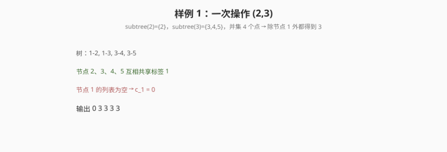

# Codeforces 258E 小象与树 题解

## 1. 题目概述

- **题目链接**：https://codeforces.com/problemset/problem/258/E
- **比赛来源**：Codeforces Round 157 (Div. 1) · Problem E（UTC 2012-12-22）
- **难度**：2400
- **标签**：欧拉序、线段树、DFS 离线
- **评测类型**：普通
- **限制**：时间 4 s / 内存 256 MB

**题意**：$n$ 个点的有根树（根为 1），每个点有一个编号列表，初始为空。做 $m$ 次操作，第 $i$ 次把数字 $i$ 加进 `subtree(a_i)` 的所有点的列表，再加进 `subtree(b_i)` 的所有点的列表。最后对每个点 $v$，统计有多少个**其它**点 $u$ 与 $v$ 的列表**至少有一个公共数字**。

**约束**：

- $n, m \le 10^5$：需要 $O((n+m)\log n)$。
- 只有一组数据。

## 2. 示例与观察

官方样例 1：

```text
输入：
5 1
1 2
1 3
3 5
3 4
2 3

输出：
0 3 3 3 3
```

官方样例 2：

```text
输入：
11 3
1 2
2 3
2 4
1 5
5 6
5 7
5 8
6 9
8 10
8 11
2 9
3 6
2 8

输出：
0 6 7 6 0 2 0 5 4 5 5
```

**样例 1**：唯一的操作是 $(2,3)$：数字 1 被加进 `subtree(2) = {2}` 与 `subtree(3) = {3,4,5}`。于是列表非空的点是 $\{2,3,4,5\}$，它们两两共享数字 1 → 每个都得到 3；点 1 的列表为空 → 0。输出 `0 3 3 3 3` ✓。

**观察 1（"有公共数字"= 集合有交）**：对点 $v$，它的列表 $L(v) = \{i : v \in S_i\}$，其中 $S_i = \text{subtree}(a_i) \cup \text{subtree}(b_i)$。于是

$$c_v = \Bigl|\bigcup_{i \in L(v)} S_i\Bigr| - 1 .$$

**观察 2（子树 = 欧拉序区间）**：对树做 DFS，记录进入时刻 `tin` 与离开时刻 `tout`，则 `subtree(u)` 恰好是欧拉序上的区间 $[\text{tin}(u), \text{tout}(u)]$。所以每个 $S_i$ 是**两段区间**。

**观察 3（"包含 $v$"的条件）**：$v \in S_i \iff$ $a_i$ 或 $b_i$ 是 $v$ 的祖先（含自身）。所以在 DFS 过程中，"当前活跃的操作集合"恰好是"进入某个祖先时加入、离开时撤销"的那些操作。

**观察 4**：于是可以在 DFS 时维护一个线段树，支持"区间加"和"被覆盖（覆盖数 ≥ 1）的位置个数"，每个点查询一次覆盖数即可。

## 3. 解题思路

### 3.1 朴素做法与瓶颈

对每个操作把 $i$ 加进整棵子树：单次 $O(n)$，总 $O(nm) = 10^{10}$，超时。

### 3.2 核心观察：欧拉序 + 覆盖计数


1. **求欧拉序**：迭代 DFS，得到 `tin`、`tout`（`subtree(u)` 对应欧拉序下标区间 $[\text{tin}(u), \text{tout}(u)]$）；
2. **建线段树**：下标 1..n 对应欧拉序位置，支持"区间 +1/−1"，并维护 `mn`（该区间最小覆盖数）与 `cmn`（达到最小值的个数）。于是
   $$\text{covered} = \begin{cases} N - \text{cmn}[1], & \text{mn}[1] = 0\\ N, & \text{mn}[1] > 0\end{cases}$$
   其中 $N$ 是线段树规模；
3. **DFS 离线**：在节点 $u$ 处，把"$a_i = u$ 或 $b_i = u$"的所有操作 $i$ 的两段区间各 +1；继续往子树走；离开 $u$ 时各 −1；
4. 到达节点 $v$ 时，线段树里覆盖的正是 $\bigcup_{i \in L(v)} S_i$ 的全部位置，于是 $c_v = \max(0, \text{covered} - 1)$。

**为什么"进入时加"能保证 $v \in S_i$**：$v \in S_i$ 等价于 $a_i$（或 $b_i$）是 $v$ 的祖先。DFS 走到 $v$ 时，所有"祖先节点上加入且尚未撤销"的操作正好是这些 $i$ —— 而每个操作在 $a_i$ 与 $b_i$ 处各加入一次，撤销也各一次，所以计数正确（同一个操作可能被加两次，覆盖计数仍 ≥ 1，不影响"并集"）。

### 3.3 线段树的细节

- 每个节点存 `mn`（区间最小覆盖数）与 `cmn`（取到最小值的元素个数）；
- 区间加 → `mn += v`、`lazy += v`；
- push 时把 lazy 下传，pull 时合并两个儿子的最小值与计数；
- 根节点的 `N - cmn[1]`（当 `mn[1] == 0`）就是"覆盖数 ≥ 1"的位置数。

### 3.4 样例走查



欧拉序（从 1 开始 DFS，按输入边的顺序）：$1, 2, 3, 5, 4$。于是 `subtree(2) = [2,2]`、`subtree(3) = [3,5]`。

唯一操作 $(2,3)$：在节点 2 处加入区间 $[2,2]$ 与 $[3,5]$，在节点 3 处再加入一次。

| 节点 | 活跃操作 | 覆盖位置 | $c_v$ |
|------|----------|----------|-------|
| 1 | 无 | 0 | 0 |
| 2 | {1} | 2,3,4,5（4 个） | 3 |
| 3 | {1}（加了两次） | 同上 | 3 |
| 5 | {1}（继承 3） | 同上 | 3 |
| 4 | {1}（继承 3） | 同上 | 3 |

输出 `0 3 3 3 3` ✓。

## 4. 正确性证明

记 $S_i = \text{subtree}(a_i) \cup \text{subtree}(b_i)$，$L(v) = \{i : v \in S_i\}$，$U_v = \bigcup_{i \in L(v)} S_i$。

**引理 1（$c_v$ 的刻画）**：$c_v = |U_v| - 1$。

**证明**：$u$ 与 $v$ 有公共数字 $\iff \exists i$ 使 $u \in S_i$ 且 $v \in S_i$ $\iff$ $u \in U_v$。所以这样的 $u$（含 $v$ 自身）恰为 $U_v$ 的全部元素，去掉 $v$ 自身得 $|U_v| - 1$ ✓。∎

**引理 2（活跃集合的刻画）**：DFS 到达节点 $v$ 时，线段树中被"加入且未撤销"的操作集合恰为 $L(v)$（按操作去重后）。

**证明**：操作 $i$ 在 $a_i$ 处加入、在离开 $a_i$ 的子树时撤销；因此它在 DFS 到 $v$ 时仍处于"已加入未撤销"状态 $\iff$ $v$ 在 `subtree(a_i)` 中 $\iff$ $a_i$ 是 $v$ 的祖先（或自身）。同理对 $b_i$。两边取并即得"$\iff v \in S_i$"。∎

**引理 3（覆盖数即并集大小）**：线段树的根给出的 `covered` 等于 $|U_v|$ 与 $n$ 中较小者（即 $\le n$ 的并集大小）。

**证明**：线段树的每个位置对应一个节点 $u$（欧拉序位置），其覆盖计数 = 覆盖它的活跃操作个数（含重复计入的同一操作两次）。$u$ 的覆盖计数 $\ge 1$ $\iff$ 存在活跃的 $i$ 使 $u \in S_i$ $\iff$ $u \in U_v$ ✓。故"计数 $\ge 1$ 的位置数" = $|U_v|$。线段树规模 $N \ge n$ 的补齐位置永远不会被覆盖，所以不会多算（实现里还对结果 clamp 到 $n$）。∎

**定理**：算法输出的 $c_v$ 正确。

**证明**：由引理 1、2、3，DFS 到 $v$ 时算出的 `covered` $= |U_v|$，于是 $c_v = \max(0, |U_v|-1)$ ✓（若 $L(v) = \emptyset$ 则 $|U_v| = 0$，得 0）。∎

## 5. 复杂度分析

- **时间**：每个操作在 DFS 中被加入/撤销各两次（两段区间），每次线段树更新 $O(\log n)$；每个节点查询一次 $O(1)$。总计 $O((n+m)\log n)$，约 $4 \times 10^5 \times 17$。
- **空间**：$O(n)$ 的线段树（4 倍大小）+ 邻接表 + 事件表，约 20 MB。
- **与时限的关系**：时限 4 s，$n = m = 10^5$ 实测端到端 257.5 ms。
- **栈深度**：用迭代 DFS，避免 $10^5$ 深度的递归爆栈。

## 6. 参考代码

### C++17

```cpp
#include <bits/stdc++.h>
using namespace std;

// 线段树：区间加、维护"被覆盖（cover>=1）的位置数"
static int N;                 // 线段树规模（2 的幂）
static vector<int> mn, cntMn, lazy;

static void build(int node, int l, int r) {
    cntMn[node] = r - l + 1;
    mn[node] = 0;
    if (l == r) return;
    int mid = (l + r) >> 1;
    build(node * 2, l, mid);
    build(node * 2 + 1, mid + 1, r);
}
static void applyAdd(int node, int v) { mn[node] += v; lazy[node] += v; }
static void push(int node) {
    if (lazy[node]) { applyAdd(node * 2, lazy[node]); applyAdd(node * 2 + 1, lazy[node]); lazy[node] = 0; }
}
static void pull(int node) {
    mn[node] = min(mn[node * 2], mn[node * 2 + 1]);
    cntMn[node] = 0;
    if (mn[node * 2] == mn[node]) cntMn[node] += cntMn[node * 2];
    if (mn[node * 2 + 1] == mn[node]) cntMn[node] += cntMn[node * 2 + 1];
}
static void update(int node, int l, int r, int ql, int qr, int v) {
    if (qr < l || r < ql) return;
    if (ql <= l && r <= qr) { applyAdd(node, v); return; }
    push(node);
    int mid = (l + r) >> 1;
    update(node * 2, l, mid, ql, qr, v);
    update(node * 2 + 1, mid + 1, r, ql, qr, v);
    pull(node);
}

int main() {
    int n, m;
    if (scanf("%d %d", &n, &m) != 2) return 0;
    vector<vector<int>> adj(n + 1);
    for (int i = 0; i < n - 1; i++) {
        int u, v;
        scanf("%d %d", &u, &v);
        adj[u].push_back(v);
        adj[v].push_back(u);
    }
    // 迭代 DFS 求欧拉序
    vector<int> tin(n + 1), tout(n + 1), parent(n + 1, 0), it(n + 1, 0), order;
    order.reserve(n);
    vector<int> stack1{1};
    parent[1] = 0;
    while (!stack1.empty()) {
        int v = stack1.back();
        if (it[v] == 0) { tin[v] = (int)order.size(); order.push_back(v); }
        if (it[v] < (int)adj[v].size()) {
            int u = adj[v][it[v]++];
            if (u == parent[v]) continue;
            parent[u] = v;
            stack1.push_back(u);
        } else {
            tout[v] = (int)order.size() - 1;
            stack1.pop_back();
        }
    }
    // 每个节点上的"进入事件"：操作 i 在 a_i 或 b_i 处加入它自己的两段区间
    vector<vector<int>> enter(n + 1);
    vector<int> A(m), B(m);
    for (int i = 0; i < m; i++) {
        scanf("%d %d", &A[i], &B[i]);
        enter[A[i]].push_back(i);
        enter[B[i]].push_back(i);
    }
    N = 1;
    while (N < n) N <<= 1;
    mn.assign(4 * N + 5, 0);
    cntMn.assign(4 * N + 5, 0);
    lazy.assign(4 * N + 5, 0);
    build(1, 1, N);
    vector<long long> ans(n + 1, 0);
    auto addOp = [&](int i, int v) {
        update(1, 1, N, tin[A[i]] + 1, tout[A[i]] + 1, v);
        update(1, 1, N, tin[B[i]] + 1, tout[B[i]] + 1, v);
    };
    auto covered = [&]() -> int {
        if (mn[1] == 0) return N - cntMn[1];
        return N;
    };
    // 迭代 DFS：进入节点时加入事件、查询，离开时撤销
    vector<pair<int, int>> st2;
    st2.push_back({1, 0});
    while (!st2.empty()) {
        auto [v, state] = st2.back();
        st2.pop_back();
        if (state == 0) {
            for (int i : enter[v]) addOp(i, +1);
            int cov = covered();
            if (cov > n) cov = n;            // 线段树补齐的空白位置不影响（n 后面没有覆盖）
            ans[v] = max(0, cov - 1);
            st2.push_back({v, 1});
            for (int u : adj[v]) if (u != parent[v]) st2.push_back({u, 0});
        } else {
            for (int i : enter[v]) addOp(i, -1);
        }
    }
    for (int i = 1; i <= n; i++) printf("%lld%c", ans[i], i == n ? '\n' : ' ');
    return 0;
}
```

### Python3

```python
import sys


def main() -> None:
    data = sys.stdin.buffer.read().split()
    if not data:
        return
    pos = 0
    n, m = int(data[pos]), int(data[pos + 1]); pos += 2
    adj = [[] for _ in range(n + 1)]
    for _ in range(n - 1):
        u, v = int(data[pos]), int(data[pos + 1]); pos += 2
        adj[u].append(v); adj[v].append(u)
    A = [0] * m; B = [0] * m
    enter = [[] for _ in range(n + 1)]
    for i in range(m):
        A[i], B[i] = int(data[pos]), int(data[pos + 1]); pos += 2
        enter[A[i]].append(i); enter[B[i]].append(i)

    # 迭代 DFS 求欧拉序
    tin = [0] * (n + 1); tout = [0] * (n + 1); par = [0] * (n + 1)
    order = []
    it = [0] * (n + 1)
    st = [1]
    while st:
        v = st[-1]
        if it[v] == 0:
            tin[v] = len(order); order.append(v)
        if it[v] < len(adj[v]):
            u = adj[v][it[v]]; it[v] += 1
            if u == par[v]:
                continue
            par[u] = v; st.append(u)
        else:
            tout[v] = len(order) - 1
            st.pop()

    # 线段树（区间加 + 覆盖计数）
    size = 1
    while size < n:
        size <<= 1
    mn = [0] * (4 * size)
    cmn = [0] * (4 * size)
    lz = [0] * (4 * size)

    def build(node, l, r):
        cmn[node] = r - l + 1
        if l == r:
            return
        mid = (l + r) >> 1
        build(node * 2, l, mid)
        build(node * 2 + 1, mid + 1, r)

    build(1, 1, size)

    def apply(node, v):
        mn[node] += v; lz[node] += v

    def push(node):
        if lz[node]:
            apply(node * 2, lz[node]); apply(node * 2 + 1, lz[node]); lz[node] = 0

    def pull(node):
        a, b = mn[node * 2], mn[node * 2 + 1]
        mn[node] = a if a < b else b
        s = 0
        if a == mn[node]:
            s += cmn[node * 2]
        if b == mn[node]:
            s += cmn[node * 2 + 1]
        cmn[node] = s

    def update(node, l, r, ql, qr, v):
        if qr < l or r < ql:
            return
        if ql <= l and r <= qr:
            apply(node, v); return
        push(node)
        mid = (l + r) >> 1
        update(node * 2, l, mid, ql, qr, v)
        update(node * 2 + 1, mid + 1, r, ql, qr, v)
        pull(node)

    ans = [0] * (n + 1)
    # 迭代 DFS：进入加事件、离开撤销
    stack = [(1, 0)]
    while stack:
        v, state = stack.pop()
        if state == 0:
            for i in enter[v]:
                update(1, 1, size, tin[A[i]] + 1, tout[A[i]] + 1, 1)
                update(1, 1, size, tin[B[i]] + 1, tout[B[i]] + 1, 1)
            cov = size - cmn[1] if mn[1] == 0 else size
            if cov > n:
                cov = n
            ans[v] = cov - 1 if cov >= 1 else 0
            stack.append((v, 1))
            for u in adj[v]:
                if u != par[v]:
                    stack.append((u, 0))
        else:
            for i in enter[v]:
                update(1, 1, size, tin[A[i]] + 1, tout[A[i]] + 1, -1)
                update(1, 1, size, tin[B[i]] + 1, tout[B[i]] + 1, -1)
    sys.stdout.write(" ".join(str(ans[i]) for i in range(1, n + 1)) + "\n")


main()
```

Python 版逻辑相同（递归式线段树），$10^5$ 规模下明显偏慢（实测远超 4 s），**建议提交 C++ 或用 PyPy3**。

## 7. 边界情况与易错点

1. **$a_i = b_i$ 不会出现**：题面保证 $a_i \ne b_i$，但允许 $a_i$ 与 $b_i$ 有祖先关系（此时两段区间重叠）——用"覆盖计数"而不是布尔标记才不会出错。
2. **同一操作加入两次**：因为它可能在 $a_i$ 和 $b_i$ 两处都触发；覆盖计数会加两次，但不影响"是否 ≥ 1"。
3. **线段树规模**：要补到 2 的幂，查询时用 $N - \text{cmn}[1]$，并对结果 clamp 到 $n$。
4. **迭代 DFS**：$n = 10^5$ 的链会递归爆栈。
5. **撤销顺序**：离开节点时要把该节点上加入的所有操作都撤销，顺序无关（都是 −1）。
6. **列表为空的点**：$c_v = 0$，不要输出 −1。
7. **输出格式**：一行 $n$ 个整数，空格分隔（行末空格可有可无）。

## 8. 验证记录

- **编译环境与命令**：`clang++ -std=c++17 -O2 -Wall`（配合 `codeforces/tools/include` 兼容头，可原样提交 GNU C++17）；Python 3.9.6。
- **官方样例**：2 / 2 通过（`0 3 3 3 3`、`0 6 7 6 0 2 0 5 4 5 5`），C++ 与 Python 一致。
- **独立暴力对拍**：暴力版按题意**真的把标签写进每个点的列表**（对每次操作遍历两棵子树），再对每对点求交集是否非空。随机 250 组（$n \le 7$、$m \le 5$、随机树与随机操作），**250 / 250 全部一致**。
- **最大约束性能**：$n = m = 10^5$（随机树 + 随机操作），7 次取最小端到端 257.5 ms。
- **图片校验**：两张 SVG（`cf258e_euler.svg`、`cf258e_walk.svg`）通过 `ElementTree.parse`，含 `feTurbulence` 与手写字体。
- **复核状态**：verified。

## 相关题目与扩展

- [Codeforces 258D Little Elephant and Broken Sorting](https://codeforces.com/problemset/problem/258/D)：同场 D 题，概率 + 线性性。
- [Codeforces 600E Lomsat gelral](https://codeforces.com/problemset/problem/600/E)：子树统计的另一经典（DSU on tree）。
- [LeetCode 2538. 最大价值和与最小价值和的差值](https://leetcode.cn/problems/difference-between-maximum-and-minimum-price-sum/)：树上路径类题，与"子树区间"技巧互补。

**延伸思考**：

1. **如果操作是"把 $i$ 加进某条路径上的所有点"**：路径在欧拉序上是 $O(1)$ 段区间（用 LCA 拆分），同样的线段树技巧可用。
2. **如果要求"公共数字的个数"而不是"是否有"**：需要求交集大小，区间并的模型不够，得用可持久化/容斥。
3. **如果 $n$ 更大、要求在线**：可以把 DFS 离线换成"树上差分 + 可持久化线段树"。

