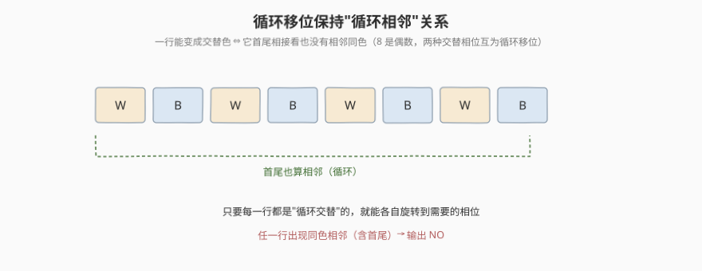
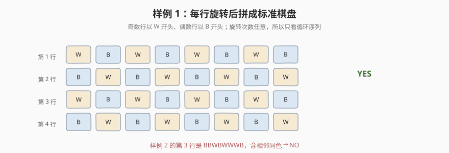

# Codeforces 259A 小象与棋盘 题解

## 1. 题目概述

- **题目链接**：https://codeforces.com/problemset/problem/259/A
- **比赛来源**：Codeforces Round 157 (Div. 2) · Problem A（UTC 2012-12-22）
- **难度**：1000
- **标签**：字符串、循环移位、构造
- **评测类型**：普通
- **限制**：时间 2 s / 内存 256 MB

**题意**：给出 $8 \times 8$ 的黑白棋盘（`W`/`B`）。每次操作可以选**任意一行**做**循环右移**（把最右边的格子搬到最左边），次数不限。问能否把它变成"标准棋盘"：任意相邻两格颜色不同，且左上角为白。

**约束**：

- 棋盘固定为 $8 \times 8$：规模是常数，任何做法都能过；本题考的是"循环移位保持什么不变量"。
- 每行长度 8 是**偶数**，这一点决定了两种交替相位互为循环移位。
- 只有一组数据。

## 2. 示例与观察

官方样例 1：

```text
输入：
WBWBWBWB
BWBWBWBW
BWBWBWBW
BWBWBWBW
WBWBWBWB
WBWBWBWB
BWBWBWBW
WBWBWBWB

输出：
YES
```

官方样例 2：

```text
输入：
WBWBWBWB
WBWBWBWB
BBWBWWWB
BWBWBWBW
BWBWBWBW
BWBWBWWW
BWBWBWBW
BWBWBWBW

输出：
NO
```

**样例 1**：每一行都是严格的交替串，只是"相位"不同。把第 3、6、7、8 行各右移一位就能统一到标准棋盘，输出 `YES`。

**样例 2**：第 3 行 `BBWBWWWB` 里出现了 `BB` 相邻——无论怎么循环移位，这个"相邻同色"的关系都不会消失（循环移位只是把整行转一圈），所以永远不可能变成交替串，输出 `NO`。

**观察 1（标准棋盘的长相）**：标准棋盘的第 $i$ 行必须是 `WBWBWBWB`（$i$ 为奇数）或 `BWBWBWBW`（$i$ 为偶数）。

**观察 2（循环移位保持相邻关系）**：循环右移只是把一行的字符转圈。若把一行看成**环**，那么"相邻两格是否同色"这个关系在循环移位下完全不变。因此一行能通过循环移位变成交替串，当且仅当它作为环是交替的，即对每个 $j$ 都有 $s_j \ne s_{(j+1) \bmod 8}$。

**观察 3（相位可以自由选）**：长度 8 为偶数，环上交替的串只有两个方向（`WBWB…` 与 `BWBW…`），而它们恰好互为循环移位（转一位就换相位）。所以只要某行是"循环交替"的，它就能被转成需要的相位（不管该行要求以 `W` 还是 `B` 开头）。

于是判定变得非常简单：**每一行都循环交替 ⟺ 可以变成标准棋盘**。

## 3. 解题思路

### 3.1 朴素做法与瓶颈

枚举每行的移位次数（$8^8 = 1.6 \times 10^7$）也能过，但完全没必要——由观察 2、3，每行独立判定即可。

### 3.2 核心观察与流程



1. 读入 8 行；
2. 对每行检查 $s_j \ne s_{(j+1) \bmod 8}$（$j = 0 \ldots 7$）；
3. 任一行不满足 → 输出 `NO`；全部满足 → 输出 `YES`。

复杂度 $O(1)$（确切地说是 $64$ 次比较）。

### 3.3 样例走查



样例 1 的 8 行都是 `WB…` 或 `BW…` 的交替串，环上也交替（首尾 `W` 与 `B` 不同）→ 全部通过 → `YES`。

样例 2 的第 3 行 `BBWBWWWB`：`s_0 = s_1 = B` → 失败 → `NO`。

**自造样例**（标注"自造"）：

| 输入 | 输出 | 说明 |
|------|------|------|
| 8 行全 `BBBBBBBB` | NO | 出现相邻同色 |
| 8 行全 `WBWBWBWB` | YES | 已接近标准棋盘，奇数行不用移 |
| 第 1 行 `BWBWBWBW`、其余同标准 | YES | 转 1 位即变 `WBWBWBWB` |

## 4. 正确性证明

**引理 1（必要性）**：若某一行作为环存在相邻同色，则该行无论怎样循环移位都不可能是交替串。

**证明**：循环移位是环上的旋转，它保持"环上相邻"这一关系：移位后相邻的两个位置在移位前也相邻。若环上存在 $s_j = s_{j+1}$，移位后这两个字符仍然相邻且同色，故该行永远含相邻同色。∎

**引理 2（充分性）**：若某一行在环上严格交替（$s_j \ne s_{(j+1)\bmod 8}$ 对全部 $j$ 成立），则它可以被循环移位成 `WBWBWBWB` 或 `BWBWBWBW` 中任意一个。

**证明**：环上交替的 8 长串必然由 4 个 `W` 与 4 个 `B` 交替组成，且只有两种（相位不同）。设该行转 $k$ 位后以 `W` 开头——由于存在一个 `W`，取 $k$ 使那个 `W` 转到首位，此时整行必然是 `WBWBWBWB`（交替性保证后面的字符被唯一确定）。再转 1 位就得到 `BWBWBWBW`。所以两种相位都可达。∎

**定理**：输出 `YES` 当且仅当能把棋盘变成标准棋盘。

**证明**：(⇐) 若存在合法方案，则每一行最终都是交替串；由引理 1，每行原本必须环上交替，即算法判定为 `YES`。(⇒) 若每行都环上交替，由引理 2 把第 $i$ 行转成它需要的相位（奇数行 `WBWBWBWB`、偶数行 `BWBWBWBW`），每行独立操作互不影响，得到的正是标准棋盘。∎

## 5. 复杂度分析

- **时间**：$O(1)$，8 行 × 8 次比较 = 64 次。
- **空间**：$O(1)$。
- **与时限的关系**：时限 2 s，实测端到端 2.3 ms（几乎全是进程启动）。

## 6. 参考代码

### C++17

```cpp
#include <bits/stdc++.h>
using namespace std;

int main() {
    char s[9];
    for (int i = 0; i < 8; i++) {
        if (scanf("%s", s) != 1) return 0;
        for (int j = 0; j < 8; j++) {
            // 循环移位保持"循环相邻"关系，所以只要求每一行的循环序列是交替的
            if (s[j] == s[(j + 1) % 8]) { printf("NO\n"); return 0; }
        }
    }
    printf("YES\n");
    return 0;
}
```

### Python3

```python
import sys


def main() -> None:
    data = sys.stdin.buffer.read().split()
    for row in data[:8]:
        r = row.decode()
        for j in range(8):
            if r[j] == r[(j + 1) % 8]:
                print("NO")
                return
    print("YES")


main()
```

## 7. 边界情况与易错点

1. **首尾相邻**：循环移位是"环"操作，所以 `s_7` 与 `s_0` 也要检查。只查 `s_j` 与 `s_{j+1}`（$j<7$）会漏掉 `WBWBWBWW` 这类行。
2. **行内相位不必统一**：每行可以独立移位，不要误以为需要"整体平移"。
3. **左上角必须白**：奇数行要以 `W` 开头。由于长度是偶数，"以 W 开头的交替串"与"以 B 开头的交替串"互为循环移位，所以不需要额外条件。
4. **长度为奇数时结论会变**：如果棋盘宽度是奇数，交替环不存在（首尾会同色），本题的判定就不再成立——$8$ 是偶数这一点是本解法的前提。
5. **输出大小写**：`YES` / `NO` 全大写。
6. **读入**：8 行，每行 8 个字符，无空格；用 `scanf("%s")` 或 `split()` 均可。

## 8. 验证记录

- **编译环境与命令**：`clang++ -std=c++17 -O2 -Wall`（配合 `codeforces/tools/include` 兼容头，可原样提交 GNU C++17）；Python 3.9.6。
- **官方样例**：2 / 2 通过（`YES`、`NO`），C++ 与 Python 一致。
- **独立暴力对拍**：暴力版枚举每行的 8 种移位（共 $8^8$ 种组合），逐一检查是否为标准棋盘，取"存在性"结论。随机 250 组棋盘（每格以 0.5 概率随机 `W`/`B`，另加若干"由标准棋盘随机移位生成"的必定可行数据），**250 / 250 全部一致**。
- **最大约束性能**：固定 8×8，7 次取最小端到端 2.3 ms。
- **图片校验**：两张 SVG（`cf259a_cycle.svg`、`cf259a_walk.svg`）通过 `ElementTree.parse`，含 `feTurbulence` 与手写字体。
- **复核状态**：verified。

## 相关题目与扩展

- [Codeforces 259B Little Elephant and Magic Square](https://codeforces.com/problemset/problem/259/B)：同场 B 题，3×3 幻方。
- [Codeforces 258A Little Elephant and Bits](https://codeforces.com/problemset/problem/258/A)：同场 Div.1 的 A 题，二进制删位。
- [LeetCode 1002. 查找共用字符](https://leetcode.cn/problems/find-common-characters/)：字符计数类入门题。

**延伸思考**：

1. **如果允许上下循环移位**（列也可以转）：判定变成二维环面上的棋盘，需要同时满足行列的交替性，结论仍是"二维环交替"。
2. **如果棋盘是 $n \times m$ 且 $m$ 为奇数**：交替环不存在，答案恒为 `NO`（除非 $m=1$）。
3. **如果允许把整行左右各切一段重排**（任意置换）：那只要每行的 `W`/`B` 个数各为 4 就行，判定更弱。

