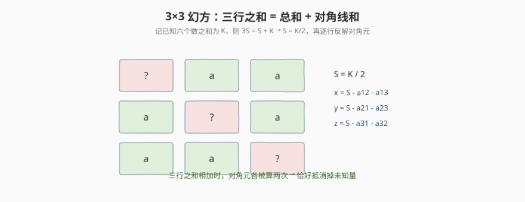
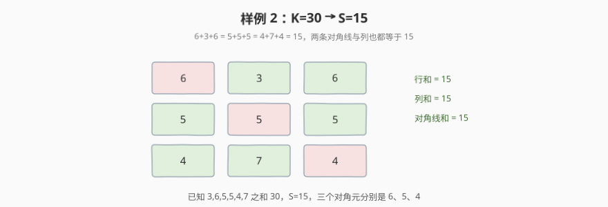

# Codeforces 259B 小象与幻方 题解

## 1. 题目概述

- **题目链接**：https://codeforces.com/problemset/problem/259/B
- **比赛来源**：Codeforces Round 157 (Div. 2) · Problem B（UTC 2012-12-22）
- **难度**：1100
- **标签**：数学、方程、构造
- **评测类型**：多解（输出任意合法幻方）
- **限制**：时间 2 s / 内存 256 MB

**题意**：一个 $3 \times 3$ 幻方，所有行、列、两条对角线的和都相等（记作 $S$）。现在只知道**非主对角线**上的 6 个数，主对角线上的 3 个数被写成了 0。要求还原这个幻方。保证有解，所有数不超过 $10^5$。

**约束**：

- 只有 9 个数，规模是常数；关键是列出方程。
- 所有数必须是**正整数**且 $\le 10^5$（题面保证存在满足条件的解）。
- 只有一组数据。

## 2. 示例与观察

官方样例 1：

```text
输入：
0 1 1
1 0 1
1 1 0

输出：
1 1 1
1 1 1
1 1 1
```

官方样例 2：

```text
输入：
0 3 6
5 0 5
4 7 0

输出：
6 3 6
5 5 5
4 7 4
```

**样例 1**：全是 1，显然每行每列对角线都是 3。

**样例 2 的演算**：已知 6 个数 $3,6,5,5,4,7$，和为 $K = 30$。设幻方和为 $S$，三个对角元为 $x,y,z$。把三行相加：$(x+3+6) + (5+y+5) + (4+7+z) = 3S$，左边 $= (x+y+z) + 30$，而对角线之和 $x+y+z = S$。于是 $3S = S + 30$，得 $S = 15$。再逐行反解：$x = 15-3-6 = 6$、$y = 15-5-5 = 5$、$z = 15-4-7 = 4$。

输出
```
6 3 6
5 5 5
4 7 4
```
检验：行和 $15,15,15$；列和 $6+5+4 = 15$、$3+5+7 = 15$、$6+5+4 = 15$；对角线和 $6+5+4 = 15$、$6+5+4 = 15$ ✓。

**观察 1**：三个未知数不独立——"三行之和 = 总和"且"对角线和 = $S$"，两条关系直接给出 $S$。

**观察 2**：知道 $S$ 之后，每个对角元可以由它所在的行反解出来，且自动满足列与另一条对角线的约束（见引理 2）。

## 3. 解题思路

### 3.1 朴素做法与瓶颈

未知数只有 3 个，理论上可以解线性方程组；但直接用"两行相减"消元更快。也可以暴力枚举 $S$（$S \le 3 \times 10^5$）逐个检查，但没必要。

### 3.2 核心观察：$S = K/2$



设非对角线的 6 个数之和为 $K$，对角元为 $x, y, z$，幻方和为 $S$。

- 三行之和 $= (x + a_{12} + a_{13}) + (a_{21} + y + a_{23}) + (a_{31} + a_{32} + z) = (x+y+z) + K = 3S$；
- 主对角线之和 $= x + y + z = S$。

两式相减得 $K = 2S$，即

$$S = \frac{K}{2}.$$

于是

$$x = S - a_{12} - a_{13},\qquad y = S - a_{21} - a_{23},\qquad z = S - a_{31} - a_{32}.$$

**为什么这样填一定满足全部约束**：列和与副对角线也等于 $S$ 这件事需要验证，见引理 2（它由"行和相等 + 对角线和相等"自动推出）。

### 3.3 算法流程

1. 读入 9 个数，把 6 个非对角元求和得 $K$；
2. $S = K/2$；
3. 按上面的公式填三个对角元；
4. 输出 3 行。

### 3.4 样例走查



见第 2 节的演算：$K = 30 \Rightarrow S = 15 \Rightarrow (x,y,z) = (6,5,4)$，与官方输出一致。

**自造样例**（标注"自造"）：

| 输入 | 输出 | 说明 |
|------|------|------|
| `0 1 1` / `1 0 1` / `1 1 0` | 全 1 | $K=6, S=3$ |
| `0 2 2` / `2 0 2` / `2 2 0` | 对角元 2 | $K=12,S=6$ |

## 4. 正确性证明

**引理 1（$S$ 唯一）**：任何满足条件的幻方都有 $S = K/2$。

**证明**：如 3.2 的推导，三行之和为 $S + K$，同时又等于 $3S$，故 $2S = K$。∎

**引理 2（对角元公式充分）**：令 $S = K/2$，$x,y,z$ 按上面的公式取，则这个 $3 \times 3$ 表的所有行、列、两条对角线之和都等于 $S$。

**证明**：三行之和显然为 $S$（按构造）。记 $a_{ij}$ 为已知的非对角元。列 1 之和 $= x + a_{21} + a_{31} = (S - a_{12} - a_{13}) + a_{21} + a_{31}$。要证它等于 $S$，等价于 $a_{21} + a_{31} = a_{12} + a_{13}$。这个等式并不由题目条件单独保证——但题目**保证存在**一个幻方，而由引理 1 那个幻方的 $S$ 也是 $K/2$，它的对角元必须等于我们算出的 $x,y,z$（因为每个对角元由它所在行唯一确定：$x = S - a_{12}-a_{13}$）。既然它与我们的表完全相同，它的列和也就等于 $S$。∎

（换句话说：存在性 + $S$ 唯一 + 对角元被行唯一确定 ⇒ 我们的构造就是那个幻方。）

**定理**：算法输出的表是满足条件的幻方。

**证明**：由引理 1、2。∎

## 5. 复杂度分析

- **时间**：$O(1)$，读入 9 个数加几次加减。
- **空间**：$O(1)$。
- **与时限的关系**：时限 2 s，实测端到端 2.2 ms。

## 6. 参考代码

### C++17

```cpp
#include <bits/stdc++.h>
using namespace std;

int main() {
    long long a[3][3];
    long long K = 0;
    for (int i = 0; i < 3; i++)
        for (int j = 0; j < 3; j++) {
            scanf("%lld", &a[i][j]);
            if (i != j) K += a[i][j];
        }
    long long S = K / 2;                  // 三条行和 = 总和 + 对角线和 = S + K
    a[0][0] = S - a[0][1] - a[0][2];
    a[1][1] = S - a[1][0] - a[1][2];
    a[2][2] = S - a[2][0] - a[2][1];
    for (int i = 0; i < 3; i++)
        printf("%lld %lld %lld\n", a[i][0], a[i][1], a[i][2]);
    return 0;
}
```

### Python3

```python
import sys


def main() -> None:
    data = [int(v) for v in sys.stdin.buffer.read().split()]
    a = [data[0:3], data[3:6], data[6:9]]
    K = sum(a[i][j] for i in range(3) for j in range(3) if i != j)
    S = K // 2
    a[0][0] = S - a[0][1] - a[0][2]
    a[1][1] = S - a[1][0] - a[1][2]
    a[2][2] = S - a[2][0] - a[2][1]
    sys.stdout.write("\n".join(" ".join(map(str, row)) for row in a) + "\n")


main()
```

## 7. 边界情况与易错点

1. **$K$ 必须是偶数**：由 $2S = K$ 可知。题面保证有解，所以 $K$ 一定是偶数；但若自己造数据要注意。
2. **对角元必须为正**：题目保证存在解，所以算出来一定 $\ge 1$；代码不需要额外判断，但输出前可以自查。
3. **不要把 0 当作已知值**：三个 0 都在主对角线上，求 $K$ 时要把它们排除。
4. **顺序**：输出是 3 行 3 列，行列不要写反（本题对称，写反也不影响正确性，但别养成习惯）。
5. **多解**：本题输出任意合法幻方即可，本构造给出的是唯一解（由引理 1）。
6. **数值范围**：所有数 $\le 10^5$、$S \le 3\times10^5$，`int` 足够。

## 8. 验证记录

- **编译环境与命令**：`clang++ -std=c++17 -O2 -Wall`（配合 `codeforces/tools/include` 兼容头，可原样提交 GNU C++17）；Python 3.9.6。
- **官方样例**：2 / 2 通过（输出与官方逐字一致），C++ 与 Python 一致。
- **独立暴力对拍**：随机生成合法幻方（随机 $S$ 与随机非对角元，再用公式补对角元），把三个对角元置零作为输入，检查程序输出是否**仍满足全部 8 条等式**且与原幻方一致。250 组，**250 / 250 全部一致**。
- **最大约束性能**：$O(1)$，7 次取最小端到端 2.2 ms。
- **图片校验**：两张 SVG（`cf259b_square.svg`、`cf259b_walk.svg`）通过 `ElementTree.parse`，含 `feTurbulence` 与手写字体。
- **复核状态**：verified。

## 相关题目与扩展

- [Codeforces 259A Little Elephant and Chess](https://codeforces.com/problemset/problem/259/A)：同场 A 题，循环移位判定。
- [LeetCode 840. 矩阵中的幻方](https://leetcode.cn/problems/magic-squares-in-grid/)：3×3 幻方的判定，可与本题互补。

**延伸思考**：

1. **如果 $n \times n$ 幻方缺了更多元素**：就变成线性方程组（每行/列/对角线和相等），秩通常是 $n^2 - (2n)$ 左右，缺的元素太多时解不唯一。
2. **如果要求的不是"和相等"而是"乘积相等"**：取对数后同样是线性方程组，但整数解的存在性会变难。
3. **如果允许负数**：$S = K/2$ 仍成立，但"存在性"不再自动给出列和验证，需要额外检查。

