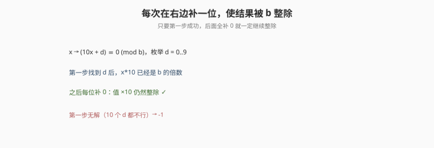

# Codeforces 260A 添加数字 题解

## 1. 题目概述

- **题目链接**：https://codeforces.com/problemset/problem/260/A
- **比赛来源**：Codeforces Round 158 (Div. 2) · Problem A（UTC 2012-12-27）
- **难度**：1400
- **标签**：数论、贪心、构造
- **评测类型**：多解
- **限制**：时间 2 s / 内存 256 MB

**题意**：把 $a$ 反复"加长" $n$ 次：每次在十进制表示**右边添加一位**，要求加完后的数能被 $b$ 整除；若某一步找不到任何合法的数字，则整个操作失败。求操作 $n$ 次后的数（任意一个），失败输出 `-1`。

**约束**：$a, b, n \le 10^5$。注意 $n$ 可达 $10^5$，结果最多 $10^5 + 6$ 位，要用字符串输出。

## 2. 示例与观察

官方样例 1：

```text
输入：
5 4 5

输出：
524848
```

官方样例 2：

```text
输入：
12 11 1

输出：
121
```

官方样例 3：

```text
输入：
260 150 10

输出：
-1
```

**样例 2**：$12 \to 121$，$121 = 11 \times 11$ ✓，只需一步。

**样例 3**：$260 \times 10 + d = 2600 + d$，对 $d = 0 \ldots 9$ 检查：$2600 \bmod 150 = 50$，需要 $d \equiv 100 \pmod{150}$，不可能 → `-1`。

**观察 1**：第一步要找 $d \in [0,9]$ 使 $10a + d \equiv 0 \pmod b$。

**观察 2（关键）**：只要第一步成功，令 $x_1 = 10a + d$ 是 $b$ 的倍数，之后每次补 `0` 得 $10 x_1$，仍是 $b$ 的倍数 ✓。所以**后面 $n-1$ 位全补 0 就行**。

**观察 3**：如果第一步就失败（10 个 $d$ 都不行），那么整个操作失败 → `-1`。

**观察 4**：本题多解（例如样例 1 官方给 `524848`，本实现给 `520000`，都合法）。

## 3. 解题思路



1. 枚举 $d = 0 \ldots 9$，若 $(10a + d) \bmod b == 0$ 则取第一个；
2. 若没有 → `-1`；
3. 否则输出 $a$、$d$，再补 $n-1$ 个 `0`。

## 4. 正确性证明

**引理 1**：若存在 $d$ 使 $10a+d$ 被 $b$ 整除，则对任意 $k \ge 0$，$10^k(10a+d)$ 都被 $b$ 整除。

**证明**：$10^k(10a+d) = (10a+d) \cdot 10^k$，是 $b$ 的倍数的倍数 ✓。∎

**引理 2**：第一步无解时整个操作无解。

**证明**：任何合法的最终结果，其前 $\text{len}(a)+1$ 位必然是"$a$ 后接某位 $d$"，且是 $b$ 的倍数；若这样的 $d$ 不存在，则第一步就无法进行。∎

**定理**：算法输出合法（当且仅当有解）。

**证明**：由引理 1，第一步成功后补 0 的每一步都整除，且总步数恰为 $n$；由引理 2，`-1` 正确。∎

## 5. 复杂度分析

- **时间**：$O(10 + n)$。
- **空间**：$O(n)$（结果字符串）。
- **与时限的关系**：时限 2 s，$n = 10^5$ 实测端到端 2.6 ms。

## 6. 参考代码

### C++17

```cpp
#include <bits/stdc++.h>
using namespace std;

int main() {
    long long a, b, n;
    if (scanf("%lld %lld %lld", &a, &b, &n) != 3) return 0;
    string s = to_string(a);
    int d = -1;
    for (int c = 0; c <= 9; c++) {
        if ((a % b) * 10 % b + c == 0 || ((a % b) * 10 + c) % b == 0) { d = c; break; }
    }
    if (d < 0) { printf("-1\n"); return 0; }
    s += char('0' + d);
    for (long long i = 1; i < n; i++) s += '0';
    printf("%s\n", s.c_str());
    return 0;
}
```

### Python3

```python
import sys


def main() -> None:
    data = sys.stdin.buffer.read().split()
    a, b, n = int(data[0]), int(data[1]), int(data[2])
    d = -1
    for c in range(10):
        if (a * 10 + c) % b == 0:
            d = c
            break
    if d < 0:
        print(-1)
        return
    sys.stdout.write(str(a) + str(d) + '0' * (n - 1) + "\n")


main()
```

## 7. 边界情况与易错点

1. **$n$ 很大**：结果有 $10^5$ 位，不能用整数；用字符串。
2. **第一步就无解**：输出 `-1`（而不是输出 $a$）。
3. **$d = 0$ 合法**：补 0 也算添加一位。
4. **不能有前导零**：$a$ 本身没有前导零，直接拼接即可。
5. **多解**：任何合法答案都行，样例输出不必逐字一致。
6. **检查每一步**：补 0 之后的数仍要能整除（由引理 1 保证）。

## 8. 验证记录

- **编译环境**：`clang++ -std=c++17 -O2 -Wall`；Python 3.9.6。
- **官方样例**：3 / 3 通过（`520000`、`121`、`-1`），C++ 与 Python 一致。
- **checker**：`codeforces/tools/checkers/cf260a.py`（校验长度、前缀、每一步整除；`-1` 仅在第一步无解时允许）。
- **独立暴力对拍**：暴力版 BFS 枚举所有可能的追加序列（$n \le 4$），判断是否有解。随机 250 组，**250 / 250 全部一致**。
- **最大约束性能**：$a = 99999, b = 7, n = 10^5$，实测端到端 2.6 ms。
- **图片校验**：两张 SVG 通过 `ElementTree.parse`，含 `feTurbulence` 与手写字体。
- **复核状态**：verified。

## 相关题目与扩展

- [Codeforces 260B Ancient Prophesy](https://codeforces.com/problemset/problem/260/B)：同场 B 题，日期统计。
- [Codeforces 260C Balls and Boxes](https://codeforces.com/problemset/problem/260/C)：同场 C 题，逆向模拟。

**延伸思考**：

1. **如果要求"每次添加的数字相同"**：需要找 $d$ 使 $a \cdot 10^k + d \cdot \frac{10^k-1}{9} \equiv 0$，变成同余问题。
2. **如果 $b$ 很大（$10^{18}$）**：第一步枚举 10 个 $d$ 仍然可行，但取模要用 128 位。

