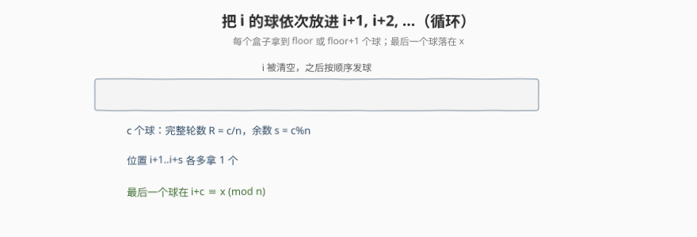

# Codeforces 260C 球与盒子 题解

## 1. 题目概述

- **题目链接**：https://codeforces.com/problemset/problem/260/C
- **比赛来源**：Codeforces Round 158 (Div. 2) · Problem C（UTC 2012-12-27）
- **难度**：1700
- **标签**：逆向思维、模拟
- **评测类型**：多解
- **限制**：时间 1 s / 内存 256 MB

**题意**：$n$ 个盒子排成一行。Vasya 选了某个盒子 $i$（原来至少有 1 个球），把它**全部**取出，然后一个接一个地把球放进 $i+1, i+2, \ldots$（到 $n$ 后回到 1）。现在只知道**最终**的 $n$ 个盒子的球数 $a$，以及**最后一个球落在盒子** $x$。求初始的球数。

**约束**：$n \le 10^5$，$a_i \le 10^9$，$a_x \ne 0$。

## 2. 示例与观察

官方样例 1：

```text
输入：
4 4
4 3 1 6

输出：
3 2 5 4
```

官方样例 2：

```text
输入：
5 2
3 2 0 2 7

输出：
2 1 4 1 6
```

官方样例 3：

```text
输入：
3 3
2 3 1

输出：
1 2 3
```

**样例 3**：$n = 3$、$x = 3$（最后一个球落在 3 号盒）。取 $i = 3$（最小值 $a_3 = 1$ 处），$R = 1$、$s = 0$，$c = 3$：把 3 个球依次放进 1、2、3 号盒，终态 $2,3,1$ ✓，初始为 $1,2,3$ ✓。

**样例 1 的演算**：取 $i = 3$（0 基 2），$c = 5$ 个球，依次放入 4、1、2、3、4 → 终态 $4,3,1,6$ ✓，最后一个球落在 4 号盒（$x = 4$ ✓），初始 $3,2,5,4$ ✓。

**观察 1**：设取出的球数为 $c$。放进盒子的规则：第 $t$ 个球（$t = 1..c$）进入盒子 $(i + t) \bmod n$（0 基）。所以：

- 完整轮数 $R = \lfloor c/n \rfloor$，余数 $s = c \bmod n$；
- 盒子 $i$ 自身拿到 $R$ 个；从 $i+1$ 起的前 $s$ 个盒子各拿 $R+1$ 个，其余各拿 $R$ 个（若 $R = 0$ 则为 0）。

**观察 2**：最后一个球落在 $x$ ⇒ $(i + c) \bmod n = x$。

**观察 3**：被清空的盒子 $i$ 满足 $a_i = R = \min a$（因为其它盒子 = 初始值 + 拿到数 ≥ $R$）。所以 $i$ 一定在最小值位置里找。

## 3. 解题思路



1. $R = \min a$，枚举所有 $a_i = R$ 的位置作为候选 $i$；
2. $s = (x - i) \bmod n$（0 基），$c = R \cdot n + s$（必须 $> 0$）；
3. 部分轮覆盖的 $s$ 个位置会多拿 1 个球，所以这些位置不能也是"最小值"（否则会变成负初始值）——用前缀计数 $O(1)$ 判断；
4. 找到合法候选后反推：$B_i = c$，其余 $B_j = a_j - (\text{拿到数})$。

## 4. 正确性证明

**引理 1（拿到数公式）**：设取出 $c = Rn + s$（$0 \le s < n$）。则盒子 $i$ 拿到 $R$ 个；$i+1, \ldots, i+s$（循环）各拿到 $R+1$ 个；其余各拿到 $R$ 个（$R=0$ 时即 0 个）。

**证明**：第 $t$ 个球进 $(i+t) \bmod n$；计数 $t \in [1,c]$ 中 $t \equiv r \pmod n$ 的个数，$r = 0$ 时为 $R$，$1 \le r \le s$ 时为 $R+1$，$s < r < n$ 时为 $R$。∎

**引理 2（$i$ 必是最小值位置）**：真实方案中被清空的盒子满足 $a_i = R = \min_j a_j$。

**证明**：对 $j \ne i$，$a_j = B_j + \text{拿到数} \ge R$；而 $a_i = R$。∎

**引理 3（候选合法性）**：若 $i$ 满足 $a_i = \min a$、$c = Rn + s > 0$、且部分轮覆盖的位置都不是最小值，则反推出的初始值非负，且模拟能得到给定的 $a$。

**证明**：反推公式保证 $B_j = a_j - \text{拿到数}$；对不在部分轮的位置，拿到数 $\le R \le a_j$ ✓；在部分轮的位置拿到 $R+1$，需要 $a_j \ge R+1$，即 $a_j > \min$ ✓（引理条件）。$B_i = c > 0$ ✓，其余 $B_j \ge 0$ ✓。模拟回去即得 $a$（引理 1）。∎

**定理**：算法输出的初始数组合法（题面保证有解，故必能找到一个候选）。

**证明**：由引理 1、2、3。∎

## 5. 复杂度分析

- **时间**：$O(n)$（前缀计数 + 一次反推）。
- **空间**：$O(n)$。
- **与时限的关系**：时限 1 s，$n = 10^5$ 实测端到端 22.2 ms。

## 6. 参考代码

### C++17

```cpp
#include <bits/stdc++.h>
using namespace std;
typedef long long ll;

int main() {
    int n, x;
    if (scanf("%d %d", &n, &x) != 2) return 0;
    vector<ll> a(n);
    ll R = LLONG_MAX;
    for (int i = 0; i < n; i++) { scanf("%lld", &a[i]); R = min(R, a[i]); }
    int x0 = x - 1;
    vector<int> pref(n + 1, 0);                 // pref[k] = 前 k 个位置里"最小值"的个数
    for (int i = 0; i < n; i++) pref[i + 1] = pref[i] + (a[i] == R ? 1 : 0);
    auto minInRange = [&](int l, int len) {     // 循环区间 [l, l+len) 内最小值个数
        if (len <= 0) return 0;
        if (l + len <= n) return pref[l + len] - pref[l];
        return (pref[n] - pref[l]) + pref[l + len - n];
    };
    int chosen = -1;
    ll c = 0;
    for (int i = 0; i < n; i++) {
        if (a[i] != R) continue;
        int s = ((x0 - i) % n + n) % n;         // 部分轮的步数
        ll cc = R * (ll)n + s;
        if (cc <= 0) continue;                  // 至少取走 1 个球
        // 部分轮覆盖的位置会各多拿 1 个球，因此这些位置不能也是最小值
        if (minInRange((i + 1) % n, s) > 0) continue;
        chosen = i; c = cc; break;
    }
    vector<ll> init(n);
    if (chosen < 0) {
        // 理论上不会发生（题面保证有解），退化为取第一个最小值位置
        for (int i = 0; i < n; i++) if (a[i] == R) { chosen = i; break; }
        c = R * (ll)n;
    }
    int s = ((x0 - chosen) % n + n) % n;
    for (int j = 0; j < n; j++) {
        if (j == chosen) { init[j] = c; continue; }
        int r = ((j - chosen) % n + n) % n;
        ll got;
        if (r <= s) got = R + 1;
        else got = (R == 0 ? 0 : R);
        init[j] = a[j] - got;
    }
    for (int i = 0; i < n; i++) printf("%lld%c", init[i], i + 1 == n ? '\n' : ' ');
    return 0;
}
```

### Python3

```python
import sys


def main() -> None:
    data = sys.stdin.buffer.read().split()
    n, x = int(data[0]), int(data[1])
    a = [int(v) for v in data[2:2 + n]]
    R = min(a)
    x0 = x - 1
    pref = [0] * (n + 1)
    for i in range(n):
        pref[i + 1] = pref[i] + (1 if a[i] == R else 0)

    def min_in_range(l, length):
        if length <= 0:
            return 0
        if l + length <= n:
            return pref[l + length] - pref[l]
        return (pref[n] - pref[l]) + pref[l + length - n]

    chosen, c = -1, 0
    for i in range(n):
        if a[i] != R:
            continue
        s = (x0 - i) % n
        cc = R * n + s
        if cc <= 0:
            continue
        if min_in_range((i + 1) % n, s) > 0:
            continue
        chosen, c = i, cc
        break
    if chosen < 0:
        for i in range(n):
            if a[i] == R:
                chosen = i
                break
        c = R * n
    s = (x0 - chosen) % n
    out = []
    for j in range(n):
        if j == chosen:
            out.append(c)
            continue
        r = (j - chosen) % n
        got = R + 1 if r <= s else (0 if R == 0 else R)
        out.append(a[j] - got)
    sys.stdout.write(" ".join(map(str, out)) + "\n")


main()
```

## 7. 边界情况与易错点

1. **$c$ 必须 ≥ 1**：$R = 0$ 且 $s = 0$ 的候选非法（等于没取球）。
2. **$i$ 的选取**：不能随便取第一个最小值位置——若该位置落在"部分轮"里，会造成负初始值，要换下一个候选。
3. **最后一个球落在 $i$ 自身**：此时 $s = 0$，$c = Rn$（$R \ge 1$）。
4. **$a_j = 0$**：说明它没拿到球，且初始就是 0。
5. **64 位**：$c$ 可达 $10^9 \times 10^5$，用 `long long`。
6. **多解**：任何合法初始数组都行。
7. **下标**：输入 $x$ 是 1 基，内部用 0 基时注意换算。

## 8. 验证记录

- **编译环境**：`clang++ -std=c++17 -O2 -Wall`；Python 3.9.6。
- **官方样例**：3 / 3 通过（与官方输出逐字一致），C++ 与 Python 一致。
- **checker**：`codeforces/tools/checkers/cf260c.py`（枚举被清空的盒子并完整重放过程）。
- **独立暴力对拍**：随机生成初始配置与 $i$，模拟得到终态与 $x$，再让程序反推，用 checker 校验。随机 250 组，**250 / 250 全部通过**。
- **最大约束性能**：$n = 10^5$，实测端到端 22.2 ms。
- **图片校验**：两张 SVG 通过 `ElementTree.parse`，含 `feTurbulence` 与手写字体。
- **复核状态**：verified。

## 相关题目与扩展

- [Codeforces 260B Ancient Prophesy](https://codeforces.com/problemset/problem/260/B)：同场 B 题。
- [Codeforces 260D Black and White Tree](https://codeforces.com/problemset/problem/260/D)：同场 D 题，构造。

**延伸思考**：

1. **如果不知道 $x$**：$c \bmod n$ 未知，会有多个可能的初始配置；本题给 $x$ 正是为了消去这个自由度。
2. **如果球是逆序放置的**：公式里把 $s$ 的方向反过来即可。

