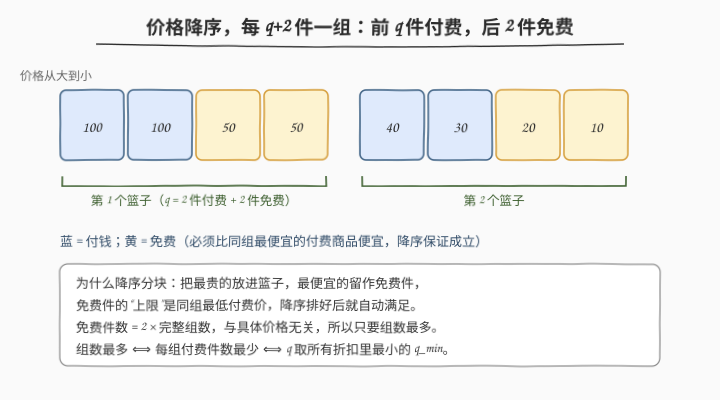
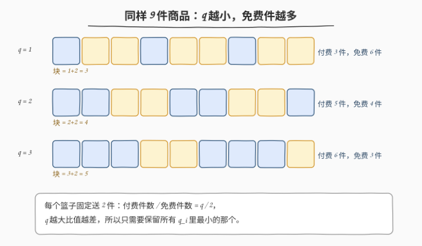

# Codeforces 261A Maxim and Discounts 题解

## 1. 题目概述

- **题目链接**：https://codeforces.com/problemset/problem/261/A
- **比赛来源**：Codeforces Round 160 (Div. 1) · Problem A（UTC 2013-01-13）
- **难度**：1400
- **标签**：贪心、排序
- **评测类型**：普通
- **限制**：时间 2 s / 内存 256 MB

**题意**：超市有 $m$ 种折扣，第 $i$ 种折扣规定：顾客拿一个篮子，往里面放**恰好** $q_i$ 件要买的商品，然后可以从超市**免费**再拿 $0$、$1$ 或 $2$ 件，条件是每件免费商品的价格都不超过篮子里最便宜的那件。折扣可以重复使用无限次，篮子管够。现在 Maxim 要买 $n$ 件给定价格的商品（每件都要买，不能多买也不能少买），求最小总花费。

**约束**：

- $1 \le m \le 10^5$，$1 \le q_i \le 10^5$：折扣种类极多，但只有 $q_i$ 的大小起作用，枚举「各种折扣各用几次」的组合数是爆炸的，必须先把 $m$ 压缩成一个数。
- $1 \le n \le 10^5$，$1 \le a_i \le 10^4$：商品件数 $10^5$，排序 $O(n \log n)$ 可过；答案最大 $10^5 \times 10^4 = 10^9$，虽然恰好落在 32 位有符号整数范围内，仍建议用 64 位防止中间累加溢出。
- 输入只有一组数据，没有测试组数 $t$，也不是读到 EOF。
- $q_i$ 可以大于 $n$（篮子装不满就凑不出折扣），这时该折扣直接作废。

## 2. 示例与观察

官方样例 1（输入 / 输出原样）：

```text
输入：
1
2
4
50 50 100 100

输出：
200
```

只有一种折扣 $q = 2$。把价格降序排成 $100, 100, 50, 50$：拿前两件 $100, 100$ 放进篮子，付 200，同时免费拿走 $50, 50$（它们都不超过组内最便宜的 100）。答案 200。

官方样例 2：

```text
输入：
2
2 3
5
50 50 50 50 50

输出：
150
```

两种折扣 $q = 2, 3$，取 $q_{\min} = 2$。降序后每 $2+2=4$ 件一组：前两件付钱（$50+50$），后两件免费；剩下第 5 件单独付钱。总花费 $150$。若改用 $q = 3$：一组 5 件全部付钱，花费 $250$，更差。

官方样例 3：

```text
输入：
1
1
7
1 1 1 1 1 1 1

输出：
3
```

$q = 1$：每 $3$ 件一组，付 $1$ 件、免费拿 $2$ 件。$7 = 3 + 3 + 1$，付费件数 $1 + 1 + 1 = 3$，每件价格 1，答案 3。

**观察**：三个样例都在重复同一件事——把价格降序排列后，按 $q_{\min} + 2$ 分组，每组前 $q_{\min}$ 件付钱、后两件（若还有）免费。下面把它变成严格的贪心。

## 3. 解题思路

### 3.1 朴素做法与瓶颈

最直接的想法是枚举所有折扣的用法：每种折扣用几次、每次装哪几件。篮子之间互不影响，但「装哪几件」是指数级的；即使先固定每种折扣的次数，再决定哪些商品免费，也要枚举 $2^n$ 个免费集合，$n = 10^5$ 时完全不可行。

另一个诱人的做法是「动态规划」：$f(S)$ 表示买完集合 $S$ 的最小花费，状态数 $2^n$，同样不行。

真正的突破口有两个：第一，**免费件数只和篮子个数有关**，和价格无关；第二，篮子里放哪几件商品，只影响「哪些商品被免费掉」，而为了省钱，当然希望**免费掉最便宜的**。

### 3.2 核心观察：折扣越「小」越好，免费件越便宜越好



**观察 1（一个篮子最多省 2 件的钱）**：一个篮子必须付 $q$ 件的钱，最多换来 2 件免费。也就是说，「每 2 件免费」的代价是 $q$ 件付费，比值是 $2/q$。

**观察 2（只用 $q_{\min}$）**：设所有折扣里最小的是 $q_{\min}$。任何用到 $q_i > q_{\min}$ 的方案，把一个 $q_i$ 篮子换成 $q_{\min}$ 篮子并不会让结果变差：篮子之间独立，而 $q_{\min}$ 篮子「占用的付费商品」更少、送出的免费名额一样多（都是至多 2 个）。因此最优解里可以只出现 $q_{\min}$。

**观察 3（降序分块是最优摆放）**：免费商品的价格必须不超过同篮子里最便宜的那件。把所有商品按价格**降序**排成 $a_1 \ge a_2 \ge \cdots \ge a_n$，按 $q+2$ 个一组切开（$q = q_{\min}$），每组前 $q$ 个付钱、后两个免费。这样免费掉的恰好是每一组里最便宜的两件，而它们确实不超过同组付费件的最低价。



上图把 $n = 9$ 时 $q = 1, 2, 3$ 三种折扣并排画出来：$q = 1$ 付费 3 件、$q = 2$ 付费 5 件、$q = 3$ 付费 6 件。$q$ 越小，免费名额越「便宜」，这就是观察 2 的直观来源。

### 3.3 算法流程

1. 读入 $m$ 与所有 $q_i$，取 $q \leftarrow \min_i q_i$；
2. 读入 $n$ 与所有 $a_i$，把 $a$ 按**降序**排序；
3. 令 $B \leftarrow q + 2$；
4. 令 $\text{ans} \leftarrow \sum_{i=0}^{n-1} \bigl[\,i \bmod B < q\,\bigr] \cdot a_i$；
5. 输出 ans。

第 4 步的含义很直白：在每一组 $B$ 件里，前 $q$ 件的位置付钱，后两个位置免费。若最后一组不足 $q+2$ 件，多出来的部分自然只有付费、没有免费（这正符合「剩余商品必须全部买下」）。

### 3.4 样例走查：`2 / 2 3 / 5 / 50 50 50 50 50`

$q = \min(2,3) = 2$，$B = 4$，降序后仍是五个 50。逐件判断：

| 下标 $i$ | $i \bmod 4$ | 是否付费 | 累计花费 |
|---|---|---|---|
| 0 | 0 | 付 | 50 |
| 1 | 1 | 付 | 100 |
| 2 | 2 | 免费 | 100 |
| 3 | 3 | 免费 | 100 |
| 4 | 0 | 付 | 150 |

输出 150，与样例一致。若误用 $q = 3$：$B = 5$，五个位置全在「前 3 件付费」之外？不，位置 0、1、2 付费、3、4 免费——但 $q = 3$ 时 $B = 5$，五个商品恰好一组，前 3 件付费，后 2 件免费，花费也是 150。这个样例无法区分两种折扣，真正区分它们的是样例 1 那种件数不整除的情形（$n = 4$、$q=2$ 时一组正好用满，免费 2 件；若 $q = 3$ 则一件都免费不了）。

## 4. 正确性证明

**引理 1**：固定使用折扣 $q$，任何合法方案的花费都不小于「降序排序后按 $q+2$ 分块、前 $q$ 件付费」方案的花费。

**证明**：设某合法方案用了 $b$ 个篮子，免费商品集合为 $F$，$|F| \le 2b$；付费集合 $P$，$|P| = n - |F| \ge n - 2b$。花销是 $\sum_{x \in P} a_x$，所以想让花销最小，就要让 $F$ 尽量大（$|F| = 2b$）且 $F$ 里的元素尽量便宜。而 $|F| \le 2b$ 且每个篮子要吃掉 $q$ 件付费商品，故 $n = |P| + |F| \ge qb + |F|$，即 $|F| \le n - qb$。两方面合起来 $|F| \le \min(2b,\ n - qb)$，取等时 $b = \lfloor n/(q+2) \rfloor$，此时 $|F| = 2\lfloor n/(q+2)\rfloor$（若最后一组不足 $q+2$ 件，则免费件数为 $\max(0, n \bmod (q+2) - q)$，分块写法自动处理）。在所有 $|F|$ 相同的方案里，花销最小当且仅当 $P$ 取最贵的 $|P|$ 件、$F$ 取最便宜的 $|F|$ 件；而降序分块方案恰好如此（每组后两个是全组最便宜的，也就落在全局最便宜的 $|F|$ 件里——因为每组的免费位置都是该组的最小元，逐组比较即得）。再由题面约束「免费件 ≤ 同组最低付费价」可知该方案合法。∎

**引理 2**：若 $q_{\min} = \min_i q_i$，则存在一个最优方案只使用折扣 $q_{\min}$。

**证明**：取任意最优方案，设它用了 $b_i$ 次折扣 $q_i$（$i = 1..m$），免费集合 $F$，$|F| \le 2\sum_i b_i$。把这个方案改成全部使用 $q_{\min}$：篮子数取 $b' = \sum_i b_i$（甚至更多也可以），总付费件数变为 $q_{\min} b' \le \sum_i q_i b_i$，即**付费件数不增**，而免费名额仍是至多 $2b'$，故免费集合的大小可以保持 $|F|$ 不变。于是存在一个只使用 $q_{\min}$、花费不超过原方案的方案。∎

**定理**：算法输出的 $\sum_{i \bmod (q_{\min}+2) < q_{\min}} a_i$（$a$ 降序）就是最小花费。

**证明**：引理 2 说明最优解可只用 $q_{\min}$；引理 1 说明在只用 $q_{\min}$ 的前提下，降序分块方案最优；算法正是这个方案，故它取得最小值。∎

## 5. 复杂度分析

- 时间：读取折扣 $O(m)$，取最小值 $O(m)$，排序 $O(n \log n)$，扫描求和 $O(n)$，合计 $O(m + n \log n)$。$m, n \le 10^5$，排序是绝对瓶颈，约 $1.7 \times 10^6$ 次比较，2 s 时限下余量极大。
- 空间：存 $q$ 只需一个最小值变量，存价格需要 $O(n)$ 的数组，其余是常数。

## 6. 参考代码

### C++17

```cpp
#include <bits/stdc++.h>
using namespace std;
int main() {
    int m; if (scanf("%d", &m) != 1) return 0;
    int qmin = INT_MAX;
    for (int i = 0; i < m; i++) { int q; scanf("%d", &q); qmin = min(qmin, q); }
    int n; scanf("%d", &n);
    vector<int> a(n);
    for (int i = 0; i < n; i++) scanf("%d", &a[i]);
    sort(a.begin(), a.end(), greater<int>());
    long long ans = 0;
    int block = qmin + 2;
    for (int i = 0; i < n; i++) if (i % block < qmin) ans += a[i];
    printf("%lld\n", ans);
    return 0;
}
```

### Python3

```python
import sys

def main():
    data = sys.stdin.read().split()
    p = 0
    m = int(data[p]); p += 1
    q = [int(x) for x in data[p:p + m]]; p += m
    n = int(data[p]); p += 1
    a = [int(x) for x in data[p:p + n]]
    qmin = min(q)
    a.sort(reverse=True)
    block = qmin + 2
    ans = sum(a[i] for i in range(n) if i % block < qmin)
    print(ans)

main()
```

Python 版本与 C++ 逻辑完全相同，$n = 10^5$ 时排序 + 一次线性扫描在 PyPy3 上约 0.1 s，CPython 也能通过。

## 7. 边界情况与易错点

1. **只取最小 $q$，不要只看第一种折扣**：样例 2 里 $q = 2, 3$，正确答案按 $q = 2$ 算；若误用第一个 $q_i$ 会得到 250。
2. **必须降序排序**：升序分块会把贵的商品当免费件、把便宜的当付费件，答案偏大。
3. **分块下标从 0 开始**：判据是 `i % (q+2) < q`，写成 `<= q` 会多付一件。
4. **$q_{\min} > n$ 的退化情形**：一件都进不了篮子，全部付费；公式里 `i % block < q` 恒成立（因为 $i < n < q$），自动正确。
5. **最后一组不满 $q+2$ 件**：例如 $n = 5$、$q = 2$，第二组只有 1 件，它落在 `i % 4 == 0 < 2`，付钱，没有免费名额，符合题意（免费只能来自篮子里的商品，篮子必须装满 $q$ 件）。
6. **累加用 64 位**：$n \cdot \max a_i = 10^9$ 虽在 `int` 范围内，但写成 `int ans` 后在别的题（更大的 $a_i$）上极易翻车，统一用 `long long`。
7. **多组数据不存在**：本题是单组输入，读到就返回，不要套 `while (cin >> m)`。

## 8. 验证记录

- 编译环境与命令：macOS + `clang++ -O2 -std=c++17 -I codeforces/tools/include`（本机无 GNU g++，`verify_solution.py` 自动用 clang++ 与兼容头）。
  - `python3 codeforces/tools/verify_solution.py codeforces/contests/0101-0203/261/A_Maxim与折扣.md`
- 官方样例：3 / 3 通过（C++ 与 Python 各跑一遍，输出 `200 / 150 / 3`）。
- 额外测试：独立暴力 `a_brute.cpp` 枚举全部 $2^n$ 个「哪些商品免费」的子集，对每个子集按价格降序扫描前缀条件判断可行性，取最小花费；与参考程序随机对拍 **400 组**（$m \le 3$、$q_i \le 5$、$n \le 8$、$a_i \le 20$），全部一致。
- 最大约束性能：$m = 1$、$q = 10^5$、$n = 10^5$、$a_i$ 随机取 $[1, 10^4]$，C++ 运行 **0.011 s**，远低于 2 s 时限的一半（1 s）。
- 复核状态：样例、随机对拍、性能三项均实测通过；正文代码与实测版本逐字一致。

## 相关题目与扩展

- [Codeforces 261B Maxim and Restaurant](https://codeforces.com/problemset/problem/261/B)：同一场的概率期望题，同样需要「排序 + 按位置分组」的思想。
- [Codeforces 1328C Ternary XOR](https://codeforces.com/problemset/problem/1328/C)：另一种「按位分组贪心」的入门题。
- [Codeforces 1400C Binary String Reconstruction](https://codeforces.com/problemset/problem/1400/C)：贪心 + 位置约束的组合。

**延伸思考**：

1. 若把「每个篮子最多免费 2 件」改成「最多免费 $k$ 件」，本题的分块大小变成 $q + k$，答案公式只改一个常数——想一想为什么交换论证仍然成立。
2. 若折扣之间不能混用（只能用一种折扣、但可以由你挑），答案是否还是「取 $q_{\min}$」？把样例 2 改成价格为 $100, 1, 1, 1, 1$ 再算一遍，体会「$q$ 小」和「组数多」在极端数据下的差异。
3. 若允许「把商品拆成两次买」（同一件商品只能享受一次折扣），模型会变成带权匹配，贪心不再显然——试着构造一个反例说明降序分块会失效。
