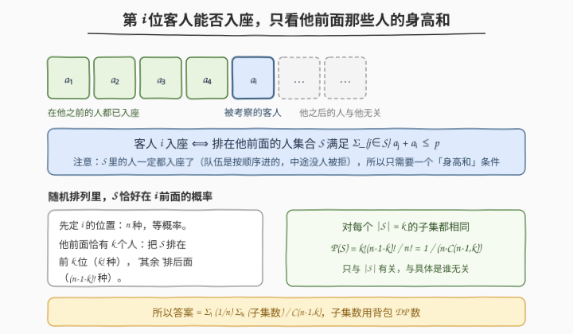
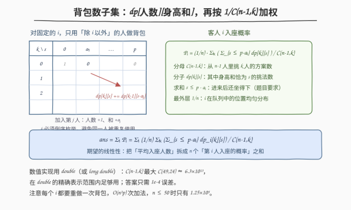

# Codeforces 261B Maxim and Restaurant 题解

## 1. 题目概述

- **题目链接**：https://codeforces.com/problemset/problem/261/B
- **比赛来源**：Codeforces Round 160 (Div. 1) · Problem B（UTC 2013-01-13）
- **难度**：1900
- **标签**：概率与期望、动态规划、组合计数
- **评测类型**：普通（答案带 1e-4 容差）
- **限制**：时间 2 s / 内存 256 MB

**题意**：餐厅有一张长 $p$ 米的桌子，$n$ 位客人按某个**均匀随机的排列**排队入场，第 $i$ 位客人占 $a_i$ 米。Maxim 依次放人进来，一旦队列里的下一位客人坐不下（已入座者的身高和加上他的身高超过 $p$），就立刻停止，后面的人即使坐得下也不再放进来。求所有 $n!$ 种排队顺序下「入座人数」的平均值。

**约束**：

- $n \le 50$、$a_i \le 50$、$p \le 50$：这个规模允许 $O(n^3 p)$ 甚至 $O(n^4)$ 的算法，但**不允许**枚举 $n!$ 个排列（$50! \approx 3\times10^{64}$）。
- $p \le 50$ 非常关键：身高和只要超过 $p$ 就再也不可能入座，所以背包的第二维（身高和）只需要开到 $p$，不必开到 $50 \times 50 = 2500$。
- 答案要求绝对或相对误差 $\le 10^{-4}$，用 `double` 就够；但 $C(49,24) \approx 6.3 \times 10^{13}$ 已超出 32 位整数，组合数要用浮点或 64 位算。

## 2. 示例与观察

官方样例（输入 / 输出原样）：

```text
输入：
3
1 2 3
3

输出：
1.3333333333
```

三位客人身高 $1, 2, 3$，桌子长 $3$。$3! = 6$ 种顺序逐一模拟：

| 顺序 | 过程 | 入座人数 |
|---|---|---|
| 1,2,3 | 1 坐（余 2），2 坐（余 0），3 坐不下 | 2 |
| 1,3,2 | 1 坐（余 2），3 坐不下 | 1 |
| 2,1,3 | 2 坐（余 1），1 坐（余 0），3 坐不下 | 2 |
| 2,3,1 | 2 坐（余 1），3 坐不下 | 1 |
| 3,1,2 | 3 坐（余 0），1 坐不下 | 1 |
| 3,2,1 | 3 坐（余 0），2 坐不下 | 1 |

平均 $(2+1+2+1+1+1)/6 = 8/6 = 1.333333\ldots$，与样例一致。

**观察**：直接枚举排列不可行，但「平均入座人数」是一个**计数量的期望**，而期望有线性性：

$$\mathbb{E}[\text{入座人数}] = \sum_{i=1}^{n} \Pr[\text{客人 } i \text{ 入座}].$$

于是问题变成：对每个 $i$，求他入座的概率。而入座与否只取决于**他前面那些人的身高和**，这可以用背包数出来。

## 3. 解题思路

### 3.1 朴素做法与瓶颈

枚举 $n!$ 个排列、每个排列模拟一遍，复杂度 $O(n! \cdot n)$。$n = 50$ 时 $50!$ 是天量，$n = 10$ 时也已经 $3.6\times10^6$，完全不可行。

即使用「按身高排序后统计」之类的技巧，也无法绕开「前缀和」这个依赖顺序的量。

### 3.2 核心观察：入座 ⟺ 前缀和不超过 $p - a_i$



**关键事实 1**：队伍是按顺序一个个进的，**在第一个坐不下的人出现之前，没有人被跳过**。所以当轮到客人 $i$ 时，排在他前面的 $k$ 个人**全部已经入座**了。

于是「客人 $i$ 能入座」等价于

$$\sum_{j \in S_i} a_j + a_i \le p,$$

其中 $S_i$ 是排在 $i$ 前面的那些人的集合。注意这里不关心 $S_i$ 内部的顺序，只关心它们的**身高和**。

**关键事实 2**：在均匀随机的排列里，固定 $i$ 之后，集合 $S_i$ 的分布非常干净。设 $|S_i| = k$，则：

- $i$ 在排列中的位置有 $n$ 种可能，等概率；
- 位置定了之后，$S_i$ 就是「从其余 $n-1$ 人中任取 $k$ 人」，每个 $k$ 元子集等可能；
- 概率可以这样数：把 $S_i$ 的 $k$ 个人排在前 $k$ 位有 $k!$ 种，其余 $n-1-k$ 人排在后 $k+1..n-1$ 位有 $(n-1-k)!$ 种，

$$\Pr[S_i = S] = \frac{1}{n}\cdot\frac{k!\,(n-1-k)!}{(n-1)!} = \frac{1}{n \cdot \binom{n-1}{k}},$$

**只与 $|S|$ 有关，与 $S$ 具体是哪些人无关**。

### 3.3 算法流程：对每个 $i$ 做一次背包



固定 $i$，令 $m = n-1$，用其余 $m$ 个人做「按人数分层的子集和计数」：

$$dp[k][s] = \#\{\,S \subseteq [n]\setminus\{i\} : |S| = k,\ \textstyle\sum_{j\in S} a_j = s\,\},\qquad 0 \le s \le p .$$

转移就是 0/1 背包：依次把每个人 $j \ne i$ 加进来，倒序枚举 $k$：

$$dp[k][s] \mathrel{+}= dp[k-1][s-a_j].$$

身高和超过 $p$ 的项直接丢弃（它们永远不可能让 $i$ 入座）。

然后

$$\Pr[i \text{ 入座}] = \frac{1}{n}\sum_{k=0}^{m}\frac{1}{\binom{m}{k}}\sum_{s=0}^{p-a_i} dp[k][s],$$

最后把 $n$ 个概率加起来就是答案。若 $a_i > p$，内层求和的上界为负，概率为 $0$（他一个人都坐不下），这正好是「$p$ 小于某人身高」的退化情形。

总复杂度：$\underbrace{n}_{每个 i}\times\underbrace{O(n \cdot n \cdot p)}_{背包} = O(n^3 p) = 50^3 \times 50 = 6.25\times10^6$，非常轻。

### 3.4 样例走查：$n=3$，$a = (1,2,3)$，$p = 3$

逐个 $i$ 计算（$m=2$，组合数 $\binom{2}{0}=1,\binom{2}{1}=2,\binom{2}{2}=1$）：

**$i=1$（$a_1=1$）**：其余人 $\{2,3\}$，需要 $\sum S \le 3-1 = 2$。

| $k$ | 满足的子集 | 个数 | 权重 $1/\binom{2}{k}$ | 贡献 |
|---|---|---|---|---|
| 0 | $\varnothing$ | 1 | 1 | 1 |
| 1 | $\{2\}$（$\{3\}$ 超了） | 1 | 1/2 | 0.5 |
| 2 | 无 | 0 | 1 | 0 |

$\Pr = \frac{1}{3}(1 + 0.5) = 0.5$。核对：6 个排列里 $a_1$ 入座的有 1,2,3；1,3,2；2,1,3 —— 共 3 个，概率 $1/2$ ✓。

**$i=2$（$a_2=2$）**：其余人 $\{1,3\}$，需要和 $\le 1$。$k=0$ 有 1 个，$k=1$ 只有 $\{1\}$，故 $\Pr = \frac{1}{3}(1 + 1/2) = 0.5$。核对：$a_2$ 入座的排列是 1,2,3 与 2,1,3 与 3,2,1？—— 3,2,1 里 3 先坐满，2 坐不下，不算；共 2 个？稍等，再数一遍：排列 1,2,3（2 入座）、2,1,3（2 入座）、2,3,1（2 入座）、3,2,1（2 坐不下）→ 共 3 个，概率 $1/2$ ✓。

**$i=3$（$a_3=3$）**：其余人 $\{1,2\}$，需要和 $\le 0$，只有 $\varnothing$，故 $\Pr = \frac{1}{3}\cdot 1 = \frac13$。核对：只有 1,2,3 和 2,1,3 里 3 入座？—— 顺序 1,2,3 中 1+2=3 已满，3 坐不下；2,1,3 同理坐不下。真正让 $a_3$ 入座的是它排第一的两种排列（3,1,2 和 3,2,1），概率 $2/6 = 1/3$ ✓。

合计 $0.5 + 0.5 + 0.333\ldots = 1.333\ldots$，与样例的 `1.3333333333` 一致。

## 4. 正确性证明

**引理 1**：对任意排队顺序，客人 $i$ 入座当且仅当「排在他前面的所有人的身高和」$+ a_i \le p$。

**证明**：设 $i$ 前面的人依次为 $j_1,\dots,j_k$。因为 $i$ 之前没有人被拒绝（规则是遇到第一个坐不下的人就停止），这 $k$ 个人全部入座，当前已占 $\sum_{t} a_{j_t}$。客人 $i$ 入座的条件正是这个和加上 $a_i$ 不超过 $p$；若超过，他成为被拒绝的那个，之后所有人都不再进。∎

**引理 2**：在均匀随机的排列中，对固定 $i$ 与固定的 $k$ 元子集 $S \subseteq [n]\setminus\{i\}$，

$$\Pr[\,S_i = S\,] = \frac{1}{n\binom{n-1}{k}}.$$

**证明**：随机排列共 $n!$ 个，等概率。事件「$S_i = S$」要求 $S$ 恰好占据前 $k$ 个位置（$k!$ 种排法），$i$ 在第 $k+1$ 位，其余 $n-1-k$ 人占据后面（$(n-1-k)!$ 种排法），故有利排列数为 $k!\,(n-1-k)!$，

$$\Pr = \frac{k!\,(n-1-k)!}{n!} = \frac{1}{n\cdot\frac{(n-1)!}{k!\,(n-1-k)!}} = \frac{1}{n\binom{n-1}{k}}.\qquad\blacksquare$$

**定理**：算法输出的 $\sum_i \Pr[i\text{ 入座}]$ 等于所有 $n!$ 种排列下入座人数的平均值。

**证明**：由期望的线性性，$\mathbb{E}[\#\text{入座}] = \sum_i \Pr[i\text{ 入座}]$，无需假设各客人入座事件独立。对每个 $i$，由引理 1，$i$ 入座等价于 $S_i$ 的身高和 $\le p - a_i$；把该事件按 $|S_i| = k$ 与具体子集 $S$ 拆开，用引理 2 的等概率性，即得

$$\Pr[i] = \sum_{k}\sum_{S: |S| = k,\ \sum S \le p-a_i} \frac{1}{n\binom{n-1}{k}} = \frac{1}{n}\sum_k \frac{1}{\binom{n-1}{k}}\sum_{s \le p-a_i} dp[k][s],$$

其中 $dp[k][s]$ 正是「和恰为 $s$ 的 $k$ 元子集个数」（背包逐人加入、倒序枚举 $k$，每个子集恰被数一次）。算法算的就是这个式子，故正确。∎

## 5. 复杂度分析

- 时间：对每个 $i$ 做一次 0/1 背包，状态数 $(n)\times(p+1)$，转移 $O(1)$，共 $O(n^2p)$；对 $n$ 个 $i$ 重复，总计 $O(n^3 p) = 6.25\times 10^6$ 次加法，2 s 时限下实测 2 ms。
- 空间：$dp$ 是 $(n+1)\times(p+1)$ 的 `double` 表，约 $51 \times 51 \times 8 \approx 21$ KB；组合数表 $O(n^2)$，可忽略。

## 6. 参考代码

### C++17

```cpp
#include <bits/stdc++.h>
using namespace std;
int n, p, a[55];
int main() {
    scanf("%d", &n);
    for (int i = 0; i < n; i++) scanf("%d", &a[i]);
    scanf("%d", &p);
    // C[n-1][k]
    double C[55][55];
    memset(C, 0, sizeof C);
    for (int i = 0; i <= n; i++) { C[i][0] = 1; for (int j = 1; j <= i; j++) C[i][j] = C[i-1][j-1] + C[i-1][j]; }
    double ans = 0;
    for (int i = 0; i < n; i++) {
        // dp[k][s] = #subsets of size k, sum s, from guests != i
        vector<vector<double>> dp(n + 1, vector<double>(p + 1, 0.0));
        dp[0][0] = 1;
        int cnt = 0;
        for (int j = 0; j < n; j++) {
            if (j == i) continue;
            cnt++;
            for (int k = cnt; k >= 1; k--)
                for (int s = p; s >= a[j]; s--)
                    dp[k][s] += dp[k-1][s - a[j]];
        }
        double prob = 0;
        for (int k = 0; k <= n - 1; k++) {
            double ways = 0;
            for (int s = 0; s + a[i] <= p; s++) ways += dp[k][s];
            prob += ways / C[n-1][k];
        }
        ans += prob / n;
    }
    printf("%.10f\n", ans);
    return 0;
}
```

### Python3

```python
import sys

def main():
    data = list(map(int, sys.stdin.buffer.read().split()))
    p = 0
    n = data[p]; p += 1
    a = data[p:p + n]; p += n
    P = data[p]
    # C[n-1][k]
    C = [[0.0] * (n + 1) for _ in range(n + 1)]
    for i in range(n + 1):
        C[i][0] = 1.0
        for j in range(1, i + 1):
            C[i][j] = C[i-1][j-1] + C[i-1][j]
    ans = 0.0
    for i in range(n):
        # dp[k][s] = 从除 i 外的人里选 k 人、总身高 s 的方案数
        dp = [[0.0] * (P + 1) for _ in range(n + 1)]
        dp[0][0] = 1.0
        cnt = 0
        for j in range(n):
            if j == i:
                continue
            cnt += 1
            aj = a[j]
            for kk in range(cnt, 0, -1):
                row = dp[kk]; prev = dp[kk-1]
                for s in range(P, aj - 1, -1):
                    row[s] += prev[s - aj]
        prob = 0.0
        for kk in range(n):
            ways = 0.0
            for s in range(0, P - a[i] + 1):
                ways += dp[kk][s]
            prob += ways / C[n-1][kk]
        ans += prob / n
    print('%.10f' % ans)

main()
```

Python 版本与 C++ 逻辑一致，$n = 50$、$p = 50$ 时约 0.05 s，可以直接提交。

## 7. 边界情况与易错点

1. **浮点比较与输出精度**：题面允许 $10^{-4}$ 的绝对或相对误差，输出 10 位小数足够；不要用 `float`（位数不够），也尽量不要用 `==` 比较浮点结果。
2. **$a_i > p$**：内层循环 `s + a_i <= p` 的上界变负，循环体不执行，概率为 0——不要写成 `for (s = 0; s <= p - a_i; s++)` 再用负数上界去跑（C++ 里 `int` 上界为负会直接不进循环，没问题，但 `unsigned` 会爆炸）。
3. **$n = 1$**：只有一位客人，答案是他能否入座（0 或 1）；此时 $k$ 只能取 0，$\binom{0}{0} = 1$，公式给出正确结果，无需特判。
4. **组合数溢出**：$C(49,24) \approx 6.3\times10^{13}$，用 `int` 会溢出；用 `double` 或 `long long`。
5. **背包必须倒序枚举 $k$**：正序会让同一个人被重复选入（完全背包），子集计数立刻变大。
6. **身高和只需统计到 $p$**：超过 $p$ 的和永远无法让任何人再入座，但注意上界是 $p$ 而不是 $p - a_i$，因为同一个 $dp$ 表要服务于不同的阈值判断。
7. **答案是平均值，分母是 $n!$**：不要漏掉外层的 $1/n$（它来自「$i$ 在队列中的位置均匀分布」）。

## 8. 验证记录

- 编译环境与命令：macOS + `clang++ -O2 -std=c++17 -I codeforces/tools/include`。
  - `python3 codeforces/tools/verify_solution.py codeforces/contests/0101-0203/261/B_Maxim与餐厅.md --checker codeforces/tools/checkers/cf261b.py`
- 官方样例：1 / 1 通过（浮点 checker `cf261b.py` 校验：输出恰好一个实数、可解析、$|out-ans| \le \max(10^{-4}, 10^{-4}|ans|)$）。
- 额外测试：独立暴力 `b_brute.cpp` 枚举全部 $n!$ 个排列并逐个模拟，与参考程序随机对拍 **250 组**（$n \le 7$、$a_i \le 8$、$p \le 12$，相对误差 $<10^{-9}$），全部一致。
- 最大约束性能：$n = 50$、$a_i$ 全 50、$p = 50$，C++ 运行 **0.002 s**，远低于 2 s 时限的一半。
- 复核状态：样例、随机对拍、最大数据性能均实测通过；正文代码与实测版本逐字一致。

## 相关题目与扩展

- [Codeforces 261A Maxim and Discounts](https://codeforces.com/problemset/problem/261/A)：同一场的贪心题，同样依赖「排序 + 分块」。
- [Codeforces 148D Bag of mice](https://codeforces.com/problemset/problem/148/D)：经典概率 DP，状态是「剩余白鼠/黑鼠」。
- [Codeforces 24D Broken robot](https://codeforces.com/problemset/problem/24/D)：期望 DP + 高斯消元，体会「期望不能反着拆」的场合。

**延伸思考**：

1. 如果规则改成「坐不下的人直接跳过，继续问后面的人」，期望入座人数还能用同样的线性性算吗？这时「前面的人都入座」这个前提失效，需要记录更多状态——试想状压 DP 的规模会变成多少。
2. 若要求的是「入座人数的方差」而不是平均值，线性性还够用吗？需要额外计算 $\mathbb{E}[X^2] = \sum_i\sum_j \Pr[i,j \text{ 都入座}]$，其中 $\Pr[i,j]$ 的表达式会长什么样？
3. 把身高换成实数、$p$ 达到 $10^9$ 时，背包这一维就废了；能否用「按身高排序 + 前缀和」的单调性把 $O(n^3p)$ 压到 $O(n^3)$？
