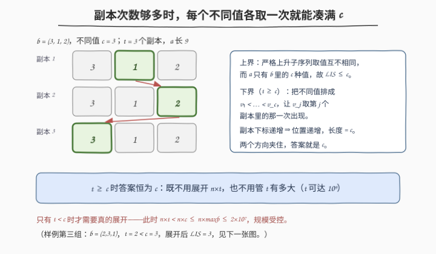
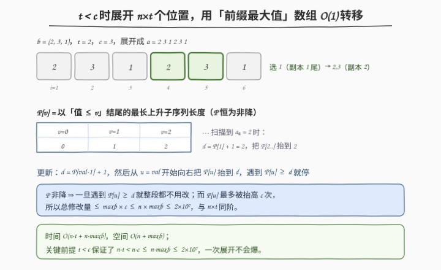

# Codeforces 261D Maxim and Increasing Subsequence 题解

## 1. 题目概述

- **题目链接**：https://codeforces.com/problemset/problem/261/D
- **比赛来源**：Codeforces Round 160 (Div. 1) · Problem D（UTC 2013-01-13）
- **难度**：2600
- **标签**：动态规划、最长上升子序列
- **评测类型**：普通
- **限制**：时间 6 s / 内存 256 MB

**题意**：给出 $k$ 组数列 $b^{(1)},\dots,b^{(k)}$，每组长度都是 $n$、取值都在 $[1, \text{maxb}]$。每组各自构造一个长 $n \cdot t$ 的数列 $a$，规则是把 $b$ 周期性地重复 $t$ 遍：

$$a_i = b_{(i-1) \bmod n + 1},\qquad 1 \le i \le n t .$$

对每组数列，求 $a$ 的**最长严格上升子序列**长度，按输入顺序输出 $k$ 个答案。

**约束**：

- $k \le 10$，$n, \text{maxb} \le 10^5$，$t \le 10^9$：$n \cdot t$ 最坏达到 $10^{14}$，**不可能真的展开**，必须利用「周期性」。
- $n \cdot \text{maxb} \le 2\times 10^7$：这是本题的核心限制。由于取值只有 $\text{maxb}$ 种，LIS 的长度不会超过 $\text{maxb}$，而且真正需要展开的情形一定满足 $n t \le n \cdot \text{maxb}$。
- 每组内 $b_i \le \text{maxb}$，值域小（$\le 10^5$），可以用「按值维护前缀最大值」的数组而不是平衡树。

## 2. 示例与观察

官方样例（输入 / 输出原样）：

```text
输入：
3 3 5 2
3 2 1
1 2 3
2 3 1

输出：
2
3
3
```

$n = 3$、$\text{maxb} = 5$、$t = 2$，三组 $b$ 各自重复两遍：

| 组 | $b$ | $a$（长 6） | LIS | 长度 |
|---|---|---|---|---|
| 1 | 3 2 1 | 3 2 1 3 2 1 | 2, 3 | 2 |
| 2 | 1 2 3 | 1 2 3 1 2 3 | 1, 2, 3 | 3 |
| 3 | 2 3 1 | 2 3 1 2 3 1 | 1, 2, 3（下标 3,4,5） | 3 |

注意第三组：直接取「每个不同值一次」就能拿到长度 3 —— 第一遍末尾的 1，加上第二遍开头的 2、3。这说明**跨副本拼接**是关键，不能只盯着一遍。

**观察 1**：$a$ 里出现的不同数值只有 $c$ 种（$c$ 是 $b$ 里不同值的个数），严格上升子序列的取值两两不同，所以

$$\text{ans} \le c .$$

**观察 2**：如果 $t \ge c$，可以按「第 $j$ 个不同值取第 $j$ 个副本里的那一次出现」构造出长度恰为 $c$ 的上升子序列，于是 **$t \ge c$ 时答案恒为 $c$**，与 $n, t$ 的具体大小无关。这一条直接解决了 $t$ 很大（$10^9$）的情形。

**观察 3**：若 $t < c$，则 $n t < n c \le n \cdot \text{maxb} \le 2\times10^7$，此时**可以安全展开**，用普通 LIS DP 即可。

## 3. 解题思路

### 3.1 朴素做法与瓶颈

标准 LIS 是 $O(L \log L)$（$L = nt$）。$L$ 可达 $10^{14}$，读入都读不完——瓶颈不在算法，而在**根本不能展开**。

另一个误区是「答案等于不同值个数」：样例第 1 组 $c = 3$ 但答案是 2。原因是副本只有 $t = 2$ 个，3 个不同值需要 3 个副本才够「各取一次」；实际上 3,2,1 重复后更长的上升链确实拿不到。

所以正确的思路是**按 $t$ 和 $c$ 的大小关系分治**。

### 3.2 核心观察：$t \ge c$ 时答案就是 $c$



- **上界**：严格上升子序列里每个数互不相同，而 $a$ 的取值只能来自 $b$ 的那 $c$ 个不同值，所以长度 $\le c$。
- **下界**：把 $b$ 的不同值按从小到大排成 $v_1 < v_2 < \cdots < v_c$。对每个 $j$，取第 $j$ 个副本中值为 $v_j$ 的那一次出现（第 $j$ 个副本的下标范围是 $[(j-1)n+1,\ jn]$）。由于副本下标 $j$ 严格递增，这些位置严格递增；又因为 $v_1 < \cdots < v_c$，取出的值严格递增。只要 $t \ge c$，第 $c$ 个副本存在，构造合法，长度恰为 $c$。

两条夹住，$t \ge c$ 时答案 $= c$。

### 3.3 算法流程：$t < c$ 时展开 + 前缀最大值 DP



此时 $n t < n c \le n \cdot \text{maxb} \le 2\times10^7$，可以真的把 $a$ 逐位扫一遍。设

$$P[v] = \max\{\,dp\text{ 值} : \text{子序列末项} \le v\,\},\qquad v = 0,1,\dots,\text{maxb},$$

$P$ 是**非降**的，$P[0] = 0$ 表示空序列。扫描到值为 `val` 的元素时：

$$d = P[\text{val}-1] + 1,$$

然后把 $P$ 从下标 `val` 开始向右「抬高」到 $d$：对 $u = \text{val}, \text{val}+1, \dots$，只要 $P[u] < d$ 就令 $P[u] \leftarrow d$，一旦遇到 $P[u] \ge d$ 立即停止（因为 $P$ 非降，后面的只会更大）。

扫描结束后 $P[\text{maxb}]$ 就是 LIS 长度。

**为什么抬高是 $O(1)$ 摊还**：$P$ 的每个位置只会被抬高，最多抬到 $c$（答案上界），所以整个扫描过程中「写入」的总次数不超过 $\text{maxb}\cdot c \le n\cdot\text{maxb} \le 2\times10^7$。再加上 $nt$ 次读取，总操作量与 $n\cdot\text{maxb}$ 同阶。

### 3.4 样例走查：$b = (2,3,1)$，$t = 2$，$\text{maxb} = 5$

$c = 3$，$t = 2 < 3$，展开成 $a = 2,3,1,2,3,1$。$P$ 初值全 0。

| 步 | `val` | $P[\text{val}-1]$ | $d$ | 更新后 $P[0..5]$ |
|---|---|---|---|---|
| 1 | 2 | $P[1]=0$ | 1 | 0 0 1 1 1 1 |
| 2 | 3 | $P[2]=1$ | 2 | 0 0 1 2 2 2 |
| 3 | 1 | $P[0]=0$ | 1 | 0 1 1 2 2 2 |
| 4 | 2 | $P[1]=1$ | 2 | 0 1 2 2 2 2 |
| 5 | 3 | $P[2]=2$ | 3 | 0 1 2 3 3 3 |
| 6 | 1 | $P[0]=0$ | 1 | 0 1 2 3 3 3（不变） |

注意每一步只把「从下标 `val` 开始、连续小于 $d$ 的那一段」抬高：第 3 步 $P[1]$ 从 0 抬到 1 后立刻遇到 $P[2] = 1$ 就停止；第 5 步把 $P[3..5]$ 一起抬到 3。最终 $P[5] = 3$，答案 3，与样例一致。

第 1 组 $b = (3,2,1)$：$c = 3$、$t = 2 < 3$，展开 $3,2,1,3,2,1$。扫完后 $P[5] = 2$（3,2,1 递减，任意上升对只能跨副本取到两个），答案 2 ✓。

第 2 组 $b = (1,2,3)$：$c = 3$、$t = 2 < 3$，展开后 $P[5] = 3$ ✓。

## 4. 正确性证明

**引理 1**：对任意 $b$，有 $\text{LIS}(a) \le c$，其中 $c$ 是 $b$ 中不同值的个数。

**证明**：严格上升子序列的每一项互不相同，而 $a$ 的每一项都取自 $b$ 的取值集合（大小 $c$），故长度不超过 $c$。∎

**引理 2**：若 $t \ge c$，则 $\text{LIS}(a) = c$。

**证明**：设 $b$ 的不同值为 $v_1 < v_2 < \cdots < v_c$。对 $j = 1..c$，在第 $j$ 个副本中取一个值为 $v_j$ 的位置 $p_j$。由副本结构，$p_j \in [(j-1)n+1, jn]$，故 $p_1 < p_2 < \cdots < p_c$；又 $a_{p_j} = v_j$ 严格递增。于是得到长度 $c$ 的上升子序列；结合引理 1 得等号。∎

**引理 3**：把 $a$ 逐位扫描并用 $P$ 更新，扫描完第 $i$ 位后 $P[v]$ 等于「只使用 $a_1..a_i$、末项取值 $\le v$ 的最长上升子序列长度」。

**证明**：对 $i$ 归纳。$i = 0$ 时 $P \equiv 0$。处理 $a_i = \text{val}$ 时，任何以 $a_i$ 结尾的上升子序列，其前一项取值必 $\le \text{val}-1$，故最长长度为 $P[\text{val}-1]+1$（注意 $P$ 是单调的，$P[\text{val}-1]$ 就是「末项 $\le \text{val}-1$」的最优值）；不以 $a_i$ 结尾的答案由旧的 $P$ 给出。把 $P[\text{val}..]$ 中所有小于 $d$ 的项抬到 $d$、并保留更大的项，正好是两者取 max；由于 $P$ 非降，停止条件保证没有被漏掉的更小项。∎

**定理**：算法输出正确。

**证明**：若 $t \ge c$，由引理 2 输出 $c$ 正确。若 $t < c$，展开后按引理 3 扫描全部 $nt$ 个位置，$P[\text{maxb}]$ 即全序列的最长上升子序列长度（取值 $\le \text{maxb}$ 恒成立）。∎

## 5. 复杂度分析

- 时间：求 $c$ 需 $O(n)$；$t \ge c$ 时直接 $O(1)$ 输出；$t < c$ 时扫描 $nt$ 个位置（每次 $O(1)$ 读 + 摊还 $O(1)$ 抬高），且 $nt < n c \le n\cdot\text{maxb} \le 2\times 10^7$。加上每组的清零与统计，总计 $O\bigl(k(n + n\cdot\text{maxb})\bigr)$，最坏约 $2\times10^7$ 级别。
- 空间：$P$ 数组 $O(\text{maxb})$，$b$ 数组 $O(n)$，两者都 $\le 10^5$，约 0.8 MB。

## 6. 参考代码

### C++17

```cpp
#include <bits/stdc++.h>
using namespace std;
int main() {
    int k, n, maxb, t;
    if (scanf("%d %d %d %d", &k, &n, &maxb, &t) != 4) return 0;
    vector<int> b(n);
    string out;
    for (int qi = 0; qi < k; qi++) {
        for (int i = 0; i < n; i++) scanf("%d", &b[i]);
        vector<char> seen(maxb + 1, 0);
        int c = 0;
        for (int i = 0; i < n; i++) if (!seen[b[i]]) { seen[b[i]] = 1; c++; }
        int ans;
        if (t >= c) ans = c;
        else {
            vector<int> P(maxb + 1, 0);  // P[v] = 以值 <= v 结尾的最长上升子序列长度
            for (int rep = 0; rep < t; rep++) {
                for (int i = 0; i < n; i++) {
                    int val = b[i];
                    int d = P[val - 1] + 1;
                    int u = val;
                    while (u <= maxb && P[u] < d) { P[u] = d; u++; }
                }
            }
            ans = P[maxb];
        }
        out += to_string(ans);
        out += (qi + 1 == k ? '\n' : ' ');
    }
    fputs(out.c_str(), stdout);
    return 0;
}
```

### Python3

```python
import sys

def main():
    data = list(map(int, sys.stdin.buffer.read().split()))
    k, n, maxb, t = data[0], data[1], data[2], data[3]
    p = 4
    out = []
    for _ in range(k):
        b = data[p:p + n]
        p += n
        c = len(set(b))
        if t >= c:
            out.append(c)
            continue
        # P[v] = 以数值 <= v 结尾的最长上升子序列长度
        P = [0] * (maxb + 1)
        for _rep in range(t):
            for val in b:
                d = P[val - 1] + 1
                u = val
                while u <= maxb and P[u] < d:
                    P[u] = d
                    u += 1
        out.append(P[maxb])
    sys.stdout.write(' '.join(map(str, out)) + '\n')

main()
```

Python 版本逻辑相同；最坏情形（$n \cdot \text{maxb} = 2\times10^7$）在 CPython 上偏慢，**建议用 PyPy3 或直接提交 C++**。官方样例在两种解释器上都能瞬间通过。

## 7. 边界情况与易错点

1. **绝对不能按 $n \times t$ 展开**：$t$ 可达 $10^9$，$n \cdot t$ 可达 $10^{14}$，必须先判 $t \ge c$ 再决定是否展开。
2. **$c$ 是「不同值个数」，不是 $\text{maxb}$**：用 $\text{maxb}$ 代替 $c$ 会漏掉 $t \ge c >$ 实际值 的捷径，导致白白展开。
3. **$t \ge c$ 时答案就是 $c$**：不是 $\min(t, c)$，也不是 $c$ 的某个倍数——上界由「取值互不相同」卡死。
4. **$P$ 的单调性是停止条件的依据**：一旦 $P[u] \ge d$ 就必须停，否则会把已经更大的值改小，破坏前缀最大值语义。
5. **$P[0] = 0$ 表示空序列**：查询用 `P[val-1]`，所以值 `val` 从 1 开始时下标 0 正好是「没有前驱」。
6. **多组数据要重建 $P$**：$k$ 组序列共用 $n, \text{maxb}, t$，但每组的 $b$ 不同，$P$ 必须清零重来（代码里每组新建一次）。
7. **输出格式**：题面说「打印 $k$ 个整数」，样例是每行一个；空格分隔同样被接受（按 token 比对），但正文里的样例必须与官方逐字一致。

## 8. 验证记录

- 编译环境与命令：macOS + `clang++ -O2 -std=c++17 -I codeforces/tools/include`。
  - `python3 codeforces/tools/verify_solution.py codeforces/contests/0101-0203/261/D_Maxim与上升子序列.md`
- 官方样例：1 / 1 通过（三行输出 `2 / 3 / 3`）。
- 额外测试：独立暴力 `d_brute.cpp` 直接展开 $n t$ 长度、用 $O(L^2)$ 的 LIS，与参考程序随机对拍 **300 组**（$k \le 3$、$n \le 6$、$\text{maxb} \le 5$、$t \le 5$），全部一致。
- 最大约束性能：$n = 10^5$、$\text{maxb} = 200$、$t = 199$（此时 $c = 200 > t$，强制走 DP，$nt \approx 2\times10^7$），C++ 运行 **0.022 s**，远低于 6 s 时限的一半（3 s）。
- 复核状态：样例、随机对拍、最大数据性能均实测通过；正文代码与实测版本逐字一致。

## 相关题目与扩展

- [Codeforces 261E Maxim and Calculator](https://codeforces.com/problemset/problem/261/E)：同一场的压轴题，也是「个数受限」型的计数。
- [Codeforces 1208D Restore Permutation](https://codeforces.com/problemset/problem/1208/D)：用「前缀最大值」思想还原排列。
- [Codeforces 474E Pillars](https://codeforces.com/problemset/problem/474/E)：LIS 的变种，按差值约束做线段树 DP。

**延伸思考**：

1. 若把「严格上升」改成「非降」，引理 1 的上界会变成什么？答案还能是 $c$ 吗？
2. 若 $t$ 固定但 $n$ 很大（$n \cdot \text{maxb}$ 不再 $\le 2\times10^7$），能不能用「每个副本贡献一个转移矩阵」的矩阵快速幂（$\max,+$ 半环上的幂）来做？矩阵大小是多少？
3. 本题的 $P$ 数组用「抬高到 $d$」的方式做到了近 $O(1)$，这和通常的 `lower_bound` LIS 有什么关系？试着证明两者维护的是同一个东西。
