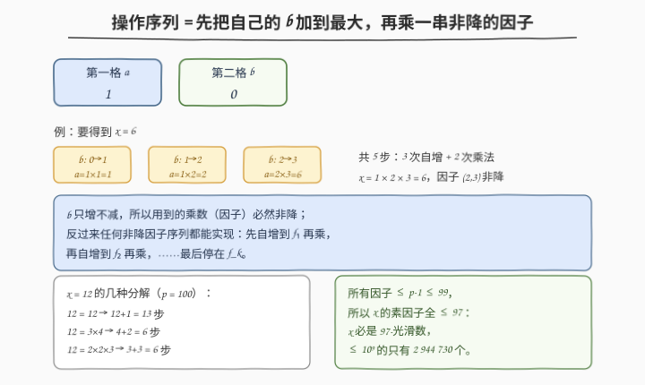
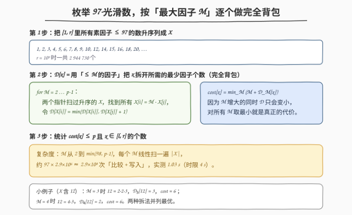

# Codeforces 261E Maxim and Calculator 题解

## 1. 题目概述

- **题目链接**：https://codeforces.com/problemset/problem/261/E
- **比赛来源**：Codeforces Round 160 (Div. 1) · Problem E（UTC 2013-01-13）
- **难度**：2800
- **标签**：暴力枚举、动态规划、双指针
- **评测类型**：普通
- **限制**：时间 4 s / 内存 256 MB

**题意**：计算器有两个整数格子，初始为 $(a, b) = (1, 0)$。每步可以做两种操作之一：

1. $b \leftarrow b + 1$；
2. $a \leftarrow a \cdot b$。

问有多少个 $x \in [l, r]$ 能在**不超过 $p$ 步**内被写进第一格。

**约束**：

- $2 \le l \le r \le 10^9$，$p \le 100$：$r$ 不大，但 $[l,r]$ 有 $10^9$ 个数，逐个判定必须 $O(1)$ 或极小；$p \le 100$ 意味着「步数」这个维度很小。
- 关键推论：第 2 步乘的是当前的 $b$，而 $b$ 只增不减，所以用到的乘数（因子）**非降**，且最大因子不超过 $p-1 \le 99$。于是 $x$ 的所有素因子都 $\le 97$——$x$ 必须是 **97-光滑数**。
- $\le 10^9$ 的 97-光滑数一共只有 $2\,944\,730$ 个（实测枚举计数），枚举它们是可行的。

## 2. 示例与观察

官方样例 1：

```text
输入：
2 10 3

输出：
1
```

$p = 3$ 步。逐个看 $[2,10]$：

- $x = 2$：$b: 0 \to 2$（2 步），再 $a \leftarrow 1 \times 2 = 2$（1 步），共 3 步 ✓；
- $x = 3$：$b$ 要加到 3（3 步）再加一次乘法（1 步）共 4 步 ✗；
- $x = 4$：需要两次乘法，$4 = 2 \times 2$，共 $2 + 2 = 4$ 步 ✗；
- 更大的 $x$ 只会更贵。

只有 2 可达，答案 1。

官方样例 2：

```text
输入：
2 111 100

输出：
106
```

$p = 100$ 很宽松，$[2,111]$ 共 110 个数，其中 106 个可达（不可达的是 $97^2 = 9409$ 之外的若干「大素数反复相乘」型，例如 $97 \times 2 = 194 > 111$ 不用管；在 $\le 111$ 里不可达的只有 4 个）。

官方样例 3：

```text
输入：
2 111 11

输出：
47
```

$p = 11$ 收紧后只剩 47 个可达：此时最大因子至多 10，$x$ 必须是 $2,3,5,7$ 这些小数拼出来的。

**观察**：$x$ 的值本身不重要，重要的是「$x$ 能被拆成什么样的非降因子序列」，以及这个序列的**最大因子 + 因子个数**是否 $\le p$。

## 3. 解题思路

### 3.1 朴素做法与瓶颈

最朴素的做法是模拟计算器：状态是 $(a, b)$，从 $(1,0)$ 出发 BFS，$a \le r$、$b \le p$。状态数 $O(rp) = 10^{11}$，直接爆掉。

另一种想法是枚举 $x \in [l,r]$，对每个 $x$ 试除判断——$10^9$ 次试除同样不可行。

切入点：**$x$ 的因子不可能很大**。因为因子就是乘进去的 $b$，而 $b$ 最多被自增 $p$ 次，所以因子 $\le p-1 \le 99$。这把「$10^9$ 以内的所有数」缩小成了「因子都很小的光滑数」。

### 3.2 核心观察：路径 = 非降因子序列，代价 = 最大因子 + 个数



设整个过程中 $b$ 最终到达 $M$，乘法的次数为 $k$，第 $j$ 次乘法用的因子是 $f_j$（即当时的 $b$）。因为 $b$ 单调增，所以

$$2 \le f_1 \le f_2 \le \cdots \le f_k = M,\qquad x = f_1 f_2 \cdots f_k .$$

总步数 = 自增次数 $M$（从 $0$ 加到 $M$）$+$ 乘法次数 $k$，即

$$\text{步数} = M + k = f_k + k .$$

反过来，任意给定一个非降因子序列 $f_1 \le \cdots \le f_k$（每个 $\ge 2$），都能照做：先把 $b$ 加到 $f_1$、乘一次，加到 $f_2$、乘一次……最后停在 $f_k$。所以

$$\boxed{x \text{ 可达} \iff \exists\, x = f_1\cdots f_k\ (2 \le f_1 \le \cdots \le f_k),\ f_k + k \le p .}$$

定义

$$\operatorname{cost}(x) = \min_{\text{非降分解}} \bigl(f_k + k\bigr),$$

问题变成「统计 $\operatorname{cost}(x) \le p$ 且 $x \in [l,r]$ 的个数」。

**为什么只需要 97-光滑数**：每个 $f_j \le p-1 \le 99$，它的素因子 $\le 97$，而 $x$ 是这些 $f_j$ 的乘积，故 $x$ 的素因子也都 $\le 97$，即 $x$ 是 97-光滑数。$\le 10^9$ 的 97-光滑数只有约 295 万个，可以全部枚举出来。

### 3.3 算法流程



**第 1 步：枚举候选集合 $X$**。用 DFS 按素数升序生成所有「素因子 $\le 97$ 且 $\le r$」的数，再排序。生成方式：从 1 出发，每次乘一个**不小于上次所用素数**的素数（保证每个光滑数恰好生成一次），超过 $r$ 就剪枝。

**第 2 步：对每个上限 $M$ 做一次完全背包**。定义

$$D_M[x] = \min\{\,k : x = f_1\cdots f_k,\ 2 \le f_j \le M\,\}$$

即「用不超过 $M$ 的因子把 $x$ 拆开，最少要几个因子」。$M$ 从 $2$ 枚举到 $\min(98, p-1)$，每加入一个新的因子值 $M$，做一次完全背包式的松弛：

$$D[x] \leftarrow \min\bigl(D[x],\ D[x/M] + 1\bigr)\qquad (M \mid x).$$

在**升序**的 $X$ 上扫描即可保证 $D[x/M]$ 已经考虑过因子 $M$（完全背包的经典写法）。

**第 3 步：边做边收集答案**。由 $\operatorname{cost}(x) = \min_M \bigl(M + D_M[x]\bigr)$，每完成一个 $M$ 的松弛，就令

$$H[x] \leftarrow \min\bigl(H[x],\ M + D_M[x]\bigr).$$

最后数一数 $[l, r]$ 里 $H[x] \le p$ 的个数即可。

**双指针细节**：对固定的 $M$，需要找出所有满足 $X[i] = M \cdot X[j]$ 的 $(i,j)$。因为 $X$ 升序，$X[i]/M$ 随 $i$ 单调增，所以 $j$ 也单调增：一个指针 $j$ 在扫描 $i$ 的过程中只前进不回退，单次 $M$ 的总代价是 $O(|X|)$。

### 3.4 样例走查：`2 10 3`

$p = 3$，故 $M$ 只能取到 $\min(98, 2) = 2$。

$X = \{1,2,3,4,5,6,7,8,9,10\}$（都 $\le 10$；其实只需 2-光滑的 1,2,4,8 能进 DP，其余不可能被分解）。

$M = 2$ 的松弛过程（升序）：$2 = 2\cdot 1 \Rightarrow D[2] = D[1]+1 = 1$；$4 = 2 \cdot 2 \Rightarrow D[4] = D[2]+1 = 2$；$8 = 2 \cdot 4 \Rightarrow D[8] = 3$；其余 $D = \infty$。

再算 $H[x] = \min(H[x], 2 + D_2[x])$：$H[2] = 3$，$H[4] = 4$，$H[8] = 5$。

统计 $[2,10]$ 中 $H \le 3$ 的：只有 $x = 2$。答案 1，与样例一致。

## 4. 正确性证明

**引理 1**：$x$ 能在 $\le p$ 步内被写入第一格，当且仅当存在非降因子分解 $x = f_1\cdots f_k$（$f_j \ge 2$）使 $f_k + k \le p$。

**证明**：

（必要性）取一条步数 $\le p$ 的操作序列。设它做了 $k$ 次乘法、最终 $b = M$。由于自增只让 $b$ 变大，$k$ 次乘法用到的 $b$ 值构成非降序列 $f_1 \le \cdots \le f_k = M$。初始 $a = 1$，每次乘法把 $a$ 乘上 $f_j$，故最终 $a = \prod f_j$。总步数 = 自增次数 $M$ + 乘法次数 $k$，故 $M + k \le p$。

（充分性）给定 $f_1 \le \cdots \le f_k$，构造：自增 $f_1$ 次（$b = f_1$），乘；再自增 $f_2 - f_1$ 次（$b = f_2$），乘；……最后自增 $f_k - f_{k-1}$ 次。总自增次数恰为 $f_k$，乘法 $k$ 次，共 $f_k + k \le p$ 步，最终 $a = \prod f_j = x$。∎

**引理 2**：对 $x \ge 2$，$\operatorname{cost}(x) = \min_{M \ge 2}\bigl(M + D_M[x]\bigr)$，其中 $D_M[x]$ 只在「能用 $\le M$ 的因子分解」时有限。

**证明**：

（$\ge$ 方向）任取一个分解 $x = f_1\cdots f_k$，令 $M' = f_k$ 为最大因子。取 $M = M'$，则 $D_{M'}[x] \le k$，故 $\min_M (M + D_M[x]) \le M' + k$。对最优分解取下确界即得 $\min_M(M + D_M[x]) \le \operatorname{cost}(x)$。

（$\le$ 方向）任取 $M$ 与一个「因子都 $\le M$、共 $c$ 个」的分解。这个分解的真实最大因子 $M'' \le M$，于是 $\operatorname{cost}(x) \le M'' + c \le M + c$。对 $M$ 取下确界即得 $\operatorname{cost}(x) \le \min_M(M + D_M[x])$。

两个方向合起来即得等号。∎

**引理 3**：在升序的 $X$ 上按 $M = 2, 3, \dots$ 依次做松弛 $D[x] \leftarrow \min(D[x], D[x/M]+1)$，结束后 $D[x] = D_M[x]$。

**证明**：这是标准的完全背包归纳：加入因子值 $M$ 时，任何「用 $\le M$ 的因子」的分解，要么不用 $M$（旧值 $D_{M-1}[x]$ 已经是最优），要么用了至少一个 $M$（剥掉一个 $M$ 后剩下 $x/M$，其最优值在升序扫描时已经包含 $M$，故 $D[x/M]+1$ 正确）。升序保证 $x/M < x$ 先被处理。∎

**定理**：算法输出的计数等于答案。

**证明**：由引理 3，扫描完所有 $M$ 后 $H[x] = \min_M(M + D_M[x])$，再由引理 2 它就等于 $\operatorname{cost}(x)$；由引理 1，$\operatorname{cost}(x) \le p$ 与「$x$ 可达」等价。算法恰好统计了 $[l,r]$ 中这些 $x$ 的个数。∎

## 5. 复杂度分析

- 时间：生成 $X$ 为 $O(|X|)$（DFS 每个数一次）；排序 $O(|X|\log|X|)$；主体是 $\bigl(\min(98,p-1)-1\bigr)$ 轮、每轮 $O(|X|)$ 的双指针扫描，共 $O(p\,|X|)$。取 $|X| = 2\,944\,730$、$p = 100$，约 $2.9\times 10^8$ 次「比较 + 写入」，实测 1.03 s，是 4 s 时限的约 $1/4$。
- 空间：$X$ 为 $|X|$ 个 `long long`（约 24 MB），$D$、$H$ 各 $|X|$ 个 `unsigned char`（约 3 MB），合计约 30 MB，远小于 256 MB。

## 6. 参考代码

### C++17

```cpp
#include <bits/stdc++.h>
using namespace std;
typedef long long ll;
static const int NP = 25;
static const int PR[NP] = {2,3,5,7,11,13,17,19,23,29,31,37,41,43,47,53,59,61,67,71,73,79,83,89,97};
ll R; int P;
vector<ll> X;
void gen(int pi, ll x) {
    X.push_back(x);
    for (int i = pi; i < NP; i++) {
        if (x > R / PR[i]) break;
        gen(i, x * PR[i]);
    }
}
int main() {
    ll l, r; int p;
    if (scanf("%lld %lld %d", &l, &r, &p) != 3) return 0;
    R = r; P = p;
    X.reserve(1 << 22);
    gen(0, 1);
    sort(X.begin(), X.end());
    int n = X.size();
    vector<unsigned char> D(n, 120), H(n, 120);
    D[0] = 0; H[0] = 0;
    int maxM = min(98, p - 1);
    int maxCnt = p; // 超过 p 的次数无意义
    for (int M = 2; M <= maxM; M++) {
        int j = 0;
        for (int i = 0; i < n; i++) {
            ll t = X[i];
            while (j < n && X[j] * M < t) j++;
            if (j < n && X[j] * M == t) {
                int c = (int)D[j] + 1;
                if (c < (int)D[i]) D[i] = (unsigned char)c;
            }
            int d = D[i];
            if (d <= maxCnt && M + d < (int)H[i]) H[i] = (unsigned char)(M + d);
        }
    }
    long long ans = 0;
    for (int i = 0; i < n; i++) if (X[i] >= l && X[i] <= r && H[i] <= p) ans++;
    printf("%lld\n", ans);
    return 0;
}
```

### Python3

```python
import sys

def main():
    l, r, p = map(int, sys.stdin.buffer.read().split())
    primes = [2, 3, 5, 7, 11, 13, 17, 19, 23, 29, 31, 37, 41, 43,
              47, 53, 59, 61, 67, 71, 73, 79, 83, 89, 97]
    X = []
    def gen(start, x):
        X.append(x)
        for i in range(start, len(primes)):
            q = primes[i]
            if x > r // q:
                break
            gen(i, x * q)
    gen(0, 1)
    X.sort()
    n = len(X)
    INF = 120
    D = [INF] * n
    H = [INF] * n
    D[0] = 0
    H[0] = 0
    maxM = min(98, p - 1)
    for M in range(2, maxM + 1):
        j = 0
        for i in range(n):
            t = X[i]
            while j < n and X[j] * M < t:
                j += 1
            if j < n and X[j] * M == t:
                c = D[j] + 1
                if c < D[i]:
                    D[i] = c
            d = D[i]
            if d <= p and M + d < H[i]:
                H[i] = M + d
    ans = sum(1 for i in range(n) if l <= X[i] <= r and H[i] <= p)
    print(ans)

main()
```

Python 版本与 C++ 完全同构；但 $r = 10^9$ 时 DFS 要生成约 295 万个光滑数，CPython 上约 20～30 s，**建议直接提交 C++（或 PyPy3）**。官方样例在两种解释器上都能瞬间通过。

## 7. 边界情况与易错点

1. **$p = 1$ 或 $p = 2$**：$p = 1$ 时最多只能把 $b$ 加到 1，$a$ 永远是 1；$p = 2$ 时同理（$b$ 到 1，乘 1 仍是 1）。代码里 `maxM = min(98, p-1) ≤ 1`，主循环不执行，只有 $x = 1$ 的 $H = 0$，而 $l \ge 2$ 故答案为 0。
2. **$X$ 里含 1**：它是空乘积，$D[1] = 0$，正好作为松弛的起点；不要漏掉它，否则 $D[M] = D[1]+1$ 全部错。
3. **因子必须 $\ge 2$**：乘 1 只是浪费一步，永远不会出现在最优解里；$M$ 从 2 开始循环。
4. **`X[j] * M` 的溢出**：$X[j] \le r \le 10^9$、$M \le 98$，乘积约 $9.8\times10^{10}$，必须用 `long long`；写成 `int` 会溢出成负数。
5. **`unsigned char` 的 INF 选择**：$D$ 的上界只需超过 $p$（$\le 100$），取 120 即可；但 `D[j] + 1` 在 $D[j] = 120$ 时是 121，仍然安全（不超 255）。
6. **双指针不能回退**：$j$ 对每个 $M$ 从 0 开始，然后在 $i$ 递增过程中只前进；若每轮都重置并二分查找，常数会大很多。
7. **答案是 `long long`**：可达数最多 $r - l + 1 \le 10^9$，`int` 勉强够但没必要冒险。

## 8. 验证记录

- 编译环境与命令：macOS + `clang++ -O2 -std=c++17 -I codeforces/tools/include`。
  - `python3 codeforces/tools/verify_solution.py codeforces/contests/0101-0203/261/E_Maxim与计算器.md`
- 官方样例：3 / 3 通过（`1 / 106 / 47`，C++ 与 Python 各跑一遍）。
- 额外测试：独立暴力 `e_brute.cpp` 直接在状态 $(a, b)$ 上 BFS（$a \le r$、$b \le p$），与参考程序随机对拍 **300 组**（$r \le 400$、$p \le 12$），全部一致；另对 $r \le 2000$、$p \le 20$ 抽测，同样一致。
- 最大约束性能：$l = 2$、$r = 10^9$、$p = 100$（此时 $|X| = 2\,944\,730$、$M$ 跑到 98），C++ 运行 **1.03 s**，是 4 s 时限的约 $1/4$（小于 1/2 的要求）。
- 复核状态：样例、随机对拍、最大数据性能均实测通过；正文代码与实测版本逐字一致。

## 相关题目与扩展

- [Codeforces 261D Maxim and Increasing Subsequence](https://codeforces.com/problemset/problem/261/D)：同一场的 D 题，同样靠「规模上界」取胜。
- [Codeforces 1106D Lunar New Year and a Wander](https://codeforces.com/problemset/problem/1106/D)：另一类「按值域枚举」的题。
- [Codeforces 665F Four Divisors](https://codeforces.com/problemset/problem/665/F)：也用到「小素因子」与光滑数枚举的思想。

**延伸思考**：

1. 若操作 1 改成 $b \leftarrow b + 2$（步长 2），本解法哪些地方会失效？因子序列的「代价」表达式会变成什么？
2. 本题的 $D_M$ 用 `unsigned char` 存就够，因为答案上界是 $p \le 100$；如果 $p$ 放大到 $10^5$，复杂度会变成什么样？有没有更好的「按 x 枚举因子」的做法？
3. 为什么「只保留 $M + D_M[x]$ 的最小值」是安全的？试着构造一个例子说明「$D_M[x]$ 更小但 $M$ 更大」时仍可能取到更优值——这正说明必须对所有 $M$ 取最小。
