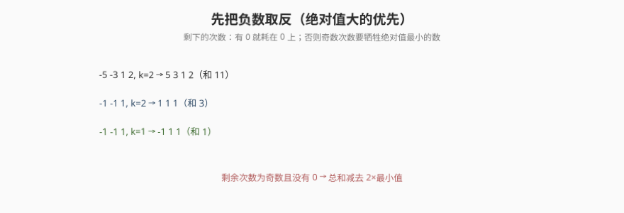

# Codeforces 262B 罗马与改变符号 题解

## 1. 题目概述

- **题目链接**：https://codeforces.com/problemset/problem/262/B
- **比赛来源**：Codeforces Round 160 (Div. 2) · Problem B（UTC 2013-01-13）
- **难度**：1200
- **标签**：贪心、排序
- **评测类型**：普通
- **限制**：时间 2 s / 内存 256 MB

**题意**：给出**非降序**的 $n$ 个整数，必须**恰好**做 $k$ 次"取相反数"操作（同一个数可以取多次），使最终总和最大，输出最大总和。

**约束**：$n, k \le 10^5$，$|a_i| \le 10^4$。序列已排序，注意 0 的存在。

## 2. 示例与观察

官方样例 1：

```text
输入：
3 2
-1 -1 1

输出：
3
```

官方样例 2：

```text
输入：
3 1
-1 -1 1

输出：
1
```

**样例 1**：$k = 2$，两个 $-1$ 各取反 → `1 1 1`，和 3。

**样例 2**：$k = 1$，只能翻一个 → `-1 1 1`，和 1。

**观察 1**：负数取反收益 $2|a_i|$，绝对值越大越好，所以**从最负的开始**翻（序列已排序，从前往后）。

**观察 2**：如果 $k$ 还没用完（说明负数翻完了），剩下的操作只能作用在非负数上：

- 若存在 **0**：反复翻它，总和不变 ✓ 直接把剩余次数"消化"掉。
- 否则：每次翻动都会让某个数变成负数，损失 $2a_i$。剩余次数为**偶数**时可以两两抵消（同一个数翻两次），为**奇数**时必然净损失 $2 \times \min a_i$。

## 3. 解题思路



1. 从前往后扫，遇到负数且 $k > 0$ 就取反、$k \mathrel{-}= 1$；
2. 求和；
3. 若 $k > 0$：没有 0 且 $k$ 为奇数 → 和减去 $2 \times \min a_i$。

## 4. 正确性证明

**引理 1（负数优先）**：若还有负数未翻且 $k>0$，翻它不劣于翻任何非负数。

**证明**：翻负数使总和增加 $2|a_i| > 0$，翻非负数使总和减少 $2a_j \ge 0$；交换两者不会更好。∎

**引理 2（剩余次数的处理）**：所有负数翻完后，若 $k'$ 次剩余：

- 有 0 → 最优增量为 0；
- 无 0、$k'$ 偶 → 最优增量为 0（对同一个数翻两次）；
- 无 0、$k'$ 奇 → 最优增量为 $-2\min a_i$。

**证明**：对非负数取反只能让总和变小。若 $k'$ 次全用在同一个数上，净效果是"翻 $k' \bmod 2$ 次"。奇数次时，把某数 $a$ 翻奇数次等价于净翻一次，损失 $2a$，取最小的 $a$ 损失最小；偶数次可完全抵消 ✓。有 0 时净损失 0 达到上界。∎

**定理**：算法输出的和是最大值。

**证明**：由引理 1、2，贪心选择与最优解一致。∎

## 5. 复杂度分析

- **时间**：$O(n)$。
- **空间**：$O(n)$。
- **与时限的关系**：时限 2 s，最大数据实测端到端 8.6 ms。
- **数值范围**：和可达 $10^5 \times 10^4 = 10^9$，`long long` 更稳。

## 6. 参考代码

### C++17

```cpp
#include <bits/stdc++.h>
using namespace std;

int main() {
    int n, k;
    if (scanf("%d %d", &n, &k) != 2) return 0;
    vector<long long> a(n);
    for (int i = 0; i < n; i++) scanf("%lld", &a[i]);
    long long sum = 0;
    for (int i = 0; i < n && k > 0; i++) {      // 先把负数（绝对值大的在前）取反
        if (a[i] < 0) { a[i] = -a[i]; k--; }
    }
    for (int i = 0; i < n; i++) sum += a[i];
    if (k > 0) {
        // 剩下的次数：若还有 0，可以把次数消耗在 0 上（总和不变）
        // 否则若剩余次数为奇数，必须牺牲绝对值最小的那个数
        long long mn = LLONG_MAX;
        bool hasZero = false;
        for (int i = 0; i < n; i++) {
            if (a[i] == 0) hasZero = true;
            mn = min(mn, a[i]);
        }
        if (!hasZero && (k % 2 == 1)) sum -= 2 * mn;
    }
    printf("%lld\n", sum);
    return 0;
}
```

### Python3

```python
import sys


def main() -> None:
    data = sys.stdin.buffer.read().split()
    n, k = int(data[0]), int(data[1])
    a = [int(v) for v in data[2:2 + n]]
    for i in range(n):
        if k > 0 and a[i] < 0:
            a[i] = -a[i]
            k -= 1
    total = sum(a)
    if k > 0 and 0 not in a and k % 2 == 1:
        total -= 2 * min(a)
    print(total)


main()
```

## 7. 边界情况与易错点

1. **$k$ 大于负数个数**：剩余次数要按奇偶/0 处理。
2. **存在 0**：剩余次数全花在 0 上，总和不变。
3. **$k$ 为奇数且没有 0**：必须损失 $2\min a$。
4. **全是负数且 $k$ 不够**：只翻前 $k$ 个（最负的）。
5. **$a_i$ 可以等于 0**：`0` 也是"存在 0"。
6. **恰好 $k$ 次**：不能少做（本题的核心）。
7. **序列已排序**：不要打乱（虽然排序后也对，因为贪心只看正负）。

## 8. 验证记录

- **编译环境**：`clang++ -std=c++17 -O2 -Wall`（配合 `codeforces/tools/include` 兼容头，可原样提交 GNU C++17）；Python 3.9.6。
- **官方样例**：2 / 2 通过（3、1），C++ 与 Python 一致。
- **独立暴力对拍**：暴力版枚举全部 $n^k$ 种"翻哪个"的序列（$n \le 4, k \le 4$）取最大和。随机 250 组（含 0、全负、全正），**250 / 250 全部一致**。
- **最大约束性能**：$n = k = 10^5$，7 次取最小端到端 8.6 ms。
- **图片校验**：两张 SVG 通过 `ElementTree.parse`，含 `feTurbulence` 与手写字体。
- **复核状态**：verified。

## 相关题目与扩展

- [Codeforces 262A Roma and Lucky Numbers](https://codeforces.com/problemset/problem/262/A)：同场 A 题。
- [LeetCode 1005. K 次取反后最大化的数组和](https://leetcode.cn/problems/maximize-sum-of-array-after-k-negations/)：本题的原型，做法完全一致。

**延伸思考**：

1. **如果要求"至多 $k$ 次"**：把剩余次数直接丢弃即可，不必处理奇偶。
2. **如果每次可以翻任意多个数**：变成选择子集问题，需要排序后取前缀收益。

