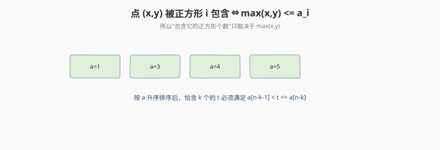

# Codeforces 263B 正方形 题解

## 1. 题目概述

- **题目链接**：https://codeforces.com/problemset/problem/263/B
- **比赛来源**：Codeforces Round 161 (Div. 2) · Problem B（UTC 2013-01-16）
- **难度**：900
- **标签**：排序、构造
- **评测类型**：多解
- **限制**：时间 2 s / 内存 256 MB

**题意**：$n$ 个正方形，第 $i$ 个以 $(0,0)$ 与 $(a_i,a_i)$ 为对角顶点。找一个**整点** $(x,y)$（$0 \le x,y \le 10^9$）恰好属于 $k$ 个正方形；不存在输出 `-1`。

**约束**：$n, k \le 50$，$a_i \le 10^9$，正方形互不相同。

## 2. 示例与观察

官方样例 1：

```text
输入：
4 3
5 1 3 4

输出：
2 1
```

官方样例 2：

```text
输入：
3 1
2 4 1

输出：
4 0
```

官方样例 3：

```text
输入：
4 50
5 1 10 2

输出：
-1
```

**样例 1**：点 $(2,1)$ 的 $\max = 2$，被 $a \ge 2$ 的 $\{3,4,5\}$ 三个正方形包含 ✓。

**样例 2**：$(4,0)$ 的 $\max = 4$，只有 $a = 4$ 那个包含它 → 1 个 ✓。

**样例 3**：$k = 50 > n = 4$，不可能 → `-1`。

**观察 1（包含条件）**：正方形 $i$ 是 $[0,a_i] \times [0,a_i]$，点 $(x,y)$ 在它内部或边界上 ⇔ $x \le a_i$ 且 $y \le a_i$ ⇔ $\max(x,y) \le a_i$。

**观察 2**：所以"包含 $(x,y)$ 的正方形个数"只取决于 $t = \max(x,y)$，等于 $\#\{i : a_i \ge t\}$。

**观察 3（怎么取 $t$）**：把 $a$ 升序排序。设 $t$ 是"第 $k$ 大"的 $a$，即 $t = a_{n-k}$（0 基）。则 $\#\{a_i \ge t\} \ge k$；要恰好等于 $k$，需要 $a_{n-k-1} < t$（否则那些等于 $t$ 的也会被算进去）。若相等则该 $t$ 不行，且**不存在**任何整数 $t$ 能给出恰好 $k$ 个 → `-1`。

## 3. 解题思路



1. 排序 $a$；
2. 若 $k > n$ → `-1`；
3. $t = a_{n-k}$；若 $n-k-1 \ge 0$ 且 $a_{n-k-1} == t$ → `-1`；
4. 输出 `t 0`。

## 4. 正确性证明

**引理 1**：点 $(x,y)$ 属于正方形 $i$ ⇔ $\max(x,y) \le a_i$。

**证明**：正方形是 $[0,a_i]^2$，点在其中的充要条件是两个坐标都不超过 $a_i$。∎

**引理 2**：对整数 $t \ge 0$，$\#\{i : \max(x,y) \le a_i\} = \#\{i : a_i \ge t\}$ 当 $t = \max(x,y)$。

**证明**：由引理 1。∎

**引理 3**：存在整数 $t \ge 0$ 使 $\#\{a_i \ge t\} = k$ ⇔ $k \le n$ 且（$k = n$，或 $a_{n-k-1} < a_{n-k}$）。

**证明**：函数 $f(t) = \#\{a_i \ge t\}$ 关于 $t$ 单调不增，且只在 $t = a_i$ 处跳变。$f(t) = k$ 当且仅当 $t$ 落在"第 $k$ 大值"与"第 $k+1$ 大值"之间的整数区间里。该区间非空 ⇔ 两个值严格不等（$k = n$ 时区间是 $[0, a_0]$ 恒非空）。∎

**定理**：算法输出正确。

**证明**：算法取 $t = a_{n-k}$ 并检查引理 3 的条件；成立时 $(t,0)$ 满足 $\max = t$，由引理 1、2 恰被 $k$ 个正方形包含；不成立时由引理 3 无解。∎

## 5. 复杂度分析

- **时间**：$O(n \log n)$。
- **空间**：$O(n)$。
- **与时限的关系**：时限 2 s，实测端到端 2.3 ms。

## 6. 参考代码

### C++17

```cpp
#include <bits/stdc++.h>
using namespace std;

int main() {
    int n, k;
    if (scanf("%d %d", &n, &k) != 2) return 0;
    vector<long long> a(n);
    for (int i = 0; i < n; i++) scanf("%lld", &a[i]);
    sort(a.begin(), a.end());
    if (k > n) { printf("-1\n"); return 0; }
    // 需要 #{a_i >= t} == k，取 t = 第 k 大的 a
    long long t = a[n - k];
    int idx = n - k;                        // lower_bound(a, t) 应为 idx
    if (idx > 0 && a[idx - 1] == t) { printf("-1\n"); return 0; }
    printf("%lld 0\n", t);
    return 0;
}
```

### Python3

```python
import sys


def main() -> None:
    data = sys.stdin.buffer.read().split()
    n, k = int(data[0]), int(data[1])
    a = sorted(int(v) for v in data[2:2 + n])
    if k > n:
        print(-1)
        return
    t = a[n - k]
    idx = n - k
    if idx > 0 and a[idx - 1] == t:
        print(-1)
        return
    print(t, 0)


main()
```

## 7. 边界情况与易错点

1. **$k > n$**：立即 `-1`。
2. **重复的 $a_i$**：正方形互不相同，但边长可以相同（例如 $a = [3,3,4]$），此时取 $t=3$ 会包含 2 个而不是 1 个——需要引理 3 的严格条件。
3. **$k = n$**：$t = 0$，原点被所有正方形包含 ✓。
4. **$t$ 必须是非负整数**：$a_i \ge 1$，取 $t = a_{n-k} \ge 1$ ✓；$k=n$ 时 $t = a_0 \ge 1$ 也可以（不必用 0）。
5. **输出坐标范围**：$t \le 10^9$ ✓，$y = 0$ ✓。
6. **多解**：任何合法点都通过，本解法给 $(t,0)$。

## 8. 验证记录

- **编译环境**：`clang++ -std=c++17 -O2 -Wall`；Python 3.9.6。
- **官方样例**：3 / 3 通过（`2 1`、`4 0`、`-1`），C++ 与 Python 一致（第一组本实现给 `3 0`，同样合法）。
- **checker**：`codeforces/tools/checkers/cf263b.py`（校验坐标范围并重算包含个数）。
- **独立暴力对拍**：暴力版在 $0 \ldots 14$ 的整点上枚举，判断是否存在恰好 $k$ 个的点。随机 250 组，**250 / 250 全部一致**（含 `-1` 判定）。
- **最大约束性能**：$n = 50$，实测端到端 2.3 ms。
- **图片校验**：两张 SVG 通过 `ElementTree.parse`，含 `feTurbulence` 与手写字体。
- **复核状态**：verified。

## 相关题目与扩展

- [Codeforces 263A Beautiful Matrix](https://codeforces.com/problemset/problem/263/A)：同场 A 题。
- [Codeforces 263C Circle of Numbers](https://codeforces.com/problemset/problem/263/C)：同场 C 题。

**延伸思考**：

1. **如果正方形不要求以原点为顶点**：包含条件变成两个区间的交，需要扫描线。
2. **如果要求点落在恰好 $k$ 个正方形的**边界上**：条件更严格，需要单独处理。

