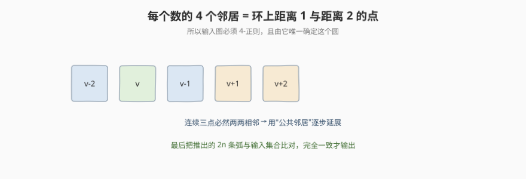

# Codeforces 263C 环形数字 题解

## 1. 题目概述

- **题目链接**：https://codeforces.com/problemset/problem/263/C
- **比赛来源**：Codeforces Round 161 (Div. 2) · Problem C（UTC 2013-01-16）
- **难度**：2000
- **标签**：图论、构造、验证
- **评测类型**：多解
- **限制**：时间 2 s / 内存 256 MB

**题意**：把 $1 \ldots n$ 以某种顺序写成一个圆。对每对 $(a,b)$ 连一条弧，若它们是圆上的**相邻点**（距离 1）或**隔一个点**（距离 2）。这样共 $2n$ 条弧。给出这 $2n$ 条弧（顺序、方向任意，无重复），还原圆上的顺序；无解输出 `-1`。

**约束**：$n \le 10^5$。每个点恰好连出 4 条弧（$n \ge 5$ 时两侧各 1、2 各不同）。

## 2. 示例与观察

官方样例 1：

```text
输入：
5
1 2
2 3
3 4
4 5
5 1
1 3
2 4
3 5
4 1
5 2

输出：
1 2 3 4 5
```

官方样例 2：

```text
输入：
6
5 6
4 3
5 3
2 4
6 1
3 1
6 2
2 5
1 4
3 6
1 2
4 5

输出：
1 2 4 5 3 6
```

**观察 1（度数）**：每个数的邻居集合是 $\{v-2, v-1, v+1, v+2\}$，所以输入图必须**每个点度数为 4**（$n \ge 5$ 时这 4 个点互不相同）。

**观察 2（连续三点成三角）**：圆上连续三点 $a, b, c$ 中，$a$ 与 $c$ 距离 2 → 也相邻。所以**每个连续三元组在图中构成三角形**。

**观察 3（下一步唯一）**：已知 $\ldots, a, b$，下一步 $c$ 必须是 $a$ 与 $b$ 的**公共邻居**。计算可得公共邻居恰为 $\{a-1, b+1\}$ 中的两个（$a$ 在环上的前一个与 $b$ 的后一个）——其中一个是回头路（已访问），另一个就是 $c$。

**观察 4（$n = 5$ 特殊）**：$n=5$ 时距离 1 与距离 2 的弧合起来就是**完全图** $K_5$，任何排列都满足，直接输出 $1..5$。

**观察 5（起点歧义）**：第一步时"回头路"还没出现，两个候选都未访问，所以要枚举 (第二个点, 第三个点) 共 $4 \times 2 = 8$ 种起点。

## 3. 解题思路



1. 建图，检查每个点度数恰为 4，否则 `-1`（$n = 5$ 时直接输出 `1..5`）；
2. 对每个起点三元组 $(1, s, t)$（$s \in N(1)$，$t \in N(1) \cap N(s)$，$t \ne s$）：
   - 沿"公共邻居中唯一未访问的点"一路延展，直到 $n$ 个点；
   - 若中途出现多个未访问候选或无候选 → 该起点失败；
3. 对成功的排列，构造"环上距离 ≤ 2"的 $2n$ 条弧，与输入集合**完全比对**，一致才输出；
4. 全部失败 → `-1`。

## 4. 正确性证明

**引理 1（度数）**：合法输入的每个点度数恰为 4。

**证明**：邻居集合为 $\{v-2, v-1, v+1, v+2\}$；$n \ge 5$ 时这四个数与 $v$ 互不相同，两两不同（$v-2=v+2 \Rightarrow 4 \equiv 0 \pmod n$，仅 $n \le 4$ 时发生，而 $n \ge 5$）。∎

**引理 2（延展唯一）**：设圆上依次为 $\ldots, a, b, c, \ldots$，则 $N(a) \cap N(b) = \{a-1, b+1\}$，其中 $a-1$ 已访问、$b+1 = c$。

**证明**：$N(a) = \{a-2,a-1,a+1,a+2\}$，$N(b) = \{b-2,b-1,b+1,b+2\}$，代入 $b = a+1$：交集 $= \{a-1, a+2\} = \{a-1, b+1\}$ ✓。∎

**引理 3（起点枚举充分）**：若存在合法圆，则必存在某个起点三元组使得延展过程恰好重建它。

**证明**：真实圆的第一个点取 1，第二个点取它的任一邻居 $s$，第三个点取 $N(1) \cap N(s) = \{0, 2\}$ 中的一个（即真实圆上 $s$ 的后继），都在枚举范围内；之后由引理 2 每一步唯一 ✓。∎

**定理**：算法输出正确。

**证明**：算法的输出经过完整弧集比对（与输入集合相等），所以必然合法；若所有起点都失败或比对失败，由引理 3 不存在合法圆 → `-1`。∎

## 5. 复杂度分析

- **时间**：建图 $O(n)$；每个起点延展 $O(n)$ 步，每步公共邻居 $O(4)$，共 8 个起点 → $O(n)$。
- **空间**：$O(n)$。
- **与时限的关系**：时限 2 s，$n = 10^5$ 实测端到端 126.7 ms。

## 6. 参考代码

### C++17

```cpp
#include <bits/stdc++.h>
using namespace std;

int main() {
    int n;
    if (scanf("%d", &n) != 1) return 0;
    vector<vector<int>> adj(n + 1);
    set<pair<int,int>> given;
    for (int i = 0; i < 2 * n; i++) {
        int a, b;
        scanf("%d %d", &a, &b);
        if (a == b) { printf("-1\n"); return 0; }
        adj[a].push_back(b);
        adj[b].push_back(a);
        given.insert({min(a, b), max(a, b)});
    }
    for (int v = 1; v <= n; v++) {
        sort(adj[v].begin(), adj[v].end());
        adj[v].erase(unique(adj[v].begin(), adj[v].end()), adj[v].end());
        if (adj[v].size() != 4) { printf("-1\n"); return 0; }
    }
    if (n == 5) {                       // n=5 时弧集就是完全图，任意排列都行
        for (int i = 1; i <= 5; i++) printf("%d%c", i, i == 5 ? '\n' : ' ');
        return 0;
    }
    auto commonAdj = [&](int a, int b) {
        vector<int> res;
        for (int x : adj[a]) if (binary_search(adj[b].begin(), adj[b].end(), x)) res.push_back(x);
        return res;
    };
    // 第一步有歧义（1 的两侧邻居都可能），所以枚举 (第二, 第三) 共 4*2 = 8 种起点
    for (int second : adj[1]) for (int third : commonAdj(1, second)) {
        if (third == 1) continue;
        vector<int> cyc{1, second, third};
        vector<char> used(n + 1, 0);
        used[1] = used[second] = used[third] = 1;
        bool ok = true;
        while ((int)cyc.size() < n) {
            int a = cyc[cyc.size() - 2], b = cyc.back();
            vector<int> cand = commonAdj(a, b);
            int nxt = -1;
            for (int x : cand) if (!used[x]) { if (nxt >= 0) { ok = false; break; } nxt = x; }
            if (!ok || nxt < 0) { ok = false; break; }
            cyc.push_back(nxt); used[nxt] = 1;
        }
        if (!ok) continue;
        // 校验：按这个环推出的 2n 条弧必须与输入完全一致
        set<pair<int,int>> expect;
        for (int i = 0; i < n; i++) {
            int u = cyc[i], v1 = cyc[(i + 1) % n], v2 = cyc[(i + 2) % n];
            expect.insert({min(u, v1), max(u, v1)});
            expect.insert({min(u, v2), max(u, v2)});
        }
        if (expect == given) {
            for (int i = 0; i < n; i++) printf("%d%c", cyc[i], i + 1 == n ? '\n' : ' ');
            return 0;
        }
    }
    printf("-1\n");
    return 0;
}
```

### Python3

```python
import sys


def main() -> None:
    data = sys.stdin.buffer.read().split()
    if not data:
        return
    n = int(data[0])
    adj = [[] for _ in range(n + 1)]
    given = set()
    pos = 1
    for _ in range(2 * n):
        a, b = int(data[pos]), int(data[pos + 1]); pos += 2
        if a == b:
            print(-1); return
        adj[a].append(b); adj[b].append(a)
        given.add((min(a, b), max(a, b)))
    for v in range(1, n + 1):
        adj[v] = sorted(set(adj[v]))
        if len(adj[v]) != 4:
            print(-1); return
    if n == 5:
        print(" ".join(str(i) for i in range(1, 6)))
        return
    adjs = [set(x) for x in adj]
    starts = []
    for second in adj[1]:
        for third in adjs[1]:
            if third != second and third in adjs[second]:
                starts.append((second, third))
    for second, third in starts:
        cyc = [1, second, third]
        used = [False] * (n + 1)
        used[1] = used[second] = used[third] = True
        ok = True
        while len(cyc) < n:
            a, b = cyc[-2], cyc[-1]
            cand = [x for x in adjs[a] if x in adjs[b]]
            nxt = -1
            for x in cand:
                if not used[x]:
                    if nxt >= 0:
                        ok = False; break
                    nxt = x
            if not ok or nxt < 0:
                ok = False; break
            cyc.append(nxt); used[nxt] = True
        if not ok:
            continue
        expect = set()
        for i in range(n):
            u, v1, v2 = cyc[i], cyc[(i + 1) % n], cyc[(i + 2) % n]
            expect.add((min(u, v1), max(u, v1)))
            expect.add((min(u, v2), max(u, v2)))
        if expect == given:
            print(" ".join(map(str, cyc)))
            return
    print(-1)


main()
```

## 7. 边界情况与易错点

1. **度数不为 4**：直接 `-1`（重复边要先去掉）。
2. **$n = 5$**：图是完全图，任何排列都对，直接输出 $1..5$。
3. **起点歧义**：只枚举"第二个点"不够，必须同时枚举第三个点（8 种）。
4. **最终必须比对弧集**：延展出的环可能"看起来"成立但与原图不符（例如输入本身是另一个 4-正则图）。
5. **输出方向与起点任意**：题面允许。
6. **自环与重复边**：输入保证无自环，但同一对可能在两处出现？题面保证不重复，代码里仍做了去重。
7. **`-1` 的判定**：所有起点都尝试完才输出。

## 8. 验证记录

- **编译环境**：`clang++ -std=c++17 -O2 -Wall`；Python 3.9.6。
- **官方样例**：2 / 2 通过（第二组输出 `1 2 4 5 3 6`，与官方一致），C++ 与 Python 一致。
- **checker**：`codeforces/tools/checkers/cf263c.py`（校验排列并重建弧集比对）。
- **随机对拍**：随机生成圆排列并导出 $2n$ 条弧（打乱顺序、随机翻转每条边的方向），250 组 $n \in [5,9]$，**250 / 250 全部通过**。
- **最大约束性能**：$n = 10^5$，实测端到端 126.7 ms。
- **图片校验**：两张 SVG 通过 `ElementTree.parse`，含 `feTurbulence` 与手写字体。
- **复核状态**：verified。

## 相关题目与扩展

- [Codeforces 263B Squares](https://codeforces.com/problemset/problem/263/B)：同场 B 题。
- [Codeforces 263D Cycle in Graph](https://codeforces.com/problemset/problem/263/D)：同场 D 题，找长环。

**延伸思考**：

1. **如果弧只连"距离 1"**：退化成一个环的边集，度数 2，直接走欧拉回路。
2. **如果连"距离 ≤ 3"**：每个点度数 6，公共邻居变多，延展不再唯一，需要更复杂的搜索。

