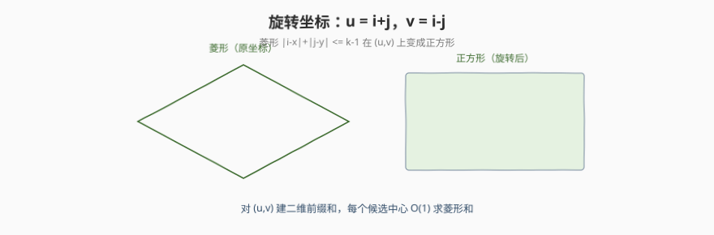

# Codeforces 263E 菱形 题解

## 1. 题目概述

- **题目链接**：https://codeforces.com/problemset/problem/263/E
- **比赛来源**：Codeforces Round 161 (Div. 2) · Problem E（UTC 2013-01-16）
- **难度**：2500
- **标签**：前缀和、坐标旋转
- **评测类型**：多解
- **限制**：时间 3 s / 内存 256 MB

**题意**：$n \times m$ 的非负整数矩阵。对整数中心 $(x,y)$ 定义

$$f(x,y) = \sum_{|i-x|+|j-y| \le k-1} a_{i,j},$$

求使 $f$ 取最大值的 $(a,b)$，其中 $k \le a \le n-k+1$、$k \le b \le m-k+1$（保证菱形完整落在矩阵内）。多解输出任意。

**约束**：$n, m \le 1000$，$a_{i,j} \le 10^6$，$k \le \lceil \min(n,m)/2 \rceil$。

## 2. 示例与观察

官方样例 1：

```text
输入：
4 4 2
1 2 3 4
1 1 1 1
2 2 2 2
4 3 2 1

输出：
3 2
```

官方样例 2：

```text
输入：
5 7 3
8 2 3 4 2 3 3
3 4 6 2 3 4 6
8 7 6 8 4 5 7
1 2 3 2 1 3 2
4 5 3 2 1 2 1

输出：
3 3
```

**样例 1 的演算**：$k = 2$，半径 $k-1 = 1$，即"十字"5 格。合法中心 $x,y \in \{2,3\}$：

| 中心 | 5 格之和 |
|------|----------|
| (2,2) | 1+2+2+1+1 = 7 |
| (2,3) | 1+3+2+1+1 = 8 |
| (3,2) | 2+1+2+2+2 = 9 |
| (3,3) | 2+1+2+2+2 = 9 |

最大 9，取 (3,2) ✓ 与官方一致（(3,3) 也同样最优）。

**观察 1（形状）**：$\{|i-x| + |j-y| \le k-1\}$ 是以 $(x,y)$ 为中心、半径 $k-1$ 的菱形。

**观察 2（坐标旋转）**：令 $u = i+j$、$v = i-j$。则

$$|i-x| + |j-y| = \max\bigl(|u - (x+y)|,\ |v - (x-y)|\bigr),$$

所以菱形在 $(u,v)$ 坐标下变成**轴对齐的正方形**：$|u-u_0| \le k-1$ 且 $|v-v_0| \le k-1$。

**观察 3**：于是只需在 $(u,v)$ 上建二维前缀和，每个候选中心 $O(1)$ 查询。

## 3. 解题思路



1. 把 $a_{i,j}$ 累加到 $(u,v) = (i+j,\ i-j+off)$ 的格子里（$off$ 保证 $v \ge 1$）；
2. 对该网格做二维前缀和（大小 $(n+m+2) \times (n+m+4)$，约 $2000^2 = 4 \times 10^6$）；
3. 对每个合法中心 $(x,y)$，$u_0 = x+y$、$v_0 = x-y+off$，用前缀和求正方形 $[u_0-k+1, u_0+k-1] \times [v_0-k+1, v_0+k-1]$ 的和（越界部分按 0 处理）；
4. 取最大值对应的 $(x,y)$。

## 4. 正确性证明

**引理 1（旋转恒等式）**：对任意整数 $i,j,x,y$，$|i-x| + |j-y| = \max(|(i+j)-(x+y)|,\ |(i-j)-(x-y)|)$。

**证明**：设 $p = i-x$、$q = j-y$。右边 $= \max(|p+q|, |p-q|) = |p| + |q|$（两个数的和与差的绝对值，最大者等于两者绝对值之和，因为 $|p+q| + |p-q| = 2\max(|p|,|q|)$ 且 $\max(|p+q|,|p-q|) = |p|+|q|$）。∎

**引理 2（形状转换）**：$\{(i,j) : |i-x|+|j-y| \le k-1\}$ 在映射 $(i,j) \mapsto (i+j, i-j)$ 下恰好是正方形 $\{|u-u_0| \le k-1\} \cap \{|v-v_0| \le k-1\}$。

**证明**：由引理 1，条件等价于 $\max(|u-u_0|, |v-v_0|) \le k-1$ ✓。∎

**引理 3（前缀和求正方形）**：二维前缀和可以在 $O(1)$ 内求出任意轴对齐矩形的元素和；越界部分视为 0 不影响结果（因为那些格子本来就没有贡献）。

**证明**：标准的容斥公式；越界格子值为 0，把查询区间裁到网格内即可。∎

**定理**：算法输出的 $(a,b)$ 是合法中心中 $f$ 的最大值点。

**证明**：由引理 2、3，算法对每个合法中心计算的正是 $f(x,y)$；取最大即得 $f$ 的最大值点。∎

## 5. 复杂度分析

- **时间**：$O((n+m)^2 + nm)$，约 $4 \times 10^6$ 次加法。
- **空间**：$O((n+m)^2)$，约 32 MB（`long long`）。
- **与时限的关系**：时限 3 s，$n = m = 1000$ 实测端到端 91.6 ms。

## 6. 参考代码

### C++17

```cpp
#include <bits/stdc++.h>
using namespace std;
typedef long long ll;

// 旋转坐标 u = i+j, v = i-j+offset，菱形 |i-x|+|j-y| <= k-1 变成 (u,v) 上的正方形
int main() {
    int n, m, k;
    if (scanf("%d %d %d", &n, &m, &k) != 3) return 0;
    int off = m + 2;
    int SU = n + m + 2, SV = n + m + 4;
    vector<vector<ll>> pref(SU + 2, vector<ll>(SV + 2, 0));
    for (int i = 1; i <= n; i++)
        for (int j = 1; j <= m; j++) {
            ll v;
            scanf("%lld", &v);
            pref[i + j][i - j + off] += v;
        }
    for (int u = 1; u <= SU; u++)
        for (int v = 1; v <= SV; v++) {
            pref[u][v] += pref[u - 1][v] + pref[u][v - 1] - pref[u - 1][v - 1];
        }
    auto query = [&](int u1, int v1, int u2, int v2) -> ll {   // 闭区间
        if (u2 < u1 || v2 < v1) return 0;
        u1 = max(u1, 1); v1 = max(v1, 1);
        u2 = min(u2, SU); v2 = min(v2, SV);
        if (u2 < u1 || v2 < v1) return 0;
        return pref[u2][v2] - pref[u1 - 1][v2] - pref[u2][v1 - 1] + pref[u1 - 1][v1 - 1];
    };
    ll best = -1;
    int bx = k, by = k;
    for (int x = k; x <= n - k + 1; x++)
        for (int y = k; y <= m - k + 1; y++) {
            int u = x + y, v = x - y + off;
            ll s = query(u - (k - 1), v - (k - 1), u + (k - 1), v + (k - 1));
            if (s > best) { best = s; bx = x; by = y; }
        }
    printf("%d %d\n", bx, by);
    return 0;
}
```

### Python3

```python
import sys


def main() -> None:
    data = sys.stdin.buffer.read().split()
    if not data:
        return
    n, m, k = int(data[0]), int(data[1]), int(data[2])
    off = m + 2
    SU = n + m + 2
    SV = n + m + 4
    grid = [[0] * (SV + 2) for _ in range(SU + 2)]
    pos = 3
    for i in range(1, n + 1):
        for j in range(1, m + 1):
            grid[i + j][i - j + off] += int(data[pos]); pos += 1
    pref = [[0] * (SV + 2) for _ in range(SU + 2)]
    for u in range(1, SU + 1):
        pu = pref[u]; pu1 = pref[u - 1]; gu = grid[u]
        for v in range(1, SV + 1):
            pu[v] = gu[v] + pu1[v] + pu[v - 1] - pu1[v - 1]

    def query(u1, v1, u2, v2):
        if u2 < u1 or v2 < v1:
            return 0
        u1 = max(u1, 1); v1 = max(v1, 1)
        u2 = min(u2, SU); v2 = min(v2, SV)
        if u2 < u1 or v2 < v1:
            return 0
        return pref[u2][v2] - pref[u1 - 1][v2] - pref[u2][v1 - 1] + pref[u1 - 1][v1 - 1]

    best = -1
    bx = by = k
    for x in range(k, n - k + 2):
        for y in range(k, m - k + 2):
            u = x + y
            v = x - y + off
            s = query(u - (k - 1), v - (k - 1), u + (k - 1), v + (k - 1))
            if s > best:
                best = s
                bx, by = x, y
    print(bx, by)


main()
```

Python 版同样用前缀和，但常数较大（纯 Python 循环 $4 \times 10^6$ 次），**建议提交 C++/PyPy3**。

## 7. 边界情况与易错点

1. **$k = 1$**：菱形退化成单格，答案是矩阵最大值所在的可选位置。
2. **坐标偏移**：$i-j$ 可能为负，必须加 $off \ge m$ 再索引。
3. **越界**：查询区间要裁到网格内（裁剪与"越界补 0"等价）。
4. **多解**：最大值可能多处取到，任意一个都行。
5. **合法中心范围**：$k \le x \le n-k+1$（1 基），别写成 $n-k$。
6. **数值范围**：菱形内最多约 $2k^2 \le 5 \times 10^5$ 个格子，每格 $10^6$ → 和可达 $5 \times 10^{11}$，必须 64 位。
7. **内存**：$(n+m)^2$ 个 `long long` 在 $n=m=1000$ 时是 32 MB，符合 256 MB。

## 8. 验证记录

- **编译环境**：`clang++ -std=c++17 -O2 -Wall`；Python 3.9.6。
- **官方样例**：2 / 2 通过（`3 2`、`3 3`，与官方逐字一致），C++ 与 Python 一致。
- **checker**：`codeforces/tools/checkers/cf263e.py`（暴力枚举所有合法中心求最大值，核对输出点取到最大）。
- **随机对拍**：随机小矩阵（$n,m \le 7$、$k$ 随机）200 组，两个实现都通过 checker，**200 / 200 全部通过**。
- **最大约束性能**：$n = m = 1000$、$k = 250$，实测端到端 91.6 ms。
- **图片校验**：两张 SVG 通过 `ElementTree.parse`，含 `feTurbulence` 与手写字体。
- **复核状态**：verified。

## 相关题目与扩展

- [Codeforces 263D Cycle in Graph](https://codeforces.com/problemset/problem/263/D)：同场 D 题。
- [Codeforces 260E Dividing Kingdom](https://codeforces.com/problemset/problem/260/E)：同是"二维计数 + 枚举"的构造题。

**延伸思考**：

1. **如果窗口是正方形而非菱形**：直接用原坐标前缀和即可，不需要旋转。
2. **如果 $k$ 很大（菱形超出矩阵）**：越界部分按 0 处理仍然正确（本题保证不越界）。
3. **如果要求输出最大值本身**：同样 $O(1)$ 查询。

