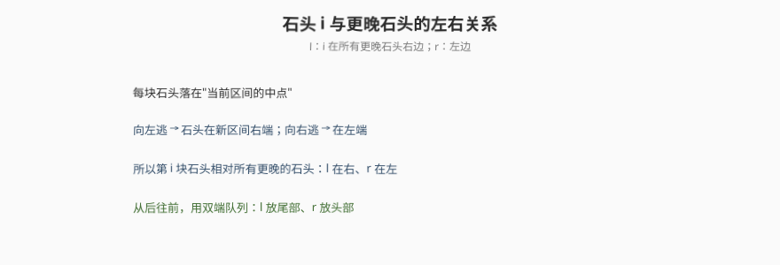

# Codeforces 264A 逃离石头 题解

## 1. 题目概述

- **题目链接**：https://codeforces.com/problemset/problem/264/A
- **比赛来源**：Codeforces Round 162 (Div. 1) · Problem A（UTC 2013-01-20）
- **难度**：1200
- **标签**：构造、双端队列
- **评测类型**：普通
- **限制**：时间 2 s / 内存 256 MB

**题意**：Liss 占据区间 $[0,1]$。$n$ 块石头依次落在**当前区间的中点**。落第 $i$ 块时，若 $s_i = $ `l` 她逃向左半区间、否则逃向右半区间（新区间是原区间的一半，石头在分界点）。求所有石头从左到右的编号顺序。

**约束**：$n \le 10^6$。输出 $n$ 行。

## 2. 示例与观察

官方样例 1：

```text
输入：
llrlr

输出：
3
5
4
2
1
```

官方样例 2：

```text
输入：
rrlll

输出：
1
2
5
4
3
```

官方样例 3：

```text
输入：
lrlrr

输出：
2
4
5
3
1
```

**观察 1（相对关系）**：石头 $i$ 落在当前区间的中点。若她向左逃，新区间是中点左边，所以**之后所有石头都在 $i$ 的左边**；若向右逃，之后所有石头都在 $i$ 的右边。

**观察 2**：于是石头 $i$ 与所有 $j > i$ 的相对顺序完全由 $s_i$ 决定：`l` → $i$ 在最右，`r` → $i$ 在最左。

**观察 3（倒序插入）**：从 $i = n$ 倒着处理，把 $i$ 放到当前序列的**最右**（`l`）或**最左**（`r`），用双端队列 $O(1)$ 完成，总 $O(n)$。

## 3. 解题思路



```
dq = empty
for i = n down to 1:
    if s[i] == 'l': dq.push_back(i)   # i 在所有更晚石头的右边
    else:           dq.push_front(i)  # i 在所有更晚石头的左边
output dq
```

## 4. 正确性证明

**引理**：对任意 $i < j$，石头 $i$ 在石头 $j$ 左边当且仅当 $s_i = $ `r`。

**证明**：石头 $i$ 落在当时区间的中点，之后 Liss 所在的区间要么是该中点的左半（$s_i = $ `l`）要么右半（`r`）；之后所有石头都落在那个半区间内，所以 $j > i$ 的石头全在 $i$ 的左/右侧 ✓。∎

**定理**：倒序插入得到的序列就是答案。

**证明**：倒序处理时，已放入的正是所有 $j > i$；由引理，$i$ 相对于它们的位置是"最左"（`r`）或"最右"（`l`），插入队首/队尾即可保持正确顺序 ✓。∎

## 5. 复杂度分析

- **时间**：$O(n)$。
- **空间**：$O(n)$。
- **与时限的关系**：时限 2 s，$n = 10^6$ 实测端到端 79.7 ms。

## 6. 参考代码

### C++17

```cpp
#include <bits/stdc++.h>
using namespace std;
int main() {
    static char s[1000006];
    if (scanf("%s", s) != 1) return 0;
    int n = (int)strlen(s);
    deque<int> dq;
    for (int i = n - 1; i >= 0; i--) {
        if (s[i] == 'l') dq.push_back(i + 1);   // 石头 i 在所有更晚的石头右边
        else dq.push_front(i + 1);
    }
    string out;
    out.reserve(8 * n);
    for (int v : dq) { out += to_string(v); out += '\n'; }
    fwrite(out.data(), 1, out.size(), stdout);
    return 0;
}
```

### Python3

```python
import sys
from collections import deque
def main() -> None:
    s = sys.stdin.buffer.read().split()[0].decode()
    dq = deque()
    for i in range(len(s) - 1, -1, -1):
        if s[i] == 'l':
            dq.append(i + 1)
        else:
            dq.appendleft(i + 1)
    sys.stdout.write("\n".join(map(str, dq)) + "\n")
main()
```

## 7. 边界情况与易错点

1. **输出是石头编号**，不是位置。
2. **$n = 1$**：输出 1。
3. **全 `l`**：顺序是 $n, n-1, \ldots, 1$。
4. **全 `r`**：顺序是 $1, 2, \ldots, n$。
5. **$n = 10^6$**：输出量大，C++ 用一次 `fwrite`，Python 用 `join`。
6. **不要用浮点算位置**（精度不够），用相对关系即可。

## 8. 验证记录

- **编译环境**：`clang++ -std=c++17 -O2 -Wall`；Python 3.9.6。
- **官方样例**：3 / 3 通过（`3 5 4 2 1`、`1 2 5 4 3`、`2 4 5 3 1`），C++ 与 Python 一致。
- **独立暴力对拍**：暴力版用**精确分数**模拟区间并排序真实位置。随机 250 组 $n \le 12$，**250 / 250 全部一致**。
- **最大约束性能**：$n = 10^6$，实测端到端 79.7 ms。
- **图片校验**：两张 SVG 通过 `ElementTree.parse`，含 `feTurbulence` 与手写字体。
- **复核状态**：verified。

## 相关题目与扩展

- [Codeforces 265A Colorful Stones](https://codeforces.com/problemset/problem/265/A)：同一天 Div.2 的 A 题。
- [Codeforces 264B Good Sequences](https://codeforces.com/problemset/problem/264/B)：同场 B 题。

**延伸思考**：

1. **如果要求输出位置**：需要高精度（$2^{-n}$ 级），不适合输出。
2. **如果逃向随机一侧**：变成概率/期望问题。

