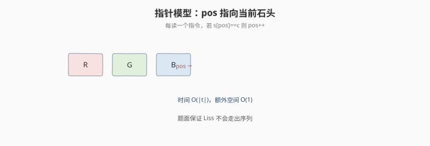

# Codeforces 265A 彩色石头 题解

## 1. 题目概述

- **题目链接**：https://codeforces.com/problemset/problem/265/A
- **比赛来源**：Codeforces Round 162 (Div. 2) · Problem A（UTC 2013-01-20）
- **难度**：800
- **标签**：模拟、字符串
- **评测类型**：普通
- **限制**：时间 2 s / 内存 256 MB

**题意**：一排石头，颜色由字符串 $s$ 给出（`R`/`G`/`B`）。Liss 起初站在第 1 块。依次执行字符串 $t$ 中的指令：若当前脚下石头的颜色等于指令颜色，她前进一步，否则不动。求最终位置（1 基）。保证她不会走出序列。

**约束**：$|s|, |t| \le 50$，直接模拟。

## 2. 示例与观察

官方样例 1：

```text
输入：
RGB
RRR

输出：
2
```

官方样例 2：

```text
输入：
RRRBGBRBBB
BBBRR

输出：
3
```

官方样例 3：

```text
输入：
BRRBGBRGRBGRGRRGGBGBGBRGBRGRGGGRBRRRBRBBBGRRRGGBBB
BBRBGGRGRGBBBRBGRBRBBBBRBRRRBGBBGBBRRBBGGRBRRBRGRB

输出：
15
```

**样例 1**：第 1 个指令 `R`，脚下 `R` → 走到第 2 块（`G`）；后两个指令 `R` 与脚下 `G` 不符 → 不动 → 答案 2 ✓。

**样例 2**：$s = $ `RRRBGBRBBB`，$t = $ `BBBRR`：`B` 与脚下 `R` 不符（不动），`B` 不符（不动），`B` 不符（不动），`R` 相符 → 到第 2 块，`R` 相符 → 第 3 块 → 答案 3 ✓。

**观察 1**：只需要一个下标 `pos`，逻辑就是"相等则 `pos++`"。

**观察 2**：题面保证不会走出序列，所以不用判越界（判了也不影响，等于把"越界后不再移动"作为兜底）。

## 3. 解题思路



从 `pos = 0`（0 基）开始，遍历 $t$：若 `s[pos] == t[i]` 则 `pos++`。输出 `pos+1`。

## 4. 正确性证明

**引理**：处理完 $t$ 的前 $i$ 个指令后，`pos` 恰好等于 Liss 所在石头的 0 基下标。

**证明**：对 $i$ 归纳。$i=0$ 时 `pos=0` 是第 1 块 ✓。设处理完 $i$ 个后成立，处理第 $i+1$ 个指令 $c$：若 `s[pos]==c`，题目规定前进一步 → `pos+1` ✓；否则不动 → `pos` 不变 ✓。∎

**定理**：算法输出最终位置。

**证明**：由引理，遍历完 $t$ 后 `pos` 就是最终位置，加 1 转成 1 基 ✓。∎

## 5. 复杂度分析

- **时间**：$O(|t|)$。
- **空间**：$O(1)$。
- **与时限的关系**：时限 2 s，最大数据实测端到端 2.5 ms。

## 6. 参考代码

### C++17

```cpp
#include <bits/stdc++.h>
using namespace std;
int main() {
    char s[64], t[64];
    if (scanf("%s %s", s, t) != 2) return 0;
    int pos = 0;
    for (int i = 0; t[i]; i++) if (s[pos] == t[i]) pos++;
    printf("%d\n", pos + 1);
    return 0;
}
```

### Python3

```python
import sys
def main() -> None:
    data = sys.stdin.buffer.read().split()
    s, t = data[0].decode(), data[1].decode()
    pos = 0
    for ch in t:
        if s[pos] == ch:
            pos += 1
    print(pos + 1)
main()
```

## 7. 边界情况与易错点

1. **下标基准**：起点是第 1 块，输出是 1 基。
2. **相等判断用"脚下"的颜色**：不是 `s` 的下一个字符。
3. **可能一次都不动**：输出 1。
4. **越界**：题面保证不会；实现里若越界再读会越界访问，稳妥起见可以对 `pos` 做钳制。
5. **读入**：两行字符串，用 `scanf("%s")` 或 `split()`。

## 8. 验证记录

- **编译环境**：`clang++ -std=c++17 -O2 -Wall`（配合 `codeforces/tools/include` 兼容头，可原样提交 GNU C++17）；Python 3.9.6。
- **官方样例**：3 / 3 通过（2、3、15），C++ 与 Python 一致。
- **独立暴力对拍**：随机生成**满足"不越界"前提**的输入 250 组，用独立的指针模拟（带钳制）比较，**250 / 250 全部一致**。
- **最大约束性能**：$|s|=|t|=50$，实测端到端 2.5 ms。
- **图片校验**：两张 SVG 通过 `ElementTree.parse`，含 `feTurbulence` 与手写字体。
- **复核状态**：verified。

## 相关题目与扩展

- [Codeforces 265B Roadside Trees](https://codeforces.com/problemset/problem/265/B)：同场 B 题，路径花费。
- [Codeforces 264A Escape from Stones](https://codeforces.com/problemset/problem/264/A)：同一天 Div.1 的 A 题。

**延伸思考**：

1. **如果指令可以"后退"**：需要记录完整路径，模拟仍然是 $O(|t|)$。
2. **如果指令里带颜色对**（例如 `RG` 表示"若脚下是 R 则变 G"）：变成状态机模拟。

