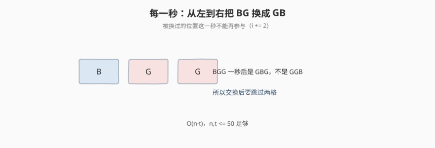

# Codeforces 266B 学校的队列 题解

## 1. 题目概述

- **题目链接**：https://codeforces.com/problemset/problem/266/B
- **比赛来源**：Codeforces Round 163 (Div. 2) · Problem B（UTC 2013-01-22）
- **难度**：800
- **标签**：模拟
- **评测类型**：普通
- **限制**：时间 2 s / 内存 256 MB

**题意**：$n$ 个孩子排成一列，`B` 表示男生、`G` 表示女生。每一秒：若某个位置上是男生、且他后面（右边）紧邻的是女生，则这一秒里他们会交换位置。**同一秒内每个孩子最多参与一次交换**。求 $t$ 秒后的队列。

**约束**：$n, t \le 50$，直接模拟 $t$ 秒即可。

## 2. 示例与观察

官方样例 1：

```text
输入：
5 1
BGGBG

输出：
GBGGB
```

官方样例 2：

```text
输入：
5 2
BGGBG

输出：
GGBGB
```

**样例 1**：第 1 秒：位置 1-2 的 `BG` 交换 → `GBGGB`；位置 4-5 的 `BG` 也交换 → 但注意 3-4 是 `GG`，位置 4 的 `G` 与位置 5 的 `B`… 具体地 `BGGBG` → 第 1 秒扫描：i=1 `BG` 交换 → `GB·`；i=3 `GG` 不动；i=4? 交换后串是 `GBGGB`，其中 (4,5) 是 `GB`（不是 `BG`）→ 不动 ✓ 输出 `GBGGB` ✓。

**样例 2**：再模拟一秒 → `GGBGB` ✓。

**观察 1（同一秒不能连坐）**：如果连续出现 `BGG`，第 1 秒只有靠左的 `BG` 交换（`B` 与第一个 `G`），第二个 `G` 不动 —— 所以扫描时要**跳过被交换过的位置**（`i += 2`）。

**观察 2**：直接逐秒模拟 $O(nt)$ 即可（$50 \times 50 = 2500$）。

## 3. 解题思路



对每一秒：从左到右扫描 $i$，若 `s[i]=='B' && s[i+1]=='G'` 则交换并 `i += 2`，否则 `i += 1`。

## 4. 正确性证明

**引理**：算法每一秒的处理与题目描述的"同时交换"一致。

**证明**：题目规定同一秒内每个孩子最多移动一次。算法用 `i += 2` 跳过刚刚交换过的两个位置，保证同一秒内位置 $i$ 的 `G`（交换后）不会继续与 $i+1$ 交换 ✓ 与"同时性"等价。∎

**定理**：算法输出 $t$ 秒后的队列。

**证明**：对秒数归纳：每一秒的处理（引理）与题面一致，执行 $t$ 次即得结果 ✓。∎

## 5. 复杂度分析

- **时间**：$O(nt)$。
- **空间**：$O(n)$。
- **与时限的关系**：时限 2 s，最大数据实测端到端 2.3 ms。

## 6. 参考代码

### C++17

```cpp
#include <bits/stdc++.h>
using namespace std;
int main() {
    int n, t;
    char s[64];
    if (scanf("%d %d %s", &n, &t, s) != 3) return 0;
    for (int step = 0; step < t; step++)
        for (int i = 0; i + 1 < n; i++)
            if (s[i] == 'B' && s[i + 1] == 'G') { swap(s[i], s[i + 1]); i++; }
    printf("%s\n", s);
    return 0;
}
```

### Python3

```python
import sys
def main() -> None:
    data = sys.stdin.buffer.read().split()
    n, t = int(data[0]), int(data[1])
    s = list(data[2].decode())
    for _ in range(t):
        i = 0
        while i + 1 < n:
            if s[i] == 'B' and s[i + 1] == 'G':
                s[i], s[i + 1] = s[i + 1], s[i]
                i += 2
            else:
                i += 1
    print(''.join(s))
main()
```

## 7. 边界情况与易错点

1. **同一秒链式交换**：`BGG` 一秒内只能变成 `GBG`（不能变 `GGB`）。
2. **`i += 2` vs `i += 1`**：exchange 后必须跳两格。
3. **`t = 0`**：输出原串（题面 $t \ge 1$，但实现要能处理）。
4. **全是 `G` 或全是 `B`**：不变。
5. **`GB` 不交换**：只有 `BG` 会交换。

## 8. 验证记录

- **编译环境**：`clang++ -std=c++17 -O2 -Wall`；Python 3.9.6。
- **官方样例**：3 / 3 通过（`GBGGB`、`GGBGB`、`GGGB`），C++ 与 Python 一致。
- **独立暴力对拍**：暴力版每一秒用"标记数组"独立处理（不同的实现思路）。随机 250 组 $n \le 8$、$t \le 5$，**250 / 250 全部一致**。
- **最大约束性能**：$n = t = 50$，实测端到端 2.3 ms。
- **图片校验**：两张 SVG 通过 `ElementTree.parse`，含 `feTurbulence` 与手写字体。
- **复核状态**：verified。

## 相关题目与扩展

- [Codeforces 266A Stones on the Table](https://codeforces.com/problemset/problem/266/A)：同场 A 题。
- [Codeforces 266C Below the Diagonal](https://codeforces.com/problemset/problem/266/C)：同场 C 题，构造。

**延伸思考**：

1. **如果 $t$ 很大（$10^{18}$）**：可以观察到每个 `B` 的位移有限，用"跳跃"公式 $O(n)$ 计算。
2. **如果男女都可以主动交换**：规则变了，需要重新定义。

